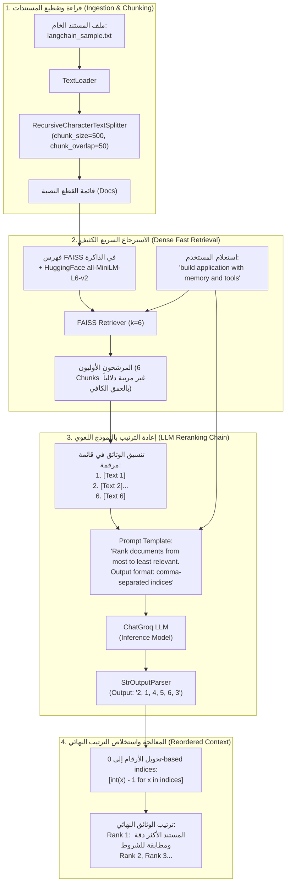

# المحاضرة 45: التطبيق العملي لإعادة الترتيب (LLM-based Prompt Reranking)
### Practical Implementation of Reranking Hybrid Strategies with LangChain & FAISS

---

## 1. النظرة العامة والهدف التطبيقي (Overview)
في المحاضرة السابقة (المحاضرة 44)، تعرفنا نظرياً على معمارية المراحل الثلاث للـ RAG، حيث يتم إضافة مرحلة **إعادة الترتيب (`Reranking`)** بين المسترجع السريع ونموذج التوليد النهائي.
في هذه المحاضرة (فيديو 45)، نطبق هذه الاستراتيجية عملياً باستخدام **النموذج اللغوي الكبير كـ Reranker (`LLM-as-a-Reranker`)** عبر هندسة التوجيه (`Prompt-based Reranking`).

### جوهر المشكلة التطبيقية:
إذا طرح المستخدم سؤالاً مركباً:
> `"How can I use LangChain to build an application with memory and tools?"`

وقام المسترجع السريع (`FAISS`) باسترجاع أفضل 6 قطع نصية من المستند الكبير (`langchain_sample.txt`)، فإن الترتيب الأولي يعتمد على القرب الرياضي السطحي للمتجهات. قد يأتي المستند الذي يشرح هيكل الإطار عامة في المركز الأول، بينما المستند الذي يجمع بين الذاكرة والأدوات معاً مدفون في المركز الرابع أو الخامس.
مهمة الـ Reranker هنا هي فحص الاستعلام والقطع النصية معاً، وإعادة ترتيب أرقام الوثائق بحيث يصعد المستند الأكثر تلبية لكافة شروط السؤال إلى المركز الأول (#1).

---

## 2. المعمارية الهندسية لخط الأنابيب (Three-Stage Pipeline)



---

## 3. تصميم قالب التوجيه لإعادة الترتيب (Reranking Prompt Design)

يعتمد نجاح الـ Reranking عبر الـ LLM على صرامة القالب والتزامه بتنسيق إخراج قياسي يمكن معالجته برمجياً بسهولة:

```python
prompt_template = """You are a helpful assistant.
Your task is to rank the following documents from most to least relevant to the user question.

User Question:
{question}

Documents:
{documents}

Instructions:
Think about the relevance of each document to the user question.
Return a list of document indices in ranked order starting from the most relevant.
Output format: comma-separated document indices (e.g., 2, 1, 4, 3, 5, 6)."""
```

---

## 4. خوارزمية التحليل وإعادة الترتيب (Parsing & Reordering Logic)

عندما يستجيب النموذج اللغوي بمصفوفة نصية مثل `"2, 1, 4, 5, 6, 3"`:
1. يتم تقسيم النص بواسطة الفاصلة (`,`).
2. يتم تجريد المسافات الزائدة (`strip()`) والتأكد من أنها أرقام صحيحة (`isdigit()`).
3. يتم طرح $1$ من كل رقم لمواءمة الترقيم البشري ($1$-based) مع فهرسة بايثون البرمجية ($0$-based):
   $$\text{index}_{\text{python}} = \text{index}_{\text{LLM}} - 1$$
4. يتم استرجاع الوثائق وفق الترتيب الجديد مع التحقق من صحة الحدود ($0 \le i < \text{len}(\text{docs})$).

---

## 5. المقارنة الهندسية: LLM-as-a-Reranker مقابل Cross-Encoder

| معيار المقارنة | إعادة الترتيب بالنموذج اللغوي (`LLM Prompt Reranking`) | إعادة الترتيب بنموذج الانتباه (`Cross-Encoder`) |
| :--- | :--- | :--- |
| **طبيعة النموذج** | نموذج توليدي كبير (Generative LLM مثل Groq / OpenAI) | نموذج تصنيف وتشفير متخصص (مثل `ms-marco-MiniLM`) |
| **ميزة الاستخدام** | يفهم الاستعلامات المعقدة ومتعددة الشروط بسهولة فائقة | سريع جداً وخفيف ولا يستهلك توكنز توليد |
| **التكامل البرمجي** | لا يحتاج مكتبات إضافية سوى الـ LLM الموجود مسبقاً | يحتاج مكتبات تضمين ونماذج PyTorch محلية |
| **شكل المخرجات** | قائمة فهارس مرتبة (`2, 1, 4...`) | درجات رقمية مستمرة لكل زوج (`Score` لكل وثيقة) |
| **الحد الأقصى للمرشحين** | 6 إلى 15 مستنداً (لتفادي استهلاك نافذة السياق) | 20 إلى 100 مستند |
