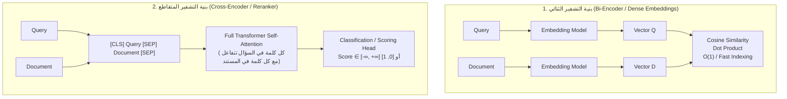

# المحاضرة 45: التطبيق العملي لخوارزميات إعادة الترتيب
### Practical Implementation of Reranking Strategies (Cross-Encoders, FlashRank, and LangChain Compressors)

---

## 1. الأهداف التعليمية والعملية
في هذه المحاضرة ننتقل من الإطار النظري للمراحل الثلاث في معمارية RAG إلى التطبيق البرمجي الفعلي:
1. بناء خط أنابيب استرجاع أولي سريع (Broad Retrieval) يسترجع $K=10$ مستندات مرشحة.
2. تطبيق نموذج **الانتباه المتقاطع (`Cross-Encoder`)** لتقييم كل زوج `(Query, Document)` وإعادة ترتيب المستندات وفق درجات الصلة الحقيقية.
3. تطبيق نموذج **`FlashRank`** المسرّع بتقنية ONNX كحل خفيف وعالي الكفاءة في بيئات الإنتاج بدون أعباء حوسبية ضخمة.
4. دمج الـ Reranker داخل سلاسل **LangChain** باستخدام `ContextualCompressionRetriever`.
5. قياس الأثر: مقارنة جودة السياق الواصل للـ LLM قبل وبعد عملية الـ Reranking.

---

## 2. المقارنة المعمارية: Bi-Encoder مقابل Cross-Encoder

### الفروق الجوهرية في الإنتاج:

| وجه المقارنة | Bi-Encoder (تضمين المتجهات) | Cross-Encoder (إعادة الترتيب) | FlashRank (إعادة ترتيب خفيفة) |
| :--- | :--- | :--- | :--- |
| **طبيعة المعالجة** | مستقلة تماماً لكل طرف | معالجة تفاعلية مشتركة للمدخلين معاً | نموذج مقلّص (Pruned) مسرّع عبر محرك ONNX |
| **حجم فضاء البحث** | ملايين المستندات | مخصص لـ 10 إلى 100 مرشح فقط | 10 إلى 50 مرشحاً في ميلي ثوانٍ معدودة |
| **السرعة وزمن التأخير** | ميكروثانية (عبر فهارس FAISS/HNSW) | 10 إلى 50 ميلي ثانية لكل وثيقة | 2 إلى 8 ميلي ثوانٍ عبر الـ CPU العادي |
| **دقة الفهم الدلالي** | جيدة جداً للمطابقة الإجمالية | استثنائية (تلتقط النفي والشروط الدقيقة) | قريبة جداً من نماذج Transformer الكاملة |
| **مكانه في خط الـ RAG** | **المرحلة 1**: التصفية الأولية السريعة | **المرحلة 2**: إعادة الترتيب والفلترة العميقة | **المرحلة 2**: مناسب للأنظمة السحابية الخفيفة |

---

## 3. المعمارية الهندسية لمسار إعادة الترتيب في LangChain

---

## 4. الصيغة الرياضية لحساب درجات الصلة

يقوم نموذج الـ Cross-Encoder بحساب درجة التشابه $S(q, d)$ من خلال التفاعل التام لمصفوفات الانتباه الذاتي:

$$\text{Attention}(Q, K, V) = \text{softmax}\left(\frac{Q K^T}{\sqrt{d_k}}\right) V$$

حيث يتم دمج توكنز السؤال $q = (t_1^q, \dots, t_m^q)$ مع توكنز المستند $d = (t_1^d, \dots, t_n^d)$ في تسلسل إدخال واحد:

$$x = [\text{CLS}] \circ q \circ [\text{SEP}] \circ d \circ [\text{SEP}]$$

وتمر هذه المتجهات عبر $L$ طبقات من الـ Transformer، مما يتيح التفاعل الكامل بين كل توكن في الاستعلام وكل توكن في المستند، وتخرج النتيجة النهائية عبر رأس تصنيف خطي:

$$\text{Score}(q, d) = \mathbf{w}^T \mathbf{h}_{\text{CLS}} + b$$

---

## 5. مخرجات التعلم وأفضل الممارسات (Senior Best Practices)
1. **قاعدة الـ 10 أضعاف ($10\times$ Rule)**: اطلب من المسترجع الأولي استرجاع 10 إلى 20 ضعف ما تحتاجه للـ LLM ($K_{\text{initial}} = 20$ إلى $30$) ثم اترك للـ Reranker تصفيتها إلى ($N_{\text{final}} = 3$ إلى $5$).
2. **تجنب تشغيل Cross-Encoder على كامل قاعدة البيانات**: هذا يسبب انهيار زمن الاستجابة (Latency Explosion) لأن التكلفة الحسابية تصبح $O(N \cdot M)$.
3. **اعتماد FlashRank على بيئات الـ Serverless**: لتوفير استهلاك الذاكرة وتجنب تنزيل مكتبات PyTorch الضخمة إذا كانت الموارد مقيدة.
