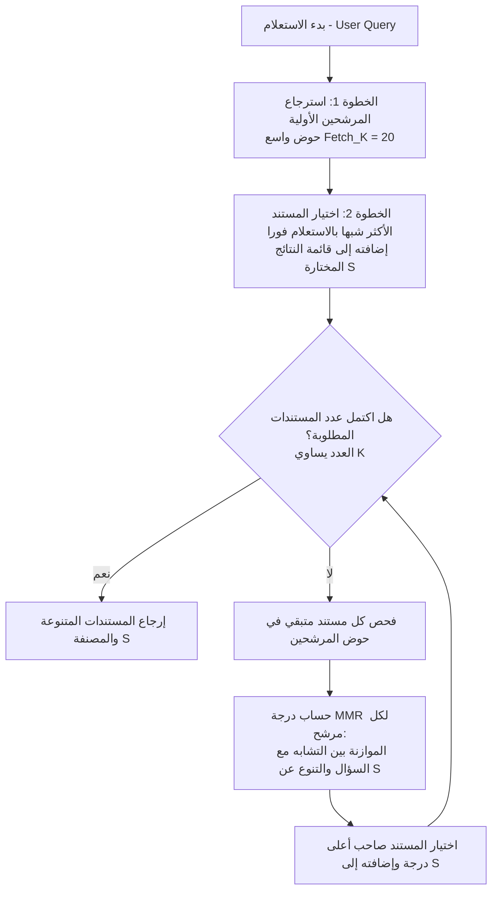

# المحاضرة 46: الشرح النظري لخوارزمية أقصى تنوع نسبي (MMR)
### Maximal Marginal Relevance (MMR) - Theoretical Foundations and Mathematical Formulation

---

## 1. مشكلة التكرار في الاسترجاع الدلالي التقليدي (The Redundancy Problem)

في أنظمة الـ RAG التقليدية التي تعتمد على البحث بتشابه جيب التمام (`Cosine Similarity`) أو أقرب الجيران (`k-NN`):
* إذا قام المستخدم بطرح استعلام مثل: `"What are the key features of Python?"`
* وكانت قاعدة البيانات تحتوي على 10 مقالات أو فقرات تتناول تاريخ إنشاء بايثون وسهولة قراءتها، فإن المسترجع سيختار أفضل 4 مستندات، وغالباً ما تكون متطابقة في المعنى أو مكررة بنسبة 90%.
* **المشكلة الحقيقية**:
  1. إهدار سياق نافذة الـ LLM (`Context Window Waste`) على معلومات مكررة بصيغ لغوية مختلفة.
  2. حرمان النموذج من معرفة ميزات أخرى هامة للغة (مثل تنوع المكتبات، البرمجة الوظيفية، المجتمع والدعم) لأنها حلت في المراكز 5 و 6 و 7.
  3. إصابة النموذج بالتكرار وضيق الأفق التوليدي (Confirmation Bias).

لحساب هذا التوازن، تم ابتكار خوارزمية **Maximal Marginal Relevance (MMR)** بواسطة *Carbonell & Goldstein (1998)* لتكون المعيار الذهبي في استرجاع المعلومات وتنويع النتائج.

---

## 2. الصيغة الرياضية لخوارزمية MMR

تسعى خوارزمية MMR في كل خطوة تكرارية $t$ إلى اختيار المستند التالي $d_i$ الذي يحقق أقصى توازن بين:
1. **الصلة بالاستعلام** ($\text{Relevance to Query}$).
2. **الجدّة والتنوع بالنسبة لما تم اختياره مسبقاً** ($\text{Novelty / Diversity}$).

$$\text{MMR} \triangleq \arg\max_{d_i \in R \setminus S} \left[ \lambda \cdot \text{Sim}_1(d_i, q) - (1 - \lambda) \cdot \max_{d_j \in S} \text{Sim}_2(d_i, d_j) \right]$$

### تفكيك عناصر المعادلة:
* $R$: مجموعة المرشحين الأولية المسترجعة بالبحث السريع (حجمها يُعرف بـ `fetch_k`، مثلاً $R = 20$).
* $S$: مجموعة المستندات التي تم اختيارها بالفعل حتى هذه اللحظة (في البداية تكون فارغة $S = \emptyset$).
* $R \setminus S$: المستندات المتبقية التي لم يتم اختيارها بعد.
* $q$: متجه استعلام المستخدم (`Query Embedding`).
* $\text{Sim}_1(d_i, q)$: درجة التشابه الدلالي بين المستند المرشح والاستعلام (باستخدام Cosine Similarity).
* $\text{Sim}_2(d_i, d_j)$: درجة التشابه الدلالي بين المستند المرشح $d_i$ وأقرب مستند له تم اختياره بالفعل $d_j \in S$.
* $\lambda \in [0, 1]$: معامل الموازنة (`lambda_mult`):
  * عندما $\lambda = 1$: يتم إلغاء حد العقوبة تماماً، وتتحول الخوارزمية إلى بحث تقليدي خالص حسب درجة التشابه (`Pure Similarity Search`).
  * عندما $\lambda = 0$: تركز الخوارزمية كلياً على أقصى تباعد واختلاف بين المستندات المختارة بغض النظر عن السؤال (`Pure Diversity`).
  * عندما $\lambda = 0.5$ إلى $0.7$: يتحقق التوازن الأمثل في تطبيقات الإنتاج: مستندات وثيقة الصلة بالسؤال ولكنها تغطي جوانب وزوايا مختلفة.

---

## 3. المخطط التدفقي لخوارزمية الاختيار خطوة بخطوة

---

## 4. المسألة التطبيقية المحلولة بالأرقام (كما وردت بالمحاضرة 46)

لنتتبع الخوارزمية خطوة بخطوة بالقيم الحسابية الدقيقة التي شرحها المحاضر لتوضيح كيف تمنع خوارزمية MMR التكرار عملياً:

### مدخلات المسألة:
* **استعلام المستخدم ($Q$)**: `"How to use LangChain for RAG"`
* **المستندات في قاعدة البيانات**:
  * $D_1$: `"LangChain enables retrieval with FAISS"`
  * $D_2$: `"LangChain can use Chroma and Pinecone too"`
  * $D_3$: `"LangChain agents can call external tools"`
* **معامل الموازنة ($\lambda$)**: نحدد $\lambda = 0.7$ (أي إعطاء 70% من الوزن للصلة بالاستعلام و 30% للتنوع ومنع التكرار).

---

### الخطوة الأولى: حساب تشابه الاستعلام واختيار المستند الأول
نقوم بحساب تشابه جيب التمام (`Cosine Similarity`) بين الاستعلام $Q$ وكل مستند:
* $\text{Sim}(D_1, Q) = 0.95$ (الأعلى تطابقاً مع السؤال)
* $\text{Sim}(D_2, Q) = 0.93$
* $\text{Sim}(D_3, Q) = 0.80$

> يتم اختيار $D_1$ مباشرة في المركز الأول ($S = \{D_1\}$) لأنه صاحب أعلى درجة صلة بالاستعلام.
> المرشحون المتبقون للمركز الثاني: $R \setminus S = \{D_2, D_3\}$.

---

### الخطوة الثانية: حساب مصفوفة التشابه البيني بين المستندات (Inter-Document Similarity)
لمعرفة أي المستندات يكرر معلومات $D_1$ وأيها يضيف تنوعاً جديداً:
* $\text{Sim}(D_1, D_2) = 0.90$ (تشابه مرتفع جداً لأن كلاهما يتحدث عن مخازن المتجهات في لانج تشين -> **مستند مكرر Redundant**)
* $\text{Sim}(D_1, D_3) = 0.30$ (تشابه منخفض لأن $D_3$ يتناول الوكلاء والأدوات الخارجية -> **مستند متنوع ومكمل Diverse**)
* $\text{Sim}(D_2, D_3) = 0.40$

---

### الخطوة الثالثة: حساب درجات MMR للمستندات المتبقية ($\lambda = 0.7$)

#### 1. حساب درجة MMR للمستند $D_2$:
$$\text{MMR}(D_2) = \lambda \cdot \text{Sim}(D_2, Q) - (1 - \lambda) \cdot \text{Sim}(D_2, D_1)$$
$$\text{MMR}(D_2) = 0.7 \times 0.93 - 0.3 \times 0.90$$
$$\text{MMR}(D_2) = 0.651 - 0.270 = \mathbf{0.381}$$

#### 2. حساب درجة MMR للمستند $D_3$:
$$\text{MMR}(D_3) = \lambda \cdot \text{Sim}(D_3, Q) - (1 - \lambda) \cdot \text{Sim}(D_3, D_1)$$
$$\text{MMR}(D_3) = 0.7 \times 0.80 - 0.3 \times 0.30$$
$$\text{MMR}(D_3) = 0.560 - 0.090 = \mathbf{0.470}$$

---

### الخطوة الرابعة: الترتيب النهائي للنتائج (Final Ranked Selection)
بمقارنة درجات MMR:
$$\text{MMR}(D_3) = 0.470 > \text{MMR}(D_2) = 0.381$$

* **المركز الأول (#1)**: $D_1$ (تم اختياره لقوة صلته بالسؤال: $\text{Sim} = 0.95$).
* **المركز الثاني (#2)**: $D_3$ (تم اختياره لتفوقه في درجة MMR وتقديمه تنوعاً غير مكرر: $\text{MMR} = 0.470$).

> [!NOTE]
> **الخلاصة الجوهرية**: رغم أن المستند $D_2$ كان يمتلك تشابهاً أولياً أعلى مع السؤال ($0.93 > 0.80$)، إلا أن خوارزمية MMR **عاقبته وخفضت ترتيبه** بسبب تكراره لما ورد في $D_1$ بنسبة $90\%$، مما أتاح للسياق استيعاب معلومة جديدة ومكملة تماماً عبر $D_3$.
