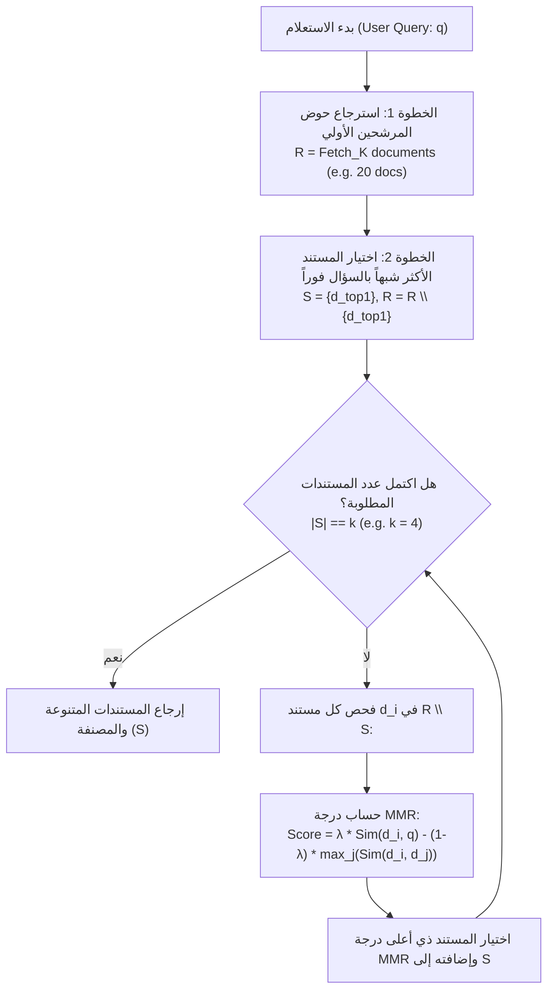

# المحاضرة 46: الشرح النظري لخوارزمية أقصى تنوع نسبي (MMR)
### Maximal Marginal Relevance (MMR) - Theoretical Foundations and Mathematical Formulation

---

## 1. مشكلة التكرار في الاسترجاع الدلالي التقليدي (The Redundancy Problem)

في أنظمة الـ RAG التقليدية التي تعتمد على البحث بتشابه جيب التمام (`Cosine Similarity`) أو أقرب الجيران (`k-NN`):
* إذا قام المستخدم بطرح استعلام مثل: `"What are the key features of Python?"`
* وكانت قاعدة البيانات تحتوي على 10 مقالات أو فقرات تتناول تاريخ إنشاء بايثون وسهولة قراءتها، فإن المسترجع سيختار أفضل 4 مستندات، وغالباً ما تكون متطابقة في المعنى أو مكررة بنسبة 90%.
* **المشكلة الحقيقية**:
  1. إهدار سياق نافذة الـ LLM (`Context Window Waste`) على معلومات مكررة بصيغ لغوية مختلفة.
  2. حرمان النموذج من معرفة ميزات أخرى هامة للغة (مثل تنوع المكتبات، البرمجة الوظيفية، المجتمع والدعم) لأنها حلت في المراكز 5 و 6 و 7.
  3. إصابة النموذج بالتكرار وضيق الأفق التوليدي (Confirmation Bias).

لحساب هذا التوازن، تم ابتكار خوارزمية **Maximal Marginal Relevance (MMR)** بواسطة *Carbonell & Goldstein (1998)* لتكون المعيار الذهبي في استرجاع المعلومات وتنويع النتائج.

---

## 2. الصيغة الرياضية لخوارزمية MMR

تسعى خوارزمية MMR في كل خطوة تكرارية $t$ إلى اختيار المستند التالي $d_i$ الذي يحقق أقصى توازن بين:
1. **الصلة بالاستعلام** ($\text{Relevance to Query}$).
2. **الجدّة والتنوع بالنسبة لما تم اختياره مسبقاً** ($\text{Novelty / Diversity}$).

$$\text{MMR} \triangleq \arg\max_{d_i \in R \setminus S} \left[ \lambda \cdot \text{Sim}_1(d_i, q) - (1 - \lambda) \cdot \max_{d_j \in S} \text{Sim}_2(d_i, d_j) \right]$$

### تفكيك عناصر المعادلة:
* $R$: مجموعة المرشحين الأولية المسترجعة بالبحث السريع (حجمها يُعرف بـ `fetch_k`، مثلاً $R = 20$).
* $S$: مجموعة المستندات التي تم اختيارها بالفعل حتى هذه اللحظة (في البداية تكون فارغة $S = \emptyset$).
* $R \setminus S$: المستندات المتبقية التي لم يتم اختيارها بعد.
* $q$: متجه استعلام المستخدم (`Query Embedding`).
* $\text{Sim}_1(d_i, q)$: درجة التشابه الدلالي بين المستند المرشح والاستعلام (باستخدام Cosine Similarity).
* $\text{Sim}_2(d_i, d_j)$: درجة التشابه الدلالي بين المستند المرشح $d_i$ وأقرب مستند له تم اختياره بالفعل $d_j \in S$.
* $\lambda \in [0, 1]$: معامل الموازنة (`lambda_mult`):
  * عندما $\lambda = 1$: يتم إلغاء حد العقوبة تماماً، وتتحول الخوارزمية إلى بحث تقليدي خالص حسب درجة التشابه (`Pure Similarity Search`).
  * عندما $\lambda = 0$: تركز الخوارزمية كلياً على أقصى تباعد واختلاف بين المستندات المختارة بغض النظر عن السؤال (`Pure Diversity`).
  * عندما $\lambda = 0.5$ إلى $0.7$: يتحقق التوازن الأمثل في تطبيقات الإنتاج: مستندات وثيقة الصلة بالسؤال ولكنها تغطي جوانب وزوايا مختلفة.

---

## 3. المخطط التدفقي لخوارزمية الاختيار خطوة بخطوة

---

## 4. مثال رقمي توضيحي (Numerical Walkthrough)

لنفترض أن لدينا استعلام $q$ وثلاثة مستندات مرشحة بعد اختيار المستند الأول $d_1$:
* $S = \{d_1\}$
* المرشح الأول $d_2$: درجة قربه من السؤال $\text{Sim}(d_2, q) = 0.88$، ولكنه شديد الشبه بـ $d_1$ حيث $\text{Sim}(d_2, d_1) = 0.95$.
* المرشح الثاني $d_3$: درجة قربه من السؤال $\text{Sim}(d_3, q) = 0.78$، ولكنه يتحدث عن زاوية مختلفة حيث $\text{Sim}(d_3, d_1) = 0.20$.

بافتراض ضبط $\lambda = 0.5$:
$$\text{MMR}(d_2) = 0.5 \times 0.88 - 0.5 \times 0.95 = 0.44 - 0.475 = -0.035$$
$$\text{MMR}(d_3) = 0.5 \times 0.78 - 0.5 \times 0.20 = 0.39 - 0.10 = +0.29$$

**النتيجة الحاسمة**:
رغم أن $d_2$ أكثر شبهاً بالسؤال ظاهرياً ($0.88 > 0.78$)، إلا أن خوارزمية MMR **عاقبته بشدة** بسبب تكراره لما ورد في $d_1$ ($0.95$)، واختارت المستند $d_3$ الذي أضاف معلومة جديدة تماماً ورفع القيمة المعرفية للسياق!
