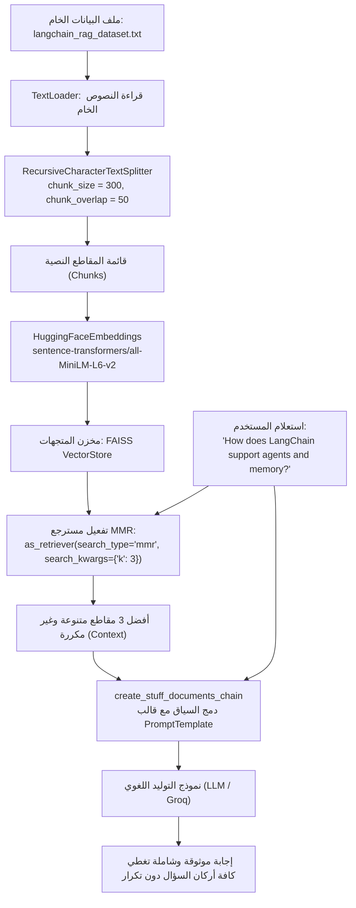

# المحاضرة 47: تطبيق خط أنابيب RAG متكامل بمسترجع MMR عملياً
### Practical Implementation of an End-to-End RAG Pipeline with MMR, FAISS, and LangChain

---

## 1. الأهداف الهندسية والعملية للمحاضرة
في المحاضرة السابقة (46)، قمنا بتفكيك الأسس الرياضية لخوارزمية أقصى تنوع نسبي (`Maximal Marginal Relevance - MMR`). في هذه المحاضرة (47)، ننتقل للتطبيق العملي الكامل لبناء خط أنابيب استرجاع متقدم (`Production RAG Pipeline`) يدمج خوارزمية `MMR` مباشرة مع متجر متجهات `FAISS` ونموذج توليد لغوي (`LLM`).

تشمل الأهداف العملية:
1. استيعاب وتقطيع بيانات وثائق لانج تشين (`langchain_rag_dataset.txt`) باستخدام `RecursiveCharacterTextSplitter` مع ضبط `chunk_size = 300` و `chunk_overlap = 50`.
2. توليد التضمينات المتجهية محلياً عبر موديل `sentence-transformers/all-MiniLM-L6-v2` وحفظها في متجر `FAISS`.
3. تحويل متجر المتجهات إلى مسترجع متنوع عبر وسيط `search_type="mmr"` وضبط عدد النتائج المطلوبة `search_kwargs={"k": 3}`.
4. بناء خط الأنابيب المتكامل عبر دمج سلسلتي `create_stuff_documents_chain` و `create_retrieval_chain`.
5. فحص المخرجات دلالياً وتحليل كيف نجحت خوارزمية `MMR` في استرجاع مقاطع متنوعة تغطي (الوكلاء Agents، والذاكرة Memory، والمفاهيم الأساسية) دون تكرار.

---

## 2. المخطط المعماري لخط أنابيب الـ RAG بمسترجع MMR



---

## 3. الخطوات البرمجية خطوة بخطوة (كما وردت بالمحاضرة)

### الخطوة 1: استيراد المكتبات وتهيئة البيئة
نعتمد على واجهات LangChain القياسية:
```python
import os
from typing import Any, Dict, List
from langchain_community.document_loaders import TextLoader
from langchain_community.vectorstores import FAISS
from langchain_core.prompts import ChatPromptTemplate
from langchain_huggingface import HuggingFaceEmbeddings
from langchain_text_splitters import RecursiveCharacterTextSplitter

# سلاسل التجميع والاسترجاع
from langchain.chains import create_retrieval_chain
from langchain.chains.combine_documents import create_stuff_documents_chain
from langchain_groq import ChatGroq
```

### الخطوة 2: استيعاب وتقطيع المستندات (Ingestion & Chunking)
نقرأ ملف بيانات لانج تشين ثم نطبّق التقطيع بحجم مقطع 300 حرف وتداخل 50 حرف:
```python
loader = TextLoader("langchain_rag_dataset.txt", encoding="utf-8")
raw_docs = loader.load()

text_splitter = RecursiveCharacterTextSplitter(chunk_size=300, chunk_overlap=50)
chunks = text_splitter.split_documents(raw_docs)
print(f"Total chunks created: {len(chunks)}")
```

### الخطوة 3: التضمين وبناء فهرس المتجهات (FAISS Vector Store)
نستخدم التضمين المحلي المفتوح المصدر `all-MiniLM-L6-v2` لتوليد الفهرس المتجهي:
```python
embeddings = HuggingFaceEmbeddings(
    model_name="sentence-transformers/all-MiniLM-L6-v2"
)
vector_store = FAISS.from_documents(chunks, embeddings)
```

### الخطوة 4: تفعيل مسترجع أقصى تنوع نسبي (MMR Retriever)
الخطوة الجوهرية في المحاضرة تكمن في تحديد نوع البحث ليكون `mmr`:
```python
# إذا لم تحدد search_type سيتحول افتراضياً إلى بحث تشابه تقليدي (Dense Similarity)
retriever = vector_store.as_retriever(
    search_type="mmr",
    search_kwargs={
        "k": 3,  # عدد المستندات النهائية المطلوبة
        "fetch_k": 20,  # حوض المرشحين الأولي لحساب التباعد البيني
        "lambda_mult": 0.5,  # معامل الموازنة بين الصلة والتنوع
    },
)
```

### الخطوة 5: صياغة القالب وبناء خط الأنابيب الكامل
نربط المسترجع مع نموذج اللغة وقالب السؤال والسياق:
```python
prompt = ChatPromptTemplate.from_template("""
Answer the question based on the context provided:
<context>
{context}
</context>
Question: {input}
""")

# استدعاء النموذج اللغوي
llm = ChatGroq(model="openai/gpt-oss-20b", temperature=0.0)

# 1. سلسلة دمج المستندات في القالب
document_chain = create_stuff_documents_chain(llm, prompt)

# 2. سلسلة الاسترجاع المتكاملة
rag_chain = create_retrieval_chain(retriever, document_chain)
```

### الخطوة 6: تنفيذ الاستعلام وفحص السياق المتنوع
نوجه السؤال الشامل:
```python
query = "How does LangChain support agents and memory?"
response = rag_chain.invoke({"input": query})

print("=== Final LLM Answer ===")
print(response["answer"])

print("\n=== Retrieved Context Chunks (MMR Diversity) ===")
for i, doc in enumerate(response["context"], 1):
    print(f"\n[Chunk {i}]:")
    print(doc.page_content.strip())
```

---

## 4. التحليل الهندسي: كيف منع MMR التكرار عملياً؟

عند طرح استعلام يجمع بين موضوعين مثل `"agents and memory"`:
* **في البحث التقليدي (`Similarity Search`)**:
  إذا احتوت قاعدة البيانات على 5 فقرات تتحدث جميعها عن الذاكرة (`ConversationBufferMemory`)، فإن أعلى 3 نتائج ستكون كلها عن الذاكرة لأن درجة تشابهها السطحي مع السؤال مرتفعة، وبالتالي يُحرم النموذج من قراءة معلومات الوكلاء (`Agents`).
* **في مسترجع MMR**:
  1. يختار المستند الأول صاحب أعلى درجة تشابه مع السؤال (مثلاً فقرة تتحدث عن الذاكرة).
  2. عند اختيار المستند الثاني، يفرض عقوبة تنوع على الفقرات الأخرى التي تتحدث عن الذاكرة بسبب تشابهها البيني المرتفع مع المستند الأول ($Sim(D_1, D_2) \approx 0.90$).
  3. نتيجة لذلك، تصعد فقرة الوكلاء والأدوات الخارجية (`Agents and Tools`) لأنها تضيف معلومة جديدة ومتنوعة، فيحصل الـ LLM على سياق شامل يغطي كلاً من الذاكرة والوكلاء دون أي حشو مكرر.

---

## 5. مقارنة وسائط التحكم في الـ MMR Retriever

| المعامل | النوع | القيمة الافتراضية | التأثير الهندسي |
| :--- | :---: | :---: | :--- |
| **`search_type`** | `str` | `"similarity"` | تحويل نوع المسترجع إلى `"mmr"` لتفعيل معادلة التنوع الأقصى. |
| **`k`** | `int` | `4` | عدد المستندات النهائية التي ستُمرر إلى النموذج اللغوي. |
| **`fetch_k`** | `int` | `20` | حجم حوض المرشحين الأولي المجلوب قبل تطبيق مصفوفة التباعد البيني. |
| **`lambda_mult`** | `float` | `0.5` | وزن الموازنة $\lambda \in [0, 1]$ بين الصلة بالسؤال ومنع التكرار البيني. |
