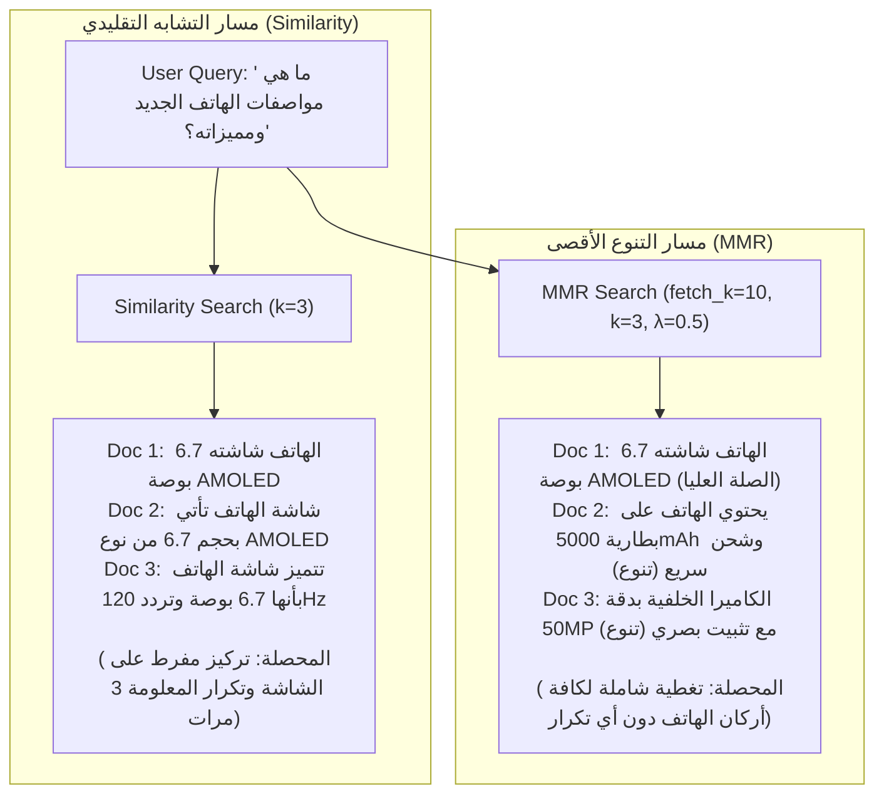

# المحاضرة 47: تطبيق مسترجع أقصى تنوع نسبي (MMR) عملياً
### Practical Implementation of MMR Retrievers with LangChain, FAISS, and ChromaDB

---

## 1. الأهداف البرمجية والتطبيقية
1. بناء مسترجع `MMR` باستخدام واجهات لانج تشين الرسمية (`search_type="mmr"`).
2. التحكم في معاملي `fetch_k` (حجم حوض المرشحين الأولي) و `lambda_mult` (معامل التوازن).
3. إجراء مقارنة حية وجهاً لوجه بين البحث العادي (`search_type="similarity"`) والبحث المتنوع (`search_type="mmr"`) على مجموعة وثائق عالية التكرار.
4. دمج مسترجع MMR في خط أنابيب LCEL متكامل مع نموذج `ChatGroq`.

---

## 2. كيفية تفعيل MMR في LangChain

توفر مكتبات التخزين المتجهية (مثل `FAISS` و `Chroma`) دعمًا أصيلًا لخوارزمية MMR من خلال وسائط بسيطة عند إنشاء الـ Retriever:

```python
# 1. مسترجع التشابه التقليدي
similarity_retriever = vector_store.as_retriever(
    search_type="similarity", search_kwargs={"k": 3}
)

# 2. مسترجع أقصى تنوع نسبي (MMR)
mmr_retriever = vector_store.as_retriever(
    search_type="mmr",
    search_kwargs={
        "k": 3,  # عدد المستندات النهائية المطلوبة
        "fetch_k": 10,  # عدد المرشحين الأولي الذي تفحصه الخوارزمية
        "lambda_mult": 0.5,  # 0.5 لتوازن متساوٍ بين الصلة والتنوع
    },
)
```

---

## 3. المعمارية الهندسية ومقارنة النتائج



---

## 4. تأثير معامل `lambda_mult`

| قيمة `lambda_mult` | طبيعة السلوك في الاسترجاع | متى تستخدمها؟ |
| :---: | :--- | :--- |
| **0.0 - 0.2** | أقصى تنوع ممكن، وتجاهل شبه تام لقوة التطابق مع السؤال | في مهام العصف الذهني واستكشاف الموضوعات الشاملة (Exploratory Search) |
| **0.4 - 0.6** | توازن هندسي مثالي بين دقة الإجابة وتنوع الزوايا | **الخيار الموصى به لمعظم تطبيقات RAG العامة** |
| **0.7 - 0.9** | تركيز عالي على الصلة مع لمسة تنوع خفيفة جداً | في الأسئلة التقنية الحساسة التي تتطلب تركيزاً شديداً على التفاصيل الدقيقة |
| **1.0** | بحث تشابه تقليدي خالص دون أي عقوبة على التكرار | عند البحث عن حقائق مفردة قطعية لا تقبل التنوع |
