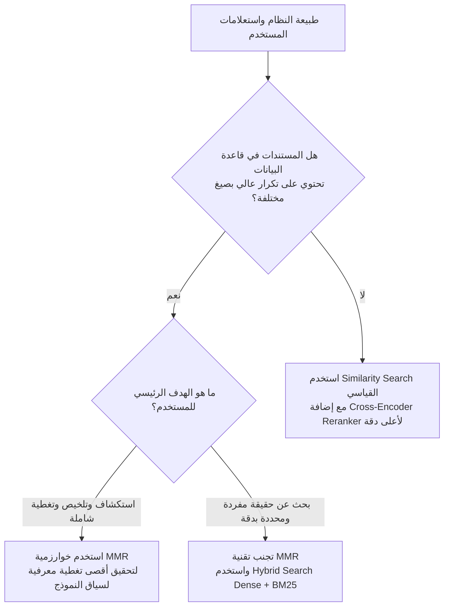

# المحاضرة 48: دليل اتخاذ القرار الهندسي وأسئلة المقابلات - متى نستخدم ومتى نتجنب تقنية MMR
### Architectural Decision Matrix & Technical Interview Guide: When to Use MMR vs. Standard Similarity vs. Rerankers

---

## 1. الفلسفة الجوهرية لتقنية MMR في أنظمة الـ RAG
الهدف الأساسي والحاسم لخوارزمية أقصى تنوع نسبي (`Maximal Marginal Relevance - MMR`) يمكن تلخيصه في عبارة واحدة:
> **"منع تزويد النموذج اللغوي (LLM) بمستندات مكررة، وإثراء سياق الإجابة بأكبر قدر من التنوع المعرفي."**

### مثال واقعي من المحاضرة: البحث عن "LangChain"
لو قمت بالبحث عن موضوع تقني عام مثل `"LangChain"` في متجر متجهات `FAISS` باستخدام البحث التقليدي (`Similarity Search`):
* المستندات المسترجعة قد تكون 5 مقاطع جميعها تتحدث عن نفس المفهوم المكرر (مثلاً: تعريف إطار العمل فقط أو التضمينات فقط).
* **مع تفعيل مسترجع MMR**:
  يقوم المسترجع بموازنة الصلة مع التباعد البيني، فيسترجع سياقاً فائق الثراء والتنوع:
  * **المستند 1**: التخزين المتجهي وفهارس `FAISS`.
  * **المستند 2**: الوكلاء البرمجية وتكامل الأدوات (`Agents & Tool Calling`).
  * **المستند 3**: إدارة الذاكرة وحفظ الحوار (`Conversation Memory`).
  * **المستند 4**: سلاسل التوجيه وقوالب الأوامر (`Prompt Templates & Chains`).
  * **المستند 5**: استراتيجيات البحث الهجين (`Hybrid Retrieval`).
* **المحصلة الهندسية**: يدخل إلى النموذج اللغوي (`LLM`) سياق متكامل ومتنوع يغطي جوانب الموضوع من زوايا متعددة بدلاً من حشو نافذة السياق بكلام مكرر.

---

## 2. الحالات الأربع المثالية لاستخدام تقنية MMR (When to Use)

### 1. خطوط أنابيب الـ RAG العامة لمنع التكرار (General RAG Pipelines)
لتجنب استهلاك نافذة السياق (`Context Window`) في نصوص مكررة لا تضيف أي قيمة معرفية جديدة للنموذج اللغوي.

### 2. روبوتات الدردشة ومحركات البحث المؤسسية (Chatbots & Document Browsers)
* روبوتات الأسئلة الشائعة (`FAQ Chatbots`): المستخدم يسأل سؤالاً عاماً، والهدف تقديم إجابة تغطي كافة الحالات والسياسات المتعلقة بالسؤال دون إسهاب مكرر.
* تطبيقات البحث وتصفح الوثائق (`Search Apps & Document Browsers`): عرض نتائج متنوعة تلبي مختلف النوايا المحتملة للمستخدم (`User Intent`).

### 3. عندما يرجع المسترجع حوضاً كبيراً من النتائج (Large Candidate Pools)
عندما يقوم المسترجع المبدئي بجلب عدد كبير من المقاطع (مثلاً 20 أو 50 مقطعاً مرشحاً)، فإن تطبيق MMR يتيح تصفية هذه المقاطع واختيار أفضل $K$ مقاطع تمثل حوض المرشحين بأعلى تنوع وأقل تشابه بيني.

### 4. الدمج مع البحث الهجين (Combining with Hybrid Retrieval)
عند دمج البحث الكثيف (`Dense Retriever`) مع البحث الإحصائي (`Sparse / BM25`):
غالبًا ما يُرجع كلا المسارين نصوصاً متقاربة دلالياً أو مكررة لفظياً. تطبيق خوارزمية MMR على مخرجات البحث الهجين يضمن إزالة هذا التداخل وتقديم سياق نقي ومتنوع للـ LLM.

---

## 3. الحالات الأربع التي يجب فيها تجنب تقنية MMR (When NOT to Use)

### 1. نافذة السياق شديدة الصغر (Extremely Short Context Window)
إذا كان النظام مصمماً لتمرير مقطع أو مقطعين فقط ($K = 1$ أو $K = 2$) إلى النموذج اللغوي، فإنك تحتاج إلى أقصى دقة وتطابق مباشر مع السؤال (`Top-1 Relevance`)، وتطبيق التنوع هنا قد يُبعد المقطع الأهم لصالح مقطع فرعي غير مطلوب.

### 2. استعلامات الحقائق المحددة بدقة (Factoid / Single-Fact Queries)
عندما يبحث المستخدم عن حقيقة حتمية ومحددة (مثل: *"ما هو رقم هاتف الدعم الفني؟"* أو *"ما هو منفذ الشبكة الافتراضي لقاعدة البيانات؟"*):
* إجبار النظام على التنوع يعد خطأً معمارياً؛ لأن هناك إجابة واحدة صحيحة، والتنويع سيجلب مقاطع أخرى مشوشة ومشتتة لذهن النموذج.

### 3. عندما تكون المستندات في قاعدة البيانات متنوعة بطبيعتها (Already Diverse Corpus)
إذا كانت الوثائق في قاعدة بياناتك قد خضعت لعمليات تنظيف دقيقة، وتجزئة ذرية (`Atomic Chunking`) بحيث لا يوجد أي تكرار بين المقاطع، فلا حاجة لفرض التنوع عبر MMR لأنه يمثل عبئاً حسابياً دون فائدة حقيقية.

### 4. عند استخدام نماذج إعادة الترتيب المتقدمة مع الفلترة اللاحقة (LLM Reranking & Post-Filtering)
إذا كان خط الأنابيب لديك يحتوي بالفعل على مرحلة `Cross-Encoder Reranker` متقدمة أو `LLM Reranker` متبوعة بفلترة استبعاد التكرار (`Deduplication Filter`)، فإن مشكلة التكرار تكون محلولة بالفعل على مستوى الـ Reranker، ولا داعي لإضافة طبقة MMR مكررة.

---

## 4. أسئلة المقابلات التقنية لمهندسي الذكاء الاصطناعي (AI Interview Deep-Dive)

### س1: ما الفرق الجوهري بين خوارزمية MMR ونماذج إعادة الترتيب (Reranking)؟
* **`MMR`**:
  * خوارزمية غير مكلفة حسابياً تعتمد على مصفوفة تشابه جيب التمام (`Cosine Similarity`) بين متجهات التضمين المحسوبة مسبقاً.
  * تركيزها الأكبر ينصب على **منع التكرار وإثراء التنوع**.
* **`Cross-Encoder Reranker`**:
  * نموذج لغوي يمرر السؤال والمستند معاً في طبقات الانتباه المشترك (`Cross-Attention`).
  * تركيزه الأكبر ينصب على **دقة الترتيب الدلالي وفهم المعاني الدقيقة** بغض النظر عن التنوع.

### س2: هل يمكن الجمع بين MMR و Reranking في نفس خط أنابيب الـ RAG؟
**نعم، وهو النمط المعماري الموصى به في الأنظمة المؤسسية فائقة الضخامة (`Enterprise Multi-Stage Architecture`)**:
1. **المرحلة 1**: استرجاع واسع وسريع هجين (`Hybrid Search Dense + Sparse`) لجلب 50 مقطعاً.
2. **المرحلة 2**: تطبيق خوارزمية `MMR` لتصفية الـ 50 مقطعاً واختيار أفضل 15 مقطعاً متنوعاً ومنع التكرار.
3. **المرحلة 3**: تمرير الـ 15 مقطعاً المتنوعة إلى `Cross-Encoder Reranker` لترتيبها بدقة متناهية واختيار أفضل 3 إلى 5 مقاطع تُسلّم إلى النموذج اللغوي (`LLM`).

---

## 5. جدول المقارنة الشامل لاتخاذ القرار المعماري

| المعيار | البحث التقليدي (`Similarity Search`) | أقصى تنوع نسبي (`MMR`) | إعادة الترتيب (`Reranker`) | المعمارية الثلاثية المتكاملة (`Hybrid + MMR + Rerank`) |
| :--- | :--- | :--- | :--- | :--- |
| **الهدف الأسمى** | العثور على أقرب المتجهات في الفضاء | منع التكرار وإثراء السياق بزوايا متعددة | تصحيح ترتيب المستندات بفهم تفاعلي عميق | استرجاع واسع + تنويع السياق + تصفية دقيقة |
| **التعقيد الحسابي** | شبه منعدم ($O(1)$ مع ANN) | منخفض جداً ($O(K^2)$ مصفوفة Cosine) | متوسط إلى مرتفع ($O(K)$ مع Transformer) | متوازن ومثالي للأنظمة الحية |
| **القدرة على منع التكرار** | ضعيفة جداً (يقع في فخ التكرار) | **استثنائية وفائقة** | متوسطة (لا يمنع تشابه المقاطع) | **شاملة ومثالية** |
| **خطر إدخال ضوضاء** | منخفض | متوسط (إذا تم خفض $\lambda$ كثيراً) | منخفض جداً | شبه معدوم |
| **أفضل حالة استخدام** | الأسئلة المباشرة البسيطة | روبوتات الدردشة، الأسئلة الشاملة، تلخيص المقالات | الأنظمة عالية الحساسية القانونية والطبية | المنصات المعرفية المؤسسية الكبرى |
