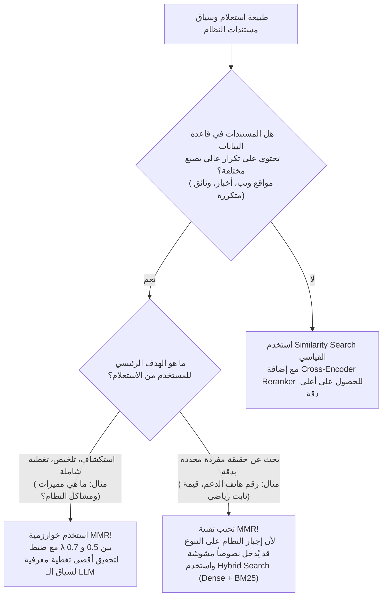

# المحاضرة 48: دليل اتخاذ القرار - متى نستخدم ومتى نتجنب تقنية MMR
### Strategic Decision Matrix: When to Use MMR vs. Standard Similarity vs. Rerankers

---

## 1. شجرة اتخاذ القرار المعمارية (Architectural Decision Tree)

---

## 2. جدول المقارنة الاستراتيجي: MMR مقابل Reranking مقابل Similarity

| المعيار | البحث العادي (`Similarity Search`) | إعادة الترتيب (`Reranker`) | أقصى تنوع نسبي (`MMR`) | الدمج الموصى به (`Hybrid + MMR + Rerank`) |
| :--- | :--- | :--- | :--- | :--- |
| **الهدف الأسمى** | العثور على أقرب المتجهات في الفضاء | تصحيح ترتيب المستندات بفهم تفاعلي عميق | منع التكرار وإثراء السياق بزوايا متعددة | استرجاع واسع + تنويع السياق + تصفية نوعية |
| **التكلفة الحسابية** | شبه منعدمة ($O(1)$) | متوسطة ($O(K)$ مع Transformer) | منخفضة جداً ($O(K^2)$ مصفوفة Cosine) | متوازنة ومثالية للشركات |
| **القدرة على منع التكرار** | سيئة جداً (يقع في فخ التكرار) | لا تمنع التكرار (قد ترفع مستندين مكررين معاً) | **ممتازة واستثنائية** | **فائقة الدقة والتنوع** |
| **خطر إدخال ضوضاء** | منخفض | منخفض جداً | متوسط (إذا كانت $\lambda$ منخفضة جداً) | معدوم تقريباً |

---

## 3. حالات الاستخدام المثالية لتقنية MMR (When to Use)

1. **تلخيص الوثائق المتعددة (`Multi-Document Summarization`)**:
   عندما تجمع 20 مقالاً عن حدث اقتصادي أو سياسي، فإن الهدف ليس قراءة نفس التصريح 10 مرات، بل جمع تصريحات الأطراف المختلفة.
2. **أنظمة التوصية والاقتراحات (`Recommendation Engines`)**:
   إذا بحث المستخدم عن "هواتف سامسونج"، لا تقترح عليه 4 نسخ من نفس الهاتف بفروق ألوان، بل اقترح هواتف بفئات سعرية ومواصفات متنوعة.
3. **الأسئلة الشاملة ذات الجوانب المتعددة (`Broad Exploratory Queries`)**:
   مثل: *"What are the advantages and disadvantages of microservices?"* - الـ MMR يضمن أن بعض المستندات تناقش المميزات والبعض الآخر يناقش العيوب والتحديات.
4. **قواعد البيانات المستخلصة من الويب (`Web Scraped Corpora`)**:
   حيث توجد مقالات منسوخة ومعدلة في عدة صفحات.

---

## 4. الحالات التي يجب فيها تجنب تقنية MMR (When to Avoid)

1. **الاستعلامات الدقيقة للحقائق المفردة (`Factoid / Needle-in-a-Haystack Queries`)**:
   مثل: *"What is the invoice total for invoice #8921?"* - هنا لا يوجد أي معنى للبحث عن "تنوع"، المطلوب هو المستند الذي يحمل هذا الرقم تحديداً. إجبار النظام على التنوع قد يسترجع فواتير أخرى بالخطأ!
2. **المستندات ذات التجزئة فائقة الصغر والنوعية (`Atomic Chunks`)**:
   إذا كانت استراتيجية التقطيع لديك تفصل كل فقرة إلى موضوع مستقل تماماً، فإن مشكلة التكرار تكون محلولة مسبقاً على مستوى الـ Chunking.
3. **عند انخفاض عدد المستندات في الحوض الأولي ($K < 3$)**:
   لا معنى لتطبيق MMR إذا كنت تسترجع وثيقتين فقط، لأن تكلفة حساب التنوع تصبح غير ذات جدوى.
