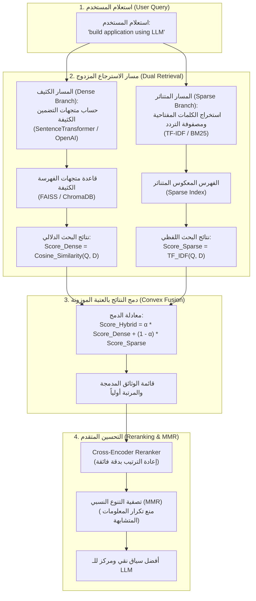

# المرحلة 05: استراتيجيات البحث الهجين والاسترجاع المتقدم
### Hybrid Search and Advanced Retrieval Strategies (`docs/05-hybrid-search-and-retrieval/`)

تغطي هذه المرحلة بالكامل **القسم التاسع من الكورس (Section 9: Hybrid Search Strategies - المحاضرات 41 إلى 48)**.

تتناول هذه المرحلة معمارية **البحث الهجين (`Hybrid Search`)** الذي يجمع بين قوة البحث الكثيف الدلالي (`Dense Semantic Retrieval`) ودقة البحث المتناثر بالألفاظ الدقيقة (`Sparse Lexical Retrieval`)، بالإضافة إلى تقنيات إعادة الترتيب (`Reranking`) وخوارزمية التنوع الأقصى (`Maximal Marginal Relevance - MMR`).

---

## فهرس موضوعات المرحلة

| الرقم | عنوان الدرس النظري | المحاضرة المقابلة | الملف التوثيقي | الكود النموذجي (`stages/`) | معمل التجربة (`playground/`) | الحالة |
| :---: | :--- | :---: | :---: | :---: | :---: | :---: |
| 01 | **دمج المصفوفات الكثيفة والمتناثرة (الأسس الرياضية والنظرية)** | Lecture 41 | [`01-combining-dense-and-sparse.md`](./01-combining-dense-and-sparse.md) | [`stages/05/.../01-...ipynb`](../../stages/05-hybrid-search-and-retrieval/01-combining-dense-and-sparse/01-combining-dense-and-sparse.ipynb) | [`playground/05/.../01-...ipynb`](../../playground/05-hybrid-search-and-retrieval/01-combining-dense-and-sparse.ipynb) | [x] مكتمل |
| 02 | **تطبيق المسترجع الهجين باستخدام مكتبة LangChain** | Lecture 42 | [`02-combining-dense-and-sparse-langchain.md`](./02-combining-dense-and-sparse-langchain.md) | [`stages/05/.../02-...ipynb`](../../stages/05-hybrid-search-and-retrieval/02-combining-dense-and-sparse-langchain/02-combining-dense-and-sparse-langchain.ipynb) | [`playground/05/.../02-...ipynb`](../../playground/05-hybrid-search-and-retrieval/02-combining-dense-and-sparse-langchain.ipynb) | [x] مكتمل |
| 03 | **فوائد وحالات استخدام البحث الهجين في بيئات الإنتاج** | Lecture 43 | [`03-benefits-of-hybrid-search.md`](./03-benefits-of-hybrid-search.md) | [`stages/05/.../03-...ipynb`](../../stages/05-hybrid-search-and-retrieval/03-benefits-of-hybrid-search/03-benefits-of-hybrid-search.ipynb) | [`playground/05/.../03-...ipynb`](../../playground/05-hybrid-search-and-retrieval/03-benefits-of-hybrid-search.ipynb) | [x] مكتمل |
| 04 | **استراتيجية إعادة الترتيب (Reranking Hybrid Strategy)** | Lecture 44 | `04-reranking-hybrid-strategy.md` | قيد العمل | قيد العمل | [ ] قادم |
| 05 | **تطبيق خوارزميات الـ Reranking عملياً** | Lecture 45 | `05-reranking-implementation.md` | قيد العمل | قيد العمل | [ ] قادم |
| 06 | **الشرح النظري لخوارزمية أقصى تنوع نسبي (MMR)** | Lecture 46 | `06-mmr-theoretical-explanation.md` | قيد العمل | قيد العمل | [ ] قادم |
| 07 | **تطبيق مسترجع MMR في مسارات الـ RAG** | Lecture 47 | `07-mmr-retriever-implementation.md` | قيد العمل | قيد العمل | [ ] قادم |
| 08 | **دليل اتخاذ القرار: متى نستخدم ومتى نتجنب تقنية MMR** | Lecture 48 | `08-when-to-use-mmr.md` | قيد العمل | قيد العمل | [ ] قادم |

---

## المعمارية الشاملة للبحث الهجين وإعادة الترتيب (Hybrid Search Architecture)

---

## المقارنة الهندسية: البحث الكثيف مقابل البحث المتناثر مقابل البحث الهجين

| معيار المقارنة | البحث الكثيف (`Dense Search`) | البحث المتناثر (`Sparse Search`) | البحث الهجين (`Hybrid Search`) |
| :--- | :--- | :--- | :--- |
| **طبيعة التمثيل** | متجهات أرقام عشرية مستمرة (مثلاً 384 أو 1536 بعداً) | متجهات متناثرة معظم عناصرها أصفار (قيم للألفاظ فقط) | دمج المتجهات الكثيفة مع الفهارس المعكوسة |
| **الخوارزميات المستخدمة** | `Cosine Similarity`, `Inner Product`, `L2 Distance` | `TF-IDF`, `BM25`, `Bag of Words` | معادلة الدمج الموزون ($\alpha \cdot \text{Dense} + (1-\alpha) \cdot \text{Sparse}$) |
| **نقاط القوة** | فهم المترادفات، المعنى الضمني، صياغات بديلة، وتعدد اللغات | المطابقة الحرفية الصارمة للمصطلحات، الأسماء، الأكواد، والأرقام | الجمع بين فهم السياق والمطابقة الحرفية الصارمة |
| **نقاط الضعف** | يفشل أحياناً في جلب أسماء الأعلام أو الرموز الفنية الدقيقة | يعجز عن فهم المترادفات أو المعنى العام بدون تطابق لفظي | يتطلب استهلاك ذاكرة وحسابات إضافية لكلا الفهرسين |
