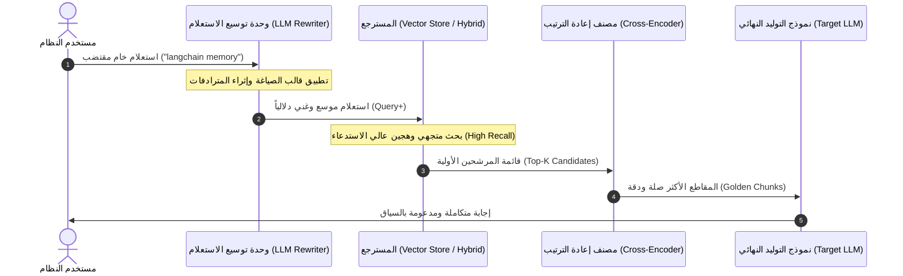
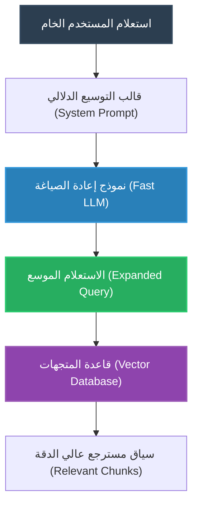

# أساسيات ومفاهيم توسيع الاستعلامات (Query Expansion Fundamentals)

تُمثل جودة وصياغة استعلام المستخدم (`User Query`) **السقف النظري والعملي الأعلى (`Performance Ceiling`)** لجودة الاسترجاع في أي نظام `RAG`. فمهما بلغت قوة قاعدة البيانات المتجهية (`Vector Database`) أو دقة خوارزميات الترتيب (`Reranking Algorithms`)، فإن استرجاع السياق يعتمد أساساً على قدرة الاستعلام على مضاهاة متجهات الوثائق دلالياً ولفظياً.

في هذا الدليل، نغطي الأسس المعمارية والنظرية لتقنية **توسيع الاستعلامات (`Query Expansion Technique`)**، ولماذا تُعد خطوة محورية في خطوط الإنتاج المتقدمة.

---

## 1. جوهر المشكلة: لماذا تفشل الاستعلامات الخام؟ (The Root Problem)

في التطبيقات الواقعية، نادراً ما يكتب المستخدم النهائي استعلاماً مثالياً متكاملاً. تقع معظم الاستعلامات الخام في واحد أو أكثر من الأنماط الإشكالية التالية:

1. **الاستعلامات شديدة الاقتضاب (`Short & Underspecified Queries`)**:
   - المستخدم يكتب كلمة أو كلمتين فقط، مثل: `` `langchain memory` ``.
   - هذا الاستعلام يفتقر إلى تحديد الهدف (هل يريد أنواع الذاكرة؟ أم طريقة الاستخدام؟ أم مشكلة تسريب الذاكرة؟).
2. **الفجوة المعجمية وتعدد المترادفات (`Vocabulary Mismatch Problem`)**:
   - قد يستخدم السائل مصطلحات دارجة بينما كُتبت الوثائق الرسمية بلغة تقنية دقيقة.
   - مثال: كتابة `` `tools in LLM` `` بينما الفهرس يحتوي على وثائق بعنوان `` `LangChain Agents Tool Calling API & Structured Tool Interfaces` ``.
3. **الغموض الدلالي (`Semantic Ambiguity`)**:
   - كتابة مصطلحات عامة مثل `` `retrieval` ``، والتي قد تحتمل في قاعدة البيانات مئات الموضوعات المتفرقة (مثل: `` `Dense Search` `` أو `` `BM25 Lexical Matching` `` أو `` `MMR Diversity` ``).

### الأثر الرياضي على فضاء المتجهات (Mathematical Impact)

إذا مثّلنا فضاء التضمين بمتجه الاستعلام $\mathbf{e}_q \in \mathbb{R}^D$ ومتجهات الوثائق $\mathbf{e}_{d_i} \in \mathbb{R}^D$:

$$S(q, d) = \cos(\mathbf{e}_q, \mathbf{e}_d) = \frac{\mathbf{e}_q \cdot \mathbf{e}_d}{\|\mathbf{e}_q\| \|\mathbf{e}_d\|}$$

عندما يكون الاستعلام مقتضباً جداً (كلمة واحدة أو اثنتين)، فإن كثافة المعلومات الدلالية في $\mathbf{e}_q$ تكون منخفضة، وتتوزع أوزان الانتباه (`Attention Weights`) على أبعاد عامة غير محددة، مما يؤدي إلى:
1. انخفاض نسبة الاستدعاء:

$$R@k = \frac{|\mathcal{D}_{\text{retrieved}} \cap \mathcal{D}_{\text{relevant}}|}{|\mathcal{D}_{\text{relevant}}|}$$

2. استرجاع وثائق عامة هامشية بدلاً من المقاطع التخصصية المطلوبة.

---

## 2. تعريف توسيع الاستعلام (`Query Expansion Definition`)

> **توسيع الاستعلام (`Query Expansion`)**: هو أسلوب منهجي لإعادة صياغة (`Reformulating`) وإثراء استعلام المستخدم الأصلي عبر إضافة المترادفات، والمصطلحات ذات الصلة، والتعبيرات التوضيحية المشتقة من السياق الدلالي المستهدف، قبل إرسال الاستعلام إلى المسترجع (`Retriever`).

الهدف الأساسي ليس استبدال رغبة المستخدم، بل **تجسير الفجوة المعجمية والدلالية** بين ما كتبه المستخدم وما هو مخزن فعلياً داخل قاعدة المعرفة (`Knowledge Base`).

---

## 3. المعمارية الهندسية وتدفق البيانات (Architectural Data Flow)

يوضح المخطط التالي دورة حياة الاستعلام عند دمج وحدة **تحسين الاستعلامات (`Query Enhancement Module`)**:

---

## 4. نماذج التحويل: قبل وبعد التوسيع (Concrete Examples)

| الاستعلام الأصلي الخام | نمط الضعف | الاستعلام بعد التوسيع الدلالي (`Enhanced Query`) | المحتوى المسترجع المستهدف |
| :--- | :--- | :--- | :--- |
| `` `langchain memory` `` | مقتضب وغير محدد | `` `LangChain memory modules, conversation buffer, summary memory, window memory management` `` | وثائق شرح هياكل الذاكرة وسلاسل الحوار |
| `` `tools in LLM` `` | عام ويفتقر للمصطلحات التقنية | `` `LangChain tool calling API, agents, custom tools, calculator tool, structured execution` `` | مواصفات واجهات استدعاء الأدوات والوكلاء |
| `` `retrieval` `` | شديد العمومية | `` `Vector retrieval, dense semantic search, sparse BM25, MMR diversity ranking` `` | فصول البحث المتجهي والهجين والتنويع |

---

## 5. تكوين وحدة التوسيع البرمجية (Inside the Enhancement Module)

تتكون وحدة توسيع الاستعلام من ثلاث ركائز برمجية مترابطة في سلسلة واحدة (`Chain`):

1. **نموذج لغوي وسيط (`Rewriter LLM`)**: نموذج سريع وخفيف التكلفة (مثل النماذج السريعة أو النماذج المحلية الصغيرة) مخصص لمهمة التحويل النصي فقط.
2. **قالب توجيه متخصص (`Expansion Prompt Template`)**: يوجه النموذج بصرامة لإعادة الصياغة دون إجابة السؤال مباشرة:
   - إضافة المترادفات التقنية.
   - تفصيل الاختصارات المبهمة.
   - الحفاظ على نية المستخدم الأصلية دون إدخال افتراضات مضللة (`Preventing Query Drift`).
3. **مسترجع المعرفة (`Knowledge Retriever`)**: يستقبل ناتج السلسلة المحسّن وينفذ الاستعلام عبر فضاء المتجهات أو البحث الهجين.

---

## 6. جدول المقارنة والمفاضلة الهندسية (Engineering Trade-offs)

| معيار التقييم | البحث بالاستعلام الخام (`Naive Query`) | الاستعلام الموسع (`Query Expansion`) | التفسير الهندسي |
| :--- | :--- | :--- | :--- |
| **معدل الاستدعاء (`Recall`)** | منخفض إلى متوسط | **مرتفع جداً** | يضمن تغطية المترادفات والبدائل اللغوية |
| **زمن الاستجابة (`Latency`)** | فوري (زمن البحث فقط) | يزداد بمقدار استدعاء النموذج | يتطلب استدعاء LLM إضافي لإعادة الصياغة |
| **استهلاك التوكنز والتكلفة** | صفر توكنز إضافية | توكنز إضافية لإعادة الصياغة | يُفضل استخدام نماذج خفيفة وسريعة للتحويل |
| **خطر انحراف المعنى (`Query Drift`)** | منعدم (الاستعلام لم يتغير) | محتمل إن لم يُضبط الـ `Prompt` | يجب تقييد النموذج بعدم إضافة معلومات خارج السياق |
| **الحاجة في بيئات الإنتاج** | غير كافية للتطبيقات التخصصية | **ضرورية للمحادثات الحرة والأسئلة العامة** | تسد الفجوة بين لغة المستخدم ولغة الوثائق |

---

## 7. أسئلة المقابلات الهندسية المتقدمة (Senior Interview Deep Dive)

> **س1: كيف تمنع ظاهرة "انحراف الاستعلام" (`Query Drift`) عند استخدام توسيع الاستعلامات بالنماذج اللغوية؟**  
> **الإجابة الهندسية**: يتم ضبط قالب التوجيه (`System Prompt`) بفرض قيود صارمة:
> 1. حظر الإجابة عن السؤال؛ وظيفة النموذج هي **إعادة الصياغة فقط**.
> 2. تقييد التوسيع بإضافة مترادفات واختصارات معجمية محددة دون إضافة أسئلة فرعية جديدة.
> 3. استخدام درجة حرارة منخفضة جداً (`Temperature = 0.0`) لمنع الإبداع الزائد والهلوسة.

> **س2: هل يحل توسيع الاستعلامات محل البحث الهجين (`Hybrid Search`) أم يكملّه؟**  
> **الإجابة الهندسية**: **يكملّه تماماً**. توسيع الاستعلام يثري المسارين معاً:
> - يغذي مسار البحث الكثيف (`Dense Search`) بمتجهات دلالية متعددة الزوايا.
> - يغذي مسار البحث المتناثر (`BM25`) بكلمات مفتاحية ومترادفات لفظية دقيقة كان المستخدم قد أغفل ذكرها، مما يرفع دقة الاسترجاع الإجمالية للـ `EnsembleRetriever`.
