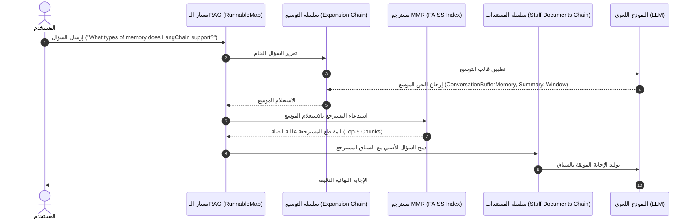

# التطبيق العملي لتوسيع الاستعلامات في مسار RAG متكامل
### Query Expansion Practical Implementation (`docs/06-query-enhancement/02-query-expansion-implementation.md`)

في هذا الدرس، ننتقل من الفهم النظري لتوسيع الاستعلامات إلى **التنفيذ البرمجي المتكامل لمسار RAG إنتاجي (`End-to-End RAG Pipeline`)** يدمج وحدة تحسين الاستعلامات (`Query Expansion`) كطبقة وسيطة تسبق المسترجع (`Retriever`).

---

## 1. المعمارية الهندسية ومخطط التدفق (Architectural Blueprint)

في هذا التصميم، لا يصل استعلام المستخدم الخام مباشرة إلى قاعدة المتجهات، بل يمر عبر محرك وسيط يعيد صياغته ويثريه بالمترادفات التقنية والمصطلحات الدقيقة:

```mermaid
flowchart TD
    subgraph InputStage ["1. استقبال استعلام المستخدم الخام (User Query)"]
        UQ["استعلام مقتضب أو غير دقيق:<br/>'Does CrewAI support memory?' أو 'langchain memory'"]
    end

    subgraph ExpansionLayer ["2. طبقة توسيع الاستعلام (Query Expansion Chain)"]
        UQ --> EP["قالب التوسيع الدلالي (Expansion Prompt)"]
        EP --> LLM_Exp["النموذج اللغوي المحول (Rewriter LLM)"]
        LLM_Exp --> StrParser["StrOutputParser"]
        StrParser --> ExpandedQ["استعلام موسع وغني دلالياً (Expanded Query):<br/>'CrewAI memory system, short-term memory, long-term memory, entity memory, SQLite'"]
    end

    subgraph RetrievalLayer ["3. طبقة الاسترجاع المتنوع (MMR Vector Retrieval)"]
        ExpandedQ --> MMR["مسترجع أقصى تنوع نسبي (MMR Retriever)<br/>k = 5, fetch_k = 20"]
        MMR --> Chunks["أفضل 5 مقاطع عالية التنوع والصلة (Diverse Chunks)"]
    end

    subgraph GenerationLayer ["4. التوليد المدعوم بالسياق (Grounded Answer Generation)"]
        Chunks --> StuffChain["سلسلة حشو المستندات (Stuff Documents Chain)"]
        UQ --> StuffChain
        StuffChain --> GenLLM["نموذج التوليد النهائي (Target LLM)"]
        GenLLM --> FinalAnswer["إجابة موثقة ودقيقة مستندة حصرياً للسياق"]
    end

    style InputStage fill:#2b1b17,stroke:#e74c3c,stroke-width:1.5px
    style ExpansionLayer fill:#1a252f,stroke:#3498db,stroke-width:1.5px
    style RetrievalLayer fill:#14342b,stroke:#2ecc71,stroke-width:1.5px
    style GenerationLayer fill:#2c1b3d,stroke:#9b59b6,stroke-width:1.5px
```

---

## 2. التدفق البرمجي عبر LangChain Expression Language (LCEL)

تكمن القوة الهندسية في هذا المسار في ربط سلسلتين منفصلتين عبر مسار متوازي (`RunnableMap` / `RunnableParallel`):

1. **سلسلة التوسيع (`query_expansion_chain`)**:
   $$\text{Expanded Query} = \text{StrOutputParser}(\text{LLM}(\text{Prompt}(\text{Raw Query})))$$

2. **سلسلة توليد الإجابة (`rag_pipeline`)**:
   يتم اشتقاق السياق ديناميكياً بتمرير ناتج سلسلة التوسيع إلى دالة المسترجع:

$$\text{Context} = \text{Retriever}(\text{ExpansionChain}(\text{Raw Query}))$$

---

## 3. الصياغة الرياضية لتأثير التوسيع على استرجاع MMR

عند استخدام مسترجع `MMR` (`Maximal Marginal Relevance`)، يتم اختيار المستند $d_i$ الذي يعظم الدالة:

$$\text{MMR}(q_{\text{exp}}, \mathcal{D}, \mathcal{S}) = \operatorname{argmax}_{d_i \in \mathcal{D} \setminus \mathcal{S}} \left[ \lambda \cdot \cos(\mathbf{e}_{q_{\text{exp}}}, \mathbf{e}_{d_i}) - (1 - \lambda) \cdot \max_{d_j \in \mathcal{S}} \cos(\mathbf{e}_{d_i}, \mathbf{e}_{d_j}) \right]$$

حيث:
* $\mathbf{e}_{q_{\text{exp}}}$ هو متجه التضمين للاستعلام الموسع بدلاً من الاستعلام الخام $\mathbf{e}_{q_{\text{raw}}}$.
* بما أن $q_{\text{exp}}$ يحتوي على مصطلحات تخصصية (مثل `` `ConversationSummaryBufferMemory` `` أو `` `EntityMemory` ``)، فإن إسقاط المتجه $\mathbf{e}_{q_{\text{exp}}}$ في فضاء التضمين يقترب جغرافياً من المستندات التخصصية، مما يرفع دقة الشبه الأولية $\cos(\mathbf{e}_{q_{\text{exp}}}, \mathbf{e}_{d_i})$.

---

## 4. مقارنة معمارية: المسار العادي مقابل مسار التوسيع

| المعيار | مسار RAG التقليدي (`Naive RAG`) | مسار RAG مع توسيع الاستعلام (`Expanded RAG`) |
| :--- | :--- | :--- |
| **نوع الاستعلام المرسل للمسترجع** | استعلام المستخدم الخام كما كُتب | استعلام موسع بالمترادفات والمصطلحات التقنية |
| **الحساسية للأخطاء والمصطلحات الدارجة** | عالية جداً؛ يفوت المستندات ذات المصطلحات الرسمية | منخفضة جداً؛ يترجم المصطلحات الدارجة للغة التقنية |
| **التوافق مع أطر العمل المختلفة** | قد يخلط بين أطر العمل المتشابهة | يفصل بدقة بين خصائص كل إطار عمل (مثل `LangChain` و `CrewAI`) |
| **عدد استدعاءات النماذج اللغوية** | استدعاء واحد فقط (في مرحلة التوليد) | استدعاءان (استدعاء للتوسيع + استدعاء للتوليد) |
| **زمن الاستجابة الإجمالي (`Latency`)** | أسرع بمقدار زمن صياغة السؤال | يتطلب من 100 إلى 250 ميلي ثانية إضافية |

---

## 5. مصفوفة تفكيك النتائج للأسئلة التجريبية (Benchmark Case Studies)

### الحالة الأولى: ``"What types of memory does LangChain support?"``
* **الاستعلام الموسع**: ``"LangChain memory support, ConversationBufferMemory, ConversationSummaryMemory, persistent memory, chat history storage"``
* **المسترجع**: يسترجع مباشرة مقاطع `ConversationBufferMemory` و `ConversationSummaryMemory`.
* **الإجابة**: إجابة مفصلة تشرح نوعي الذاكرة بدقة استناداً للسياق.

### الحالة الثانية: ``"Does CrewAI support memory?"``
* **الاستعلام الموسع**: ``"CrewAI memory capabilities, short-term memory, long-term memory, entity memory, contextual agent memory, SQLite storage"``
* **المسترجع**: مقاطع توضح أن CrewAI تدعم الذاكرة متعددة الطبقات (Short-term, Long-term, Entity memory).
* **الإجابة**: إجابة دقيقة تؤكد الدعم وتشرح طبقات الذاكرة الثلاث.

### الحالة الثالثة: ``"CrewAI agents"``
* **الاستعلام الموسع**: ``"CrewAI autonomous agents, role-playing, goal, backstory, tools integration, task delegation, team collaboration"``
* **المسترجع**: مقاطع تكوين الوكلاء وتوزيع المهام والأدوار.
* **الإجابة**: إجابة شاملة لأركان بناء الوكيل في CrewAI.

---

## 6. أسئلة المقابلات المتقدمة (Senior Interview Deep Dive)

> **س1: لماذا نمرر استعلام المستخدم الأصلي إلى سلسلة التوليد النهائية (`Document Chain`) بدلاً من تمرير الاستعلام الموسع؟**  
> **الإجابة الهندسية**:  
> لأن الاستعلام الموسع موجه **للفهرس الرياضي (`Retriever / Index`)** ومحشو بكلمات مفتاحية ومترادفات لتوسيع نطاق البحث، بينما نموذج التوليد النهائي يحتاج لسؤال المستخدم بصياغته الإنسانية الطبيعية حتى تكون إجابته مركزة ومباشرة على ما طلبه المستخدم فعلياً دون استطراد في المترادفات.

> **س2: كيف تضمن عدم ارتفاع تكلفة التوكنز وزمن الاستجابة عند تطبيق توسيع الاستعلامات في تطبيقات الإنتاج ذات الحركة العالية؟**  
> **الإجابة الهندسية**:  
> 1. استخدام نماذج خفيفة وسريعة جداً لمرحلة التوسيع (مثل `gpt-4o-mini` أو النماذج المحلية المدمجة `Llama-3.2-3B`).  
> 2. تطبيق التخزين المؤقت الدلالي (`Semantic Caching`) للاستعلامات الشائعة.  
> 3. تشغيل ميزة التوجيه الانتقائي (`Selective Routing`): بحيث لا يتم تفعيل التوسيع إلا إذا كان الاستعلام مقتضباً أو تقل درجة ثقته في المسترجع الأولي عن عتبة معينة.
