# تفكيك وتجزئة الاستعلامات المركبة (Query Decomposition)

تُواجه أنظمة الـ RAG التقليدية فشلاً ذريعاً عندما يطرح المستخدم **استعلاماً مركباً متعدد الأركان (`Complex Multi-Part Query`)** أو مقارنة تتطلب خطوات استدلالية متعددة (`Multi-Hop Reasoning`). إذا تم تمرير هذا الاستعلام ككتلة واحدة إلى قاعدة المتجهات، تتشتت أوزان الانتباه الدلالي (`Attention Weights`)، ويفشل نموذج التضمين في إيجاد متجهات تغطي كل أركان السؤال معاً.

هنا تأتي تقنية **تفكيك الاستعلامات (`Query Decomposition`)** كحل معماري يقسم السؤال المركب إلى أسئلة ذرية بسيطة (`Atomic Sub-Questions`)، يتم استرجاع السياق والإجابة عن كل منها على حدة، ثم دمج الإجابات في صياغة نهائية موحدة.

---

## 1. التعريف والدافع الهندسي (Definition & Motivation)

> **تفكيك الاستعلام (`Query Decomposition`)**: هو أسلوب منهجي لأخذ سؤال معقد يتألف من عدة مفاهيم ومحاور متباينة، وتجزئته عبر نموذج لغوي أو قواعد محددة إلى $m$ من الأسئلة الفرعية الذرية المستقلة:
> 
> $$Q \xrightarrow{\text{Decomposition}} \{sq_1, sq_2, \dots, sq_m\}$$
> 
> بحيث يُعالج كل سؤال فرعي بمفرده في مسار الاسترجاع والتوليد، قبل دمج المخرجات عبر مركب الإجابات (`Answer Synthesizer`).

### لماذا يفشل البحث المباشر في الاستعلامات المركبة؟ (Failure Modes of Naive Search)
1. **التشويش والاندماج الدلالي (`Semantic Blending & Blur`)**:
   - مثال: *"كيف تدير LangChain الذاكرة والوكلاء مقارنة بـ CrewAI؟"*
   - هذا السؤال يحتوي على 4 موضوعات فرعية: (LangChain Memory, LangChain Agents, CrewAI Memory, CrewAI Agents).
   - التضمين الكثيف لسؤال واحد يدمج كل هذه المعاني في متجه وسيط $\mathbf{e}_Q \in \mathbb{R}^D$ يبعد عن التفاصيل الدقيقة لكل موضوع على حدة.
2. **سقوط الاستدلال متعدد الخطوات (`Multi-Hop Reasoning Deficit`)**:
   - بعض الأسئلة لا يمكن الإجابة عن طرفها الثاني إلا بعد معرفة إجابة طرفها الأول. تجزئة السؤال تحول المعضلة إلى خطوات استدلالية متسلسلة.
3. **فقدان فرصة التوازي (`Loss of Parallelism`)**:
   - الأسئلة الفرعية المستقلة يمكن استرجاعها وتشغيلها بالتوازي (`Async / Parallelism`) في أنظمة الوكلاء المتعددة (`Multi-Agent Frameworks`).

---

## 2. المعمارية الهندسية الشاملة وتدفق البيانات (Architectural Blueprint)

```mermaid
flowchart TD
    subgraph InputStage ["1. الاستعلام المركب (Complex Query)"]
        CQ["سؤال مركب متعدد المحاور:<br/>'How does LangChain use memory and agents compared to CrewAI?'"]
    end

    subgraph DecomposerLayer ["2. طبقة التفكيك (Query Decomposer)"]
        CQ --> DecompPrompt["قالب التفكيك (Decomposition Prompt)"]
        DecompPrompt --> LLM_Dec["النموذج اللغوي المحلل (Decomposer LLM)"]
        LLM_Dec --> SubQueries["قائمة الأسئلة الفرعية الذرية (Atomic Sub-Queries):<br/>1. What memory mechanisms does LangChain offer?<br/>2. How do LangChain agents operate?<br/>3. What memory architecture does CrewAI support?<br/>4. How do CrewAI agents collaborate?"]
    end

    subgraph RetrievalLayer ["3. مسارات الاسترجاع الموازية (Parallel MMR Retrieval)"]
        SubQueries --> Ret1["Retriever(sq_1) -> Chunks_1"]
        SubQueries --> Ret2["Retriever(sq_2) -> Chunks_2"]
        SubQueries --> Ret3["Retriever(sq_3) -> Chunks_3"]
        SubQueries --> Ret4["Retriever(sq_4) -> Chunks_4"]
    end

    subgraph SubQALayer ["4. التوليد الفرعي (Sub-Question QA Generation)"]
        Ret1 --> QA1["LLM Sub-Answer 1 (A1)"]
        Ret2 --> QA2["LLM Sub-Answer 2 (A2)"]
        Ret3 --> QA3["LLM Sub-Answer 3 (A3)"]
        Ret4 --> QA4["LLM Sub-Answer 4 (A4)"]
    end

    subgraph SynthesisLayer ["5. التركيب والتوليف النهائي (Synthesizer & Combiner)"]
        QA1 & QA2 & QA3 & QA4 --> Synthesizer["مركب الإجابات (Answer Synthesizer)"]
        Synthesizer --> FinalAnswer["إجابة مقارنة متكاملة وموثقة بالسياق بنسبة 100%"]
    end

    style InputStage fill:#2b1b17,stroke:#e74c3c,stroke-width:1.5px
    style DecomposerLayer fill:#1a252f,stroke:#3498db,stroke-width:1.5px
    style RetrievalLayer fill:#14342b,stroke:#2ecc71,stroke-width:1.5px
    style SubQALayer fill:#2c1b3d,stroke:#9b59b6,stroke-width:1.5px
    style SynthesisLayer fill:#1b3022,stroke:#27ae60,stroke-width:1.5px
```



---

## 3. الصياغة الرياضية لتفكيك الاستعلام (Mathematical Formulation)

ليكن لدينا استعلام مركب $Q$ ومجموعة وثائق المعرفة الكلية $\mathcal{D}$.
في البحث التقليدي، يتم حساب الاسترجاع عبر:

$$\mathcal{D}_{\text{naive}} = \operatorname{Top-K}_{d \in \mathcal{D}} \cos(\mathbf{e}_Q, \mathbf{e}_d)$$

حيث تتوزع طاقة المتجه $\mathbf{e}_Q$ على عدة محاور متفرقة، مما يؤدي إلى:

$$\text{Recall}(Q) < \prod_{i=1}^m \text{Recall}(sq_i)$$

عند تطبيق التفكيك:

$$Q \xrightarrow{\text{LLM}} \{sq_1, sq_2, \dots, sq_m\}$$

يتم استرجاع حوض مخصص لكل سؤال فرعي:

$$\mathcal{D}_i = \operatorname{Top-K}_{d \in \mathcal{D}} \text{MMR}(sq_i, \mathcal{D})$$

وبالتالي فإن السياق الكلي المجمع:

$$\mathcal{C}_{\text{total}} = \bigcup_{i=1}^m \mathcal{D}_i$$

تضمن هذه الصياغة أن تغطية محاور السؤال تمثل الاتحاد التام (`Set Union`) لجميع المتطلبات الذرية، مما يمنع انحسار الاسترجاع في زاوية واحدة وإهمال باقي أركان السؤال.

---

## 4. طرق تنفيذ التفكيك: المقارنة بين الأساليب (Implementation Methods)

1. **التفكيك الدلالي بالنماذج اللغوية (`LLM-Driven Decomposition`)**:
   - استخدام قالب توجيه متخصص (`Prompt Template`) يطلب توليد من 2 إلى 4 أسئلة فرعية مبسطة.
   - **الميزة**: فهم السياق والترادف والعلاقات السببية بين أركان السؤال.
   - **العيب**: استدعاء إضافي للـ LLM واستهلاك توكنز.
2. **التفكيك المعجمي / القائم على القواعد (`Regex / Rule-Based Splitting`)**:
   - استخدام أدوات التحليل اللغوي وتقسيم النص استناداً إلى علامات الترقيم (`,`, `.`, `?`, `!`) وحروف العطف والمقارنة (`and`, `versus`, `compared to`).
   - **الميزة**: زمن معالجة صفر وسرعة فائقة بدون أي تكلفة توكنز.
   - **العيب**: هش في الأسئلة الضمنية التي لا تحتوي على علامات ترقيم واضحة.

---

## 5. مصفوفة المقارنة والمفاضلة الهندسية (Engineering Trade-offs)

| معيار التقييم | البحث التقليدي (`Naive RAG`) | توسيع الاستعلام (`Query Expansion`) | تفكيك الاستعلام (`Query Decomposition`) |
| :--- | :--- | :--- | :--- |
| **طبيعة الأسئلة المثالية** | أسئلة بسيطة ومباشرة | أسئلة قصيرة، مبهمة، أو تفتقر للمترادفات | **أسئلة مركبة، مقارنات، واستدلال متعدد الخطوات** |
| **استراتيجية التعديل** | دون أي تعديل على السؤال | إضافة مترادفات وكلمات مفتاحية | **تجزئة السؤال لأسئلة ذرية مستقلة ($2-4$ أسئلة)** |
| **عدد استدعاءات المسترجع** | استدعاء واحد فقط ($k$) | استدعاء واحد فقط ($k$) | **$m$ استدعاءات ($m \times k$)** |
| **عدد استدعاءات الـ LLM** | استدعاء واحد (توليد الإجابة) | استدعاءان (توسيع + توليد) | **$m + 2$ استدعاءات (تفكيك + $m$ إجابات + تركيب)** |
| **زمن الاستجابة (`Latency`)** | سريع جداً ($< 500\text{ms}$) | متوسط ($600 - 900\text{ms}$) | **مرتفع ($1.5 - 3.5\text{s}$) إلا إذا تم بالتوازي** |
| **دقة الإجابة والشمول** | ضعيفة في الأسئلة المركبة | متوسطة إلى جيدة | **فائقة الدقة وخالية من الهلوسة في المقارنات** |

---

## 6. متى نستخدم ومتى نتجنب تفكيك الاستعلامات؟ (Decision Matrix)

```
                            [طبيعة سؤال المستخدم]
                                      |
                     ----------------------------------
                     |                                |
             [سؤال بسيط مباشر]                [سؤال مركب أو مقارنة]
                     |                                |
           [توسيع الاستعلام أو البحث الهجين]                  |
                                            -----------------------
                                            |                     |
                                    [SLA زمن استجابة صارم]   [الأولوية للدقة والعمق]
                                            |                     |
                                  [Regex Rule Splitting]   [LLM Decomposition + Synthesizer]
```

---

## 7. أسئلة المقابلات الهندسية المتقدمة (Senior Interview Deep Dive)

> **س1: ما هو أكبر عنق زجاجة (`Bottleneck`) في تقنية تفكيك الاستعلامات، وكيف يمكن التغلب عليه هندسياً في الإنتاج؟**  
> **الإجابة الهندسية**:  
> أكبر عنق زجاجة هو **زمن الاستجابة (`Latency`) وتكلفة التوكنز** الناتجة عن تكرار استدعاءات الـ LLM والمسترجع لكل سؤال فرعي ($O(m)$ LLM calls).  
> **الحلول الهندسية المتبعة في بيئات العمل:**
> 1. **التنفيذ غير المتزامن بالتوازي (`Async Parallel Execution`)**: إرسال كافة الأسئلة الفرعية للـ Retriever والـ LLM بالتوازي عبر `asyncio.gather` بدلاً من الـ loop المتسلسلة.
> 2. **التوليد المباشر من السياق المجمع (`Single-Pass Synthesized Generation`)**: بدلاً من تشغيل $m$ سلاسل توليد، نجمع المستندات المسترجعة من كل الأسئلة الفرعية في مصفوفة واحدة، ثم نمررها في استدعاء LLM واحد ليجيب عن السؤال الأصلي دفعة واحدة.

> **س2: كيف يختلف تفكيك الاستعلامات (`Query Decomposition`) عن توليد الاستعلامات المتعددة (`Multi-Query / Sub-Queries`)؟**  
> **الإجابة الهندسية**:  
> في **Multi-Query**، نولد صياغات بديلة مختلفة لنفس السؤال الواحد من زوايا متعددة (Paraphrasing) لزيادة الـ Recall.  
> أما في **Query Decomposition**، فنحن نجزئ مشكلة كبرى إلى أجزاء مختلفة كلياً لا تتطابق فيما بينها؛ كل جزء يغطي ركناً محدداً من السؤال الأصلي المركب.
