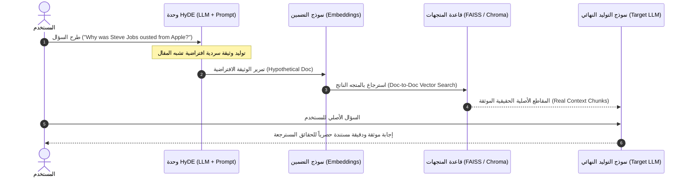

# تقنية تضمين الوثائق الافتراضية (HyDE - Hypothetical Document Embeddings)

في أنظمة الاسترجاع التقليدية، يعتمد البحث المتجهي على قياس التشابه بين **استعلام المستخدم (`User Query`)** و**وثائق المعرفة (`Knowledge Documents`)**. لكن تكمن المعضلة الجوهرية في أن الاستعلامات والوثائق تنتمي إلى أنماط لغوية شديدة التباين (`Asymmetric Information Retrieval`):
* الاستعلام عادة ما يكون **سؤالاً مقتضباً أو استفهامياً** (مثل: *"لماذا طُرد ستيف جوبز من أبل؟"*).
* الوثائق المخزنة تكون **نصوصاً تقريرية وسردية** (مثل: *"في عام 1985، نشب خلاف حاد بين ستيف جوبز وجون سكالي أدى إلى تجريده من صلاحياته"*).

هذا التباين الهيكلي بين صيغة السؤال وصيغة الإجابة يحد من دقة نماذج التضمين. هنا تبرز تقنية **تضمين الوثائق الافتراضية (`Hypothetical Document Embeddings - HyDE`)** لتقلب المعادلة بالكامل!

---

## 1. التعريف والحدس الهندسي (Definition & Core Intuition)

> **تقنية HyDE**: هي استراتيجية استرجاع متقدمة؛ بدلاً من تحويل استعلام المستخدم مباشرة إلى متجه تضمين، نطلب أولاً من نموذج لغوي (`LLM`) توليد **وثيقة أو إجابة افتراضية (`Hypothetical Document - $\hat{d}$`)** تجيب عن السؤال، ثم نقوم بتضمين هذه الوثيقة الافتراضية والبحث بها في قاعدة المتجهات!

```
[استعلام المستخدم الخام (سؤال)] 
         ↓
  (النموذج اللغوي) 
         ↓
[وثيقة افتراضية (نص تقريري يشبه الإجابة)] 
         ↓
     (Embed) 
         ↓
[بحث من نمط وثيقة-إلى-وثيقة في قاعدة المتجهات]
```

### اللغز الأكبر: ماذا لو هلوس النموذج في الوثيقة الافتراضية؟ (The Hallucination Paradox)
قد تتساءل: *ماذا لو كانت إجابة النموذج الافتراضية غير دقيقة أو تحتوي على أخطاء واقعية؟ هل سيفشل الاسترجاع؟*

**الإجابة الهندسية**: **لا!** لأن تقنية `HyDE` لا تستخدم الوثيقة الافتراضية للإجابة، بل تستخدمها كـ **مرشح دلالي (`Semantic Filter`)**.
* حتى لو اختلق النموذج بعض التواريخ أو الأسماء، فإن أسلوب النص، ومصطلحات المجال (`Domain Lexicon`)، والتراكيب النحوية ستكون أقرب بكثير في فضاء المتجهات إلى الوثائق الحقيقية مقارنة بكلمات السؤال الاستفهامية.
* يتم إسقاط المتجه في نفس "الحي الدلالي" (`Semantic Neighborhood`) المطلوب، فيجلب المسترجع المقاطع الحقيقية الموثقة من قاعدة بياناتك.

---

## 2. الصياغة الرياضية والمقارنة الهندسية (Mathematical Formulation)

ليكن لدينا استعلام مستخدم $q$. في البحث التقليدي:

$$\mathbf{e}_q = \text{Embed}(q), \quad \mathbf{e}_{d_i} = \text{Embed}(d_i)$$
$$\text{Score}_{\text{naive}}(q, d_i) = \cos(\mathbf{e}_q, \mathbf{e}_{d_i})$$

بينما في معمارية `HyDE`:
1. نولد وثيقة افتراضية مشروطة بالاستعلام:

$$\hat{d} \sim P_{\text{LLM}}(d \mid q, \text{Prompt})$$

2. نحسب متجه التضمين للوثيقة الافتراضية:

$$\mathbf{e}_{\hat{d}} = \text{Embed}(\hat{d})$$

3. نقيس التشابه بين وثيقة افتراضية ووثائق حقيقية (`Doc-to-Doc Similarity`):

$$\text{Score}_{\text{HyDE}}(\hat{d}, d_i) = \cos(\mathbf{e}_{\hat{d}}, \mathbf{e}_{d_i}) = \frac{\mathbf{e}_{\hat{d}} \cdot \mathbf{e}_{d_i}}{\|\mathbf{e}_{\hat{d}}\| \|\mathbf{e}_{d_i}\|}$$

```mermaid
flowchart LR
    subgraph Space ["فضاء المتجهات عالي الأبعاد (Vector Embedding Space)"]
        direction TB
        Eq["e_q<br/>متجه السؤال الاستفهامي"]
        Ehd["e_d_hat<br/>متجه الوثيقة الافتراضية"]
        Ed_true["e_d<br/>متجه الوثيقة الحقيقية المستهدفة"]
        
        Eq -. مسافة دلالية واسعة (فجوة الصياغة) .-> Ed_true
        Eq -->|توليد LLM| Ehd
        Ehd ===|قرب دلالي عالي (وثيقة لوثيقة)| Ed_true
    end

    style Eq fill:#e74c3c,stroke:#c0392b,color:#fff
    style Ehd fill:#3498db,stroke:#2980b9,color:#fff
    style Ed_true fill:#2ecc71,stroke:#27ae60,color:#fff
```

---

## 3. المعمارية الهندسية لمسار HyDE في الإنتاج (Architectural Blueprint)



---

## 4. أساليب التطبيق البرمجي في LangChain (Implementation Patterns)

توفر مكتبة LangChain طريقتين هندسيتين لتطبيق HyDE:

### الطريقة الأولى: المسار الصريح المخصص (`Explicit LCEL / Chain Pipeline`)
* ننشئ دالة أو سلسلة `Prompt | LLM | StrOutputParser` تأخذ السؤال وتولد نص الوثيقة الافتراضية.
* نمرر النص الافتراضي مباشرة إلى `retriever.invoke(hypo_doc)`.
* **ميزتها**: شفافية تامة، وتحكم دقيق في الـ Prompt، وإمكانية تسجيل ومراقبة الوثيقة الافتراضية للتنقيح والتصحيح.

### الطريقة الثانية: المضمن الافتراضي الأصيل (`HypotheticalDocumentEmbedder`)
* توفر LangChain فئة متخصصة `HypotheticalDocumentEmbedder.from_llm(llm, base_embeddings, prompt_key)`.
* هذه الفئة تُغلف كائن التضمين (`Embeddings`) نفسه؛ بحيث تصبح قاعدة البيانات المتجهية تفهم ضمنياً أن أي استعلام بحث يتم تحويله أولاً لوثيقة افتراضية قبل تضمينه.
* تدعم قوالب افتراضية جاهزة مثل: `` `web_search` ``, `` `sci_fact` ``، أو قوالب مخصصة (`Custom Prompts`).

---

## 5. مصفوفة المقارنة والمفاضلة الهندسية (Engineering Trade-offs)

| المعيار | البحث التقليدي (`Naive Vector Search`) | توسيع الاستعلام (`Query Expansion`) | تضمين الوثائق الافتراضية (`HyDE`) |
| :--- | :--- | :--- | :--- |
| **طبيعة التحويل** | لا يوجد أي تحويل | إضافة مترادفات وكلمات مفتاحية | **توليد مقال/إجابة افتراضية كاملة** |
| **نوع المقارنة في الفضاء** | سؤال ضد وثيقة (غير متناظر) | سؤال موسع ضد وثيقة | **وثيقة ضد وثيقة (متناظر دلالياً 100%)** |
| **التكلفة وزمن الاستجابة** | فوري (صفر توكنز إضافية) | استدعاء LLM سريع وقصير | **استدعاء LLM لتوليد فقرة سردية كاملة** |
| **الحساسية للأخطاء** | يفوت المقاطع إذا اختلفت الكلمات | قد يلتقط مقاطع هامشية بالمترادفات | **دقة استدعاء عالية جداً في الأسئلة المعقدة** |
| **الاستخدام المثالي** | أسئلة بسيطة ومباشرة | استعلامات قصيرة وتفتقر للمصطلحات | **استعلامات مفتوحة وأسئلة استكشافية ووثائق سردية** |

---

## 6. متى نستخدم ومتى نتجنب تقنية HyDE؟ (When to Use & When to Avoid)

### حالات الاستخدام المثالية:
1. **الاستعلامات الاستكشافية المفتوحة**: مثل الأسئلة التي تبدأ بـ *"كيف"* أو *"لماذا"* أو *"اشرح آلية عمل..."*.
2. **البيانات السردية والمقالات التاريخية والتقنية**: مثل مستندات الويكيبيديا، والأبحاث العلمية، والسياسات المؤسسية.
3. **غياب الكلمات المفتاحية الدقيقة في الاستعلام**: عندما يصف المستخدم الفكرة بأسلوبه دون معرفة المصطلحات الرسمية.

### حالات التجنب:
1. **البحث عن أرقام أو أكواد دقيقة (SKUs, Part Numbers, Codes)**: الوثيقة الافتراضية قد تخمن كوداً خاطئاً يشتت البحث المتجهي؛ هنا يكون البحث الهجين المتناثر (`BM25`) هو الخيار الأنسب.
2. **الأنظمة ذات المتطلبات الزمنية الصارمة جدًا ($< 200\text{ms}$)**: لأن توليد الوثيقة الافتراضية يتطلب استدعاء LLM إضافي.

---

## 7. أسئلة المقابلات الهندسية المتقدمة (Senior Interview Deep Dive)

> **س1: إذا ولّد النموذج اللغوي وثيقة افتراضية مليئة بالهلوسة والمعلومات غير الصحيحة، فلماذا لا ينهار نظام الاسترجاع؟**  
> **الإجابة الهندسية**:  
> لأن فضاء التضمين الكثيف لا يبحث عن التطابق اللفظي الحرفي، بل يمثل "المجال الدلالي" (`Semantic Neighborhood`). حتى لو ذكر النموذج تاريخاً أو اسماً وهمياً، فإن المفردات المحيطة، وصيغ الأفعال، وطبيعة الموضوع توجه المتجه نحو نفس المنطقة الطوبولوجية في فضاء المتجهات التي تتواجد فيها الوثائق الحقيقية الصحيحة.

> **س2: لماذا نمرر السؤال الأصلي للمستخدم إلى مرحلة التوليد النهائية بدلاً من الوثيقة الافتراضية؟**  
> **الإجابة الهندسية**:  
> الوثيقة الافتراضية هي **أداة استرجاع بحتة (`Retrieval Tool`)** تنتهي مهمتها فور استخراج المقاطع من قاعدة البيانات. في مرحلة التوليد، نحتاج لإلزام النموذج اللغوي النهائي بالإجابة عن سؤال المستخدم الفعلي استناداً حصرياً إلى السياق الحقيقي المسترجع، وتفادي نقل أي هلوسات محتملة من الوثيقة الافتراضية إلى المستخدم.
