# المرحلة 06: تحسين وتوسيع الاستعلامات في أنظمة الـ RAG
### Query Enhancement and Transformation Strategies (`docs/06-query-enhancement/`)

تغطي هذه المرحلة بالكامل **القسم العاشر من الكورس (Section 10: Query Enhancement - المحاضرات 49 إلى 56)**.

تتناول هذه المرحلة استراتيجيات **تحسين الاستعلامات (`Query Enhancement & Transformation`)**؛ حيث تُعد جودة وصياغة استعلام المستخدم هي السقف الحقيقي لجودة ودقة المستندات المسترجعة من قواعد البيانات المتجهية (`Vector Stores`).

---

## فهرس موضوعات المرحلة

| الرقم | عنوان الدرس النظري | المحاضرة المقابلة | الملف التوثيقي | الكود النموذجي (`stages/`) | معمل التجربة (`playground/`) | الحالة |
| :---: | :--- | :--- :---: | :---: | :---: | :---: | :---: |
| 01 | **أساسيات ومفاهيم توسيع الاستعلامات (Query Expansion Fundamentals)** | Lecture 49 | [`01-query-expansion-fundamentals.md`](./01-query-expansion-fundamentals.md) | [`stages/06/.../01-...ipynb`](../../stages/06-query-enhancement/01-query-expansion-fundamentals/01-query-expansion-fundamentals.ipynb) | [`playground/06/.../01-...ipynb`](../../playground/06-query-enhancement/01-query-expansion-fundamentals.ipynb) | [x] مكتمل |
| 02 | **التطبيق العملي لتوسيع الاستعلامات عبر LangChain** | Lecture 50 | قيد المتابعة | قيد المتابعة | قيد المتابعة | [ ] قيد العمل |
| 03 | **توليد استعلامات متعددة (Multi-Query Generation)** | Lecture 51 | قيد المتابعة | قيد المتابعة | قيد المتابعة | [ ] قيد الانتظار |
| 04 | **تفكيك الاستعلامات المركبة (Query Decomposition)** | Lecture 52 | قيد المتابعة | قيد المتابعة | قيد المتابعة | [ ] قيد الانتظار |
| 05 | **استرجاع الخطوة للوراء (Step-Back Prompting)** | Lecture 53 | قيد المتابعة | قيد المتابعة | قيد المتابعة | [ ] قيد الانتظار |
| 06 | **تضمين الوثائق الافتراضية (HyDE - Hypothetical Document Embeddings)** | Lecture 54 | قيد المتابعة | قيد المتابعة | قيد المتابعة | [ ] قيد الانتظار |
| 07 | **هندسة التوجيه وتوجيه الاستعلامات (Query Routing)** | Lecture 55 | قيد المتابعة | قيد المتابعة | قيد المتابعة | [ ] قيد الانتظار |
| 08 | **دليل المقارنة واختيار استراتيجية التحسين المثلى** | Lecture 56 | قيد المتابعة | قيد المتابعة | قيد المتابعة | [ ] قيد الانتظار |

---

## المعمارية الهندسية لمسار تحسين الاستعلامات (Query Enhancement Architecture)

```mermaid
flowchart LR
    subgraph RawInput ["1. استعلام المستخدم الخام (Raw Query)"]
        UQ["استعلام مقتضب أو غامض:\n'langchain memory'"]
    end

    subgraph EnhancementLayer ["2. طبقة تحسين وصياغة الاستعلام (LLM Transformation)"]
        UQ --> EP["قالب التوجيه للتحسين (Expansion Prompt):\n'توسيع الاستعلام بالمترادفات والمفاهيم المرتبطة'"]
        EP --> LLM["النموذج اللغوي (LLM Rewriter)"]
        LLM --> EQ["استعلام موسع وغني دلالياً:\n'langchain memory modules conversational buffer window summary'"]
    end

    subgraph RetrievalLayer ["3. طبقة الاسترجاع الفعلي (Enhanced Retrieval)"]
        EQ --> Ret["المسترجع (Retriever / Vector Store)"]
        Ret --> TopK["مستندات عالية الصلة والشمول (Top-K Chunks)"]
    end

    subgraph GenerationLayer ["4. التوليد المدعوم بالسياق (Grounded Generation)"]
        TopK --> FinalLLM["نموذج التوليد النهائي (Target LLM)"]
        FinalLLM --> Ans["إجابة دقيقة وخالية من الهلوسة"]
    end

    style RawInput fill:#2b1b17,stroke:#e74c3c,stroke-width:1.5px
    style EnhancementLayer fill:#1a252f,stroke:#3498db,stroke-width:1.5px
    style RetrievalLayer fill:#14342b,stroke:#2ecc71,stroke-width:1.5px
    style GenerationLayer fill:#2c1b3d,stroke:#9b59b6,stroke-width:1.5px
```

---

## أهداف المرحلة ومخرجات التعلم

1. **فهم مشكلة الفجوة المعجمية والدلالية (`Vocabulary Mismatch Problem`)**: لماذا تفشل التضمينات المباشرة في فهم الاستعلامات القصيرة أو الغامضة.
2. **إتقان معمارية سلاسل التحويل (`Transformation Chains`)**: دمج النماذج اللغوية كمحول استعلامات (`Query Rewriter`) قبل وصول الطلب للمسترجع.
3. **موازنة الأداء والتكلفة (`Latency vs. Recall Trade-off`)**: متى تبرر القيمة المضافة زمن المعالجة الإضافي للـ LLM وتكلفة التوكنز.
