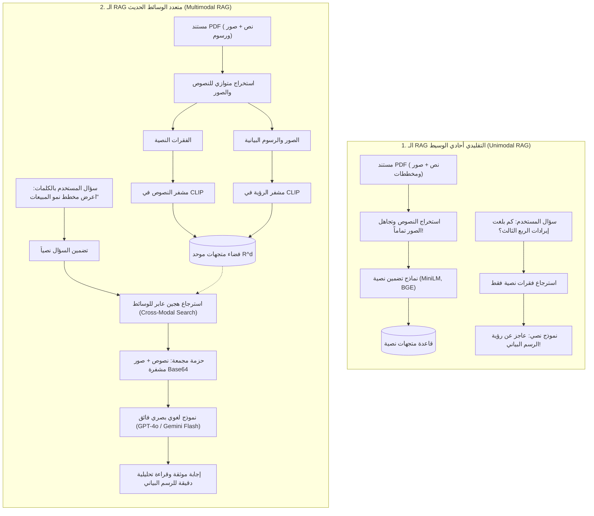
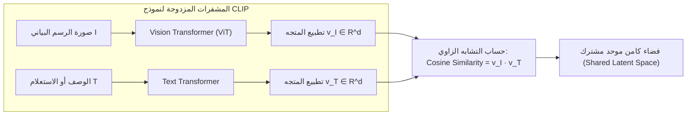
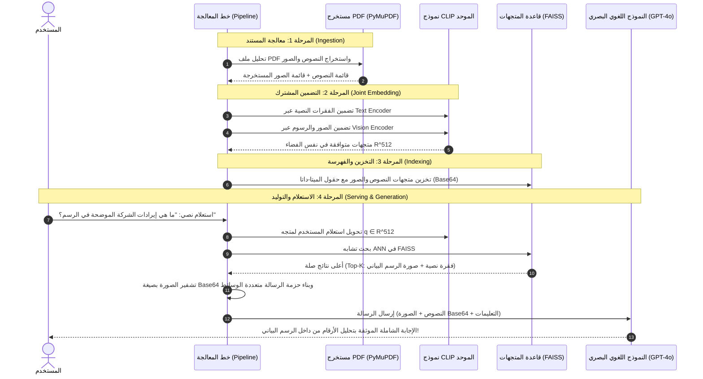

# 01 - معمارية وأسس الـ RAG متعدد الوسائط (Multimodal RAG Architecture & Foundations)

في بيئات الأعمال الحقيقية والشركات الكبرى، نادراً ما تأتي المستندات والتقارير كنصوص صافية مجردة. فالتقارير المالية للشركات، والأوراق البحثية، والمخططات الهندسية، وكتالوجات المنتجات تحتوي على معلومات حيوية مشفرة بصرياً في شكل: **رسوم بيانية للإيرادات والأرباح (`Financial Revenue Charts`)**، **مخططات معمارية للأنظمة (`Architectural Schematics`)**، و**جداول مصورة وتدفقات عمل**.

إذا اعتمدنا على أنظمة الـ RAG التقليدية الأحادية الوسيط (`Unimodal Text-Only RAG`)، فإننا نتجاهل أكثر من 40% إلى 60% من القيمة المعرفية لتلك الوثائق. من هنا نشأت الحاجة المعمارية لـ **الـ RAG متعدد الوسائط (`Multimodal RAG`)**.

---

## 1. الفجوة المعمارية: الـ RAG النصي التقليدي مقابل الـ RAG متعدد الوسائط

---

## 2. النماذج اللغوية البصرية (`Multimodal LLMs / Vision-Language Models`)

النماذج اللغوية التقليدية (مثل `GPT-3.5` أو `LLaMA-2`) تم تدريبها حصرياً على التنبؤ بالرمز اللغوي التالي (`Next-Token Prediction`) من مدخلات نصية.

أما **النماذج اللغوية البصرية (`VLMs`)** مثل `GPT-4o`، و `GPT-4.1`، و `Gemini 1.5/2.5 Flash`:
* تم تدريب أوزانها بشكل مشترك (`Jointly Trained`) على فهم كتل البكسل (`Image Patches / Vision Tokens`) جنباً إلى جنب مع الرموز اللغوية (`Text Tokens`).
* عند تمرير صورة مخطط إيرادات مرمزة بصيغة `Base64` مع برومبت نصي: *"حلل اتجاه الأرباح في الربع الأخير"*:
  1. يقوم محول الرؤية الداخلي للنموذج بتفكيك الصورة إلى مصفوفة رموز دلالية (`Vision Embeddings`).
  2. يتم حقن هذه الرموز مباشرة في آلية الانتباه (`Self-Attention Mechanism`) للنموذج اللغوي.
  3. يقرأ النموذج الأرقام والمحاور والاتجاهات من داخل الصورة كما لو كانت فقرة نصية مكتوبة.

---

## 3. فضاء التضمين الموحد ومعمارية نموذج CLIP

المعضلة الهندسية الكبرى في الـ RAG متعدد الوسائط هي: **كيف نبحث عن رسم بياني (صورة) باستخدام استعلام مكتوب بالكلمات (نص)؟**

الحل المعماري يكمن في نموذج **`CLIP (Contrastive Language-Image Pre-training)`** المطور من OpenAI.

### أ. الهيكل الداخلي لنموذج CLIP:
يتكون النموذج من مشفرين متوازيين يعملان بتناغم تام:
1. **مشفر الرؤية (`Vision Encoder - ViT`)**: يستقبل الصورة $I$ ويحولها إلى متجه $\mathbf{v}_I \in \mathbb{R}^d$ باستخدام محول الرؤية (`Vision Transformer`).
2. **مشفر النصوص (`Text Encoder`)**: يستقبل الوصف النصي $T$ ويحوله إلى متجه $\mathbf{v}_T \in \mathbb{R}^d$ باستخدام محول النصوص (`Transformer`).

---

### ب. الرياضيات الحاكمة للتدريب التقابلي (`Contrastive Learning Math`)

تم تدريب نموذج `CLIP` على أكثر من **400 مليون زوج (صورة، نص)** مأخوذة من الإنترنت.

في كل دفعة تدريبية (`Batch`) مكونة من $N$ أزواج $\{(I_1, T_1), (I_2, T_2), \dots, (I_N, T_N)\}$:
* يحسب التشابه الزاوي بين جميع الصور والنصوص:
  $$s(I_i, T_j) = \frac{\mathbf{v}_{I_i} \cdot \mathbf{v}_{T_j}}{\|\mathbf{v}_{I_i}\|_2 \|\mathbf{v}_{T_j}\|_2}$$
* **الهدف الرياضي**: تعظيم التشابه بين الزوج المطابق الصحيح ($i = j$)، وتقليل التشابه إلى أدنى حد ممكن لجميع الأزواج غير المتطابقة ($i \neq j$).

تحسب دالة الخسارة المشتركة عبر معادلة `InfoNCE / Symmetric Cross-Entropy Loss` مع معامل حرارة قابل للتعلم $\tau$:

$$\mathcal{L} = \frac{1}{2} \left( \mathcal{L}_{I \to T} + \mathcal{L}_{T \to I} \right)$$

حيث خسارة التنبؤ بالنص المقابل للصورة:
$$\mathcal{L}_{I \to T} = - \frac{1}{N} \sum_{i=1}^N \log \frac{\exp(s(I_i, T_i) / \tau)}{\sum_{j=1}^N \exp(s(I_i, T_j) / \tau)}$$

وخسارة التنبؤ بالصورة المقابلة للنص:
$$\mathcal{L}_{T \to I} = - \frac{1}{N} \sum_{i=1}^N \log \frac{\exp(s(I_i, T_i) / \tau)}{\sum_{j=1}^N \exp(s(I_j, T_i) / \tau)}$$

> **الأثر المعماري الثوري**: بفضل هذا التدريب، أصبحت الصورة والنص الخاص بها يقعان في **نفس النقطة الدلالية تقريباً** داخل فضاء المتجهات $\mathbb{R}^d$، مما يسمح بحساب المسافة الإقليدية أو الجيبية مباشرة بين استعلام نصي وصورة!

---

## 4. خطوات خط المعالجة الإنتاجي للـ Multimodal RAG

يمر خط المعالجة المتكامل بـ 7 مراحل متعاقبة:

---

## 5. مصفوفة المفاضلة الهندسية في تخزين الصور (Engineering Trade-Offs)

| الاستراتيجية | آلية العمل | المزايا | العيوب والتكلفة | متى نختارها في الإنتاج؟ |
| :--- | :--- | :--- | :--- | :--- |
| **التخزين المشفر بالـ Base64 في الميتا-داتا** | تحويل البايتات لسلسلة نصية وحفظها مباشرة داخل كائن المستند في قاعدة المتجهات | البساطة، وعدم الحاجة لأي بنية تحتية تخزينية إضافية | تضخم حجم قاعدة المتجهات بنسبة $\approx 33\%$ وبطء الفهرسة | البيئات المعملية والتطبيقات الصغيرة ومتوسطة الحجم |
| **مخزن الكائنات السحابي (`S3 / GCS Object Store`)** | حفظ الصورة في `Amazon S3` وتخزين الرابط `URI` فقط في الميتا-داتا | خفة وزن قاعدة المتجهات وسرعة هائلة في البحث المتجه | تعقيد إدارة الصلاحيات (`Presigned URLs`) وحاجة لتحميل الصورة لاحقاً | **المعيار الذهبي لبيئات الإنتاج المؤسسية الضخمة** |
| **توليد أوصاف نصية مسبقة للصورة (`Image Captioning via VLM`)** | تمرير الصورة مسبقاً لـ VLM لتلخيصها وحفظ النص التلخيصي فقط | إمكانية استخدام قواعد بيانات ونماذج تضمين نصية تقليدية | فقدان التفاصيل البصرية المعقدة وتكلفة استدعاء الـ VLM مرتين | الأرشفة البسيطة التي لا تتطلب فحصاً بصرياً دقيقاً لحظياً |

---

## 6. أسئلة المقابلات الهندسية (Senior AI Interview Questions)

### س1: لماذا لا نستخدم نموذج تضمين نصوص قياسي (مثل `all-MiniLM-L6-v2`) للنصوص، ونموذج رؤية منفصل (مثل `ResNet`) للصور في الـ Multimodal RAG؟
**الإجابة:** 
لأن لكل نموذج فضاء متجهات مستقلاً تماماً بأبعاد وأوزان وتوزيعات إحصائية لا تفهم بعضها البعض.  
إذا قمت بتضمين كلمة "رسم بياني للإيرادات" بنموذج نصوص، وتضمين صورة الرسم بنموذج `ResNet`، فإن حاصل الضرب القياسي أو المسافة الزاوية بينهما ستكون **عشوائية تماماً وبلا أي معنى دلالي**.  
لذلك فإن الشرط الرياضي الحتمي للبحث العابر للوسائط (`Cross-Modal Retrieval`) هو استخدام نموذج ثنائي المشفر مدرب بتقنية التدريب التقابلي المشترك مثل **`CLIP`** لضمان تطابق فضاء الإسقاط $\mathbb{R}^d$.

### س2: كيف تحسب تكلفة الرموز (`Token Consumption`) عند إرسال صور عالية الدقة إلى النماذج البصرية مثل GPT-4o؟
**الإجابة:**
النماذج البصرية لا تعامل الصورة كرمز واحد، بل تقوم بتقسيم الصورة إلى مربعات أو بلاطات متساوية (`Tiles: 512x512 pixels`):
1. **الوضع منخفض الدقة (`Low Detail`)**: تحتسب الصورة بتكلفة ثابتة تبلغ **85 توكن** تقريباً (تستخدم للتعرف العام على نوع الصورة).
2. **الوضع عالي الدقة (`High Detail`)**: يتم تحجيم الصورة بحيث تتسع داخل نافذة $2048 \times 2048$، ثم تقسم إلى شبكة من المربعات (كل مربع $512 \times 512$ يكلف **170 توكن**)، بالإضافة إلى 85 توكن أساسية للتحجيم.  
*صورة بجودة عالية قد تستهلك بين $700$ إلى $1400$ توكن*، مما يفرض على مهندس الذكاء الاصطناعي ضغط وتحجيم الصور المقتطعة مسبقاً قبل إرسالها للـ API لترشيد التكاليف وسرعة الاستدلال.
