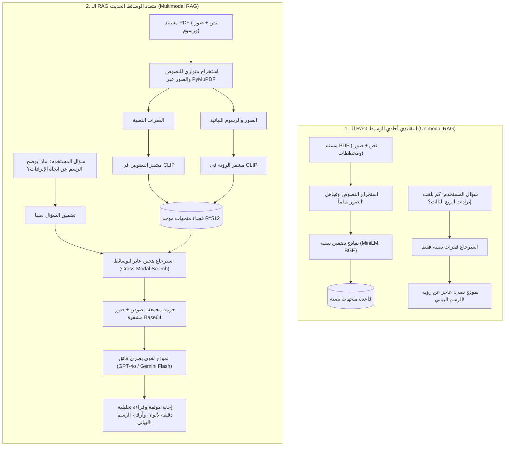
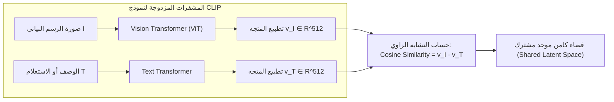
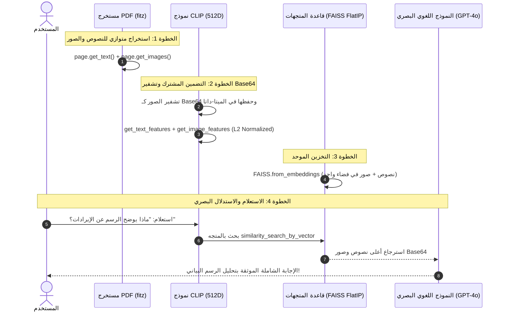

# الدليل الشامل للـ RAG متعدد الوسائط لملفات الـ PDF (Multimodal RAG Master Guide)
### Foundations, CLIP Architecture, PyMuPDF Ingestion, and Vision LLM Synthesis (Lectures 53 - 54)

---

## 1. الفجوة المعمارية: لماذا نحتاج الـ Multimodal RAG؟

في بيئات الأعمال والشركات الكبرى، نادراً ما تأتي المستندات والتقارير كنصوص صافية مجردة. فالتقارير المالية للشركات، والأوراق البحثية، والمخططات الهندسية، وكتالوجات المنتجات تحتوي على معلومات حيوية مشفرة بصرياً في شكل: **رسوم بيانية للإيرادات والأرباح (`Financial Revenue Charts`)**، **مخططات معمارية للأنظمة (`Architectural Schematics`)**، و**جداول مصورة وتدفقات عمل**.

إذا اعتمدنا على أنظمة الـ RAG التقليدية الأحادية الوسيط (`Unimodal Text-Only RAG`)، فإننا نتجاهل أكثر من **40% إلى 60% من القيمة المعرفية** لتلك الوثائق. من هنا نشأت الحاجة المعمارية لـ **الـ RAG متعدد الوسائط (`Multimodal RAG: Text + Images`)**.



---

## 2. النماذج اللغوية البصرية (`Multimodal LLMs / Vision-Language Models`)

النماذج اللغوية التقليدية (مثل `GPT-3.5` أو `LLaMA-2`) تم تدريبها حصرياً على التنبؤ بالرمز اللغوي التالي (`Next-Token Prediction`) من مدخلات نصية.

أما **النماذج اللغوية البصرية (`VLMs`)** مثل `GPT-4o`، و `GPT-4.1`، و `Gemini 1.5/2.5 Flash`:
* تم تدريب أوزانها بشكل مشترك (`Jointly Trained`) على فهم كتل البكسل (`Image Patches / Vision Tokens`) جنباً إلى جنب مع الرموز اللغوية (`Text Tokens`).
* عند تمرير صورة مخطط إيرادات مرمزة بصيغة `Base64` مع برومبت نصي: *"حلل اتجاه الأرباح في الربع الأخير"*:
  1. يقوم محول الرؤية الداخلي للنموذج بتفكيك الصورة إلى مصفوفة رموز دلالية (`Vision Embeddings`).
  2. يتم حقن هذه الرموز مباشرة في آلية الانتباه (`Self-Attention Mechanism`) للنموذج اللغوي.
  3. يقرأ النموذج الأرقام والمحاور والاتجاهات من داخل الصورة كما لو كانت فقرة نصية مكتوبة.

---

## 3. فضاء التضمين الموحد ومعمارية نموذج CLIP

المعضلة الهندسية الكبرى في الـ RAG متعدد الوسائط هي: **كيف نبحث عن رسم بياني (صورة) باستخدام استعلام مكتوب بالكلمات (نص)؟**  
الحل المعماري يكمن في نموذج **`CLIP (Contrastive Language-Image Pre-training)`** المطور من OpenAI.

### أ. الهيكل الداخلي لنموذج CLIP:
يتكون النموذج من مشفرين متوازيين يعملان بتناغم تام:
1. **مشفر الرؤية (`Vision Encoder - ViT`)**: يستقبل الصورة $I$ ويحولها إلى متجه $\mathbf{v}_I \in \mathbb{R}^d$ باستخدام محول الرؤية (`Vision Transformer`).
2. **مشفر النصوص (`Text Encoder`)**: يستقبل الوصف النصي $T$ ويحوله إلى متجه $\mathbf{v}_T \in \mathbb{R}^d$ باستخدام محول النصوص (`Transformer`).



### ب. الرياضيات الحاكمة للتدريب التقابلي (`Contrastive InfoNCE Loss`)
تم تدريب نموذج `CLIP` على أكثر من **400 مليون زوج (صورة، نص)**.  
في كل دفعة تدريبية (`Batch`) مكونة من $N$ أزواج $\{(I_1, T_1), \dots, (I_N, T_N)\}$:
* يحسب التشابه الزاوي بين جميع الصور والنصوص:
  $$s(I_i, T_j) = \frac{\mathbf{v}_{I_i} \cdot \mathbf{v}_{T_j}}{\|\mathbf{v}_{I_i}\|_2 \|\mathbf{v}_{T_j}\|_2}$$
* تحسب دالة الخسارة المشتركة عبر معادلة `Symmetric Cross-Entropy Loss` مع معامل حرارة قابل للتعلم $\tau$:
  $$\mathcal{L} = \frac{1}{2} \left( \mathcal{L}_{I \to T} + \mathcal{L}_{T \to I} \right)$$
  حيث:
  $$\mathcal{L}_{I \to T} = - \frac{1}{N} \sum_{i=1}^N \log \frac{\exp(s(I_i, T_i) / \tau)}{\sum_{j=1}^N \exp(s(I_i, T_j) / \tau)}$$

> **الأثر المعماري**: أصبحت الصورة والنص الخاص بها يقعان في **نفس النقطة الدلالية تقريباً** داخل فضاء المتجهات $\mathbb{R}^{512}$، مما يسمح بحساب المسافة الإقليدية أو الجيبية مباشرة بين استعلام نصي وصورة!

---

## 4. خطوات خط المعالجة البرمجي الكامل (End-to-End Implementation)



### أ. استخراج البيانات المزدوجة عبر `PyMuPDF (fitz)`
```python
import fitz
import io, base64
from PIL import Image

doc = fitz.open("data/pdf/multimodal_sample.pdf")
all_docs = []

for page_idx, page in enumerate(doc):
    # 1. استخراج النصوص
    text = page.get_text().strip()
    
    # 2. استخراج الصور المدمجة
    for img_idx, img_info in enumerate(page.get_images(full=True)):
        xref = img_info[0]
        base_img = doc.extract_image(xref)
        pil_img = Image.open(io.BytesIO(base_img["image"]))
        b64_str = base64.b64encode(base_img["image"]).decode('utf-8')
```

### ب. صياغة رسائل النماذج البصرية (`Multimodal Message Formatting`)
```python
from langchain_core.messages import HumanMessage

def create_multimodal_message(query: str, retrieved_docs: list) -> HumanMessage:
    content_blocks = [
        {"type": "text", "text": f"أجب بناءً على النصوص والرسوم المرفقة:\nالسؤال: {query}\n\nالسياق:\n"}
    ]
    for doc in retrieved_docs:
        if doc.metadata.get("type") == "text":
            content_blocks.append({"type": "text", "text": f"[نص]: {doc.page_content}\n"})
        elif doc.metadata.get("type") == "image":
            content_blocks.append({"type": "text", "text": f"[رسم بياني]: {doc.page_content}\n"})
            content_blocks.append({
                "type": "image_url",
                "image_url": {
                    "url": f"data:image/png;base64,{doc.metadata['image_b64']}",
                    "detail": "high"
                }
            })
    return HumanMessage(content=content_blocks)
```

---

## 5. مصفوفة المفاضلة الهندسية في تخزين ومعالجة الصور

| الاستراتيجية | آلية العمل | المزايا | العيوب والتكلفة | متى نختارها؟ |
| :--- | :--- | :--- | :--- | :--- |
| **التخزين المشفر بـ Base64 في الميتا-داتا** | حفظ كود الصورة مباشرة داخل كائن المستند في قاعدة المتجهات | البساطة التامة، وعدم الحاجة لأي خوادم تخزين إضافية | تضخم حجم قاعدة المتجهات بنسبة $\approx 33\%$ | البيئات المعملية والتطبيقات المتوسطة |
| **مخزن الكائنات السحابي (`S3 / GCS`)** | حفظ الصورة في السحابة وتخزين الرابط الموقع (`Signed URL`) | خفة وزن قاعدة المتجهات وسرعة هائلة في البحث | إدارة الصلاحيات وتأخير تنزيل الصورة | **الأنظمة المؤسسية الضخمة** |
| **الوصف المسبق للصورة (`Image Captioning`)** | تمرير الصورة لنموذج رؤية مسبقاً وتخزين النص التلخيصي فقط | إمكانية استخدام فهارس ونماذج تضمين نصية تقليدية | فقدان التفاصيل البصرية الحسابية الدقيقة وتكلفة مسبقة | الوثائق الأرشيفية البسيطة |

---

## 6. أسئلة المقابلات الهندسية المتقدمة (Senior AI Interview Questions)

### س1: لماذا يعد استخدام نموذج CLIP مفضلاً على استخدام نموذجين منفصلين (واحد للنص وواحد للصورة)؟
**الإجابة:** 
لأن النماذج المنفصلة تنتج متجهات في فضاءات رياضية متباينة تماماً بأبعاد وأوزان إحصائية لا تفهم بعضها البعض.  
إذا قمت بتضمين جملة *"مخطط نمو الأرباح"* بنموذج نصوص، وتضمين صورة المخطط بنموذج رؤية مستقل مثل ResNet، فإن حاصل الضرب القياسي أو المسافة الزاوية بينهما ستكون **عشوائية تماماً وبلا أي معنى دلالي**.  
الشرط الرياضي الحتمي للبحث العابر للوسائط (`Cross-Modal Retrieval`) هو استخدام نموذج ثنائي المشفر مدرب بتقنية التدريب التقابلي المشترك مثل **`CLIP`** لضمان تطابق فضاء الإسقاط $\mathbb{R}^d$.

### س2: كيف تحسب تكلفة الرموز (`Token Consumption`) عند إرسال صور عالية الدقة إلى النماذج البصرية مثل GPT-4o؟
**الإجابة:**
النماذج البصرية تقسم الصورة إلى بلاطات متساوية (`Tiles: 512x512 pixels`):
* **الوضع منخفض الدقة (`Low Detail`)**: تحتسب الصورة بتكلفة ثابتة تبلغ **85 توكن** تقريباً.
* **الوضع عالي الدقة (`High Detail`)**: يتم تحجيم الصورة لتتسع داخل نافذة $2048 \times 2048$، ثم تقسم إلى شبكة مربعات (كل مربع $512 \times 512$ يكلف **170 توكن**)، بالإضافة إلى 85 توكن أساسية.  
*الصورة الواضحة قد تستهلك بين $700$ إلى $1400$ توكن*، مما يفرض ضغط وتحجيم الصور المقتطعة مسبقاً قبل إرسالها لترشيد التكاليف وسرعة الاستدلال.
