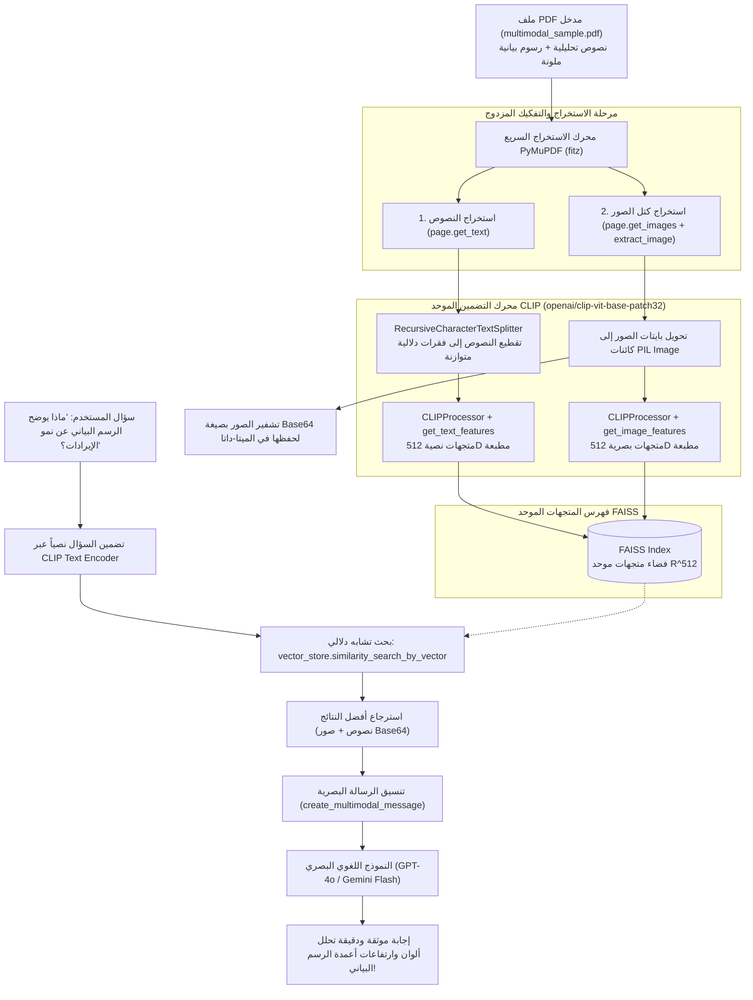

# 02 - التطبيق العملي للـ RAG متعدد الوسائط لملفات الـ PDF (Multimodal PDF RAG Implementation)

في هذا الدليل الهندسي، ننتقل من الإطار المعماري النظري للـ Multimodal RAG إلى **التنفيذ البرمجي الإنتاجي الكامل خطوة بخطوة**.  
نتناول كيفية معالجة ملفات الـ `PDF` الغنية التي تجمع بين النصوص التقريرية والرسوم البيانية التوضيحية (`Charts & Figures`)، واستخراج كل وسيط منهما بدقة فائقة عبر محرك `PyMuPDF (fitz)`، ثم تضمينهما في فضاء متجهات موحد باستخدام نموذج `CLIP (Contrastive Language-Image Pre-training)` من OpenAI، وفهرستهما في قاعدة بيانات `FAISS`، وبناء رسالة استدلال بصرية مدعومة بـ `Base64` لتغذية النماذج اللغوية البصرية (`Vision-Language Models - VLMs`) مثل `GPT-4o` و `Gemini 2.5 Flash`.

---

## 1. المعمارية الهندسية الشاملة لخط المعالجة (End-to-End Pipeline)



---

## 2. تفكيك خطوات التنفيذ البرمجي خطوة بخطوة

### الخطوة الأولى: استخراج النصوص والصور عبر `PyMuPDF (fitz)`
لماذا نفضل `PyMuPDF` على مكتبات أخرى مثل `PyPDF` أو `pdfplumber`؟
* **السرعة**: أسرع بـ 15 إلى 25 ضعفاً بفضل نواة C++ المدمجة (`MuPDF`).
* **استخراج الصور الخام**: تتيح دالة `page.get_images(full=True)` جلب مراجع الكائنات الصورية (`XREFs`)، ثم استخراج مصفوفة البايتات النقية وامتداد الصورة الأصلي (`PNG / JPEG`) دون أي تشويه للألوان:

```python
import fitz # PyMuPDF
from PIL import Image
import io

doc = fitz.open("data/pdf/multimodal_sample.pdf")
for page_idx, page in enumerate(doc):
    # 1. استخراج النصوص
    text = page.get_text()
    
    # 2. استخراج الصور المدمجة
    for img_idx, img_info in enumerate(page.get_images()):
        xref = img_info[0]
        base_image = doc.extract_image(xref)
        image_bytes = base_image["image"]
        image_ext = base_image["ext"]
        pil_image = Image.open(io.BytesIO(image_bytes))
```

---

### الخطوة الثانية: محرك التضمين الموحد عبر `CLIP` (Unified Embeddings)
نموذج `openai/clip-vit-base-patch32` يحتوي على شبكتين عصبيتين متزامنتين تُسقطان النصوص والصور في فضاء موحد بأبعاد $d = 512$:
* **مشفر النصوص (`Text Encoder`)**: يعالج ما يصل إلى 77 رمزاً لغوياً.
* **مشفر الرؤية (`Vision Encoder`)**: يقسم الصورة إلى بلاطات $32 \times 32$ بكسل ويمررها عبر محول الرؤية (`Vision Transformer - ViT`).

#### دالة تضمين الصور:
```python
import torch

def embed_image(image, clip_model, clip_processor):
    inputs = clip_processor(images=image, return_tensors="pt")
    with torch.no_grad():
        image_features = clip_model.get_image_features(**inputs)
        # تطبيع المتجه معيارياً (L2 Normalization)
        image_features = image_features / image_features.norm(p=2, dim=-1, keepdim=True)
    return image_features.cpu().numpy().flatten().astype("float32")
```

#### دالة تضمين النصوص:
```python
def embed_text(text, clip_model, clip_processor):
    inputs = clip_processor(text=text, return_tensors="pt", padding=True, truncation=True, max_length=77)
    with torch.no_grad():
        text_features = clip_model.get_text_features(**inputs)
        # تطبيع المتجه معيارياً
        text_features = text_features / text_features.norm(p=2, dim=-1, keepdim=True)
    return text_features.cpu().numpy().flatten().astype("float32")
```

---

### الخطوة الثالثة: تشفير الصور بصيغة `Base64` وهندسة الميتا-داتا
لكي تتمكن النماذج البصرية (`GPT-4o / Gemini`) من قراءة الصور المسترجعة عبر الـ API، يجب تحويل بايتات الصورة إلى سلسلة نصية مرمزة بـ `Base64`:
$$\text{Base64 String} = \text{base64.b64encode}(\text{image\_bytes}).\text{decode}('utf\text{-}8')$$

يتم حفظ هذا الكود داخل `metadata["image_b64"]` لكل كائن مستند من نوع صورة:
```python
from langchain_core.documents import Document

image_doc = Document(
    page_content="صورة رسم بياني يوضح إيرادات الفصول Q1 و Q2 و Q3",
    metadata={
        "type": "image",
        "source": "multimodal_sample.pdf",
        "page": 0,
        "image_id": "img_p0_0",
        "image_b64": base64_image_string
    }
)
```

---

### الخطوة الرابعة: الفهرسة والاسترجاع في `FAISS`
يتم تخزين متجهات النصوص ومتجهات الصور جنباً إلى جنب داخل نفس الفهرس:
```python
from langchain_community.vectorstores import FAISS

# بناء الفهرس مباشرة من قائمة الأزواج (النص، المتجه)
text_embeddings_pairs = [(doc.page_content, emb) for doc, emb in zip(all_docs, all_embeddings)]
vector_store = FAISS.from_embeddings(text_embeddings_pairs, embedding=None)

# الاستعلام باستخدام المتجه الناتج عن استعلام المستخدم
query_vec = embed_text("ما هو نمو الإيرادات في الربع الثالث؟", clip_model, clip_processor)
retrieved_docs = vector_store.similarity_search_by_vector(query_vec, k=3)
```

---

### الخطوة الخامسة: تنسيق رسالة الاستدلال البصري (`Multimodal Message Formatter`)
النماذج البصرية تتطلب هيكلاً برمجياً محدداً يتضمن كتل النصوص وكتل عناوين الصور (`image_url` بتنسيق Data URI):

```python
from langchain_core.messages import HumanMessage

def create_multimodal_message(query: str, retrieved_docs: list) -> HumanMessage:
    content_blocks = [
        {"type": "text", "text": f"أجب عن السؤال بناءً على المستندات والرسوم المرفقة:\nالسؤال: {query}\n\nالسياق:\n"}
    ]
    
    for doc in retrieved_docs:
        if doc.metadata.get("type") == "text":
            content_blocks.append({"type": "text", "text": f"[فقرة نصية]: {doc.page_content}\n"})
        elif doc.metadata.get("type") == "image":
            content_blocks.append({"type": "text", "text": f"[رسم بياني مرئي]: {doc.page_content}\n"})
            content_blocks.append({
                "type": "image_url",
                "image_url": {
                    "url": f"data:image/png;base64,{doc.metadata['image_b64']}",
                    "detail": "high"
                }
            })
            
    return HumanMessage(content=content_blocks)
```

---

## 3. مصفوفة المفاضلة الهندسية في خطوط الـ Multimodal RAG

| المعيار | استخراج الصور مع النصوص وتضمينها بـ CLIP (نهج الدرس) | استخراج النصوص فقط وتجاهل الصور | توليد شروحات نصية بالذكاء الاصطناعي مسبقاً (Image Captioning) |
| :--- | :--- | :--- | :--- |
| **اكتمال المعرفة المسترجعة** | **شامل وكامل 100% (يرى الأرقام والألوان والمخططات)** | ناقص جداً (فقدان 50% من محتوى التقارير المالية) | جيد، لكنه يفقد التفاصيل الدقيقة للأرقام الصغيرة |
| **تعقيد البنية التحتية** | متوسط (يتطلب CLIP + FAISS) | بسيط جداً (RAG تقليدي) | معقد ويتطلب تشغيل VLM في مرحلة الـ Ingestion |
| **تكلفة استهلاك الرموز (Tokens)** | أعلى قليلاً (إرسال صور Base64 يستهلك $\approx 700$ توكن لكل صورة) | منخفضة جداً (نصوص فقط) | منخفضة أثناء الاستعلام لكنها باهظة أثناء الفهرسة |
| **زمن استجابة البحث (Latency)** | سريع جداً ($20\text{ms} - 50\text{ms}$ في FAISS) | فائق السرعة | سريع |

---

## 4. أسئلة المقابلات الهندسية (Senior AI Interview Questions)

### س1: ما الفارق في الأداء والكفاءة بين تمرير الصورة بصيغة `Base64` وتمريرها كرابط سحابي `Public / Signed URL` إلى النماذج البصرية؟
**الإجابة:** 
* **`Base64 Payload`**:
  * *المزايا*: البيانات تنتقل مدمجة في نفس طلب الـ HTTP مباشرة دون أي اعتماد على خوادم خارجية، وهي مثالية للشبكات الداخلية المنعزلة وتضمن عدم فشل الطلب بسبب مشاكل صلاحيات التنزيل.
  * *العيوب*: تشفير Base64 يزيد حجم البيانات المنقولة بنسبة **33%** مقارنة بالبايتات الثنائية الأصلية.
* **`Signed URL (Amazon S3 / Google Cloud Storage)`**:
  * *المزايا*: حجم الحمولة النصية خفيف جداً، ويتيح لمزود النموذج تنزيل الصورة وتخزينها مؤقتاً في الكاش (`Server-Side Image Caching`).
  * *العيوب*: تتطلب إعداد روابط موقعة مؤقتة ومخزن كائنات سحابي، ولا تعمل إذا كان خادم التطبيق خلف شبكة خاصة (Intranet) تمنع الوصول العام.

### س2: كيف تتصرف إذا كان استعلام المستخدم يعتمد على استخراج أرقام دقيقة جداً من جداول مصورة داخل الـ PDF عجز نموذج CLIP عن فهم تفاصيلها الدقيقة؟
**الإجابة:**
نموذج CLIP ممتاز في التمييز الدلالي العام (معرفة أن هذه الصورة تمثل "رسم بياني لإيرادات")، ولكنه ضعيف في التعرف البصري الدقيق على الأرقام الحسابية الصغيرة داخل الجداول (`Fine-Grained OCR`).  
الحل الهندسي المعتمد في الإنتاج:
1. **استخدام نماذج استخراج بصري تخصصية (`ColPali / Table Transformer`)**: نماذج متعددة الوسائط مبنية على PaliGemma تقوم بإنشاء تمثيلات متعددة لكل مربع في الصفحة (`Late-Interaction Multi-Vector Search`).
2. **النهج الهجين (`Dual-Indexed OCR & Vision`)**: تشغيل محرك استخراج نصوص ضوئي (`OCR via PaddleOCR / Tesseract`) لاستخراج أرقام الجدول كنص مهيكل وتخزينه في الميتا-داتا، جنباً إلى جنب مع صورة الجدول الأصلية، مما يوفر للـ LLM القراءة المزدوجة الدقيقة.
