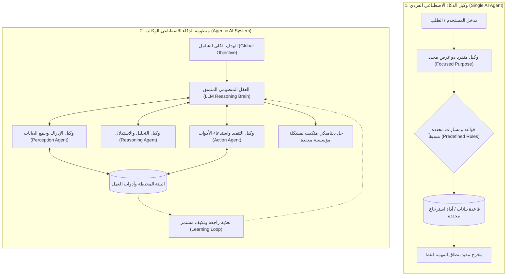
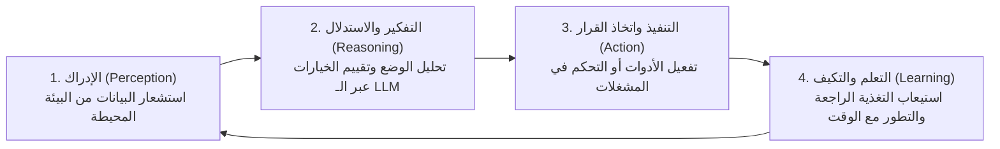
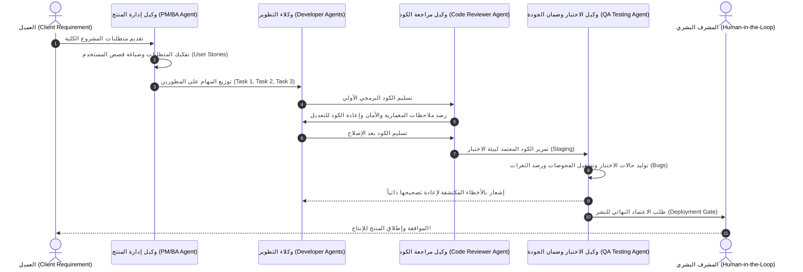

# الدليل المعماري الشامل: أسس وكلاء الذكاء الاصطناعي والمنظومات الوكالية (AI Agents vs Agentic AI Master Guide)
### Foundations, Cognitive Pillars, Agile SDLC Multi-Agent Workflows, and Human-in-the-Loop (Lectures 55 - 56)

---

## 1. الدافع المعماري: الانتقال من الكيان المنعزل إلى المنظومات الذكية

في المراحل الأولى من تطور تطبيقات النماذج اللغوية الكبيرة (`LLM Applications`)، ركزت معظم الأنظمة على نمط "السؤال والجواب" الخطي (`Linear Prompt-Response`) أو الاسترجاع المعزز البسيط (`Naive RAG`). ومع تعقد متطلبات الأعمال في شركات التكنولوجيا والـ IT، برز مصطلحان جوهريان يخلط بينهما الكثير من المطورين:

1. **وكيل الذكاء الاصطناعي الفردي (`AI Agent`)**: برنامج برمجي مستقل صُمم لتنفيذ مهمة محددة ذات هدف ضيق بدرجة استقلالية مقيدة بقواعد مسبقة البرمجة (`Bounded Autonomy with Predefined Rules`).
2. **الذكاء الاصطناعي الوكالي / المنظومي (`Agentic AI`)**: إطار عمل منظومي شامل تتعاون فيه شبكة من الوكلاء المتعددين (`Multi-Agent Network`) وتتخذ قرارات تكيفية مستقلة لحل تدفقات عمل معقدة ديناميكياً استناداً إلى التعلم والتغذية الراجعة اللحظية من البيئة بدلاً من القواعد الصارمة.

---

## 2. التأصيل الرياضي: من الـ POMDP الفردي إلى الـ Dec-POMDP التشاركي

لفهم الفارق الهندسي الدقيق بين الكيان الفردي والمنظومة الوكالية، نلجأ إلى نظرية القرارات الماركوفية:

### أ. نمذجة وكيل الذكاء الاصطناعي الفردي (`Single-Agent POMDP`)
يُنمذج الوكيل الفردي كعملية اتخاذ قرار ماركوفية مراقبة جزئياً عبر السباعية:
$$\mathcal{M}_{\text{single}} = \langle \mathcal{S}, \mathcal{A}, \mathcal{T}, \mathcal{R}, \Omega, \mathcal{O}, \gamma \rangle$$
حيث:
* $\mathcal{S}$: فضاء حالات البيئة.
* $\mathcal{A}_{\text{rules}} \subset \mathcal{A}$: فضاء الإجراءات المتاحة المقيد بضوابط وقواعد مسبقة (`Predefined Rules`).
* سياسة الوكيل $\pi(a \mid o)$ تتبع مساراً وظيفياً مباشراً لتعظيم العائد الخاص بمهمته الضيقة فقط:
$$\pi^*(a \mid o) = \arg\max_{a \in \mathcal{A}_{\text{rules}}} \mathbb{E} \left[ \sum_{t=0}^\infty \gamma^t \mathcal{R}(s_t, a_t) \right]$$

### ب. نمذجة المنظومة الوكالية (`Decentralized POMDP / Multi-Agent System`)
في منظومات `Agentic AI`، تتسع النمذجة لتصبح عملية تشاركية لا مركزية لشبكة مكونة من $N$ وكلاء:
$$\mathcal{M}_{\text{agentic}} = \langle \mathcal{S}, \{\mathcal{A}^{(i)}\}_{i=1}^N, \mathcal{T}, \mathcal{R}_{\text{global}}, \{\Omega^{(i)}\}_{i=1}^N, \{\mathcal{O}^{(i)}\}_{i=1}^N, \gamma \rangle$$
* الإجراء المنظومي المشترك في كل لحظة زمنية هو متجه الإجراءات الموزعة:
$$\mathbf{a}_t = \left( a_t^{(1)}, a_t^{(2)}, \dots, a_t^{(N)} \right)$$
* الهدف الرياضي المشترك هو تعظيم دالة الفائدة الكلية للنظام (`Global Utility Optimization`):
$$J(\boldsymbol{\pi}) = \mathbb{E}_{\boldsymbol{\pi}} \left[ \sum_{t=0}^\infty \gamma^t \mathcal{R}_{\text{global}}(s_t, \mathbf{a}_t) \right]$$

---

## 3. الأركان الإدراكية الأربعة لمنظومات الـ Agentic AI

تعتمد الأنظمة الوكالية التكيفية على دورة إدراكية رباعية المراحل (`The 4 Cognitive Pillars Cycle`):

1. **الإدراك (`Perception`)**: جمع البيانات الحية والملاحظات $\mathbf{o}_t \in \Omega$ من البيئة المحيطة، المستندات، أو مخرجات الوكلاء الآخرين.
2. **الاستدلال والتفكير (`Reasoning`)**: عمل النموذج اللغوي الكبير (`LLM`) كـ **عقل المنظومة (`Brain of the Agent`)** لتحليل الموقف، وتقييم البدائل وتوليد سلاسل التفكير (`Chain-of-Thought`).
3. **التنفيذ (`Action`)**: ترجمة القرار إلى استدعاء أدوات خارجية (`Tool Calls`)، أو كتابة كود، أو تشغيل اختبارات.
4. **التعلم والتكيف المستمر (`Learning & Adaptation`)**: استيعاب نتائج التنفيذ عبر التقييم الذاتي والتغذية الراجعة (`Self-Reflection & Reinforcement`) لتحديث السياسة مستقبلاً.

---

## 4. دراسة حالة مؤسسية: أتمتة دورة حياة تطوير البرمجيات الرشيقة (Agile SDLC Multi-Agent Workflow)

في شركات التكنولوجيا والـ IT، تتبع المشاريع منهجية `Agile / Scrum`؛ حيث يُقسّم العمل إلى سباقات (`Sprints`) تتضمن: جمع المتطلبات، كتابة كود، مراجعة الكود، واختبار الجودة.  
في بيئة `Agentic AI`، تتحول هذه الأدوار البشرية إلى **شبكة وكلاء ذكية متزامنة**:

### تفكيك أدوار الوكلاء في المنظومة:
1. **وكيل تحليل الأعمال وإدارة المنتج (`PM / Business Analyst Agent`)**: يستقبل متطلبات العميل، ويصيغها في شكل قصص مستخدم (`User Stories`) محددة بمعايير قبول (`Acceptance Criteria`).
2. **وكلاء التطوير البرمجي (`Developer Agents: Dev 1, Dev 2`)**: يستخدمون نماذج متخصصة في الكود (مثل Claude 3.5 Sonnet، GPT-4o، DeepSeek-Coder) لتوليد الحل البرمجي.
3. **وكيل مراجعة الكود (`Code Reviewer Agent`)**: يقوم بمراجعة الكود بالتوازي، ويفحص الامتثال للمعايير، والتعقيد الحسابي، والثغرات الأمنية (`Security Audits`).
4. **وكيل فحص الجودة (`QA Testing Agent`)**: يبني حالات الاختبار الأوتوماتيكية (`Unit & Integration Tests`)، ويرصد الأخطاء (`Bugs`) ويعيدها للمطورين لإصلاحها ذاتياً في حلقة تكرارية (`Feedback Loop`).

---

## 5. الحتمية المعمارية للتدخل البشري: Human-in-the-Loop (HITL)

أحد أهم المفاهيم التي شددت عليها المحاضرة 56 هو: **هل تستبدل منظومات الـ Agentic AI البشر بالكامل؟**  
**الإجابة القاطعة: لا!**

في بيئات الأعمال الحقيقية والأنظمة الحساسة (المالية، الطبية، ونشر الكود الإنتاجي)، يُشترط معمارياً وجود **المشرف البشري في الحلقة (`Human-in-the-Loop - HITL`)**.

### الصياغة الرياضية لبوابة التدخل البشري (`Confidence-Gated Escalation`):
يُعرّف النظام دالة ثقة $\mathcal{C}(a_t) \in [0, 1]$ أو مقياس خطورة للقرار المنفذ $\mathcal{R}_{\text{risk}}(a_t) \in [0, 1]$ مع عتبة أمان محددة $\tau_{\text{HITL}}$:

$$a_t^* = \begin{cases} 
a_t^{\text{agent}}, & \text{if } \mathcal{C}(a_t^{\text{agent}}) \ge \tau_{\text{HITL}} \text{ and } \mathcal{R}_{\text{risk}}(a_t) < \theta_{\text{risk}} \\
a_t^{\text{human}}, & \text{otherwise (تصعيد القرار للمشرف البشري للمراجعة والاعتماد)}
\end{cases}$$

> **التطبيق العملي في LangGraph**: يتم بناء هذه البوابة باستخدام الـ **`Interrupts`**؛ حيث يتوقف تدفق الـ `StateGraph` تلقائياً عند عقد معينة (مثل عقدة `DeployToProduction`)، وينتظر موافقة أو تعديل المستخدم البشري قبل استئناف التنفيذ.

---

## 6. مثال إضافي: منظومة أتمتة صناعة المحتوى (Multi-Agent Content Creation Pipeline)

تدفق عمل آخر توضحه المحاضرة:
* **وكيل العناوين (`Title Agent`)**: يقترح عناوين جذابة بناءً على الـ SEO.
* **وكيل كتابة المقال (`Content Writer Agent`)**: يصيغ المقال وفق الأقسام المحددة.
* **وكيل الصور (`Image Thumbnail Agent`)**: يستدعي نماذج توليد الصور لإنشاء الغلاف المناسب.
* **وكيل التدقيق اللغوي (`Editor Agent`)**: يراجع المقال ويضمن خلوه من الأخطاء قبل العرض على المشرف البشري.

---

## 7. مصفوفة المفاضلة الهندسية الشاملة (Engineering Trade-offs)

| المعيار الهندسي | وكيل الذكاء الاصطناعي الفردي (`AI Agent`) | منظومة الذكاء الاصطناعي الوكالية (`Agentic AI SDLC`) |
| :--- | :--- | :--- |
| **النطاق والتعقيد** | مهمة فردية محددة (مثل: استعلام رصيد أو بحث في جدول). | دورة عمل كاملة متعددة الأدوار (تخطيط + كتابة + مراجعة + اختبار). |
| **آلية اتخاذ القرار** | قواعد ومسارات مشروطة محددة سلفاً (`Deterministic Script`). | قرارات ذاتية متكيفة وتواصل تفاعلي بين الوكلاء (`Agent-to-Agent Coordination`). |
| **الموثوقية والرقابة** | تعتمد كلياً على دقة القاعدة البرمجية. | معززة بالتقييم الذاتي المتبادل وبوابات التدخل البشري (`HITL`). |
| **حلقات التغذية الراجعة** | معدومة تقريباً (مسار ذو اتجاه واحد). | حلقات دائرية تصحيحية (`Circular Feedback Loops: QA -> Dev -> Reviewer`). |
| **التكلفة والزمن الحسابي** | زمن استجابة سريع جداً وتكلفة توكنز منخفضة. | استهلاك أعلى للتوكنز وزمن أطول بسبب تعدد جولات التفكير والمراجعة. |

---

## 8. أسئلة المقابلات المتقدمة للـ Senior AI Engineers

### س1: ما الفارق المعماري بين وكلاء التفاعل الخطي (Linear Multi-Agents) ووكلاء التفاعل الدائري مع التدخل البشري (Cyclic HITL Agents)؟
**الإجابة:**
الوكلاء الخطيون (مثل سلاسل `SequentialChains` القديمة) يمررون المخرج من وكيل إلى وكيل في اتجاه واحد دون إمكانية العودة؛ فإذا أخطأ الوكيل الأول تتضاعف الأخطاء حتى النهاية.  
بينما في **Cyclic HITL Agents** (المطبقة في إطار `LangGraph`):
1. يمتلك الرسم البياني حوافاً دائرية شرطية (`Conditional Cyclic Edges`) تسمح لـ `QA Agent` بإعادة الكود إلى `Developer Agent` عدة مرات حتى تجتاز الفحوصات.
2. يدعم النظام توقيف الحالة وحفظها مؤقتاً (`State Persistence / Checkpointing`) عند بوابات الـ HITL لتنتظر تدخلاً أو توجيهاً بشرياً قبل الانتقال للمرحلة التالية.

### س2: كيف تتجنب ظاهرة "الحلقات اللانهائية" (Infinite Loops) في شبكات الوكلاء متعددة المراجعات؟
**الإجابة:**
نطبق 3 آليات حوكمة دفاعية:
1. **عتبة التكرار القصوى (`Recursion Limit / Max Iterations`)**: تحديد سقف أقصى لجولات المراجعة بين المطور والفاحص (مثلاً 3 إلى 5 محاولات).
2. **عتبة تقارب الجودة (`Convergence Check`)**: إذا لم يطرأ تحسن على نتيجة الاختبار بين جولتين متتاليتين، يتم كسر الحلقة وتصعيد الأمر للبشري (`Human Escalation`).
3. **التراجع التكيفي (`Fallback Gracefully`)**: إرجاع أفضل نسخة تم الوصول إليها مع توثيق الأخطاء غير المحلولة.

