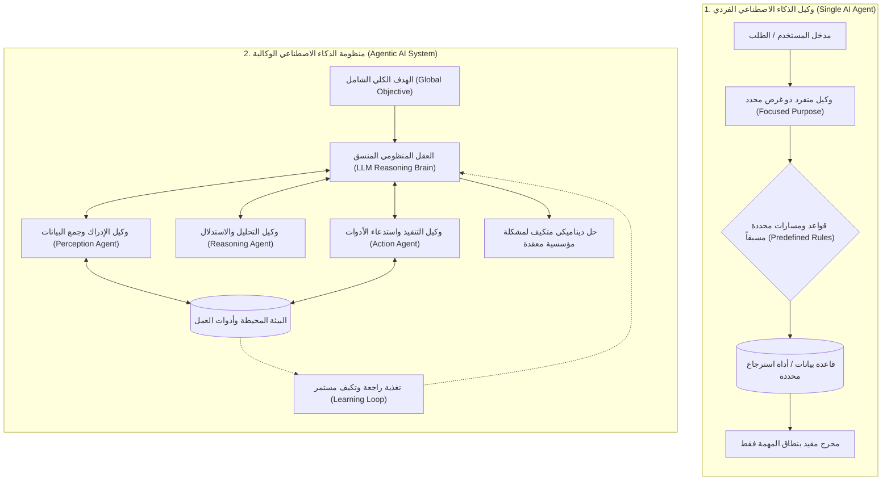
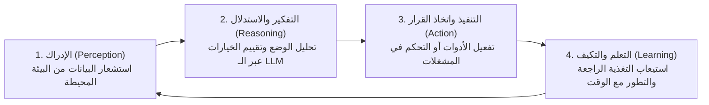

# الدليل المعماري الشامل: وكلاء الذكاء الاصطناعي ضد الأنظمة الوكالية (AI Agents vs Agentic AI)
### Foundations, Cognitive Pillars, Multi-Agent Collaboration, and Mathematical Modeling (Lecture 55)

---

## 1. الدافع المعماري: الانتقال من الكيان المنعزل إلى المنظومات الذكية

في المراحل الأولى من تطور تطبيقات النماذج اللغوية الكبيرة (`LLM Applications`)، ركزت معظم الأنظمة على نمط "السؤال والجواب" الخطي (`Linear Prompt-Response`) أو الاسترجاع المعزز البسيط (`Naive RAG`). ومع تعقد متطلبات الأعمال، برز مصطلحان جوهريان يخلط بينهما الكثير من المطورين:
1. **وكيل الذكاء الاصطناعي الفردي (`AI Agent`)**: برنامج برمجي مستقل صُمم لتنفيذ مهمة محددة ذات هدف ضيق بدرجة استقلالية مقيدة بقواعد مسبقة البرمجة.
2. **الذكاء الاصطناعي الوكالي / المنظومي (`Agentic AI`)**: إطار عمل منظومي شامل تتعاون فيه شبكة من الوكلاء المتعددين (`Multi-Agent Network`) وتتخذ قرارات تكيفية مستقلة لحل تدفقات عمل معقدة ديناميكياً استناداً إلى التعلم والتغذية الراجعة اللحظية من البيئة بدلاً من القواعد الصارمة.

---

## 2. التأصيل الرياضي: من الـ POMDP الفردي إلى الـ Dec-POMDP التشاركي

لفهم الفارق الهندسي الدقيق بين الكيان الفردي والمنظومة الوكالية، نلجأ إلى نظرية القرارات الماركوفية:

### أ. نمذجة وكيل الذكاء الاصطناعي الفردي (`Single-Agent POMDP`)
يُنمذج الوكيل الفردي كعملية اتخاذ قرار ماركوفية مراقبة جزئياً عبر السباعية:
$$\mathcal{M}_{\text{single}} = \langle \mathcal{S}, \mathcal{A}, \mathcal{T}, \mathcal{R}, \Omega, \mathcal{O}, \gamma \rangle$$
حيث:
* $\mathcal{S}$: فضاء حالات البيئة.
* $\mathcal{A}_{\text{rules}} \subset \mathcal{A}$: فضاء الإجراءات المتاحة المقيد بضوابط وقواعد مسبقة (`Predefined Rules`).
* سياسة الوكيل $\pi(a \mid o)$ تتبع مساراً وظيفياً مباشراً لتعظيم العائد الخاص بمهمته الضيقة فقط:
$$\pi^*(a \mid o) = \arg\max_{a \in \mathcal{A}_{\text{rules}}} \mathbb{E} \left[ \sum_{t=0}^\infty \gamma^t \mathcal{R}(s_t, a_t) \right]$$

### ب. نمذجة المنظومة الوكالية (`Decentralized POMDP / Multi-Agent System`)
في منظومات `Agentic AI`، تتسع النمذجة لتصبح عملية تشاركية لا مركزية لشبكة مكونة من $N$ وكلاء:
$$\mathcal{M}_{\text{agentic}} = \langle \mathcal{S}, \{\mathcal{A}^{(i)}\}_{i=1}^N, \mathcal{T}, \mathcal{R}_{\text{global}}, \{\Omega^{(i)}\}_{i=1}^N, \{\mathcal{O}^{(i)}\}_{i=1}^N, \gamma \rangle$$
* الإجراء المنظومي المشترك في كل لحظة زمنية هو متجه الإجراءات الموزعة:
$$\mathbf{a}_t = \left( a_t^{(1)}, a_t^{(2)}, \dots, a_t^{(N)} \right)$$
* الهدف الرياضي المشترك هو تعظيم دالة الفائدة الكلية للنظام (`Global Utility Optimization`):
$$J(\boldsymbol{\pi}) = \mathbb{E}_{\boldsymbol{\pi}} \left[ \sum_{t=0}^\infty \gamma^t \mathcal{R}_{\text{global}}(s_t, \mathbf{a}_t) \right]$$
* **الأثر الهندسي**: لا يعمل أي وكيل بمعزل عن الآخر؛ بل يؤثر إجراء الوكيل الأول $a_t^{(1)}$ على الملاحظة التي يتلقاها الوكيل الثاني $o_{t+1}^{(2)}$، مما يتطلب بروتوكولات تواصل ومزامنة مستمرة للحالة المشتركة (`Shared State`).

---

## 3. الأركان الإدراكية الأربعة لمنظومات الـ Agentic AI

تعتمد الأنظمة الوكالية التكيفية على دورة إدراكية رباعية المراحل (`The 4 Cognitive Pillars Cycle`):

1. **الإدراك (`Perception`)**:
   * جمع البيانات الحية من البيئة المحيطة (`Gathering data from surroundings`).
   * تشمل المدخلات: استعلامات المستخدم، قراءات الحساسات أو قواعد البيانات، سجلات النظام، ومخرجات الوكلاء الآخرين.
2. **الاستدلال والتفكير (`Reasoning`)**:
   * يعمل النموذج اللغوي الكبير (`LLM`) هنا كـ **عقل المنظومة (`Brain of the Agent`)**.
   * يقوم بتفسير وتحليل ما يحدث (`Understand what is going on`)، وتوليد سلاسل التفكير (`Chain-of-Thought`) وتحديد الخطوة التالية.
3. **التنفيذ (`Action`)**:
   * ترجمة القرار الفكري إلى إجراء ملموس؛ مثل استدعاء أداة استعلام، أو تحديث سجل مالي، أو إطفاء تكييف، أو كتابة رد موثق.
4. **التعلم والتكيف المستمر (`Learning & Adaptation`)**:
   * استيعاب نتائج الإجراء؛ هل تحقق الهدف؟
   * التعلم من الخطأ عبر التقييم الذاتي (`Self-Reflection / Reinforcement`) وتعديل السلوك المستقبلي دون الحاجة لإعادة كتابة الكود البرمجي يدوياً.

---

## 4. دراسات مقارنة من واقع بيئات العمل الحقيقية

### أ. مثال وكيل الذكاء الاصطناعي الفردي (`AI Agent Example`):
* **روبوت الاستعلامات المصرفية (`Automated Banking Bot`)**:
  * **الوظيفة**: الرد على استفسارات رصيد الحساب أو البحث عن كشف حساب لعملية معينة.
  * **آلية اتخاذ القرار**: يتبع مساراً محدداً مسبقاً (`Predefined Script / Workflow`):
    $$\text{User Query} \to \text{Extract Account ID} \to \text{Query SQL DB} \to \text{Template Response}$$
  * **الاستقلالية**: مقيدة بنطاق المعاملة فقط؛ لا يمكنه اتخاذ قرار استثماري أو تعديل الخطة المالية للعميل تلقائياً.

### ب. مثال منظومة الذكاء الاصطناعي الوكالية (`Agentic AI Example`):
* **نظام إدارة الطاقة في المنازل والمنشآت الذكية (`Smart Facility Energy System`)**:
  * **الهدف الكلي**: خفض فاتورة استهلاك الكهرباء بنسبة $30\%$ مع الحفاظ على راحة السكان وسلامة الأجهزة.
  * **شبكة الوكلاء المتفاعلة**:
    * **وكيل الإضاءة (`Lighting Agent`)**: يرصد تواجد الأشخاص في الغرف.
    * **وكيل التكييف والحرارة (`Thermostat Agent`)**: يراقب درجات الحرارة الخارجية والتوقعات الجوية ويضبط التبريد.
    * **وكيل الأجهزة والمعدات (`Appliances Agent`)**: يدير أوقات تشغيل الأجهزة الثقيلة في أوقات التعرفة المنخفضة.
  * **آلية التنسيق**: يتواصل الوكلاء معاً؛ إذا غادر الشخص الغرفة، ينسق وكيل الإضاءة مع وكيل التكييف لخفض الاستهلاك فوراً دون أي تدخل بشري، مع التكيف مع فصول السنة وسلوكيات المستخدم.

---

## 5. مصفوفة المفاضلة الهندسية الشاملة (Engineering Trade-offs)

| المعيار الهندسي | وكيل الذكاء الاصطناعي الفردي (`AI Agent`) | منظومة الذكاء الاصطناعي الوكالية (`Agentic AI`) |
| :--- | :--- | :--- |
| **النطاق والتعقيد (`Scope & Complexity`)** | مهمة ضيقة ومحددة (`Single Focused Task`). | تدفقات عمل معقدة ومتعددة التخصصات (`Complex Multi-step Workflows`). |
| **آلية اتخاذ القرار (`Decision Making`)** | قواعد ومسارات مشروطة محددة سلفاً (`Predefined Rules & Schemas`). | قرارات ذاتية متكيفة تعتمد على بيانات ولحظة البيئة الحالية (`Dynamic & Adaptive`). |
| **درجة الاستقلالية (`Autonomy Level`)** | استقلالية محدودة ومقيدة بنطاق تنفيذي ضيق (`Limited Autonomy`). | استقلالية منظومية واسعة تشمل التخطيط والتقييم (`High Systemic Autonomy`). |
| **التواصل والتفاعل (`Communication`)** | تفاعل منعزل: مستخدم $\to$ وكيل $\to$ أداة $\to$ رد. | تواصل شبكي مستمر بين وكلاء متعددين (`Agent-to-Agent Protocols`). |
| **التعامل مع الفشل (`Fault Tolerance`)** | إذا فشلت القاعدة البرمجية، يفشل الوكيل بالكامل (`Single Point of Failure`). | قدرة على إعادة التوجيه والتعافي الذاتي وتوزيع المهام على وكيل بديل. |
| **التكلفة والزمن الحسابي (`Cost & Latency`)** | زمن استجابة سريع وتكلفة استهلاك توكنز منخفضة جداً. | استهلاك أعلى للتوكنز وزمن استجابة أطول بسبب جولات التفكير المتعددة. |

---

## 6. أسئلة المقابلات المتقدمة للـ Senior AI Engineers

### س1: متى يجب على المعماري الهندسي اختيار Single AI Agent ومتى يقرر الانتقال إلى Agentic AI Architecture؟
**الإجابة النموذجية:**
نختار **Single AI Agent** عندما تكون العملية محددة المسارات (`Deterministic Process`)، وذات مدخلات ومخرجات قياسية واضحة، ولا تتطلب سوى أداة واحدة أو اثنتين، مثل: استخراج حقول من فواتير، أو الرد على أسئلة شائعة في مركز الدعم.  
بينما نقرر الانتقال الحتمي إلى **Agentic AI Architecture** عندما تكون المشكلة غير خطية (`Non-linear`)، وتتطلب مهارات متعددة متباينة (مثل: بحث بالإنترنت + كتابة كود بايثون وتشغيله في ساندبوكس + مراجعة أمنية وتدقيق لغوي)، وحيث يعجز وكيل واحد عن استيعاب كل البرومبتات في سياق نافذة انتباه واحدة دون تشويش دلالي (`Context Dilution`).

### س2: كيف تؤثر الأركان الإدراكية الأربعة (Perception, Reasoning, Action, Learning) على تصميم StateGraph في إطار LangGraph؟
**الإجابة النموذجية:**
في `LangGraph`، تترجم الأركان الأربعة معمارياً إلى كائنات برمجية محكمة:
1. **Perception**: يتمثل في كائن الحالة المشتركة (`TypedDict State`) الذي يجمع مدخلات الرسائل، وتنبيهات البيئة، ومخرجات الأدوات.
2. **Reasoning**: يمثل العقد الفكرية (`Nodes`) حيث يقوم النموذج اللغوي بمعالجة الحالة وتحديد المسار التالي عبر التوجيه الشرطي (`Conditional Edges`).
3. **Action**: يمثل عقد تنفيذ الأدوات (`ToolNode`) التي تتفاعل مع العالم الخارجي وتحدث الحالة.
4. **Learning**: يمثل آليات الحفظ التراكمي وتحديث الذاكرة (`Checkpointers`) وحلقات التقييم والتعديل التكرارية (`Cyclic Graph Loops`) لتصحيح المسار قبل إنهاء التدفق (`END`).

---

## 7. خارطة الطريق نحو التطبيق العملي
في المحاضرات القادمة من هذا القسم وما بعده، سنترجم هذا الأساس النظري عملياً:
* استخدام النماذج اللغوية كـ **عقول وكلاء الذكاء الاصطناعي (`LLM as the Brain`)**.
* ربط العقول بالأدوات وقواعد بيانات المتجهات (`Tools & Retrievers Integration`).
* بناء تدفقات العمل المنظومية وإدارة الحالات الموزعة عبر إطار **`LangGraph`**.

