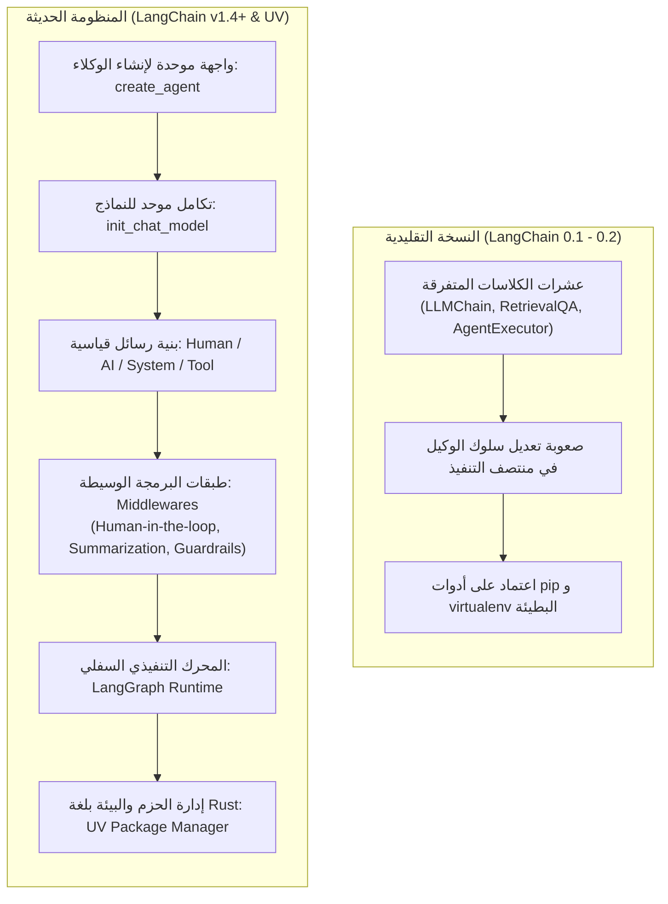

<div dir="rtl">

# الدليل المعماري الشامل: تحديثات LangChain الحديثة وبيئة التطوير السريعة (LangChain v1+ & UV Ecosystem Master Guide)
### Modern Agent Runtime, Middleware Architecture, Rust-Based UV Tooling, and Agentic IDEs (Lecture 57)

---

## 1. التحول المعماري في منظومة LangChain الحديثة (`LangChain v1+`)

شهدت مكتبة **`LangChain`** مؤخراً إعادة هيكلة جذرية في توثيقها وبنيتها البرمجية (بدءاً من الإصدار `1.x` وما بعده) للتخلص من تعقيد السلاسل المتفرقة القديمة (`Legacy Chains`) وتوحيد بناء الوكلاء على أساس محرك الحالة **`LangGraph`**.

تم تقسيم التوثيق والمنظومة إلى ثلاثة محاور متكاملة:
1. **LangChain**: واجهة التطوير العليا لبناء الوكلاء عبر دالة موحدة (`create_agent`)، وتكامل النماذج (`init_chat_model`)، وإدارة البرمجيات الوسيطة (`Middlewares`).
2. **LangGraph**: المحرك السفلي (`Low-Level Runtime`) لإدارة الرسوم البيانية الموجهة للحالة، الدورات التكرارية، والذاكرة المستمرة (`Checkpointing`).
3. **بيئة Python & Tooling الحديثة**: الاعتماد الكامل على مدير الحزم السريع **`uv`**، والنماذج المهيكلة عبر **`Pydantic v2`**.

</div>



<div dir="rtl">

---

## 2. المحاور الثمانية الجديدة في تحديثات LangChain v1+

تغطي سلسلة التحديثات الجديدة المكونات المحورية التالية التي أصبحت المعيار الصناعي لبناء تطبيقات الـ LLM الإنتاجية:

| المكون الحديث | الوظيفة الهندسية (`Engineering Role`) | الكائن أو الدالة المعيارية |
| :--- | :--- | :--- |
| **تكامل النماذج الموحد (`Model Integration`)** | تهيئة أي نموذج (OpenAI, Groq, Anthropic, Gemini) بسطر واحد موحد مع قابلية التبديل اللحظي. | `init_chat_model()` |
| **إنشاء الوكلاء (`Unified Agents`)** | بناء وكيل متكامل يدعم الأدوات والذاكرة والتدخل البشري بواجهة موحدة فوق LangGraph. | `create_agent()` |
| **استدعاء الأدوات (`Tool Calling`)** | ربط الدوال البرمجية كأدوات موثقة بالـ JSON Schema يختار النموذج استدعاءها ذاتياً. | `@tool` Decorator |
| **المخرجات المهيكلة (`Structured Output`)** | إلزام النموذج بإرجاع كائنات برمجية مضبوطة الحقول والأنواع تمنع عشوائية النص. | `Pydantic`, `TypedDict`, `Dataclass` |
| **أنواع الرسائل (`Message Types`)** | التمييز الصارم في تاريخ المحادثة بين أدوار التوجيه، البشر، الذكاء الاصطناعي، ومخرجات الأدوات. | `SystemMessage`, `HumanMessage`, `AIMessage`, `ToolMessage` |
| **الذاكرة قصيرة المدى (`Short-Term Memory`)** | حفظ سياق الجلسة النشطة (`Thread-level Persistence`) لتتبع الحوارات المتعددة. | `InMemorySaver` / `Checkpointer` |
| **البث اللحظي (`Streaming`)** | إرسال التوكنز وخطوات تفكير الوكيل وتنفيذ الأدوات لحظياً للمستخدم دون تأخير. | `.stream()` & `.astream_events()` |
| **البرمجيات الوسيطة والحماية (`Middleware & Guardrails`)** | حقن منطق مخصص قبل أو بعد استدعاء الـ LLM (مثل: تلخيص التاريخ، حدود الاستدعاء، والتدخل البشري). | `AgentMiddleware`, `HumanInTheLoopMiddleware` |

---

## 3. بنية الـ Middleware Architecture (المفهوم الثوري في التحديث)

إحدى أهم الإضافات في `LangChain v1.x` هي وحدة **`langchain.agents.middleware`**؛ حيث لم يعد المطور مضطراً لتعديل الكود الأساسي للوكيل لإضافة مراقبة أو حماية. بدلاً من ذلك، تُمرر طبقات `Middleware` تعترض دورة التنفيذ (`Execution Hooks`):

1. **Built-in Middlewares (جاهزة للاستخدام الفوري)**:
   * `HumanInTheLoopMiddleware`: يوقف التنفيذ تلقائياً عند أدوات خطرة معينة بانتظار موافقة المشرف البشري.
   * `ContextEditingMiddleware`: يتحكم في تنظيف وتحرير سياق الأدوات الطويلة لمنع تجاوز نافذة السياق (`Context Window Overflow`).
   * `ModelCallLimitMiddleware`: يضع سقفاً أقصى لعدد استدعاءات النموذج لمنع الحلقات اللانهائية واستنزاف الميزانية (`Token Burn`).
   * `LLMToolSelectorMiddleware`: يفلتر الأدوات المتاحة ذكياً قبل إرسالها للنموذج عندما يتجاوز عدد الأدوات العشرات.
2. **Custom Middlewares**: يتيح للمهندس كتابة فئة ترث من `AgentMiddleware` لتنفيذ فحوصات الأمان (`Guardrails`)، أو تسجيل التتبع (`Logging`)، أو تعديل البرومبت ديناميكياً.

---

## 4. مدير الحزم السريع `UV Package Manager` (معيار Rust الحديث)

في بيئات تطوير الذكاء الاصطناعي، تحتوي مشاريع الـ RAG والـ Agents على عشرات المكتبات المتداخلة (`torch`, `transformers`, `langchain`, `faiss`, `pydantic`). استخدام `pip` التقليدي يستهلك دقائق طويلة وقد ينتج تعارضات في الإصدارات (`Dependency Hell`).

جاء مدير الحزم والمشاريع **`uv`** (المطور من شركة Astral ومكتوب بالكامل بلغة **Rust**) ليحل هذه المشكلة جذرياً:

### أ. الأثر الحسابي وسرعة الحل (`Dependency Resolution`)
* **السرعة**: أسرع بـ **$10\times$ إلى $100\times$** مقارنة بـ `pip` و `Poetry`.
* **ملف القفل الحتمي (`uv.lock`)**: يضمن أن بيئة التطوير على جهازك تطابق بيئة الإنتاج في السحابة بنسبة $100\%$ (`Deterministic Reproducibility`).
* **توحيد التخزين المؤقت (`Global Deduplicated Cache`)**: لا يعيد تنزيل المكتبات الضخمة لكل بيئة افتراضية جديدة، بل يربطها عبر روابط سريعة على القرص.

### ب. مصفوفة المقارنة بين أدوات إدارة بيئات بايثون:

| الأداة | لغة البرمجة | سرعة التنصيب والحل | إدارة البيئات المدمجة | ملف القفل الحتمي (`Lockfile`) | التوصية الهندسية في الإنتاج |
| :--- | :---: | :---: | :---: | :---: | :--- |
| **`pip + venv`** | Python | بطيئة جداً | منفصلة يدوياً | لا يوجد قياسي (`requirements.txt` غير حتمي) | للاستخدامات البسيطة المؤقتة فقط |
| **`conda`** | Python / C++ | بطيئة جداً وثقيلة | مدمجة | يستهلك مساحة ضخمة | عند الحاجة لمكتبات نظام غير بايثون معقدة |
| **`Poetry`** | Python | متوسطة إلى بطيئة | مدمجة | يوجد (`poetry.lock`) | جيد، لكنه تراجع أمام سرعة `uv` |
| **`uv`** | **Rust** | **فائقة ($10\times$ - $100\times$)** | **مدمجة ومتكاملة** | **يوجد (`uv.lock`) قياسي وعالمي** | **المعيار الذهبي الموصى به لمشاريع AI 2026** |

### ج. الأوامر الأساسية اليومية لـ `uv`:
```bash
# 1. تهيئة مشروع بايثون جديد (ينشئ pyproject.toml و .python-version)
uv init my-langchain-project

# 2. إنشاء البيئة الافتراضية وتفعيلها تلقائياً
uv venv

# 3. إضافة مكتبة وتحديث ملف القفل uv.lock فوراً
uv add langchain langchain-core langgraph langchain-groq pydantic

# 4. مزامنة البيئة بالكامل على أي جهاز آخر أو داخل حاوية Docker
uv sync

# 5. تشغيل أي سكريبت أو نوت بوك داخل البيئة المعزولة مباشرة
uv run python app.py
```

---

## 5. بيئات التطوير الوكالية الحديثة (`Agentic IDEs`)

سلطت المحاضرة الضوء على التحول في أدوات كتابة الكود ذاتها؛ من محررات النصوص التقليدية إلى **بيئات التطوير المدعومة بالوكلاء (`Agentic IDEs`)**:

* **`VS Code` (مع الإضافات)**: المحرر المعياري المرن الذي يتيح إضافة مساعدين برمجيين عبر الـ Extensions.
* **`Cursor`**: محرر مبني على VS Code يدمج الـ LLM عميقاً في تحرير الملفات المتعددة (`Composer`).
* **`Google Antigravity`**: بيئة التطوير الوكالية الأحدث التي توفر وكلاء ذكاء اصطناعي متكاملين (`Agentic Coding Assistants`) قادرين على قراءة المستودع كاملاً، وتصميم المعمارية، وتعديل الكود، وتشغيل أوامر الطرفية (`Terminal`) واختبارها والتحقق من نجاحها ذاتياً.

---

## 6. أسئلة المقابلات المتقدمة للـ Senior AI Engineers

### س1: ما المشكلة المعمارية التي حلتها LangChain بإدخال طبقة الـ Middleware Architecture في الإصدار v1.x؟
**الإجابة النموذجية:**
في الإصدارات القديمة (`AgentExecutor`)، كان منطق عمل الوكيل مغلقاً (`Black-box Loop`)؛ فإذا أراد المهندس إضافة ميزة مثل تلخيص تاريخ المحادثة عندما يتجاوز 20 رسالة، أو إيقاف أداة حذف قاعدة البيانات لطلب موافقة البشري، أو وضع حد أقصى للتكلفة، كان يضطر لتفكيك الوكيل وإعادة كتابة منطق التنفيذ من الصفر أو استخدام Callbacks غير متزامنة ومعقدة.  
جاءت بنية الـ **Middleware** لفصل هذه المخاوف (`Separation of Concerns`)؛ بحيث تصبح ميزات الحماية، والذاكرة، والـ HITL، ومراقبة الحدود **وحدات قابلة للتركيب والدمج (`Composable Hooks`)** تلتف حول خطوات الوكيل دون تلويث الكود الوظيفي الأساسي.

### س2: لماذا يُفضّل استخدام `uv` مع حاويات `Docker` في نشر تطبيقات الـ RAG والـ Agents الإنتاجية؟
**الإجابة النموذجية:**
تتميز حاويات الـ Docker لتطبيقات الـ AI بحجم صور ضخم وبطء بناء الـ Layers عند استخدام `pip`. عند استبدال `pip` بـ `uv sync --frozen`:
1. ينخفض زمن بناء صورة الـ Docker في مسارات الـ CI/CD من دقائق طويلة إلى ثوانٍ معدودة.
2. يضمن العلم `--frozen` تثبيت الحزم بنفس الأرقام والهاشات الموثقة في `uv.lock` حرفياً، مما يمنع أي أخطاء مفاجئة في بيئة الإنتاج بسبب تحديث غير متوافق لمكتبة فرعية.

</div>
