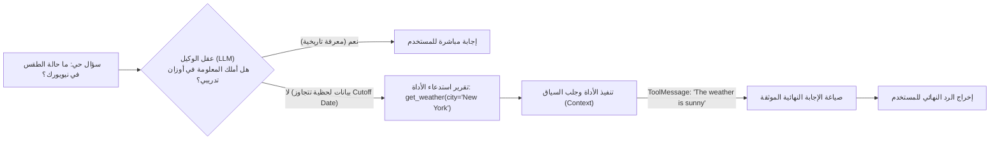
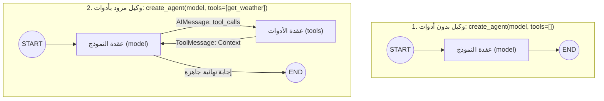
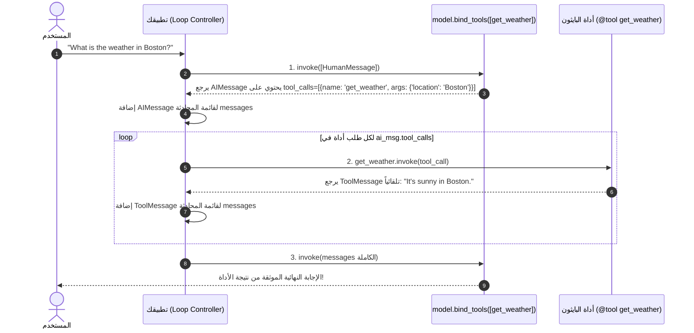

<div dir="rtl">

# الدليل المعماري الشامل: بناء الوكلاء الموحدين واستدعاء الأدوات في LangChain v1+
### Unified Agents (`create_agent`), `@tool` Decorator, `bind_tools()`, Manual Tool Execution Loop, and Message Traces (Lectures 59 & 61)

---

## 1. الدافع الهندسي: لماذا تفشل النماذج اللغوية المجردة أمام البيانات اللحظية؟

في تطبيقات الذكاء الاصطناعي التوليدي التقليدية (`Plain LLM Apps`)، نُرسل مدخلاً نصياً إلى النموذج (`GPT`, `LLaMA`, `Gemini`) ونستقبل مخرجاً نصياً. لكن هذه النماذج تعاني من قيد فيزيائي صارم يسمى **تاريخ انقطاع التدريب (`Training Cutoff Date`)**.

* النموذج اللغوي لا يمتلك معلومات اليوم؛ فإذا سألته: *"ما هي أخبار الذكاء الاصطناعي اليوم؟"* أو *"ما حالة الطقس في نيويورك الآن؟"*، لن يستطيع الإجابة بدقة لأنه دُرب على بيانات ماضية فقط.
* **الحل المعماري — وكيل الذكاء الاصطناعي (`AI Agent`)**: ربط النموذج اللغوي (الذي يعمل كعقل مفكر) بمجموعة من **الأدوات الخارجية (`Tools / APIs`)**؛ بحيث يقرر النموذج ذاتياً متى يفتقر للمعلومة، ويستدعي الأداة المناسبة لجلب السياق الحي (`Live Context`)، ثم يصيغ الإجابة النهائية.

</div>



<div dir="rtl">

---

## 2. القفزة المعمارية: من `AgentExecutor` القديم إلى `create_agent` في `LangChain v1+`

في الإصدارات السابقة من LangChain، كان بناء وكيل بسيط يتطلب خطوات يدوية معقدة (إنشاء قالب برومبت `ReAct` يدوياً، ربطه بالنموذج، ثم تغليفه داخل `AgentExecutor`).  
أما في **LangChain v1+**، تم اختزال هذه المعمارية في دالة موحدة واحدة هي **`create_agent`** المستوردة من `langchain.agents`، والتي تُرجع تلقائياً رسماً بيانياً مُجمّعاً من نوع `CompiledStateGraph` فوق محرك **`LangGraph`**.

### أ. تطور طوبولوجيا الرسم البياني (`Graph Topology Evolution`):

</div>



<div dir="rtl">

* **عندما تكون `tools=[]`**: تكون العقد فقط `['__start__', 'model', '__end__']` — مسار خطي بدون حلقات تكرارية.
* **عند إضافة أداة مثل `get_weather`**: تضاف عقدة `tools` وتتحول المعمارية إلى **رسم بياني دائري (`Cyclic Graph`)** يعود فيه مخرج الأداة إلى النموذج لتوليد الرد النهائي.
* **تنبيه حول المعاملات المهجورة**: معاملات مثل `verbose=True` التي كانت تُمرر لـ `AgentExecutor` القديم لم تعد مدعومة داخل `create_agent` وتطلق خطأ `TypeError`، لأن مراقبة التنفيذ أصبحت تُدار عبر `debug=True` أو تتبع `LangSmith` و `.stream()`.

---

## 3. عقد التوجيه عبر النصوص التوضيحية (`The Docstring Contract`)

السؤال الجوهري: **كيف يعرف النموذج اللغوي أي دالة بايثون يجب أن يستدعيها، وما هي المعاملات المطلوبة؟**

تعتمد آلية `Tool Calling` في LangChain على تحويل دالة بايثون تلقائياً إلى مخطط `JSON Schema` بناءً على 3 ركائز إلزامية:
1. **اسم الدالة (`Function Name`)**: مثل `get_weather`.
2. **توصيف الأنواع (`Type Hints`)**: مثل `city: str -> str` لتعريف نوع البيانات المتوقعة.
3. **النص التوضيحي (`Docstring`)**: النص المكتوب داخل `"""..."""` هو الإشارة الدلالية الأساسية التي يقرأها النموذج ليفهم وظيفة الأداة ومتى يقرّر استدعاءها.

```python
def get_weather(city: str) -> str:
    """Get the weather for a city."""
    return f"The weather in {city} is sunny."
```

> **قاعدة هندسية حاسمة**: كتابة `Docstring` غامض أو ترك دالة بدون `Docstring` قد يؤدي إلى فشل النموذج في استدعاء الأداة أو تمرير معاملات خاطئة تماماً!

---

## 4. عقد الاستدعاء وتفكيك مسار الرسائل (`Agent Invocation & Trace`)

لأن `create_agent` يبني رسماً بيانياً للحالة (`StateGraph`) يعتمد على قائمة الرسائل (`messages`)، فإن تمرير نص خام مباشرة مثل `agent.invoke("What is the weather?")` يُطلق خطأ (`Expected dictionary` / `InvalidUpdateError`).

### الصيغ القياسية المدعومة في الاستدعاء:
1. **الصيغة المهيكلة الكاملة**:
   ```python
   agent.invoke({"messages": [{"role": "user", "content": "What is the weather in New York?"}]})
   ```
2. **الصيغة المختصرة المرنة** (تقبل النص مباشرة داخل مفتاح `messages` وتعامل مع الأخطاء الإملائية بذكاء مثل `"wather"`):
   ```python
   agent.invoke({"messages": "What is the wather in New York?"})
   ```

### تتبع الرسائل الأربعة داخل المخرجات (`response["messages"]`):
عند تشغيل الاستعلام بنجاح، يحتوي سجل المحادثة الناتج على التسلسل الدقيق التالي:
1. **`HumanMessage`**: استعلام المستخدم الأصلي (`What is the weather in New York?`).
2. **`AIMessage` (طلب الأداة)**: استجابة النموذج الفارغة نصياً ولكنها تحتوي على خاصية `tool_calls`:
   ```python
   [{'name': 'get_weather', 'args': {'city': 'New York'}, 'id': 'fc_...', 'type': 'tool_call'}]
   ```
3. **`ToolMessage`**: نتيجة تنفيذ الدالة الفعلية في بايثون (`The weather in New York is sunny.`) مربوطة بنفس الـ `tool_call_id`.
4. **`AIMessage` (الرد النهائي)**: يقوم النموذج بقراءة `ToolMessage` وصياغة الإجابة النهائية الواضحة للمستخدم في `response["messages"][-1].content`.

---

## 5. تشريح الأدوات والمزخرف `@tool` وحلقة التنفيذ اليدوية (`Lecture 61`)

تُعرّف الأداة (`Tool`) في `LangChain` رسمياً بأنها **اقترانٌ بين شيئين (`Pairing`)**:
1. **المخطط الواصف (`Schema`)**: يضم اسم الأداة (`Name`)، الوصف النصي (`Description`)، وتعريف المعاملات وأنواعها (`Argument Definitions`).
2. **الدالة التنفيذية (`Function or Coroutine`)**: الكود الفعلي الذي يتصل بقاعدة البيانات، أو يطلق طلب API، أو ينفذ حسابات رياضية.

### أ. إنشاء الأداة باستخدام المزخرف `@tool`:
```python
from langchain.tools import tool

@tool
def get_weather(location: str) -> str:
    """Get the weather at a location."""
    return f"It's sunny in {location}."
```
* بمجرد إضافة `@tool` فوق الدالة، تتحول إلى كائن `StructuredTool` يمتلك خصائص فحص جاهزة:
  * `get_weather.name`: `"get_weather"`
  * `get_weather.description`: `"Get the weather at a location."`
  * `get_weather.args`: `{'location': {'title': 'Location', 'type': 'string'}}`

### ب. ربط الأدوات بالنموذج مباشرَةً (`model.bind_tools()`) — ما الذي يحدث خلف الكواليس؟
عندما تستدعي `model_with_tools = model.bind_tools([get_weather])`، ثم تسأل `model_with_tools.invoke("What's the weather like in Boston?")`:
* **تنبيه هندسي حاسم**: دالة `bind_tools()` **لا تنفّذ** دالة البايثون تلقائياً!
* كل ما يفعله النموذج هو إرجاع رسالة من نوع `AIMessage` تحتوي على حقل `tool_calls` (طلب تنفيذ موجه لك أنت كمطور):
  ```python
  [{'name': 'get_weather', 'args': {'location': 'Boston'}, 'id': 'fc_123', 'type': 'tool_call'}]
  ```

### ج. حلقة التنفيذ اليدوية (`The Manual Tool Execution Loop`):
لكي تفهم تماماً كيف يعمل `create_agent` من الداخل، إليك الخطوات الثلاث للحلقة اليدوية التي تبنيها عندما تستخدم `bind_tools()` مباشرة:

</div>



<div dir="rtl">

```python
# 1. إعداد المحادثة واستدعاء النموذج المربوط بالأدوات
messages = [{"role": "user", "content": "What's the weather in Boston?"}]
ai_msg = model_with_tools.invoke(messages)
messages.append(ai_msg)

# 2. تنفيذ كل طلب أداة تلقائياً وإلحاق النتيجة (ToolMessage)
for tool_call in ai_msg.tool_calls:
    # تمرير قاموس tool_call كاملاً للدالة يرجع ToolMessage متوافقاً تلقائياً مع ID الطلب!
    tool_msg = get_weather.invoke(tool_call)
    messages.append(tool_msg)

# 3. استدعاء النموذج ثانيةً بالسياق الكامل لتوليد الإجابة النهائية
final_response = model_with_tools.invoke(messages)
print(final_response.content)
```

---

## 6. مصفوفة المفاضلة الهندسية: متى نستخدم `bind_tools()` اليدوية مقابل `create_agent()`؟

| المعيار الهندسي | `model.bind_tools()` + حلقة يدوية | `create_agent()` في LangChain v1 |
| :--- | :--- | :--- |
| **التحكم في التنفيذ** | تحكم مطلق $100\%$ في كل سطر قبل وبعد تنفيذ الأداة. | آلية مدارة تلقائياً عبر LangGraph runtime. |
| **بساطة الكود** | يتطلب كتابة حلقة `while` أو `for` وإدارة قائمة الرسائل يدوياً. | سطر واحد ينتج رسماً بيانياً دائرياً متكاملاً. |
| **الحالات الأنسب** | استدعاء وحيد لمرة واحدة (`Single-shot Extraction`)، أو دمج منطق أمني صارم جداً بين الخطوات. | الوكلاء متعددو الخطوات (`Multi-hop Agents`)، وحفظ الذاكرة، والـ Middlewares. |

---

## 7. مصفوفة المقارنة المعمارية (Legacy AgentExecutor vs LangChain v1 create_agent)

| المعيار الهندسي | النمط القديم (`AgentExecutor + ReAct`) | النمط الحديث (`LangChain v1 create_agent`) |
| :--- | :--- | :--- |
| **المحرك التنفيذي** | حلقة بايثون مغلقة (`Black-box while loop`). | رسم بياني مُجمّع للحالة (`LangGraph CompiledStateGraph`). |
| **التخصيص والتحكم** | صعب جداً؛ يتطلب تجاوز الدوال الداخلية أو Callbacks. | مرن بالكامل عبر طبقات `Middleware` ونقاط التوقف `interrupt_before`. |
| **آلية استدعاء الأدوات** | يعتمد غالباً على تحليل نصوص الـ ReAct (`Thought/Action/Observation`). | يعتمد على `Native Function/Tool Calling` المدمج في النماذج الحديثة بدقة عالية. |
| **المرونة مع المدخلات** | صارم في قوالب النصوص (`PromptTemplate` variables). | موحد عبر حالة `{"messages": [...]}` مع دعم صيغ القاموس أو النصوص أو `HumanMessage`. |
| **الحفظ والبث اللحظي** | دعم محدود للذاكرة متعددة الخطوات. | دعم أصيل للـ `Checkpointers` والبث اللحظي عبر `.stream()`. |

---

## 8. أسئلة المقابلات المتقدمة للـ Senior AI Engineers

### س1: لماذا يُطلق `create_agent` خطأ إذا لم تمرر الأدوات أو مررت `verbose=True`، وما هي البدائل الإنتاجية لمراقبة تنفيذ الوكيل؟
**الإجابة النموذجية:**
دالة `create_agent` في `LangChain v1+` مبنية مباشرة فوق محرك `LangGraph` وليست مجرد غلاف لـ `AgentExecutor` القديم. في `LangGraph`، يُتوقع من المطور استخدام أنماط المراقبة الحديثة بدلاً من الطباعة الفوضوية عبر `verbose=True`:
1. تمرير `debug=True` لطباعة انتقالات العقد وتحديثات الحالة لحظياً.
2. استدعاء `agent.stream(..., stream_mode="updates")` لتدفق المخرجات عقدة بعقدة.
3. تفعيل التتبع السحابي عبر **`LangSmith`** لتسجيل كافة المسارات وحساب استهلاك التوكنز والزمن لكل أداة.

### س2: كيف تصمم `Docstring` احترافية لأداة وكيل ذكاء اصطناعي في بيئة إنتاجية معقدة تضم عشرات الأدوات المتشابهة؟
**الإجابة النموذجية:**
الـ `Docstring` هي واجهة الاستخدام الموجهة للـ LLM (`LLM-Facing API`). لتجنب الخلط بين الأدوات:
1. نبدأ بجملة أمرية حاسمة توضح **متى تُستخدم الأداة ومتى لا تُستخدم** (مثلاً: *"Use ONLY for real-time weather lookups; do NOT use for historical climate averages."*).
2. نوثق كل معامل (`Args`) بصيغة واضحة، مع ذكر الصيغة المطلوبة (مثل: *"city: Full English city name without abbreviations, e.g., 'New York'"*).
3. نستخدم `Annotated` أو `Pydantic Field` لتعزيز التحقق من صحة المدخلات قبل وصولها للدالة الفعلية.

### س3: ما الخطأ الشائع الذي يقع فيه المطورون عند استخدام `model.bind_tools()`، ولماذا نمرر كائن `tool_call` كاملاً إلى `tool.invoke(tool_call)`؟
**الإجابة النموذجية:**
الخطأ الشائع هو اعتقاد المطور أن `model.bind_tools([my_tool]).invoke(prompt)` سينفذ الدالة تلقائياً؛ الحقيقة أن النموذج اللغوي لا يملك صلاحية تنفيذ الكود محلياً، بل يكتفي بإرجاع `AIMessage` تحتوي على حقل `tool_calls` فقط.  
عندما ننفذ الأداة في حلقة التنفيذ اليدوية، نمرر قاموس `tool_call` كاملاً (`{'name': ..., 'args': ..., 'id': ...}`) إلى `my_tool.invoke(tool_call)` بدلاً من تمرير المعاملات مجردةً، والسبب المعماري هو أن `LangChain` يتعرف على وجود مفتاح `'id'` ويُغلف النتيجة تلقائياً في كائن **`ToolMessage`** مرتبط برقم `tool_call_id` المطابق، وهو شرط إلزامي في API معظم النماذج (مثل OpenAI و Groq و Anthropic) لقبول الرد في الجولة التالية!

</div>
