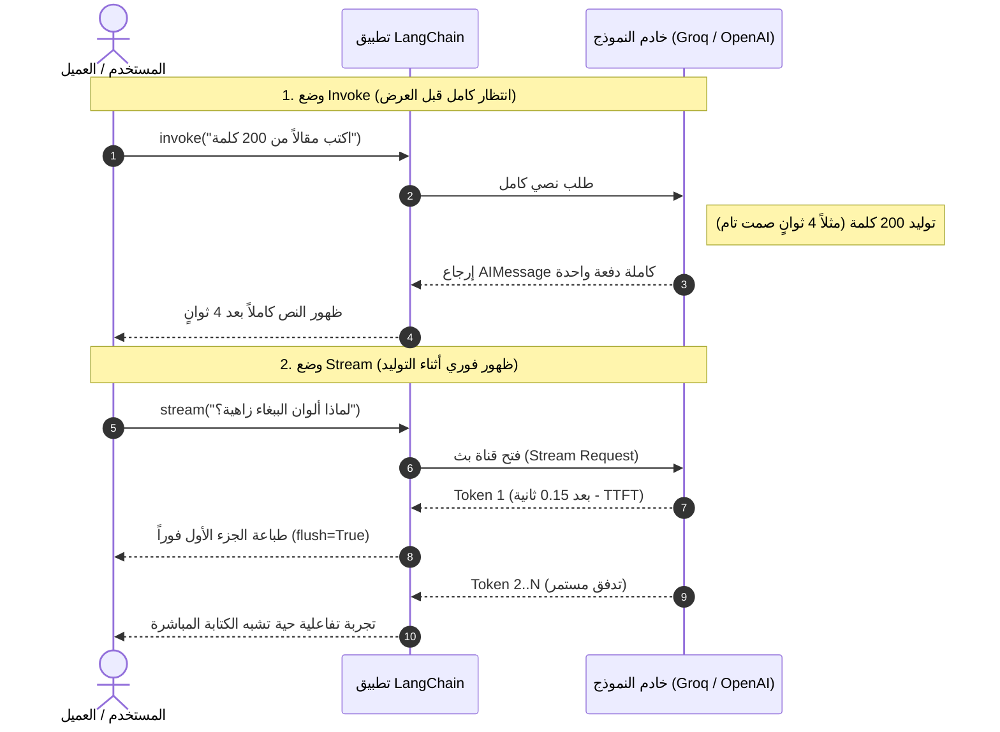

<div dir="rtl">

# الدليل المعماري الشامل: أنماط تنفيذ النماذج — البث اللحظي والمعالجة المتوازية (`Invoke`, `Stream`, & `Batch`)
### Execution Primitives, Time-to-First-Token (TTFT) Optimization, Concurrency Control, and Throughput Math (Lecture 60)

---

## 1. الدافع الهندسي: لماذا لا يكفي الاستدعاء المتزامن (`model.invoke`) في بيئات الإنتاج؟

جميع نماذج الدردشة الحديثة في `LangChain v1+` مبنية فوق واجهة **`Runnable`** الموحدة، التي توفر ثلاث طرق رئيسية للتنفيذ:
1. **الاستدعاء القياسي المتوقف (`model.invoke()`)**: ينتظر العميل في صمت حتى يكتمل توليد آخر توكن في الاستجابة قبل ظهور حرف واحد.
2. **البث اللحظي التدريجي (`model.stream()`)**: يعيد مُولّداً (`Generator / Iterator`) يُطلق أجزاءً متتابعة (`AIMessageChunk`) فور توليد كل توكن على خوادم الـ LLM.
3. **المعالجة المتوازية بالدفعات (`model.batch()`)**: يرسل عشرات أو مئات الطلبات المستقلة بالتوازي عبر خيوط متزامنة مع إمكانية تقييد سقف التزامن (`max_concurrency`).

</div>



<div dir="rtl">

---

## 2. التأصيل الرياضي للكمون والإنتاجية (`Latency & Throughput Math`)

لقياس جودة أي نظام `RAG` أو شات بوت في بيئات العمل، نستخدم مقياسين فيزيائيين حاسمين:
* **$T_{\text{TTFT}}$ (`Time To First Token`)**: الزمن المنقضي من لحظة إرسال السؤال حتى وصول أول توكن للشاشة.
* **$\text{TPOT}$ (`Time Per Output Token`)**: متوسط الزمن الذي يستغرقه النموذج لتوليد كل توكن إضافي.

### أ. مقارنة زمن الانتظار المُدرَك (`Perceived Latency`):
لإجابة مكونة من $N$ توكنز:
* **في وضع `invoke()`**: الزمن الذي ينتظره المستخدم لرؤية أول كلمة يساوي الزمن الكلي للتوليد:
$$\text{Wait}_{\text{invoke}} = T_{\text{network}} + T_{\text{prefill}} + \left( N \times \text{TPOT} \right)$$
* **في وضع `stream()`**: ينخفض زمن الانتظار المُدرَك دراماتيكياً ليقتصر فقط على زمن التحضير الأوّلي:
$$\text{Wait}_{\text{stream}} = T_{\text{TTFT}} = T_{\text{network}} + T_{\text{prefill}} \ll \text{Wait}_{\text{invoke}}$$

### ب. تسريع الدفعات وحوكمة التوازي (`Batch Speedup & Concurrency`):
عند معالجة $M$ استفساراً مستقلاً، حيث يستغرق الاستفسار الواحد $T_{\text{single}}$:
* **في التنفيذ التسلسلي (Loop with `invoke`)**:
$$T_{\text{seq}}(M) = M \times T_{\text{single}}$$
* **في التنفيذ المتوازي (`model.batch(..., config={"max_concurrency": C})`)**:
$$T_{\text{batch}}(M, C) \approx \left\lceil \frac{M}{C} \right\rceil \times T_{\text{single}}$$

> **الأهمية الحتمية لمعامل `max_concurrency`**: إرسال $100$ طلب في نفس اللحظة بدون سقف توازي سيؤدي فوراً إلى انهيار التنفيذ بأخطاء حد المعدل (**`HTTP 429 Rate Limit Exceeded`**) من مزودي الخدمة مثل OpenAI أو Groq. ضبط `max_concurrency=5` يقسم الـ $100$ طلب إلى $20$ دفعة آمنة بحد أقصى $5$ طلبات متزامنة.

---

## 3. أنماط التنفيذ البرمجية القياسية (`Implementation Patterns`)

### أ. استهلاك تدفق التوكنز في `model.stream()`:
```python
for chunk in model.stream("Why do parrots have colorful feathers?"):
    # استخدام chunk.text في LangChain v1+ مع flush=True للطباعة الفورية بدون تأخير في الذاكرة المؤقتة
    print(chunk.text, end="", flush=True)
```
* **لماذا نضع `flush=True`؟**: تقوم بايثون افتراضياً بتخزين المخرجات في ذاكرة مؤقتة (`Output Buffer`) ولا تطبعها إلا عند وجود سطر جديد `\n`. تمرير `flush=True` مع `end=""` يجبر النظام على تفريغ كل توكن إلى الشاشة في نفس المللي ثانية التي يصل فيها من النموذج.

### ب. التنفيذ المتوازي الآمن عبر `model.batch()`:
```python
questions = [
    "Why do parrots have colorful feathers?",
    "How do airplanes fly?",
    "What is quantum computing?"
]

# إرسال الأسئلة بالتوازي مع سقف توازي محكوم لتجنب حظر API
responses = model.batch(
    questions,
    config={"max_concurrency": 5}
)
```

---

## 4. مصفوفة المفاضلة الهندسية الشاملة (Execution Modes Trade-offs)

| المعيار الهندسي | `model.invoke()` | `model.stream()` | `model.batch()` |
| :--- | :--- | :--- | :--- |
| **زمن أول استجابة (`TTFT`)** | مرتفع جداً (ينتظر نهاية الإجابة). | **فوري** (مللي ثوانٍ معدودة). | يُقاس على مستوى كامل الدفعة (`Throughput`). |
| **نوع المخرج البرمجي** | كائن واحد `AIMessage`. | مُولّد `Iterator[AIMessageChunk]`. | قائمة `List[AIMessage]` بنفس ترتيب المدخلات. |
| **أهم حالات الاستخدام** | الخطوات الخلفية القصيرة، استدعاء أدوات سريعة، مخرجات JSON قصيرة. | **تطبيقات الدردشة التفاعلية (`Chatbots`)**، واجهات Streamlit / React / FastAPI SSE. | تصنيف آلاف الوثائق، تقييم النماذج (`Eval Datasets`)، تلخيص تقارير متوازية. |
| **مخاطر الإنتاج** | انتهاء مهلة الاتصال (`HTTP Timeout`) في الردود الطويلة جداً. | تعقيد التعامل مع الأخطاء في منتصف البث (`Mid-stream failure`). | أخطاء `HTTP 429` إذا أُهمل ضبط `max_concurrency`. |

---

## 5. أسئلة المقابلات المتقدمة للـ Senior AI Engineers

### س1: لماذا لا يخفض `model.stream()` التكلفة المالية أو إجمالي زمن توليد النموذج على الخادم، ومع ذلك يُعد إلزامياً في كل تطبيق دردشة احترافي؟
**الإجابة النموذجية:**
النموذج اللغوي على خادم الـ GPU يولد التوكنز بالطريقة نفسها (`Autoregressive Decoding`) بنفس عدد العمليات الحسابية والتكلفة سواء طلبتها عبر `invoke` أو `stream`.  
لكن الأثر الحقيقي لـ `stream()` هو **تحسين هندسي لتجربة المستخدم (`Perceived Latency & UX`)** ومنع **انقطاع الاتصال (`Gateway Timeouts`)**:
1. تنخفض مدة الانتظار الصامت للعميل من $8$ ثوانٍ إلى $0.2$ ثانية (`TTFT`)، فيرى المستخدم تدفق الكلام كما في ChatGPT.
2. في البنى السحابية (مثل `AWS API Gateway` أو `Cloudflare` التي تفرض مهلة $30$ ثانية للرد الأول)، يضمن تدفق البايتات المستمر بقاء الاتصال مفتوحاً دون انقطاع.

### س2: كيف تنقل مخرجات `model.stream()` من خادم FastAPI إلى واجهة مستخدم أمامية (React / Next.js) في بيئة الإنتاج؟
**الإجابة النموذجية:**
نستخدم معيار **`Server-Sent Events (SSE)`** مع دالة غير متزامنة **`model.astream()`** inside FastAPI `StreamingResponse`:
1. تُنشئ دالة مولدة غير متزامنة (`async def token_generator()`) تقرأ من `async for chunk in model.astream(prompt):`.
2. ترسل كل جزء نصي بصيغة `yield f"data: {json.dumps({'token': chunk.text})}\n\n"`.
3. تُرجع `StreamingResponse(token_generator(), media_type="text/event-stream")`، مما يوفر اتصال HTTP خفيفاً أحادي الاتجاه يدعم إعادة الاتصال التلقائي دون تعقيد بروتوكولات الـ WebSockets.

</div>
