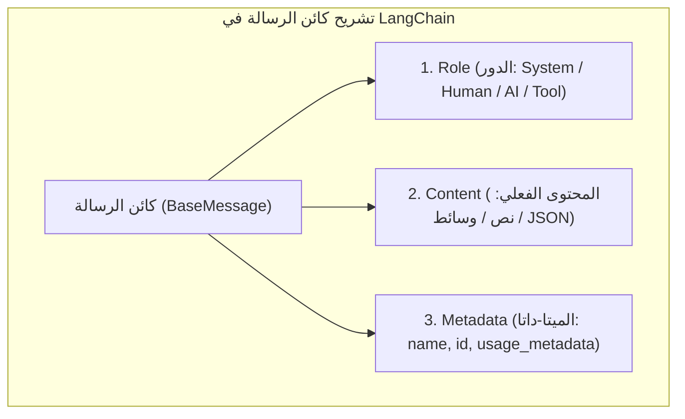
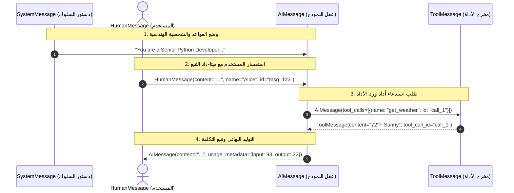

<div dir="rtl">

# الدليل المعماري الشامل: بنية الرسائل والبيانات الوصفية وتتبع التوكنز (`Messages Architecture & Telemetry`)
### System, Human, AI, Tool Messages, Metadata Tracing, and Token Accounting (Lecture 62)

---

## 1. الوحدة الأساسية للسياق: ما هي الرسالة (`Message`) في `LangChain v1+`؟

الرسالة هي **الوحدة الذرية الأساسية لنقل السياق (`Fundamental Unit of Context`)** بين التطبيق والنماذج اللغوية. على عكس النصوص الصماء، تُعد الرسائل كائنات مهيكلة تحمل ثلاثة مكونات رئيسية:
1. **الدور (`Role`)**: يحدد هوية المُرسل (`System`, `Human`, `AI`, `Tool`)، وهو ما تعتمد عليه مصفوفة الانتباه داخل النموذج لفهم التعليمات مقابل أسئلة المستخدم.
2. **المحتوى (`Content`)**: المادة الفعليّة للرسالة (نصوص، صور `Base64`، صوت، أو نتائج أدوات).
3. **البيانات الوصفية (`Metadata`)**: حقول إضافية لتتبع الهوية (`name`)، المعرف الفريد (`id`)، وقياسات استهلاك التوكنز (`usage_metadata`).

</div>



<div dir="rtl">

---

## 2. المفاضلة المعمارية: `Text Prompts` مقابل `Message Prompts`

قبل الغوص في الأنواع الأربعة، يميز المنهج الحديث بين أسلوبين لإرسال المدخلات للنموذج:

| المعيار | `Text Prompt` (نص مجرد) | `Message Prompt` (قائمة كائنات الرسائل) |
| :--- | :--- | :--- |
| **الشكل البرمجي** | `model.invoke("What is LangChain?")` | `model.invoke([SystemMessage(...), HumanMessage(...)])` |
| **السلوك الداخلي** | يُغلف تلقائياً في `HumanMessage` واحدة فقط. | يُمرر التاريخ والقيود والأدوار كاملة للـ LLM. |
| **الاحتفاظ بالذاكرة** | عديم الحالة (`Stateless`) — استعلام مستقل وحيد. | يدعم تاريخ المحادثة الكامل (`Conversation History`). |
| **التحكم في السلوك** | لا يملك توجيهات شخصية (`No System Instructions`). | يفرض الشخصية والقواعد الصارمة عبر `SystemMessage`. |
| **متى نستخدمه؟** | المهام البسيطة المستقلة بأقل تعقيد برمجي. | **جميع الشات بوتات، والـ RAG، والوكلاء متعددو الخطوات**. |

---

## 3. تشريح أنواع الرسائل الأربعة (`from langchain.messages import ...`)

</div>



<div dir="rtl">

### أ. رسالة النظام (`SystemMessage`): هندسة الشخصية ورفع جودة المخرجات
تُحدد هذه الرسالة دستور العمل للـ LLM. من التجربة العملية في المحاضرة:
* **رسالة سطحية من سطر واحد**: `"You are a helpful coding assistant."` $\to$ تترك النموذج يختار لغة برمجة عشوائية ويعطي إجابة عامة ومشتتة.
* **رسالة احترافية غنية بالسياق**: `"You are a senior Python developer with expertise in web frameworks. Always provide code examples and explain your reasoning. Be concise but thorough."` $\to$ تُلزم النموذج بإعطاء كود بايثون عملي (مثل Flask/FastAPI) مع خطوات أمان الإنتاج (`Disable debug mode, Input validation`).

### ب. رسالة المستخدم (`HumanMessage`) وحقول التتبع (`Tracing Metadata`)
تمثل مدخل المستخدم الفعلي، ويمكن تخصيصها بحقول اختيارية لتتبع الجلسات في البيئات متعددة المستخدمين:
```python
human_msg = HumanMessage(
    content="Hello!",
    name="Alice",       # تمييز هوية المستخدم في سجلات المراقبة
    id="message_123"    # معرف تتبع فريد للربط مع LangSmith
)
```

### ج. رسالة الذكاء الاصطناعي (`AIMessage`): التوليد، الحقن الاصطناعي، وتتبع التوكنز
تُمثل مخرج النموذج اللغوي، وتتميز بثلاث قدرات هندسية:
1. **حقن تاريخ المحادثة يدوياً (`Manual Conversation Seeding / Few-shot Priming`)**:
   يمكن للمطور صياغة كائن `AIMessage` يدوياً وإضافته في تاريخ المحادثة قبل استدعاء النموذج (مثلاً: إضافة رد مهذب سابق) لتوجيه نبرة وأسلوب النموذج في المحادثات اللاحقة.
2. **احتواء طلبات الأدوات (`.tool_calls`)**: عند الحاجة لبيانات خارجية.
3. **قياس التكلفة والأداء (`.usage_metadata`)**:
   تحمل كل استجابة حقيقية قاموساً دقيقاً يوثق استهلاك التوكنز، وهو الأساس في حساب الفواتير (`Token Accounting`):
   ```python
   # مثال فعلي لمخرجات usage_metadata في نماذج الاستدلال الحديثة:
   {
       'input_tokens': 93,
       'output_tokens': 22,
       'total_tokens': 115,
       'output_token_details': {'reasoning': 12}  # توكنز التفكير الداخلي!
   }
   ```

### د. رسالة الأداة (`ToolMessage`): عقد الربط الصارم عبر `tool_call_id`
عندما يطلب النموذج تشغيل أداة عبر `AIMessage(tool_calls=[..., {"id": "call_1"}])`، لا يُقبل رد الأداة إلا عبر كائن `ToolMessage` يحمل **نفس المعرف `tool_call_id="call_1"`**:
```python
tool_msg = ToolMessage(
    content="Sunny, 72F",
    tool_call_id="call_1"  # شرط إلزامي لربط النتيجة بالطلب في معظم مزودي الـ API!
)
```

---

## 4. مصفوفة المقارنة الشاملة لأنواع الرسائل

| نوع الرسالة | المُنشئ الرئيسي | الحقول الجوهرية الإضافية | الأثر في نافذة السياق (`Context Window`) |
| :--- | :--- | :--- | :--- |
| **`SystemMessage`** | المطور / النظام | `content` | يُثبّت نبرة الوكيل وقواعده والقيود الأمنية. |
| **`HumanMessage`** | المستخدم النهائي | `content`, `name`, `id` | ينقل استفسار المستخدم ويميز هويته في الأنظمة المتعددة. |
| **`AIMessage`** | النموذج اللغوي (أو حقن يدوي) | `content`, `tool_calls`, `usage_metadata` | يحمل الإجابة، أو طلب الأداة، وتفاصيل تكلفة التوكنز. |
| **`ToolMessage`** | دالة تنفيذ الأداة في بايثون | `content`, `tool_call_id` | يغذي النموذج بالسياق الحي الخارجي ويمهد للتوليد النهائي. |

---

## 5. أسئلة المقابلات المتقدمة للـ Senior AI Engineers

### س1: لماذا تنفجر واجهات برمجة التطبيقات (مثل OpenAI و Groq) بخطأ `BadRequestError` إذا أرسلت `ToolMessage` برقم `tool_call_id` غير مطابق أو نسيت إرفاق `AIMessage` السابقة لها؟
**الإجابة النموذجية:**
تفرض واجهات النماذج الحديثة (`Chat Completions API`) قاعدة هيكلية صارمة تُعرف بـ **Pairing Invariant**: كل `ToolMessage` يجب أن تسبقها مباشرة (أو ضمن مجموعة متتالية من نفس الدفعة) رسالة `AIMessage` تحتوي على حقل `tool_calls` يتضمن نفس `id`.  
إذا قام مطور بحذف رسالة الـ `AIMessage` الوسطية عند اختصار الذاكرة (`Memory Trimming`) وترك `ToolMessage` يتيمة، فسينهار الطلب فوراً. لذلك تستخدم المكتبات الحديثة مثل `ContextEditingMiddleware` في LangChain تقنيات قص ذكية تحذف زوج `(AIMessage + ToolMessage)` معاً للحفاظ على سلامة السياق!

### س2: ما أهمية قراءة حقل `output_token_details['reasoning']` داخل `usage_metadata` عند استخدام نماذج التفكير الحديثة (Reasoning Models)؟
**الإجابة النموذجية:**
نماذج الاستدلال الحديثة (مثل `gpt-oss-20b`, `o1/o3`, `DeepSeek-R1`) تولد مئات من "توكنز التفكير الخفية" (`Reasoning Tokens`) قبل كتابة الإجابة النهائية للمستخدم. رغم أنها قد لا تظهر كلها في `content`، إلا أنها **تُحسب بالكامل في فاتورة المخرجات (`output_tokens`) وتؤثر على زمن الاستجابة**. قراءة `usage_metadata` تتيح لفريق الـ LLMOps مراقبة نسبة توكنز التفكير إلى التوكنز الفعلية وضبط ميزانية التفكير (`reasoning_effort`) بناءً عليها.

</div>
