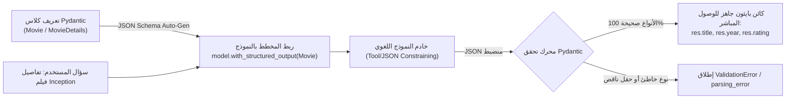

<div dir="rtl">

# الدليل المعماري الشامل: المخرجات المهيكلة الثلاثية (`Pydantic` مقابل `TypedDict` مقابل `Dataclasses`) وفحص قدرات النماذج (`model.profile`)
### Schema Enforcement (`with_structured_output` & `create_agent response_format`), Validation Trade-offs, `include_raw=True`, and Model Introspection (Lectures 63 - 65)

---

## 1. الدافع الهندسي: لماذا تفشل النصوص الحرة في الأنظمة الإنتاجية؟

عندما تطلب من نموذج لغوي عادي (`Plain LLM`) تلخيص تفاصيل فيلم أو استخراج بيانات عميل عبر `model.invoke("Provide details about Inception")`:
* سيعيد النموذج نصاً أدبياً حراً ومتغيراً في كل مرة.
* إذا أرادت قاعدة بيانات أو واجهة `REST API` أو خط أنابيب بيانات (`Data Pipeline`) قراءة "السنة" كرقم صحيح (`int`) و"التقييم" كرقم عشري (`float`)، فسيكون تحليل النص الحر (`Regex Parsing`) هشاً وينهار عند أي تغير في صياغة النموذج.

**الحل المعماري — المخرجات المهيكلة (`Structured Outputs`)**:
إلزام النموذج اللغوي بإخراج استجابة تطابق مخطط بيانات برمجي صارم (`Schema Enforcement`) عبر دالة **`model.with_structured_output(Schema)`**.

</div>



<div dir="rtl">

---

## 2. ثلاث ركائز لـ `Pydantic` (`BaseModel` + `Field`)

تدعم `LangChain` ثلاثة قوالب لهيكلة المخرجات (`Pydantic`, `TypedDict`, `Dataclasses`)، ويتربع **`Pydantic`** على القمة الإنتاجية بفضل ثلاث ميزات حاسمة:

1. **التحقق الفوري للأنواع (`Runtime Field Validation`)**:
   * يضمن أن حقل `title` نص (`str`)، وحقل `year` رقم صحيح (`int`)، وحقل `rating` عشري (`float`). إذا أعاد النموذج نصاً مكان الرقم أو العكس، يكتشفه `Pydantic` فوراً ولا يسمح بتسرب بيانات تالفة لقاعدة البيانات.
2. **الأوصاف الموجهة للنموذج (`LLM-Facing Field Descriptions`)**:
   * تمرير `Field(..., description="...")` يغذي النموذج بتعليمات دقيقة حول معنى كل حقل وصيغته المتوقعة.
   * **ملاحظة هندسية مهمة**: عند طلب أرقام ذات وحدات قياس (مثل الميزانية بالمليون دولار)، يجب صياغة الوصف بوضوح مثل: `"Budget expressed in millions of USD (e.g., write 160.0 for $160 million)"`؛ لأن الوصف العام `"Budget in millions USD"` قد يدفع النموذج أحياناً لكتابة `160000000.0` بدلاً من `160.0`.
3. **الهياكل المتداخلة (`Nested Schemas`)**:
   * دعم تعريف كلاس داخل قائمة في كلاس آخر (مثل قائمة ممثلين `List[Actor]` داخل `MovieDetails`).

```python
from pydantic import BaseModel, Field

class Movie(BaseModel):
    title: str = Field(..., description="The title of the movie")
    year: int = Field(..., description="The year the movie was released")
    director: str = Field(..., description="The director of the movie")
    rating: float = Field(..., description="The movie's rating out of 10")

model_with_structure = model.with_structured_output(Movie)
response = model_with_structure.invoke("Provide details about the movie Inception")
# المخرج كائن Movie مباشر: response.director == 'Christopher Nolan'
```

---

## 3. حفظ الرسالة الخام والبيانات الوصفية (`include_raw=True`)

عند استدعاء `model.with_structured_output(Movie)` افتراضياً، يُرجع الكائن المهيكل (`Movie`) فقط ويتم التخلص من رسالة `AIMessage` الأصلية، مما يضيع بيانات **`usage_metadata`** (استهلاك التوكنز والتكلفة).

لتفادي ذلك في الإنتاج، نمرر المعامل **`include_raw=True`**:
```python
model_with_raw = model.with_structured_output(Movie, include_raw=True)
result = model_with_raw.invoke("Provide details about the movie Inception")
```
يُرجع هذا الاستدعاء قاموساً يضم 3 مفاتيح استراتيجية:
1. **`result["raw"]`**: كائن `AIMessage` الأصلي كاملاً (يحمل `usage_metadata`، الـ ID، وبيانات التتبع).
2. **`result["parsed"]`**: كائن `Movie` المهيكل بعد نجاح التحقق (أو `None` عند الفشل).
3. **`result["parsing_error"]`**: قيمة `None` عند النجاح، أو استثناء الخطأ الدقيق عند فشل التحليل؛ مما يمنع انهيار التطبيق (`Graceful Degradation`).

---

## 4. الهياكل المتداخلة المعقدة (`Nested Pydantic Structures`)

عند استخراج وثائق مؤسسية (مثل الفواتير التي تضم قائمة بنود، أو ملفات الأفلام التي تضم طاقم عمل متعدد):

```python
from typing import List, Optional

class Actor(BaseModel):
    name: str
    role: str

class MovieDetails(BaseModel):
    title: str
    year: int
    cast: List[Actor]  # هيكل متداخل: قائمة كائنات من نوع Actor
    genres: List[str]
    budget: Optional[float] = Field(None, description="Budget in millions USD (e.g. 160.0)")
```

---

## 5. البديل الخفيف بدون تحقق وقت التشغيل: `TypedDict` و `Annotated` (`Lecture 64`)

عندما لا يحتاج تطبيقك إلى فحص صارم للأنواع أثناء وقت التشغيل (`Runtime Validation`) وترغب في التعامل مع قاموس بايثون قياسي خفيف (`Plain dict`)، يوفر **`TypedDict`** مع **`Annotated`** بديلاً ممتازاً باستخدام نظام الأنواع المدمج في بايثون:

```python
from typing_extensions import TypedDict, Annotated
from typing import List, Optional

class MovieDict(TypedDict):
    title: Annotated[str, ..., "The title of the movie"]
    year: Annotated[int, ..., "The year the movie was released"]
    director: Annotated[str, ..., "The director of the movie"]
    rating: Annotated[float, ..., "The movie's rating out of 10"]

model_with_typedict = model.with_structured_output(MovieDict)
response = model_with_typedict.invoke("Provide details about the movie Avengers")
# المخرج قاموس بايثون عادي: {'director': 'Joss Whedon', 'rating': 8, 'title': 'The Avengers', 'year': 2012}
```

### الهياكل المتداخلة عبر `TypedDict`:
تماماً مثل `Pydantic`، يدعم `TypedDict` تداخل القواميس (مثل `ActorDict` داخل `MovieDetailsDict`) مع الاستمرار في إرجاع قواميس قياسية دون إطلاق `ValidationError` إذا تغير نوع حقل فرعي:
```python
class ActorDict(TypedDict):
    name: Annotated[str, ..., "Actor full name"]
    role: Annotated[str, ..., "Role played"]

class MovieDetailsDict(TypedDict):
    title: Annotated[str, ..., "Movie title"]
    cast: Annotated[List[ActorDict], ..., "Top cast members"]
```

---

## 6. فحص قدرات النموذج برمجياً عبر `model.profile` في `LangChain v1+`

تتيح ميزة **`model.profile`** الحديثة استكشاف المواصفات والقدرات الفعلية للنموذج اللغوي قبل ربطه بأدوات أو وسائط متعددة:

* **تنبيه هندسي هام**: استدعاء `.profile` على النموذج الملفوف `model_with_structured_output.profile` سيطلق خطأ:  
  `AttributeError: 'RunnableSequence' object has no attribute 'profile'`؛ لأن `with_structured_output()` يغلف النموذج داخل تسلسل تنفيذ `RunnableSequence`.
* يجب دائماً استدعاء `model.profile` على **كائن النموذج الأساسي (`BaseChatModel`)** مباشرة:

```python
print(model.profile)
# المخرج الفعلي لنموذج ChatGroq (openai/gpt-oss-20b):
# {
#   'name': 'GPT OSS 20B',
#   'max_input_tokens': 131072,
#   'max_output_tokens': 65536,
#   'text_inputs': True, 'image_inputs': False, 'audio_inputs': False,
#   'reasoning_output': True, 'tool_calling': True, 'structured_output': True
# }
```

> **الفائدة الإنتاجية**: تستطيع بكتابة دالة فحص واحدة في بداية تشغيل الوكيل التحقق مما إذا كان النموذج يدعم `structured_output: True` و `tool_calling: True` و `image_inputs` تلقائياً قبل إرسال أي طلبات سحابية!

---

## 7. البديل القياسي الثالث: `Dataclasses` ودمج المخرجات المهيكلة داخل `create_agent` (`Lecture 65`)

إلى جانب ربط النموذج مباشرة عبر `model.with_structured_output()`، يقدم الجيل الحديث **`LangChain v1+`** آلية مدمجة لفرض المخرجات المهيكلة على مستوى **الوكيل الموحد بالكامل (`create_agent`)** عبر المعامل **`response_format`**:

```python
from dataclasses import dataclass
from langchain.agents import create_agent

@dataclass
class ContactInfo:
    name: str
    email: str
    phone: str

agent = create_agent(
    model=model,
    response_format=ContactInfo
)

result = agent.invoke({
    "messages": [{"role": "user", "content": "Extract contact info from: John Doe, john@example.com, (555) 123-4567"}]
})

# المخرج يعود داخل مفتاح مخصص في حالة الوكيل:
contact = result["structured_response"]  # ContactInfo(name='John Doe', email='john@example.com', phone='(555) 123-4567')
```

### الخصائص الهندسية للنمط الثلاثي داخل الوكيل (`response_format`):
1. **تُقبل جميع الأنواع الثلاثة (`Pydantic`, `TypedDict`, `@dataclass`) مباشرة** في معامل `response_format` الخاص بـ `create_agent()`.
2. **في `result["structured_response"]`**:
   * إذا مررت `Pydantic BaseModel` $\to$ يعود كائن محصن بـ Runtime Validation.
   * إذا مررت `TypedDict` $\to$ يعود قاموس `dict` قياسي.
   * إذا مررت `@dataclass` (المتوفر أصيلاً منذ Python 3.7) $\to$ يعود كائن بايثون أنيق يدعم الوصول بالنقطة (`contact.name`) دون تبعيات خارجية، ودون قيود تحقق صارمة في وقت التشغيل.
3. **ملاحظة إنتاجية على `TypedDict` المتداخل**: عند استخدام `TypedDict` متداخل مع بعض المزودين مثل Groq، يُفضل تمرير `method="json_schema"` في `with_structured_output(Schema, method="json_schema")` لضمان عدم حدوث تعارض في تسمية الأدوات (`tool_use_failed`).

---

## 8. مصفوفة المفاضلة الهندسية الثلاثية (`Pydantic` مقابل `TypedDict` مقابل `@dataclass`)

| المعيار الهندسي | `Pydantic BaseModel` | `TypedDict + Annotated` | Python `@dataclass` |
| :--- | :--- | :--- | :--- |
| **مصدر المكتبة** | مكتبة خارجية (`pydantic v2`). | مدمجة (`typing / typing_extensions`). | مدمجة أصيلاً منذ Python 3.7 (`dataclasses`). |
| **شكل المخرج البرمجي** | كائن كلاس (`res.name`). | قاموس بايثون (`res["name"]`). | كائن كلاس (`res.name`). |
| **التحقق في وقت التشغيل (`Runtime Validation`)** | **صارم جداً** (`ValidationError`). | **لا يوجد** (`Native dict`). | **لا يوجد** (يخزن البيانات دون فحص). |
| **العبء الحسابي (`Overhead`)** | طفيف (بسبب التحقق). | شبه معدوم. | منخفض جداً. |
| **حالات الاستخدام الأنسب** | **الإنتاج الحرج**، بوابات API، وتأمين المدخلات. | تدفقات حالة `LangGraph` والقواميس السريعة. | كائنات نقل البيانات النظيفة (`DTOs`) دون الحاجة لمكتبات خارجية. |

---

## 9. أسئلة المقابلات المتقدمة للـ Senior AI Engineers

### س1: كيف تعمل دالة `with_structured_output()` داخلياً مع مزودي النماذج مثل OpenAI و Groq؟
**الإجابة النموذجية:**
تستخدم `with_structured_output` إحدى آليتين حسب قدرات النموذج ومزود الخدمة:
1. **Tool/Function Calling Method** (الوضع الافتراضي الشائع في Groq و نماذج LangChain): تحول `Pydantic` أو `TypedDict` أو `@dataclass` إلى `JSON Schema` وتمرره للنموذج كـ أداة إلزامية، ثم تحلل الحجج (`tool_calls[0]["args"]`).
2. **Native JSON Schema (`json_schema` / Constrained Decoding)**: في أحدث النماذج مثل OpenAI GPT-4o أو وضع `method="json_schema"`، تفرض واجهة الـ API قيوداً على مستوى أخذ عينات التوكنز تضمن هندسياً استحالة توليد رمز لا يتطابق مع المخطط بنسبة $100\%$.

### س2: لماذا يُعد استخدام `include_raw=True` إلزامياً في أنظمة الإنتاج المالية والطبية؟
**الإجابة النموذجية:**
لسببين معماريين جوهريين:
1. **مراقبة التكاليف والأداء (`FinOps & Observability`)**: بدون `include_raw=True` تفقد حقول `usage_metadata` فلا تستطيع حساب فاتورة التوكنز (بما فيها توكنز التفكير الخفية) لكل طلب استخراج.
2. **المرونة الدفاعية (`Defensive Error Handling`)**: عند فشل النموذج في مطابقة حقل صارم، يقوم وضع `include_raw=False` بإطلاق استثناء مباشر يكسر مسار التنفيذ. أما `include_raw=True` فيحتوي الخطأ داخل المفتاح `parsing_error` ويمنحك النص الخام `raw` لتتمكن من تمريره لحلقة تصحيح ذاتي (`Self-Correction Retry`)!

### س3: متى تفضل استخدام `response_format` داخل `create_agent()` مقارنةً بـ `model.with_structured_output()`؟
**الإجابة النموذجية:**
نستخدم `model.with_structured_output()` للمهام الاستخراجية البسيطة ذات الخطوة الواحدة (`Single-step Extraction`) بدون أدوات. بينما نستخدم `create_agent(..., response_format=Schema)` عندما نريد للوكيل أولاً أن يفكر ويستدعي أدوات متعددة (مثل البحث في الويب أو استعلام قاعدة بيانات عبر `tools=[...]`) لجلب المعلومات، ثم في خطوة الخروج النهائية يلتزم بصياغة النتيجة النهائية داخل المفتاح `result["structured_response"]` وفق القالب المطلوب!

### س4: متى نفضل `@dataclass` على `Pydantic` و `TypedDict`؟
**الإجابة النموذجية:**
نختار `@dataclass` عندما نرغب في التعامل البرمجي المريح عبر الخصائص (`obj.email`) بدلاً من مفاتيح القواميس (`obj["email"]`) التي قد تسبب أخطاء إملائية، ولكن في نفس الوقت نعمل في بيئة تمنع الاعتماد على مكتبات خارجية إضافية أو لا تحتاج لعبء الـ Runtime Validation المستمر داخل تدفقات الكود الداخلية السريعة.

</div>
