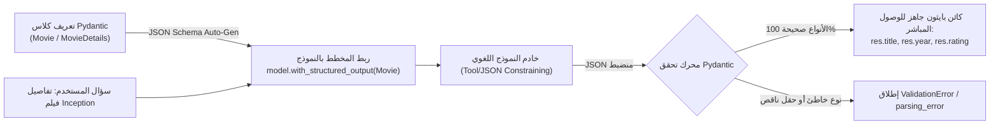

<div dir="rtl">

# الدليل المعماري الشامل: المخرجات المهيكلة والتحقق عبر `Pydantic` (`Structured Outputs`)
### Schema Enforcement, `Field` Validation, `include_raw=True` Telemetry, and Nested Schemas (Lecture 63)

---

## 1. الدافع الهندسي: لماذا تفشل النصوص الحرة في الأنظمة الإنتاجية؟

عندما تطلب من نموذج لغوي عادي (`Plain LLM`) تلخيص تفاصيل فيلم أو استخراج بيانات عميل عبر `model.invoke("Provide details about Inception")`:
* سيعيد النموذج نصاً أدبياً حراً ومتغيراً في كل مرة.
* إذا أرادت قاعدة بيانات أو واجهة `REST API` أو خط أنابيب بيانات (`Data Pipeline`) قراءة "السنة" كرقم صحيح (`int`) و"التقييم" كرقم عشري (`float`)، فسيكون تحليل النص الحر (`Regex Parsing`) هشاً وينهار عند أي تغير في صياغة النموذج.

**الحل المعماري — المخرجات المهيكلة (`Structured Outputs`)**:
إلزام النموذج اللغوي بإخراج استجابة تطابق مخطط بيانات برمجي صارم (`Schema Enforcement`) عبر دالة **`model.with_structured_output(Schema)`**.

</div>



<div dir="rtl">

---

## 2. ثلاث ركائز لـ `Pydantic` (`BaseModel` + `Field`)

تدعم `LangChain` ثلاثة قوالب لهيكلة المخرجات (`Pydantic`, `TypedDict`, `Dataclasses`)، ويتربع **`Pydantic`** على القمة الإنتاجية بفضل ثلاث ميزات حاسمة:

1. **التحقق الفوري للأنواع (`Runtime Field Validation`)**:
   * يضمن أن حقل `title` نص (`str`)، وحقل `year` رقم صحيح (`int`)، وحقل `rating` عشري (`float`). إذا أعاد النموذج نصاً مكان الرقم أو العكس، يكتشفه `Pydantic` فوراً ولا يسمح بتسرب بيانات تالفة لقاعدة البيانات.
2. **الأوصاف الموجهة للنموذج (`LLM-Facing Field Descriptions`)**:
   * تمرير `Field(..., description="...")` يغذي النموذج بتعليمات دقيقة حول معنى كل حقل وصيغته المتوقعة.
   * **ملاحظة هندسية مهمة**: عند طلب أرقام ذات وحدات قياس (مثل الميزانية بالمليون دولار)، يجب صياغة الوصف بوضوح مثل: `"Budget expressed in millions of USD (e.g., write 160.0 for $160 million)"`؛ لأن الوصف العام `"Budget in millions USD"` قد يدفع النموذج أحياناً لكتابة `160000000.0` بدلاً من `160.0`.
3. **الهياكل المتداخلة (`Nested Schemas`)**:
   * دعم تعريف كلاس داخل قائمة في كلاس آخر (مثل قائمة ممثلين `List[Actor]` داخل `MovieDetails`).

```python
from pydantic import BaseModel, Field

class Movie(BaseModel):
    title: str = Field(..., description="The title of the movie")
    year: int = Field(..., description="The year the movie was released")
    director: str = Field(..., description="The director of the movie")
    rating: float = Field(..., description="The movie's rating out of 10")

model_with_structure = model.with_structured_output(Movie)
response = model_with_structure.invoke("Provide details about the movie Inception")
# المخرج كائن Movie مباشر: response.director == 'Christopher Nolan'
```

---

## 3. حفظ الرسالة الخام والبيانات الوصفية (`include_raw=True`)

عند استدعاء `model.with_structured_output(Movie)` افتراضياً، يُرجع الكائن المهيكل (`Movie`) فقط ويتم التخلص من رسالة `AIMessage` الأصلية، مما يضيع بيانات **`usage_metadata`** (استهلاك التوكنز والتكلفة).

لتفادي ذلك في الإنتاج، نمرر المعامل **`include_raw=True`**:
```python
model_with_raw = model.with_structured_output(Movie, include_raw=True)
result = model_with_raw.invoke("Provide details about the movie Inception")
```
يُرجع هذا الاستدعاء قاموساً يضم 3 مفاتيح استراتيجية:
1. **`result["raw"]`**: كائن `AIMessage` الأصلي كاملاً (يحمل `usage_metadata`، الـ ID، وبيانات التتبع).
2. **`result["parsed"]`**: كائن `Movie` المهيكل بعد نجاح التحقق (أو `None` عند الفشل).
3. **`result["parsing_error"]`**: قيمة `None` عند النجاح، أو استثناء الخطأ الدقيق عند فشل التحليل؛ مما يمنع انهيار التطبيق (`Graceful Degradation`).

---

## 4. الهياكل المتداخلة المعقدة (`Nested Pydantic Structures`)

عند استخراج وثائق مؤسسية (مثل الفواتير التي تضم قائمة بنود، أو ملفات الأفلام التي تضم طاقم عمل متعدد):

```python
from typing import List, Optional

class Actor(BaseModel):
    name: str
    role: str

class MovieDetails(BaseModel):
    title: str
    year: int
    cast: List[Actor]  # هيكل متداخل: قائمة كائنات من نوع Actor
    genres: List[str]
    budget: Optional[float] = Field(None, description="Budget in millions USD (e.g. 160.0)")
```

---

## 5. أسئلة المقابلات المتقدمة للـ Senior AI Engineers

### س1: كيف تعمل دالة `with_structured_output()` داخلياً مع مزودي النماذج مثل OpenAI و Groq؟
**الإجابة النموذجية:**
تستخدم `with_structured_output` إحدى آليتين حسب قدرات النموذج ومزود الخدمة:
1. **Tool/Function Calling Method** (الوضع الافتراضي الشائع في Groq و نماذج LangChain): تحول `Pydantic` كلاس إلى `JSON Schema` وتمرره للنموذج كـ أداة إلزامية (`tool_choice="any"` أو اسم الكلاس)، ثم تحلل الحجج (`tool_calls[0]["args"]`) عبر `PydanticOutputParser`.
2. **Native JSON Schema (`json_schema` / Constrained Decoding)**: في أحدث النماذج مثل OpenAI GPT-4o، تفرض واجهة الـ API قيوداً على مستوى أخذ عينات التوكنز (`Logit Biasing / CFG`) تضمن هندسياً استحالة توليد رمز لا يتطابق مع المخطط بنسبة $100\%$.

### س2: لماذا يُعد استخدام `include_raw=True` إلزامياً في أنظمة الإنتاج المالية والطبية؟
**الإجابة النموذجية:**
لسببين معماريين جوهريين:
1. **مراقبة التكاليف والأداء (`FinOps & Observability`)**: بدون `include_raw=True` تفقد حقول `usage_metadata` فلا تستطيع حساب فاتورة التوكنز (بما فيها توكنز التفكير الخفية) لكل طلب استخراج.
2. **المرونة الدفاعية (`Defensive Error Handling`)**: عند فشل النموذج في مطابقة حقل صارم، يقوم وضع `include_raw=False` بإطلاق استثناء مباشر يكسر مسار التنفيذ. أما `include_raw=True` فيحتوي الخطأ داخل المفتاح `parsing_error` ويمنحك النص الخام `raw` لتتمكن من تمريره لحلقة تصحيح ذاتي (`Self-Correction Retry`)!

</div>
