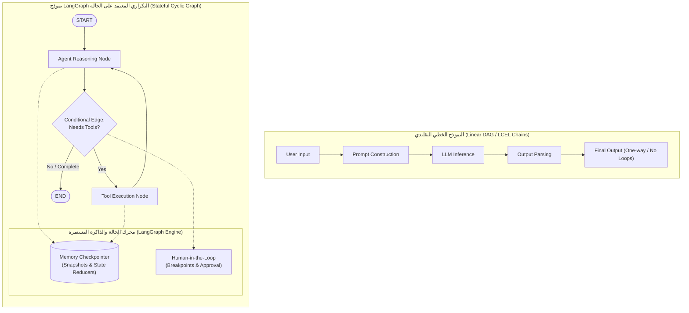
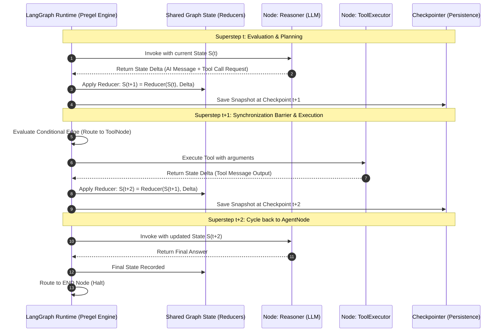
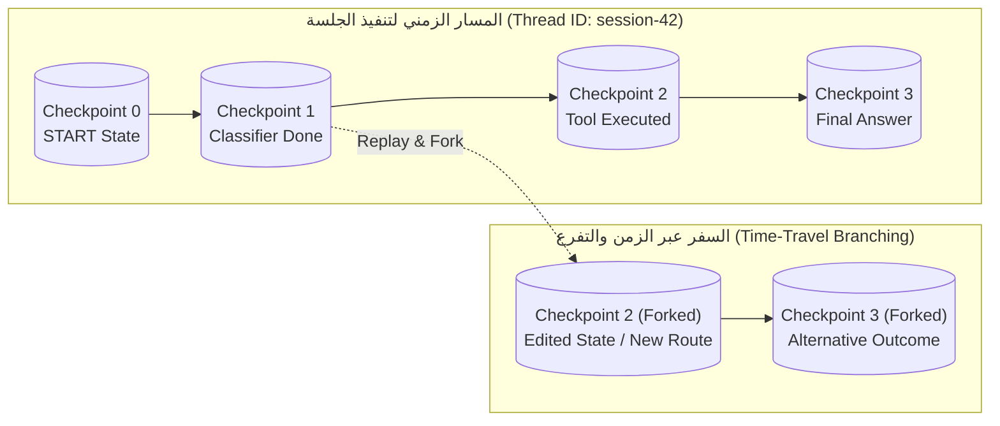

<div dir="rtl">

# الدليل المعماري الشامل: أساسيات LangGraph والأنظمة متعددة الوكلاء المعتمدة على الحالة (LangGraph Foundations & Stateful Multi-Actor Architecture)
### Graph Topology, Pregel/BSP Execution Model, State Reducers, Memory Checkpointing, and Human-in-the-Loop Orchestration (Lecture 68)

---

## 1. المدخل المعماري: لماذا نحتاج LangGraph؟ وما هو تحول الرسوم البيانية؟

في بدايات ثورة نماذج اللغات الكبيرة (`LLMs`)، اعتمدت أطر العمل مثل `LangChain` ومحركات الـ `ETL` على خطوط أنابيب خطية أو رسوم بيانية موجهة غير دائرية (**`DAGs - Directed Acyclic Graphs`**). في هذا النموذج الخطي، يتدفق المدخل $x$ عبر سلسلة من الدوال أو الطبقات بالتتابع:
$$x \longrightarrow f_1(x) \longrightarrow f_2(f_1(x)) \dots \longrightarrow y$$

وعلى الرغم من كفاءة السلاسل الخطية (`Chains`) في المهام البسيطة مثل الترجمة أو التلخيص أو الاسترجاع الأساسي (`Naive RAG`)، إلا أنها تعجز تماماً عند بناء **أنظمة الوكلاء الذكية الحقيقية (`Production Agentic AI Systems`)**. فالوكيل في العالم الحقيقي يحتاج إلى:
1. **التكرار وحلقات الاسترجاع (`Cycles & Loops`)**: التفكير ثم التصرف ثم الملاحظة، وإذا لم تكن النتيجة مرضية، إعادة الكرة مجدداً (`Reflection & Self-Correction`).
2. **إدارة الحالة المتطورة (`Statefulness`)**: تخزين سياق الجلسة، نتائج الأدوات، والرسائل السابقة في بنية بيانات مركزية آمنة دون فقدان المعلومات.
3. **تعدد الفاعلين (`Multi-Actor Coordination`)**: تشغيل وكلاء متعددين مستقلين أو عقد حسابية متخصصة تتبادل الرسائل وتحدث الحالة المشتركة بالتوازي أو بالتعاقب.
4. **التسامح مع الأخطاء وإمكانية التوقف والاستئناف (`Fault Tolerance & Persistence`)**: حفظ لقطة كاملة (`Snapshot`) لحالة النظام بعد كل خطوة، مما يتيح استئناف العمليات الطويلة، وتتبع الخطوات زمنياً (`Time-Travel`).
5. **التدخل البشري المحكم (`Human-in-the-Loop - HITL`)**: تعليق التنفيذ قبل اتخاذ إجراءات حساسة (كالتحويلات المالية أو استدعاء أدوات الحذف) لطلب موافقة أو توجيه المستخدم البشري.

لهذه الأسباب ظهر إطار **`LangGraph`**؛ وهو مكتبة حوسبية منخفضة المستوى (`Low-Level Orchestration Engine`) لبناء تطبيقات ذكاء اصطناعي تعتمد على الرسوم البيانية الموجهة التكرارية (`Stateful Cyclic Graphs`)، وهو المحرك الأساسي الذي تعتمد عليه كبرى الشركات التقنية العالمية اليوم في بيئات الإنتاج (مثل LinkedIn و Uber و Klarna و GitLab و Elastic و Replit).

</div>



<div dir="rtl">

---

## 2. الجذور النظرية: نموذج Pregel ومفهوم الحوسبة التزامنية الفائقة (Bulk Synchronous Parallel - BSP)

استلهم فريق عمل `LangGraph` تصميمه المعماري من نظامين حوسبيين رائدين في معالجة البيانات الكبيرة:
1. **Apache Beam**: النموذج الموحد لمعالجة التدفقات والبيانات الدفعية (`Batch & Stream Processing ETL Pipelines`).
2. **Google Pregel**: الورقة البحثية التاريخية لشركة جوجل (2010) حول معالجة الرسوم البيانية الضخمة عبر نموذج **الحوسبة التزامنية الفائقة (`Bulk Synchronous Parallel - BSP`)**.

### كيف يعمل نموذج Pregel / BSP في LangGraph؟
في نموذج Pregel، يتم تقسيم معالجة الجراف إلى مراحل متتالية تُسمى **الخطوات الفائقة (`Supersteps`)**:

1. **العقد كفاعلين مستقلين (`Vertices / Nodes as Actors`)**: كل عقدة في الجراف تمثل دالة أو وكيلاً حسابياً ينفذ منطقاً محدداً مستقلاً عن العقد الأخرى.
2. **تبادل الرسائل وتحديث الحالة (`Message Passing & State Mutation`)**: في كل خطوة فائقة ($t$)، تستقبل العقدة النشطة مدخلات الحالة، وتنفذ عملياتها (مثل استدعاء LLM أو تنفيذ أداة خارجية)، ثم ترسل تحديثاً (`Delta Update` $\Delta S$) إلى الحالة المشتركة.
3. **حاجز المزامنة (`Synchronization Barrier`)**: لا تبدأ الخطوة الفائقة التالية ($t+1$) حتى تنتهي كافة العقد النشطة في الخطوة الحالية من تنفيذ حساباتها وتطبيق تحديثاتها عبر دوال الدمج (`Reducers`).
4. **التصويت على الإنهاء (`Vote to Halt`)**: تتوقف الدورة الحسابية تلقائياً عندما تعود كافة العقد إلى حالة السكون ولا توجد حواف أو شروط إضافية تستدعي عقداً جديدة، أو عند الوصول إلى العقدة الخاصة `END`.

</div>



<div dir="rtl">

---

## 3. الصياغة الرياضية لنظام الحالة والانتقالات في LangGraph

يمكن نمذجة نظام `LangGraph` كآلة حالات منتهية وموجهة رياضياً عبر الخماسية:
$$\mathcal{G} = \langle \mathcal{S}, \mathcal{V}, \mathcal{E}, \mathcal{C}, \mathcal{R} \rangle$$

حيث:
* $\mathcal{S}$ هي **فضاء الحالة الكلي (`State Space`)**: يمثل بنية البيانات المشتركة بين جميع العقد (مُعرّفة كـ `TypedDict` أو `Pydantic BaseModel`).
* $\mathcal{V} = \{v_1, v_2, \dots, v_n\}$ هي **مجموعة العقد (`Nodes`)**: كل عقدة $v_i \in \mathcal{V}$ هي دالة تحويلية $f_i: \mathcal{S} \to \Delta \mathcal{S}_i$ تأخذ الحالة الحالية وتُنتج تغييراً جزئياً.
* $\mathcal{E} \subseteq \mathcal{V} \times \mathcal{V}$ هي **الحواف المباشرة (`Direct Edges`)**: تحدد المسارات الحتمية الثابتة بين عقدة وأخرى، مثل:
  $$(v_a, v_b) \implies v_b \text{ executes immediately after } v_a$$
* $\mathcal{C}$ هي **الحواف الشرطية الموجهة (`Conditional Routing Edges`)**: دوال اتخاذ القرار $g_c: \mathcal{S} \to \mathcal{V}$ التي تفحص الحالة الناتجة وتحدد العقدة التالية ديناميكياً:
  $$v_{\text{next}} = g_c(S_t) \quad \text{where } g_c(S_t) \in \{\text{ToolNode}, \text{Evaluator}, \text{END}\}$$
* $\mathcal{R}$ هي **دالة تقليص/دمج الحالة (`State Reducer Function`)**: المسؤولة عن دمج التحديثات الجزئية مع الحالة السابقة لإنتاج الحالة الجديدة:
  $$S_{t+1} = \mathcal{R}(S_t, \Delta S_t)$$
  في حالة الرسائل (`Messages State`)، تكون دالة الاختزال الشائعة هي دالة الإلحاق أو الاستبدال المعرف:
  $$\mathcal{R}_{\text{messages}}(M_t, \Delta M) = M_t \cup \Delta M$$

---

## 4. المكونات المعمارية الأساسية لـ LangGraph (The Core Building Blocks)

يتألف أي تطبيق يعتمد على `LangGraph` من خمسة عناصر رئيسية يجب على مهندس الذكاء الاصطناعي إتقانها:

### 1. الحالة العامة للجراف (`The Graph State`)
تمثل الحالة "السبورة المركزية" (`Blackboard`) التي يقرأ منها جميع الفاعلين ويكتبون فيها. يتم تعريفها عادة باستخدام `TypedDict` في بايثون:
```python
from typing import Annotated, List, TypedDict
from langchain_core.messages import BaseMessage
from langgraph.graph.message import add_messages


class AgentState(TypedDict):
  messages: Annotated[List[BaseMessage], add_messages]
  iteration_count: int
  user_verified: bool
```
> **مفهوم الـ Reducer**: استخدام `Annotated[..., add_messages]` يخبر `LangGraph` أنه عند إرجاع قائمة رسائل جديدة من أي عقدة، لا تقم بمسح الرسائل السابقة، بل ألحقها بالقائمة تلقائياً (`Append`).

### 2. العقد الحسابية (`Nodes`)
العقدة هي ببساطة دالة بايثون تأخذ الحالة الحالية كوسيط (`state: AgentState`) وتُرجع قاموساً يحتوي التعديل على الحالة:
```python
def call_model(state: AgentState) -> dict:
  response = model.invoke(state["messages"])
  return {"messages": [response], "iteration_count": state["iteration_count"] + 1}
```

### 3. الحواف والحواف الشرطية (`Edges & Conditional Edges`)
* **العقد الخاصة**:
  * `START`: نقطة الدخول الرسمية التي تستقبل مدخلات المستخدم الأولى.
  * `END`: نقطة النهاية التي تدل على اكتمال المعالجة وتوقف الجراف.
* **الحافة الثابتة**:
  ```python
  workflow.add_edge(START, "classifier_node")
```
* **الحافة الشرطية (`Conditional Edge`)**:
  ```python
  workflow.add_conditional_edges(
      "classifier_node",
      route_query,  # دالة تفحص الحالة وترجع اسم العقدة القادمة
      {"execute_tool": "tools_node", "direct_answer": "responder_node"},
  )
```

---

## 5. إدارة الذاكرة ونقاط التفتيش (`Memory Checkpointing & State Persistence`)

من أقوى ميزات `LangGraph` التي تجعله جاهزاً للإنتاج هي معمارية **نقاط التفتيش (`Checkpointers`)**. في السلاسل التقليدية، إذا انقطع الاتصال أو أغلقت الجلسة، تُفقد كافة الحسابات السابقة. أما في `LangGraph`:

1. **اللقطات الدورية (`Snapshots`)**: يقوم محرك الحفظ (مثل `InMemorySaver` أو `SqliteSaver` أو `PostgresSaver`) بحفظ لقطة كاملة لكل خطوة فائقة مع معرّف المسار (`thread_id`).
2. **عزل المسارات (`Thread Isolation`)**: يمكن تشغيل آلاف الجلسات المتزامنة للمستخدمين دون أي تداخل في الذاكرة عبر تحديد `thread_id` فريد لكل محادثة:
   ```python
   config = {"configurable": {"thread_id": "session-user-42"}}
   app.invoke({"messages": [...]}, config=config)
```
3. **السفر عبر الزمن (`Time-Travel & State Forking`)**: تتيح نقاط التفتيش للمطور قراءة سجل الحالات السابق، واسترجاع حالة الجراف عند النقطة $t=3$ مثلاً، وإعادة توجيه التنفيذ في مسار جديد تماماً دون الحاجة لإعادة تشغيل الحسابات من الصفر!

</div>



<div dir="rtl">

---

## 6. التدخل البشري في حلقة التنفيذ (`Human-in-the-Loop - HITL`)

في بيئات المؤسسات الحساسة (مثل الرعاية الصحية، الشؤون القانونية، والأنظمة المالية)، لا يُسمح للوكيل باتخاذ قرارات قطعية وتنفيذها دون موافقة بشرية (`Human Oversight`).
يوفر `LangGraph` دعماً أصيلاً للتدخل البشري عبر خاصية **نقاط التوقف (`Interrupts & Breakpoints`)**:

* **`interrupt_before`**: يوقف تنفيذ الجراف قبل دخول عقدة معينة (مثلاً: إيقاف الجراف قبل استدعاء عقدة `execute_financial_transfer`).
* **`interrupt_after`**: يوقف الجراف بعد تنفيذ عقدة معينة لعرض الناتج على المشرف البشري للتعديل أو التأكيد.

عند حدوث التوقف (`Interrupt`)، يُخزن الجراف الحالة بدقة في الـ `Checkpointer`. يمكن للمستخدم مراجعة الحالة، تعديل البيانات إذا لزم الأمر، ثم إصدار أمر استئناف التنفيذ (`Resume`) بسلاسة تامة.

---

## 7. مقارنة معمارية وهندسية: LangGraph مقابل أطر عمل الوكلاء الأخرى

| المعيار الهندسي | LangGraph | LangChain Legacy Chains | CrewAI | AutoGen |
| :--- | :--- | :--- | :--- | :--- |
| **طوبولوجيا التحكم** | رسوم بيانية دائرية (`Cyclic Graphs`) | سلاسل خطية أحادية (`Linear DAG`) | أدوار ومهام هرمية (`Role-Based`) | محادثة متعددة الوكلاء (`Conversational`) |
| **مستوى التحكم (`Granularity`)** | دقيق جداً ومنخفض المستوى (`Low-Level`) | عالي المستوى وجامد (`Rigid`) | معلب ومبسط (`Opinionated`) | معتمد على الحوار التلقائي |
| **إدارة الحالة المتطورة** | بنية حالة صريحة مع `Reducers` | ضمنية وغير مستقرة | داخلية ومخفية في المهام | عبر تاريخ الرسائل فقط |
| **نقاط التفتيش والذاكرة** | أصيلة عبر `Checkpointers` متعددة | غير موجودة أصلياً | محدودة في الذاكرة | محدودة |
| **السفر عبر الزمن (`Time-Travel`)** | مدعوم أصلياً بالكامل | غير مدعوم | غير مدعوم | غير مدعوم |
| **التدخل البشري (`HITL`)** | نقاط توقف دقيقة (`Breakpoints`) | معقد ويحتاج `Callbacks` | دعم عبر مدخلات نصية | دعم عبر التفاعل النصي |
| **الجاهزية للإنتاج (`Production`)** | مصمم خصيصاً للمؤسسات والإنتاج | مناسب للنماذج التجريبية | مناسب للسيناريوهات السريعة | مناسب للبحوث والتجارب |

---

## 8. أسئلة المقابلات المتقدمة لمهندسي الذكاء الاصطناعي (Senior AI Engineer Interview Q&A)

### س1: ما الفارق الجوهري بين محرك الرسوم البيانية الخطي (DAG) والرسوم البيانية الموجهة التكرارية (Cyclic Graphs) في سياق الوكلاء الأذكياء؟
**الإجابة النموذجية:**
الـ DAG ينفذ تدفقاً باتجاه واحد فقط دون إمكانية الرجوع إلى الوراء. في الوكلاء الأذكياء، تتطلب العمليات المعقدة بطبيعتها حلقات تكرارية (`Feedback Loops`) لتمكين الوكيل من فحص نواتج الأدوات، اكتشاف الأخطاء وتصحيحها ذاتياً (`Self-Correction`)، وإعادة المحاولة حتى الوصول للحل الأمثل. يوفر `LangGraph` هذه الإمكانية التكرارية عبر محرك `Pregel` دون حدوث حلقات لانهائية غير منضبطة بفضل إدارة عدد التكرارات القصوى (`recursion_limit`).

### س2: كيف يمنع LangGraph تضارب البيانات عند قيام عدة عقد بتحديث الحالة في نفس الخطوة الفائقة؟
**الإجابة النموذجية:**
من خلال استخدام **دوال التقليص (`Reducers`)** مع مكتبة `typing.Annotated`. بدلاً من السماح للعقد باستبدال الحالة السابقة بالكامل، تُعيد كل عقدة تحديثاً جزئياً (`Delta`). يقوم محرك `LangGraph` عند حاجز المزامنة (`Synchronization Barrier`) بتطبيق دالة الاختزال المحددة (مثل `add_messages`) لدمج التحديثات بترتيب زمني منضبط، مما يضمن الاتساق الحسابي التام (`State Consistency`).

### س3: ما هو الدور الذي يلعبه الـ `thread_id` في نظام `Checkpointing`، وكيف يدعم تطبيقات الـ Production؟
**الإجابة النموذجية:**
الـ `thread_id` هو المفتاح الأساسي لتحديد سياق الجلسة المستقلة في قاعدة بيانات نقاط التفتيش. يسمح للنظام بخدمة مئات الآلاف من المستخدمين في آن واحد على نفس تطبيق الجراف دون أي تداخل في الذاكرة. كما يسمح باستئناف المحادثات بعد انقطاع الاتصال أو خمول الجلسات لأيام، ويوفر إمكانية التدقيق الأمني (`Audit Trail`) لكل خطوة اتخذها الوكيل.

---

</div>
