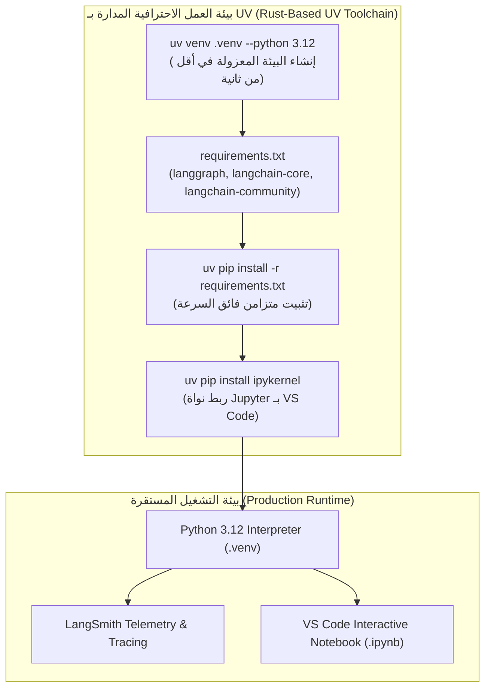

<div dir="rtl">

# الدليل المعماري الشامل: تأسيس بيئة عمل وكلاء LangGraph باستخدام مدير الحزم السريع UV وهندسة المراقبة (UV-Powered LangGraph Environment & Telemetry Architecture)
### Fast Rust-Based Environment Management (UV), Virtual Prefix Isolation, VS Code Kernel Configuration, and Production Telemetry (Lecture 69)

---

## 1. المدخل المعماري: لماذا نحتاج مدير الحزم السريع `uv` مع LangGraph؟

تختلف تطبيقات الوكلاء المعتمدة على الحالة (`Stateful Agentic Applications`) مثل **`LangGraph`** جذرياً عن مشاريع بايثون التقليدية. فالوكيل ليس مجرد سكريبت ينفذ دالة ويغلق؛ بل هو نظام يتكامل مع:
1. **محرك حوسبة موزع وموجّه للحالة (`Pregel BSP Engine`)** يتطلب تزامن الإصدارات بين `langgraph` و `langchain-core` و `pydantic`.
2. **بروتوكولات استدعاء الأدوات الخارجية (`Tool Calling Protocols`)** وحزم تكامل متنوعة (`langchain-community`, `groq`, `openai`).
3. **أجهزة مراقبة وتتبع فوري (`Observability & Tracing`)** مثل `LangSmith` التي تعترض كل خطوة فائقة (`Superstep`) لتسجيل الحالة وحساب التكلفة والكمون (`Latency`).

إذا استخدمنا مديري البيئات القديمة (مثل `Conda` أو `Pip` التقليدي)، سنواجه:
* بطء شديد في فحص شجرة التبعيات (`Dependency Resolution`) قد يستغرق دقائق طويلة.
* استهلاك ضخم لمساحات التخزين.
* تعليق محتمل عند تضارب الحزم الثنائية.

لذلك، يمثل **`uv`** (المكتوب بلغة Rust بواسطة Astral) الحل المعماري القياسي للإنتاج؛ حيث يوفر إنشاء البيئات وتثبيت الحزم وحل شجرة التبعيات في **أجزاء من الثانية (10 إلى 100 ضعف سرعة Conda و Pip)**.

</div>



<div dir="rtl">

---

## 2. خطوات تأسيس بيئة العمل العملية باستخدام `uv` (خطوة بخطوة)

بدلاً من انتظار إنشاء بيئات `Conda` البطيئة، إليك سير العمل المعياري المعتمد باستخدام `uv`:

### الخطوة 1: إنشاء مجلد المشروع والبيئة المعزولة محلياً
```bash
# إنشاء مجلد العمل
mkdir agentic_workspace
cd agentic_workspace

# إنشاء بيئة افتراضية محلية ببايثون 3.12 في لحظات معدودة:
uv venv .venv --python 3.12
```

> **مفهوم الـ Prefix Environment في `uv`**: مجلد `.venv` يُنشأ داخل المشروع نفسه، مما يضمن العزل التام وسهولة الحذف أو النقل إلى الحاويات (`Docker`) دون تلويث النظام.

### الخطوة 2: تفعيل البيئة الافتراضية
* على نظام **Windows (PowerShell)**:
  ```powershell
  .venv\Scripts\Activate.ps1
  ```
* على نظام **Windows (Command Prompt)**:
  ```cmd
  .venv\Scripts\activate.bat
  ```
* على نظام **Linux / macOS**:
  ```bash
  source .venv/bin/activate
  ```

---

## 3. مصفوفة التبعيات الأساسية لتطبيقات LangGraph (`requirements.txt`)

قم بإنشاء ملف `requirements.txt` وضع فيه الحزم الأساسية:

```text
# نواة محرك الرسوم البيانية المعتمدة على الحالة
langgraph>=0.2.0

# الرسائل والواجهات المعيارية الأساسية
langchain-core>=0.3.0

# الأدوات والتكاملات الجاهزة مع قواعد البيانات والمتجهات
langchain-community>=0.3.0

# واجهات التنسيق العليا
langchain>=0.3.0

# مزودات نماذج الاستدلال (سريعة ومفتوحة المصدر وتجارية)
langchain-groq
langchain-openai

# إدارة المتغيرات والأسرار
python-dotenv
```

### تثبيت التبعيات بسرعة فائقة باستخدام `uv pip`:
```bash
uv pip install -r requirements.txt
```

---

## 4. تجهيز نواة Jupyter داخل VS Code (`ipykernel`)

لتشغيل الدفاتر التفاعلية (`.ipynb`) داخل VS Code دون أن تظهر رسالة الخطأ الشهيرة:
> *"Running cells with 'venv' requires the ipykernel package."*

نقوم بتثبيت حزمة النواة داخل بيئة `uv`:
```bash
uv pip install ipykernel
```

### ربط النواة في VS Code:
1. افتح أي ملف `.ipynb` داخل VS Code.
2. اضغط في الزاوية العلوية اليمنى على **`Select Kernel`**.
3. اختر **`Python Environments`**.
4. حدد مسار البيئة المحلية: **`.venv (Python 3.12)`**.

---

## 5. منظومة المتغيرات البيئية والتتبع المؤسسي (`.env & LangSmith`)

أنشئ ملف `.env` في جذر المشروع لتأمين مفاتيحك وتفعيل التتبع:

```env
# مفاتيح مزودات الاستدلال
GROQ_API_KEY=gsk_...
OPENAI_API_KEY=sk-...

# تتبع ومراقبة وكلاء LangGraph عبر LangSmith
LANGCHAIN_TRACING_V2=true
LANGCHAIN_ENDPOINT=https://api.smith.langchain.com
LANGCHAIN_API_KEY=lsv2_pt_...
LANGCHAIN_PROJECT=rag-mastery-langgraph
```

### لماذا يعتبر تتبع `LangSmith` أمراً مصيرياً لوكلاء LangGraph؟
في أنظمة الـ `Stateful Cyclic Graphs`، يدور الوكيل في حلقات تفكير وتصحيح ذاتي واستدعاء أدوات متعددة. يوفر `LangSmith`:
* **تتبع كل خطوة فائقة (`Superstep Telemetry`)**: فحص المدخلات والمخرجات لكل عقدة على حدة.
* **رصد زمن الاستجابة والتكلفة (`Latency & Token Economics`)**: حساب تكلفة استدعاء النماذج بالملي ثانية وسنتات الدولار.
* **شجرة اتخاذ القرار التفاعلية (`Execution DAG`)**: تصور بصري للمسار الذي سلكه الوكيل بين العقد.

---

## 6. جدول مقارنة هندسي: `uv` مقابل `Conda` و `Pip`

| المعيار الهندسي | مدير الحزم الحديث `uv` | بيئة `Conda` التقليدية | مدير `pip` المدمج |
| :--- | :--- | :--- | :--- |
| **لغة البناء والسرعة** | Rust (أجزاء من الثانية) | Python / C (عدة دقائق) | Python (متوسط) |
| **حل شجرة التبعيات** | فائق السرعة عبر خوارزمية PubGrub | بطيء جداً ومستهلك للذاكرة | خطي وبسيط |
| **دعم البيئة المحلية** | أصلي وتلقائي (`uv venv .venv`) | يحتاج علم صريح (`-p ./venv`) | يحتاج أمر `python -m venv` |
| **إدارة ملف القفل** | `uv.lock` فائق الدقة | معقد ويحتاج قنوات | يحتاج أدوات خارجية |
| **التوافق مع الإنتاج و Docker**| الخيار الأول عالمياً حالياً | ثقيل جداً في صور Docker | قياسي لكنه بطيء |

---

## 7. أسئلة المقابلات المتقدمة لمهندسي الذكاء الاصطناعي (Senior AI Engineer Interview Q&A)

### س1: ما الفائدة المعمارية من تفضيل `uv` على `conda` في بيئات الحاويات (`Docker`) الخاصة بوكلاء الذكاء الاصطناعي؟
**الإجابة النموذجية:**
بيئات `conda` تضيف مئات الميجابايت من الملفات الثنائية غير الضرورية مما يضخم حجم صورة Docker ويطيل زمن الـ Build والـ Deployment لعدة دقائق. في المقابل، ملف `uv` الثنائي حجمه صغير جداً ويعمل في بيئة خفيفة (`Distroless / Alpine / Debian Slim`) ويثبت حزم `LangGraph` في ثوانٍ معدودة، مما يخفف استهلاك الذاكرة ويقلل سطح الهجوم الأمني (`Attack Surface`).

### س2: كيف نضمن أن كود بايثون في Jupyter داخل VS Code يقرأ المتغيرات من `.env` بشكل قطعي؟
**الإجابة النموذجية:**
من خلال استدعاء `dotenv.load_dotenv()` في الخلية الأولى من الدفتر البرمجي، أو ضبط إعداد `python.envFile: "${workspaceFolder}/.env"` في ملف `.vscode/settings.json`. هذا يضمن حقن المتغيرات السرية تلقائياً في `os.environ` دون الحاجة لتعريفها يدوياً في نظام التشغيل.

---

</div>
