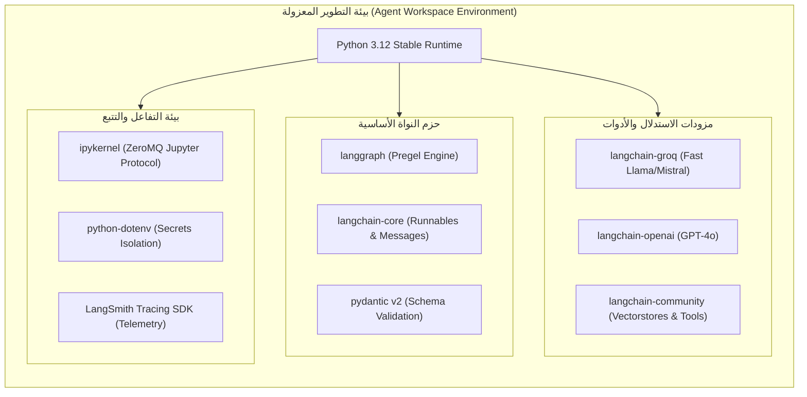
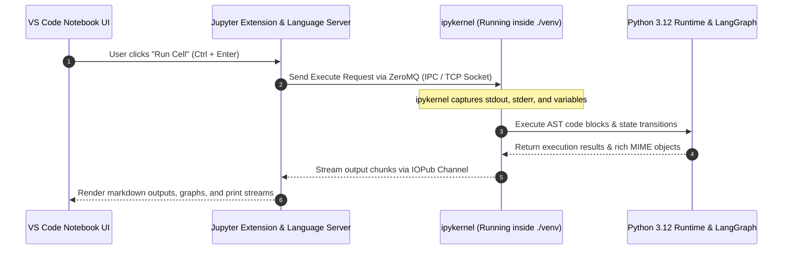

<div dir="rtl">

# الدليل المعماري الشامل: بيئة تشغيل وكلاء LangGraph وهندسة المراقبة والتتبع (LangGraph Environment & Telemetry Architecture)
### Prefix Isolation, Dependency Resolution (Conda vs UV), VS Code Kernel Architecture, and Production Observability (Lecture 69)

---

## 1. المدخل المعماري: لماذا تتطلب تطبيقات الوكلاء بيئة تشغيل معزولة بصرامة؟

تختلف تطبيقات الوكلاء المعتمدة على الحالة (`Stateful Agentic Applications`) مثل **`LangGraph`** جذرياً عن مشاريع بايثون التقليدية. فالوكيل ليس مجرد سكريبت ينفذ دالة ويغلق؛ بل هو نظام يتكامل مع:
1. **محرك حوسبة موزع وموجّه للحالة (`Pregel BSP Engine`)** يتطلب تزامن الإصدارات بين `langgraph` و `langchain-core` و `pydantic`.
2. **بروتوكولات استدعاء الأدوات الخارجية (`Tool Calling Protocols`)** وحزم تكامل متنوعة (`langchain-community`, `groq`, `openai`).
3. **أجهزة مراقبة وتتبع فوري (`Observability & Tracing`)** مثل `LangSmith` التي تعترض كل خطوة فائقة (`Superstep`) لتسجيل الحالة وحساب التكلفة والكمون (`Latency`).

إذا حدث تضارب في إصدارات الحزم (`Dependency Drift` أو `DLL Hell`)، ستنهار آليات التحقق من صحة الحالة (`State Schema Validation`) أثناء تشغيل الوكيل، مما يؤدي إلى فشل صامت أو توقف غير متوقع في بيئات الإنتاج.

</div>



<div dir="rtl">

---

## 2. معمارية البيئات المعزولة محلياً: علم البيئات المحددة بالمسار (`Prefix Environments`)

في المحاضرة، تم استخدام الأمر:
```bash
conda create -p ./venv python=3.12 -y
```

### ما هو الفرق بين البيئة المسماة (`Named Environment`) والبيئة المحددة بالمسار (`Prefix-Based Environment`)؟
* **البيئة المسماة (`Named Environment`)**: تُنشأ باستخدام `conda create -n myenv`. يتم حفظ كافة الملفات الثنائية في مجلد مركزي عالمي في مسار المستخدم (مثل `~/miniconda3/envs/myenv`).
  * **المشكلة المعمارية**: صعوبة نقل المشروع إلى خادم آخر، وتراكم عشرات البيئات المهملة في المجلد المركزي، واحتمال تشابه الأسماء بين المشاريع المختلفة.
* **البيئة المحددة بالمسار (`Prefix Environment -p ./venv`)**: تُنشأ مباشرة داخل مجلد المشروع نفسه (`./venv`).
  * **الميزة الإنتاجية**: عزل كامل وشفافية تامة؛ فحذف المجلد يحذف البيئة تماماً دون ترك مخلفات في النظام. بمجرد فتح المجلد في بيئات الحاويات (`Docker`) أو خوادم الاستضافة، يمكن لمسارات العمل استهداف مفسر بايثون المحلي بدقة: `./venv/bin/python` أو `.\venv\python.exe`.

### المقارنة المعمارية مع مدير الحزم فائق السرعة `uv`:
في حين أن `conda` ممتاز في إدارة مكتبات `C/C++` الثنائية، إلا أنه يعاني من بطء شديد في فحص شجرة التبعيات (`SAT Solver Latency`). لذلك، يمثل مدير الحزم **`uv`** المعيار الحديث المتبع في مسارنا:
```bash
# إنشاء بيئة بايثون 3.12 معزولة في أجزاء من الثانية:
uv venv .venv --python 3.12

# تثبيت الحزم المتزامنة بسرعة تفوق conda بـ 10 إلى 100 ضعف:
uv pip install -r requirements.txt
```

---

## 3. مصفوفة التبعيات الأساسية لتطبيقات LangGraph (`requirements.txt`)

تعتمد منظومة `LangGraph` على تفكيك واضح للمسؤوليات (`Separation of Concerns`) عبر أربع حزم رئيسية:

```text
# نواة المحرك ومخطط الحالة
langgraph>=0.2.0

# الرسائل والواجهات المعيارية الأساسية
langchain-core>=0.3.0

# الأدوات والتكاملات الجاهزة مع قواعد البيانات والمتجهات
langchain-community>=0.3.0

# واجهات التنسيق العليا
langchain>=0.3.0

# مزودات نماذج الاستدلال
langchain-groq
langchain-openai

# إدارة المتغيرات والتتبع
python-dotenv
ipykernel
```

1. **`langgraph`**: يوفر محرك الرسم البياني (`StateGraph`)، نقاط الدخول والنهاية (`START`, `END`)، ومحركات حفظ الحالة والذاكرة (`MemorySaver`).
2. **`langchain-core`**: يوفر هياكل البيانات الأساسية للرسائل (`HumanMessage`, `AIMessage`, `ToolMessage`, `SystemMessage`) ودوال دمج الحالة (`add_messages`).
3. **`langchain-community`**: يوفر مئات الأدوات الخارجية والاتصالات بقواعد البيانات المتجهية.
4. **`ipykernel`**: يمثل الجسر البرمجي بين واجهة VS Code ومفسر بايثون داخل البيئة المعزولة.

---

## 4. معمارية قناة الاتصال بين VS Code ونواة بايثون (`Jupyter ZeroMQ Architecture`)

عند فتح ملف دفتر تفاعلي (`.ipynb`) داخل VS Code، لا يتم تشغيل الكود مباشرة داخل المحرر، بل يعمل وفق معمارية عميل وخادم (`Client-Server Model`):

</div>



<div dir="rtl">

إذا لم تكن حزمة **`ipykernel`** مثبتة داخل البيئة المعزولة (`./venv`)، سيفشل المحرر في إنشاء مقبس `ZeroMQ`، وستظهر رسالة الخطأ الشائعة:
> *"Running cells with 'venv' requires the ipykernel package."*

لذا فإن التثبيت الصريح لحزمة `ipykernel` وتعيين النواة (`Kernel Selector`) إلى مسار البيئة المحلية هو خطوة التأسيس الحرجة لأي مهندس ذكاء اصطناعي.

---

## 5. منظومة المتغيرات البيئية والتتبع المؤسسي (`Secrets Management & Telemetry`)

لا يمكن تشغيل وكيل ذكي في بيئة إنتاجية دون إدارة صارمة للمفاتيح والتتبع:

### 1. عزل المفاتيح (`.env`)
يتم تخزين المفاتيح في ملف `.env` محلي، مع إضافة الملف فوراً إلى `.gitignore`:
```env
# Inference Providers
GROQ_API_KEY=gsk_...
OPENAI_API_KEY=sk-...

# LangSmith Observability & Tracing
LANGCHAIN_TRACING_V2=true
LANGCHAIN_ENDPOINT=https://api.smith.langchain.com
LANGCHAIN_API_KEY=lsv2_pt_...
LANGCHAIN_PROJECT=rag-mastery-langgraph
```

### 2. أهمية التتبع عبر LangSmith لوكلاء LangGraph
في السلاسل البسيطة، يمكن الاكتفاء بـ `print()` لمتابعة المخرجات. أما في وكلاء `LangGraph` الذين يدورون في حلقات تكرارية معقدة (`Cycles`) مع استدعاء أدوات متعددة وتحديثات مستمرة للحالة، فإن **`LangSmith`** يوفر:
* **مراقبة كل خطوة فائقة (`Superstep Telemetry`)**: رؤية مدخلات ومخرجات كل عقدة على حدة مع الزمن المستغرق.
* **تتبع استهلاك الرموز والتكلفة (`Token Economics`)**: رصد تكلفة كل نداء للنموذج لمنع الحلقات اللانهائية باهظة الثمن.
* **فحص شجرة اتخاذ القرار (`Execution DAG Inspection`)**: رسم شجرة تفاعلية لكيفية تحرك الوكيل بين الأدوات والعقد.

---

## 6. جدول المقارنة الهندسية لمديري البيئات في مشاريع الذكاء الاصطناعي

| المعيار | `uv` (المعيار الحديث للمسار) | `Conda` (المستخدم في المحاضرة) | `python -m venv` القياسي | `Poetry` |
| :--- | :--- | :--- | :--- | :--- |
| **لغة البناء** | Rust (فائق السرعة) | Python / C | C / Python | Python |
| **سرعة تثبيت الحزم** | أجزاء من الثانية إلى ثوانٍ معدودة | بطيء جداً (عدة دقائق) | متوسط | بطيء نسبياً |
| **حل شجرة التبعيات (`Dependency Resolution`)** | سريع جداً وخالٍ من التعليق | بطيء ومستهلك للذاكرة | غير موجود (تثبيت خطي) | متقدم ولكن بطيء |
| **دعم البيئات المحلية (`Prefix`)** | مدعوم أصلياً (`uv venv .venv`) | مدعوم عبر علم `-p` | مدعوم أصلياً | غير مدعوم افتراضياً |
| **إدارة ملف الإقفال (`Lockfile`)** | `uv.lock` دقيق وسريع | معقد ويحتاج قنوات | غير متوفر افتراضياً | `poetry.lock` ممتاز |
| **التوصية الإنتاجية** | الخيار الأول للإنتاج والسرعة | ممتاز للمكتبات الثنائية المعقدة (CUDA) | مناسب للاختبارات السريعة | ممتاز لحزم المكتبات |

---

## 7. أسئلة المقابلات المتقدمة لمهندسي الذكاء الاصطناعي (Senior AI Engineer Interview Q&A)

### س1: لماذا يفضل استخدام Python 3.12 كبيئة عمل مستقرة لتطبيقات LangGraph حالياً؟
**الإجابة النموذجية:**
يوفر بايثون 3.12 تحسينات جوهرية في أداء المفسر (`PEP 659 Specialized Adaptive Interpreter`) مما يقلل من زمن معالجة قواميس الحالة (`TypedDict`) وعمليات التحقق في `Pydantic v2`. كما أن كافة مكتبات الذكاء الاصطناعي الرئيسية (`LangGraph`, `LangChain`, `PyTorch`) أطلقت عجلات ثنائية مسبقة التجميع (`Pre-built Wheels`) متوافقة ومستقرة تماماً مع 3.12، بينما لا تزال بعض التكاملات تعاني من عدم استقرار كامل مع الإصدارات الأحدث فور صدورها.

### س2: كيف تتصرف معمارية LangSmith عند انقطاع الاتصال بالإنترنت أو عدم توفر مفتاح التتبع؟
**الإجابة النموذجية:**
تعمل مكتبة التتبع الخاصة بـ LangSmith بنمط خلفي غير متزامن (`Asynchronous Background Worker`). إذا كان المتغير `LANGCHAIN_TRACING_V2=true` ولكن الاتصال انقطع، يتم تخزين السجلات مؤقتاً في طابور غير حاجز (`Non-blocking Queue`) ومحاولة الإرسال دون تعطيل تدفق عمل الجراف أو رمي استثناءات حاسمة تؤثر على تجربة المستخدم النهائية. وفي بيئات الاختبار المعزولة، يمكن تعطيل التتبع فوراً بجعل `LANGCHAIN_TRACING_V2=false`.

### س3: ما هو الخطر الأمني الأكبر عند مشاركة مستودعات وكلاء الذكاء الاصطناعي مع الفريق، وكيف يتم تفاديه هندسياً؟
**الإجابة النموذجية:**
الخطر الأكبر هو تسريب مفاتيح واجهات البرمجة (`API Keys Leaks`) من خلال إدراج ملف `.env` أو كراسات جوبيتر المحتوية على المخرجات السرية (`Cell Outputs`) في نظام الـ Git. يتم تفادي ذلك عبر ثلاث طبقات حماية:
1. إدراج `.env` و `.venv/` في ملف `.gitignore`.
2. استخدام أدوات الفحص التلقائي قبل الالتزام (`Pre-commit hooks`) مثل `git-secrets` أو `trufflehog`.
3. تحميل المتغيرات البيئية ديناميكياً داخل بيئات السحابية عبر أنظمة إدارة الأسرار (`Vault`, `AWS Secrets Manager`, `GitHub Secrets`).

---

</div>
