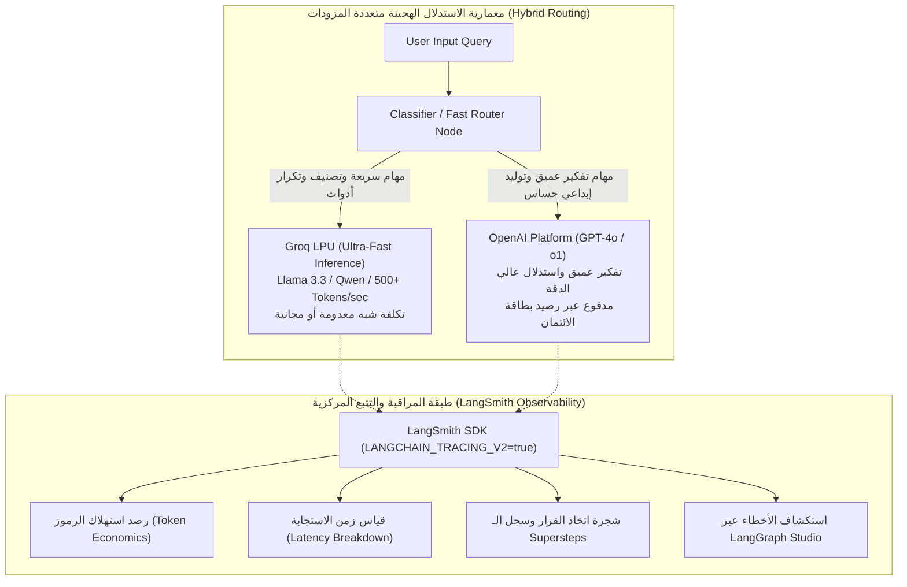
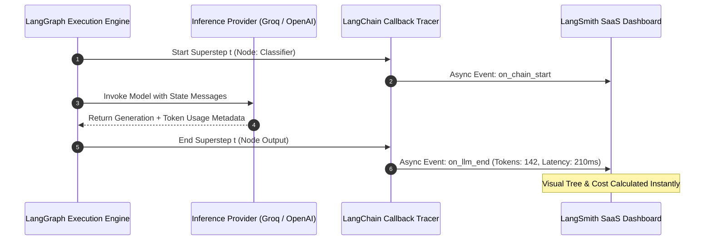

<div dir="rtl">

# الدليل المعماري الشامل: مزودات الاستدلال المتعددة، معمارية LPU، وهندسة المراقبة عبر LangSmith
### Multi-Provider Architecture (OpenAI vs Groq LPU), Token Economics, Inference Latency, and Production Tracing via LangSmith (Lectures 70 - 72)

---

## 1. المدخل المعماري: معضلة الاستدلال والتكلفة في أنظمة الوكلاء متعددة الخطوات

في تطبيقات الـ LLM التقليدية أحادية الخطوة (`Single-Turn LLM Calls`)، يكون التأخير (`Latency`) وتكلفة الرموز (`Token Cost`) مقبولين؛ حيث يُرسل المستخدم سؤالاً واحداً ويستقبل إجابة واحدة:
$$\text{Cost} = N_{\text{input}} \cdot P_{\text{input}} + N_{\text{output}} \cdot P_{\text{output}}$$

أما في **أنظمة الوكلاء المعتمدة على الحالة (`Agentic AI & LangGraph`)**، يتغير المشهد جذرياً. فالوكيل يمر بسلسلة من **الخطوات الفائقة (`Supersteps`)** وحلقات التكرار:
* تصنيف نية المستخدم (`Routing / Intent Classification`).
* استدعاء الأدوات وفحص نواتجها (`Tool Calling & Observation Loop`).
* التفكير الذاتي وتصحيح الأخطاء (`Self-Reflection & Quality Evaluation`).
* تلخيص السياق وكتابة الرد النهائي (`Response Synthesis`).

إذا اعتمد الوكيل بالكامل على نماذج تجارية باهظة ومحدودة السرعة (مثل `GPT-4o` عبر خوادم الـ GPU التقليدية)، فإن:
1. **زمن الاستجابة الكلي يرتفع** إلى 10 - 20 ثانية، مما يدمر تجربة المستخدم (`UX`).
2. **تكلفة الفاتورة تتضاعف أسياً** بسبب تكرار إرسال تاريخ المحادثة بالكامل في كل خطوة فائقة.

لذلك، تعتمد بنية الإنتاج الحديثة على **نمط المعمارية الهجينة متعددة المزودات (`Hybrid Multi-Provider Architecture`)** مدعومة بنظام مراقبة وتتبع فوري (`Observability via LangSmith`).

</div>



<div dir="rtl">

---

## 2. معمارية LPU في Groq مقابل خوادم الـ GPU التقليدية

في المحاضرة 71، تم تسليط الضوء على منصة **`Groq`** ومحركها الحوسبي الثوري المسمى **`LPU` (Language Processing Unit)**.

### ما هو الفرق الفيزيائي والمعماري بين الـ GPU والـ LPU؟
1. **معضلة الـ GPU التقليدي (Memory-Bound Bottleneck)**:
   * في نماذج اللغات الكبيرة، توليد الرموز هو عملية متسلسلة (`Auto-regressive token generation`). لكل رمز جديد، يجب قراءة أوزان النموذج الضخمة من الذاكرة الخارجية (`HBM - High Bandwidth Memory`) ونقلها إلى أنوية الحساب.
   * مهما كانت قوة الـ GPU الحسابية (مثل Nvidia H100)، يظل المعالج مقيداً بسرعة نقل البيانات عبر ناقل الذاكرة (`Memory Bandwidth Limit`)، مما يحد سرعة التوليد بين 30 إلى 80 رمزاً في الثانية.

2. **معمارية LPU (SRAM-Based Deterministic Tensor Architecture)**:
   * صممت شركة Groq معالج الـ LPU ليعتمد بالكامل على **الذاكرة السريعة جداً المدمجة في نفس الشريحة (`On-chip SRAM`)** بدلاً من الـ HBM الخارجية.
   * سرعة الوصول إلى SRAM تصل إلى عشرات التيرا بايت في الثانية دون أي عنق زجاجة، مع معمارية حتمية خالية من فترات الانتظار (`Zero Dynamic Scheduling Overheads`).
   * **النتيجة العملية**: سرعات استدلال خارقة تتجاوز **500 إلى 800 رمز في الثانية** لنماذج مثل `Llama-3.1-8B` و `Llama-3.3-70B`، مما يجعل حلقات تكرار الوكلاء في `LangGraph` تنفذ في لمح البصر!

---

## 3. الصياغة الرياضية لاقتصاديات الرموز وتحسين التكلفة (`Token Economics`)

في أي مسار وكيلي يحتوي على $K$ خطوة فائقة (`Supersteps`)، تُحسب التكلفة الإجمالية للجلسة عبر التكامل المنفصل:

$$C_{\text{total}} = \sum_{k=1}^{K} \left( N_{\text{input}}^{(k)} \cdot P_{\text{in}}^{(m_k)} + N_{\text{output}}^{(k)} \cdot P_{\text{out}}^{(m_k)} \right)$$

حيث:
* $m_k$ هو النموذج المختار للخطوة $k$ (سواء كان Groq Llama-3 مجانياً أو OpenAI GPT-4o مدفوعاً).
* $N_{\text{input}}^{(k)}$ يتزايد تدريجياً في كل خطوة فائقة لأن الحالة تراكم الرسائل السابقة:
  $$N_{\text{input}}^{(k)} = N_{\text{input}}^{(k-1)} + N_{\text{output}}^{(k-1)} + N_{\text{tool}}^{(k-1)}$$

### استراتيجية التوجيه الذكي الموفرة للتكلفة (`Cost-Optimized Routing Strategy`):
* تعيين $m_k = \text{Groq (Llama-3.3-70B)}$ للعقد التكرارية: التصنيف، استدعاء الأدوات، التقييم، واستخراج الكيانات (تكلفة تقترب من \$0.00 وسرعة < 500ms).
* تعيين $m_k = \text{OpenAI (GPT-4o)}$ فقط عند العقدة النهائية التي تتطلب إبداعاً لغوياً فائقاً أو صياغة تقارير نهائية للمستخدم.
* **النتيجة**: خفض تكلفة تشغيل الوكيل بنسبة **تتجاوز 85%** مقارنة بالاعتماد الحصري على OpenAI.

---

## 4. هندسة التتبع والمراقبة المؤسسية عبر LangSmith (Lectures 72)

في المحاضرة 72، تم استعراض منصة **`LangSmith`** كأداة لا غنى عنها في مرحلة التطوير والإنتاج.

### لماذا تفشل أدوات المراقبة التقليدية (مثل Datadog أو Prometheus) مع وكلاء الذكاء الاصطناعي؟
* أدوات الـ APM التقليدية تراقب المقاييس السطحية: استهلاك المعالج، الذاكرة، ورموز الخطأ HTTP 200/500.
* أما في الوكلاء الأذكياء، قد يرجع الخادم كود `HTTP 200` بنجاح، لكن الوكيل في الحقيقة:
  * وقع في حلقة مفرغة لا نهائية (`Infinite Loop`).
  * هلوس وألف إجابة غير صحيحة (`Hallucination`).
  * استهلك 50,000 رمز في دقيقة واحدة دون الوصول للحل.

### معمارية التتبع في LangSmith:
بمجرد ضبط المتغيرات البيئية:
```env
LANGCHAIN_TRACING_V2=true
LANGCHAIN_ENDPOINT=https://api.smith.langchain.com
LANGCHAIN_API_KEY=lsv2_pt_...
LANGCHAIN_PROJECT=rag-mastery-langgraph
```

يقوم عميل التتبع (`Background Telemetry Worker`) بالتقاط كل استدعاء في `LangGraph` تلقائياً دون تعديل سطر واحد في منطق الجراف:
1. **تفكيك كل Superstep**: معرفة المدخلات اللحظية والمخرجات لكل عقدة.
2. **رصد شجرة الأدوات (`Tool Call Hierarchy`)**: المدخلات التي مررها الوكيل للأداة والمخرجات العائدة منها.
3. **تحليل التكلفة والزمن**: حساب زمن كل خطوة وتكلفتها بالدولار بالاعتماد على أسعار المزود المحدثة.
4. **تكامل استوديو الرسوم البيانية (`LangGraph Studio`)**: تشغيل واجهة بصرية تفاعلية تسمح باختبار وتعديل وتصحيح الجراف محلياً وسحابياً.

</div>



<div dir="rtl">

---

## 5. مصفوفة المقارنة الهندسية لمزودات الاستدلال ومنصات التتبع

| المعيار الهندسي | OpenAI Developer Platform | GroqCloud LPU Platform | LangSmith Observability |
| :--- | :--- | :--- | :--- |
| **طبيعة المنصة** | مزود استدلال سحابي لنماذج مغلقة | منصة استدلال فائق السرعة لنماذج مفتوحة | منصة مراقبة وتتبع وتقييم (APM) |
| **المعمارية العتادية** | خوادم GPU متطورة (Nvidia H100) | معالجات LPU معمارية الـ SRAM | سحابة بيانات موزعة لتخزين الـ Traces |
| **سرعة التوليد** | 30 - 80 رمز/ثانية | **500 - 800+ رمز/ثانية** | لا تولد رموزاً (تسجل المقاييس) |
| **النماذج المتاحة** | GPT-4o, GPT-4o-mini, o1, o3-mini | Llama-3.3, Qwen-2.5, DeepSeek-R1, Mistral | تدعم تتبع كافة النماذج |
| **نموذج التسعير** | مدفوع مسبقاً برصيد بطاقة الائتمان | شريحة مجانية سخية جداً للاختبار + دفع بالاستهلاك | شريحة مجانية حتى 5000 Trace شهرياً |
| **الدور في وكلاء LangGraph** | التفكير الإبداعي والنهائي المعقد | التوجيه، استدعاء الأدوات، والتحليل السريع | كشف الأخطاء، مراقبة التكلفة والزمن |

---

## 6. أسئلة المقابلات المتقدمة لمهندسي الذكاء الاصطناعي (Senior AI Engineer Interview Q&A)

### س1: كيف تصمم معمارية وكيل LangGraph في بيئة إنتاجية تحقق أقل تكلفة وأعلى سرعة دون التضحية بجودة الإجابات؟
**الإجابة النموذجية:**
نعتمد على **نمط التوجيه متعدد النماذج (`Multi-Tier Model Routing`)**:
1. نستخدم نماذج مفتوحة المصدر فائقة السرعة على خوادم **Groq LPU** (مثل `Llama-3.1-8B` أو `Llama-3.3-70B`) في العقد التكرارية كثيفة الاستدعاء: تصنيف النوايا، صياغة استعلامات قواعد البيانات المتجهية، واستخراج بارامترات الأدوات.
2. نحتفظ بنماذج الاستدلال الكبيرة مثل **OpenAI GPT-4o** للعقدة التلخيصية النهائية فقط أو في حال تعثر النموذج الصغير وفشله في اجتياز عقدة التقييم (`Evaluator Node`).
3. نربط المنظومة بـ **LangSmith** لرصد استهلاك الرموز وزمن كل خطوة واكتشاف أي انحراف في التكلفة مبكراً.

### س2: ما هو التأثير المعماري لـ `LANGCHAIN_TRACING_V2=true` على زمن استجابة الوكيل النهائي للمستخدم؟
**الإجابة النموذجية:**
التأثير يقترب من الصفر عملياً (`Zero-Latency Overhead`). صُممت مكتبة التتبع لتعمل بنمط العمال غير المتزامنين في الخلفية (`Asynchronous Background Worker Thread Pool`). عندما تنتهي العقدة من التنفيذ، ترسل بيانات الـ Trace إلى طابور في الذاكرة وتعود النتيجة فوراً للمستخدم، بينما تتولى خيوط المعالجة الخلفية إرسال البيانات عبر دفعات إلى واجهة برمجة LangSmith.

### س3: لماذا تفشل مفاتيح واجهات البرمجة أحياناً رغم صحة نص المفتاح، وكيف يتم التعامل مع هذا دفاعياً في الكود؟
**الإجابة النموذجية:**
الأسباب الشائعة هي:
1. نفاد الرصيد المالي (`Quota Exhaustion / Zero Balance`) خاصة في منصات مثل OpenAI.
2. تجاوز الحدود القصوى للطلبات في الدقيقة (`Rate Limiting - 429 Too Many Requests`).
3. مسافات بيضاء غير مرئية أو أسطر جديدة عند نسخ المفتاح في ملف `.env`.
يتم التعامل مع ذلك دفاعياً عبر كتابة فئات التفافية (`Defensive Fallback Wrappers`) تفحص صلاحية المفتاح مسبقاً، وتعتمد استراتيجية الرجوع التلقائي للمزود البديل (`Graceful Provider Fallback`) عند التقاط استثناءات الاتصال.

---

</div>
