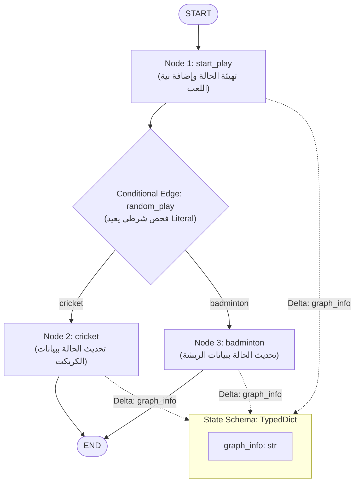

<div dir="rtl">

# الدليل المعماري الشامل: بناء تدفقات العمل الأساسية وهندسة العقد والحالة (Simple Graph Workflows, State Schemas & Deterministic Routing)
### Pure Functional Graph Execution, TypedDict State Schemas, Node Mutation Contracts, and Conditional Branching (Lecture 73)

---

## 1. المدخل المعماري: لماذا نبني رسوماً بيانية بدون نماذج لغوية (LLM-Free Graphs) أولاً؟

عند دراسة أطر عمل الوكلاء الأذكياء مثل **`LangGraph`**، يقع الكثيرون في خطأ البدء مباشرة بربط النماذج اللغوية الكبيرة (`LLMs`) والأدوات المعقدة. يؤدي ذلك إلى خلط أخطاء النموذج اللغوي (مثل الهلوسة أو فشل استخراج الـ JSON) مع مشاكل مسار الرسم البياني نفسه.

لذلك، تعتمد الممارسة الهندسية الرصينة على **تجريد وعزل ميكانيكا الجراف أولاً (`Graph Mechanics Isolation`)**:
1. **حتمية التنفيذ (`Deterministic Execution`)**: بناء وفحص حركة تدفق البيانات، والعقد، والشروط الحسابية باستخدام كود بايثون خالص (`Pure Python`) للتأكد من خلو المسار من أي سلوك عشوائي غير منضبط.
2. **فهم عقد التعديل على الحالة (`State Mutation Contract`)**: كيف تستقبل العقدة كائن الحالة المشتركة (`State`)، وكيف تعيد قاموساً جزئياً (`Delta Update`) يُدمج في الحالة دون تضارب.
3. **ضبط التفرع الشرطي المكتبي (`Type-Safe Routing`)**: استخدام النوع `typing.Literal` لضمان أن دوال التوجيه تعيد حصرياً أسماء العقد المسجلة داخل الجراف وقت كتابة الكود.

</div>



<div dir="rtl">

---

## 2. الأركان الأربعة الأساسية لأي رسم بياني في LangGraph

يتألف أي تطبيق في `LangGraph` (سواء كان تدفقاً بسيطاً أو وكيلاً متعدد المستويات) من أربعة مكونات هيكلية:

### 1. مخطط الحالة (`State Schema`)
يمثل العقد الهيكلي للبيانات المشتركة عبر الجراف. في المحاضرة 73، تم تعريفه باستخدام `TypedDict`:
```python
from typing_extensions import TypedDict


class State(TypedDict):
  graph_info: str
```
* **لماذا `TypedDict`؟**: لأنه في وقت التشغيل (`Runtime`) هو مجرد قاموس بايثون قياسي خفيف جداً (`Standard Dict`) دون أي تكلفة معالجة إضافية، وفي نفس الوقت يوفر تلميحات الأنواع (`Type Hints`) لبيئة التطوير.

### 2. العقد الحسابية (`Nodes`)
كل عقدة هي دالة بايثون خالصة (`Pure Python Function`).
* **المدخل الإلزامي الأول**: يجب أن تستقبل كائن الحالة كأول وسيط موضعي: `def node_fn(state: State) -> dict:`.
* **المخرج الإلزامي**: تعيد قاموساً يحتوي التعديل الجزئي (`State Delta`). لا تقم العقدة بتعديل كائن `state` مباشرة في مكانه (`No In-Place Mutation`)، بل يعيد التغيير ليتولى محرك الجراف دمجه.

```python
def start_play(state: State) -> dict:
  prev_info = state.get("graph_info", "")
  return {"graph_info": f"{prev_info} I am planning to play"}
```

### 3. الحواف والحواف الشرطية (`Edges & Conditional Edges`)
* **الحافة الثابتة (`Direct Edge`)**: مسار قطعي ينقل التنفيذ من عقدة لأخرى: `builder.add_edge(START, "start_play")`.
* **الحافة الشرطية (`Conditional Edge`)**: دالة منطقية تفحص الحالة الحالية وتعيد اسم العقدة التالية كمطابقة ثابتة (`Literal`):
  ```python
  def random_play(state: State) -> Literal["cricket", "badminton"]:
    if random.random() > 0.5:
      return "cricket"
    return "badminton"
```

### 4. كائن الرسم البياني (`StateGraph`)
هو المحرك التنسيقي الذي تُسجل فيه العقد، وتُربط فيه الحواف، وتُترجم منه البنية إلى تطبيق قابل للتشغيل (`Compiled Executable Graph`):
```python
workflow = StateGraph(State)
workflow.add_node("start_play", start_play)
# ... إضافة العقد والحواف ثم التجميع
app = workflow.compile()
```

---

## 3. الصياغة الرياضية لتطور فضاء الحالة في المسارات المتفرعة

يمكن التعبير عن مسار تدفق البيانات في هذا الجراف بالمعادلة التحويلية المتتالية:

$$S_0 = \{\text{graph\_info}: \text{""}\}$$

1. **الخطوة الفائقة الأولى (العقدة `start_play`)**:
   $$S_1 = S_0 \oplus \Delta S_{\text{start}} = \{\text{graph\_info}: \text{"I am planning to play"}\}$$

2. **التقييم الشرطي للتفرع (`Routing Function` $g$)**:
   $$v^* = g(S_1) \in \{\text{cricket}, \text{badminton}\}$$

3. **الخطوة الفائقة الثانية (العقدة المختارة $v^*$)**:
   $$S_2 = S_1 \oplus \Delta S_{v^*} = \{\text{graph\_info}: S_1[\text{graph\_info}] + \text{" cricket" / " badminton"}\}$$

4. **الوصول لنقطة النهاية**:
   $$S_2 \longrightarrow \text{END} \implies S_{\text{final}} = S_2$$

---

## 4. جدول المقارنة الهندسية: استخدام TypedDict مقابل Pydantic في تعريف الحالة

| المعيار الهندسي | `TypedDict` (المعتمد في المحاضرة 73) | `Pydantic BaseModel` |
| :--- | :--- | :--- |
| **زمن التشغيل والتنفيذ** | فائق السرعة (قاموس بايثون خام بدون Overhead) | يتطلب معالجة إضافية للتحقق من الحقول |
| **التحقق من صحة البيانات (`Validation`)** | ثابت أثناء التطوير فقط (`Static Type Checking`) | فوري وديناميكي أثناء التشغيل (`Runtime Validation`) |
| **استهلاك الذاكرة** | ضئيل جداً | متوسط |
| **التسلسل والتحويل إلى JSON** | مباشر وتلقائي (`Native Dict`) | يحتاج استدعاء `.model_dump()` |
| **أفضل سيناريو استخدام** | التدفقات البسيطة، والأنظمة عالية التردد والسرعة | المدخلات الحساسة، واجهات المستخدم، ومخرجات الـ LLM المعقدة |

---

## 5. أسئلة المقابلات المتقدمة لمهندسي الذكاء الاصطناعي (Senior AI Engineer Interview Q&A)

### س1: لماذا يُلزم LangGraph العقد بإرجاع قاموس التحديث الجزئي (Delta) بدلاً من تعديل كائن الحالة في مكانه مباشرة (In-Place Mutation)؟
**الإجابة النموذجية:**
لأن محرك `LangGraph` مبني على فلسفة الحوسبة التزامنية الفائقة (`Pregel BSP`) ومبدأ الثبات (`Immutability`). إرجاع الـ `Delta` يسمح للمحرك بتطبيق دوال الاختزال (`Reducers`) عند حاجز المزامنة، وتخزين لقطات الحالة الأصلية في نقاط التفتيش (`Checkpoints`) بدقة لتسهيل السفر عبر الزمن (`Time-Travel`)، والرجوع إلى الخلف عند حدوث أخطاء، وتشغيل عدة عقد بالتوازي دون حدوث تضارب في الذاكرة المشتركة (`Race Conditions`).

### س2: ما هي أهمية تحديد النوع `typing.Literal` في دوال التوجيه الشرطي داخل LangGraph؟
**الإجابة النموذجية:**
النوع `Literal` يُقيد مخرجات دالة التوجيه بمجموعة محددة وثابتة من النصوص تمثل أسماء العقد المسجلة (`Target Node Names`). هذا يمنع الأخطاء المطبعية الشائعة (`Typos`)، ويتيح لبيئات التطوير ومحللات الأكواد الساكنة (`Mypy / Pyright`) التحقق من صحة مسارات الجراف واكتشاف أي حافة غير معرفة قبل تشغيل التطبيق في الإنتاج.

---

</div>
