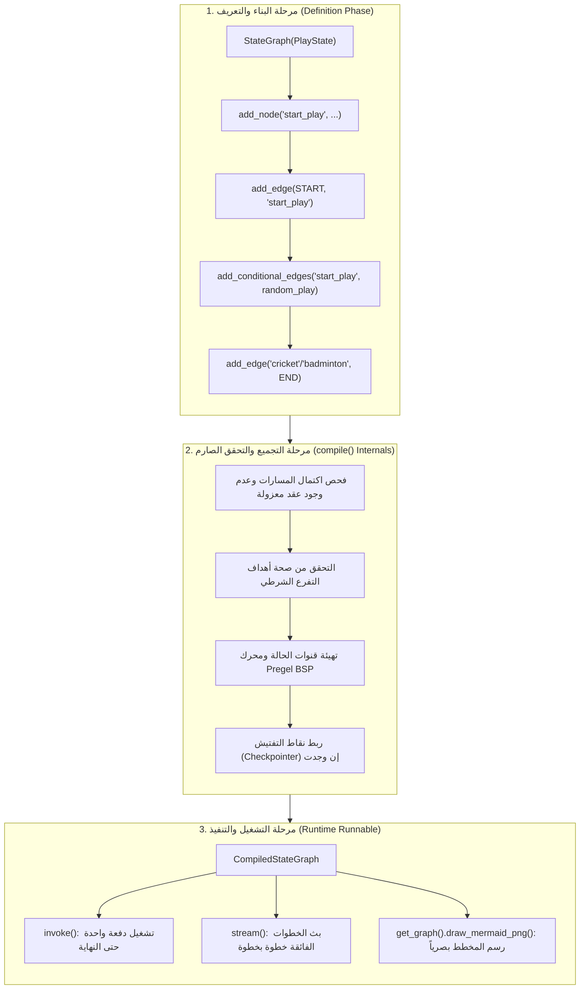

<div dir="rtl">

# الدليل المعماري الشامل: تجميع الرسوم البيانية، الفحص البصري، وهندسة الاستدعاء التنفيذي (Graph Compilation, Visualization & Invocation Lifecycle)
### StateGraph Compilation Internals, Mermaid Topology Rendering, Invocation Interfaces (invoke vs stream), and Probabilistic Branching (Lecture 74)

---

## 1. المدخل المعماري: ما الذي تفعله دالة التجميع `compile()` في كواليس LangGraph؟

في المحاضرة 74، انتقلنا من مرحلة تعريف العقد والشروط المنفصلة إلى بناء الكيان المتكامل عبر استدعاء دالة التجميع:
```python
app = workflow.compile()
```

كثير من المطورين يظنون أن `.compile()` هي مجرد دالة شكلية، لكنها في الحقيقة **أهم خطوة تحقق وتحويل هيكلي في دورة حياة الجراف**. عند استدعاء `.compile()`، يقوم محرك `LangGraph` بالعمليات الهندسية التالية في الخلفية:

1. **التحقق من سلامة البنية وطوبولوجيا المسارات (`Static Graph Validation`)**:
   * فحص العقد المعزولة (`Orphan / Unreachable Nodes`): التأكد من عدم وجود عقدة مسجلة ليس لها حواف دخول أو خروج.
   * التحقق من نقطتي البداية والنهاية (`START & END Connectivity`): التأكد من أن نقطة `START` موصولة بعقدة أولى واحدة على الأقل، وأن كافة المسارات تؤول في النهاية إلى `END`.
   * فحص خرائط التوجيه الشرطي (`Conditional Routing Target Validation`): التأكد من أن كافة النصوص التي قد تعيدها دالة القرار (مثل `"cricket"` و `"badminton"`) تطابق أسماء عقد حقيقية مسجلة في الجراف.
2. **تهيئة قنوات الحالة ومحرك Pregel (`Pregel Runtime Initialization`)**:
   * تحويل مخطط الحالة (`State Schema`) إلى قنوات إدارة تزامنية (`Channels`).
   * إعداد دوال الاختزال (`Reducers`) وحواجز المزامنة (`Synchronization Barriers`).
3. **تحويل الجراف إلى كائن تنفيذي (`CompiledStateGraph / Runnable`)**:
   * تغليف الجراف ليصبح كائناً يدعم واجهة `LangChain Runnable` الموحدة (`invoke`, `ainvoke`, `stream`, `astream_events`).

</div>



<div dir="rtl">

---

## 2. معمارية الفحص البصري وتوليد الرسوم البيانية (`Graph Visualization Engine`)

من أعظم ميزات `LangGraph` قدرته الأصيلة على **التعبير عن نفسه بَصرياً** مباشرة من الكود المترجم دون الحاجة لأدوات تصميم خارجية.

تعتمد الدالة:
```python
from IPython.display import Image, display

display(Image(app.get_graph().draw_mermaid_png()))
```

على المعمارية التالية:
1. **استخراج شجرة الجراف (`get_graph()`)**: يقوم المحرك بفحص العقد والحواف المترجمة وتحويلها إلى بنية شجرية (`Graph AST - Abstract Syntax Tree`).
2. **توليد كود Mermaid النصي (`draw_mermaid()`)**: تحويل الـ AST إلى صياغة كود `Mermaid.js` قياسي يصف العقد والأسهم.
3. **التصيير الرسومي (`draw_mermaid_png()`)**: إرسال كود الـ Mermaid إلى محرك تصيير محلي أو سحابي لتحويله إلى مصفوفة بايتات لصورة `PNG` عالية الدقة وعرضها داخل كراسة جوبيتر.

### فائدة الفحص البصري في الإنتاج:
* **التوثيق الآلي (`Self-Documenting Code`)**: بمجرد تعديل أي مسار أو عقدة في كود بايثون، يتحدث المخطط المعماري تلقائياً.
* **اكتشاف الأخطاء المعمارية بالعين المجردة (`Visual Debugging`)**: معرفة هل هناك حلقة تكرارية غير مقصودة، أو مسار تائه لم يتصل بـ `END`.

---

## 3. الصياغة الرياضية لتوزيع الاحتمالات في التفرع الشرطي

في تدفق المحاضرة 74، يمر تدفق التنفيذ بنموذج شجرة احتمالية ثنائية التفرع (`Stochastic Branching Process`):

$$\mathcal{G} = (V, E, C)$$
حيث:
$$V = \{\text{start\_play}, \text{cricket}, \text{badminton}\}$$

إذا كانت دالة الاختيار الشرطي تعتمد على متغير عشوائي منتظم $U \sim \text{Uniform}(0, 1)$:

$$g(S) = \begin{cases} 
\text{"cricket"} & \text{if } U > 0.5 \\
\text{"badminton"} & \text{if } U \le 0.5 
\end{cases}$$

فإن احتمالية سلوك المسار الأول مقابل الثاني متساوية تماماً:
$$P(\text{Path} = \text{START} \to \text{start\_play} \to \text{cricket} \to \text{END}) = 0.5$$
$$P(\text{Path} = \text{START} \to \text{start\_play} \to \text{badminton} \to \text{END}) = 0.5$$

وحالة المخرجات النهائية $S_{\text{final}}$ تكون متغيراً عشوائياً يأخذ إحدى القيمتين:
$$S_{\text{final}}[\text{"graph\_info"}] = \begin{cases}
\text{"[input] I am planning to play cricket"} & \text{with probability } 0.5 \\
\text{"[input] I am planning to play badminton"} & \text{with probability } 0.5
\end{cases}$$

---

## 4. مقارنة هندسية بين واجهات الاستدعاء في LangGraph (`invoke` vs `stream`)

| وجه المقارنة | `invoke(input)` (المستخدم في المحاضرة 74) | `stream(input)` (المعتمد في أنظمة الإنتاج) | `astream_events()` (المتقدم) |
| :--- | :--- | :--- | :--- |
| **طبيعة التنفيذ** | أحادي متزامن ينتظر حتى نهاية كل العقد | تكراري يعيد ناتج كل خطوة فائقة فور انتهائها | متقدم جداً يبث التوكنز اللحظية داخل كل عقدة |
| **زمن أول استجابة (`Time to First Token`)** | بطيء (يساوي زمن تنفيذ كامل الجراف) | سريع جداً (بمجرد انتهاء أول عقدة) | فوري (بمجرد أن يبدأ الـ LLM في الكلام) |
| **شكل المخرجات** | كائن الحالة النهائي المكتمل فقط | قاموس بالاسم والتعديل الجزئي لكل عقدة | أحداث تفصيلية (`on_chat_model_stream`) |
| **الاستخدام المثالي** | الاختبارات السريعة والتحقق البرمجي (`assert`) | واجهات الويب وشاشات الانتظار لتحديث الخطوات | تطبيقات الشات التي تتطلب بث كلمة بكلمة |

---

## 5. أسئلة المقابلات المتقدمة لمهندسي الذكاء الاصطناعي (Senior AI Engineer Interview Q&A)

### س1: ماذا يحدث برمجياً إذا استدعت دالة التوجيه الشرطي اسماً لعقدة غير موجودة في الجراف أثناء التشغيل؟
**الإجابة النموذجية:**
إذا لم يتم تعريف خريطة توجيه صريحة (`Mapping Dict`) وأعادت دالة التوجيه الشرطي اسماً غير مسجل في الجراف، سيرمي محرك `LangGraph` استثناء تشغيلي فوري من نوع `KeyError` أو `GraphRecursionError` يفيد بعدم العثور على العقدة الهدف (`Destination node not found`). ولتفادي ذلك في بيئات الإنتاج، نستخدم دائماً:
1. التقييد النمطي باستخدام `typing.Literal`.
2. تمرير خريطة صريحة في الوسيط الثالث: `add_conditional_edges("source", condition_fn, {"target_a": "node_a", "target_b": "node_b"})` لضمان التحقق وقت الـ Compile.

### س2: لماذا نفضل استخدام `draw_mermaid()` كبديل نصي احتياطي بجانب `draw_mermaid_png()`؟
**الإجابة النموذجية:**
لأن دالة `draw_mermaid_png()` تعتمد داخلياً على خدمة تصيير رسومي خارجية (أو تتطلب تثبيت حزم ثنائية محلية مثل Graphviz). في بيئات الحاويات المقفلة أمنياً (`Air-gapped Environments`) أو عند انقطاع الاتصال الخارجي، قد تفشل عملية استدعاء الصورة الثنائية. لذلك، توفير خيار إرجاع نص `draw_mermaid()` يضمن إمكانية نسخ الكود ولصقه في أي قارئ Markdown خارجي دون تعطيل تشغيل الاختبارات أو الدفاتر البرمجية.

---

</div>
