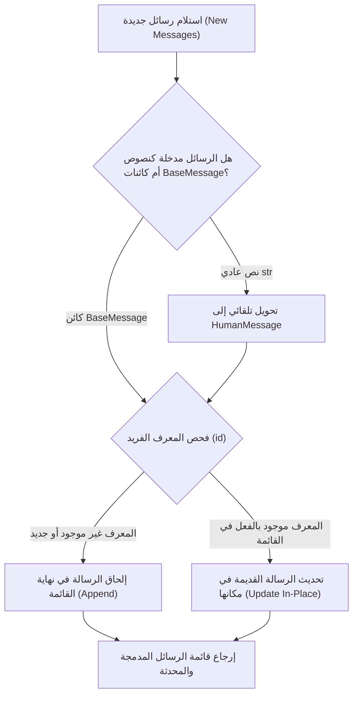

# الدليل المعماري الشامل: بناء روبوت محادثة مدعوم بنماذج اللغة الكبيرة مع مجمعات الحالة والبث التدفقي
# (Master Architecture Guide: LLM-Powered Chatbot with State Reducers and Pregel Streaming)

---

## 1. المدخل المعماري: الانتقال من الرسوم البيانية البسيطة إلى الوكلاء التفاعليين

في المحاضرات السابقة، قمنا ببناء وتشغيل رسوم بيانية موجهة (`StateGraph`) معتمدة على دوال برمجية حتمية (`Deterministic Functions`) وقرارات شرطية عشوائية (`Stochastic Routers`) دون الاستعانة بنماذج اللغة الكبيرة (`LLMs`). 

في هذا الدليل الهندسي، ننتقل خطوة محورية إلى الأمام نحو بناء **روبوت محادثة متكامل مدعوم بالذكاء الاصطناعي التوليدي (`LLM-Powered Chatbot`)** يُعرف معمارياً باسم **`SuperBot`**. يتميز هذا النظام بقدرته على:
1. استيعاب سياق المحادثة الممتد عبر الزمن بدلاً من معالجة الرسائل كمدخلات معزولة.
2. تفعيل **مجمعات الحالة (`State Reducers`)** لحماية سجل الرسائل من الاستبدال أو الحذف العرضي.
3. دعم مزودي استدلال متعددين (`Multi-Provider Inference`) للموازنة بين التكلفة، السرعة، والاعتمادية (مثل `Groq LPU` و `OpenAI`).
4. استهلاك المخرجات عبر نمطي التشغيل: الاستدعاء اللحظي الكامل (`Invocation`) والبث التدفقي التزايدي للأحداث (`Pregel Event Streaming`).

---

## 2. مجمعات الحالة في LangGraph: التشريح العميق لدالة `add_messages`

### أ. معضلة استبدال الحالة الافتراضية (Default Overwrite Behavior)

في المعمارية القياسية لـ `StateGraph`، عندما تقوم أي عقدة (`Node`) بإرجاع قاموس تحديث (`State Delta`):
$$\Delta S = \{\text{"key"}: \text{new\_value}\}$$
يقوم محرك التنفيذ `Pregel` بعملية استبدال مباشر (`Shallow Replacement`):
$$S_{t+1}[\text{"key"}] = \Delta S[\text{"key"}]$$

إذا كان المفتاح عبارة عن قائمة رسائل (`messages: list`)، فإن إرجاع رسالة جديدة من العقدة سيؤدي حتماً إلى **مسح وحذف كافة الرسائل التاريخية السابقة**، مما يفقد الروبوت ذاكرته الحوارية ويجعله عاجزاً عن متابعة السياق متعدد الجولات (`Multi-Turn Conversation`).

```
الوضع الافتراضي بدون مُجمّع (Overwrite):
[رسالة المستخدم 1]  ---> العقدة ترجع [رد الذكاء الاصطناعي 1] ---> الحالة تفقد رسالة المستخدم 1 وتقتصر على الرد فقط!
```

---

### ب. مفهوم المجمع الرياضي والبرمجي (`Reducer`)

المُجمّع (`Reducer`) هو دالة رياضية تأخذ الحالة السابقة وتحديثاً جديداً، وتنتج حالة متكاملة تراكمية:
$$S_{t+1} = \text{Reducer}(S_t, \Delta S)$$

في لغة بايثون و `LangGraph`، يتم الإعلان عن المُجمّع داخل مخطط الحالة (`TypedDict`) باستخدام التلميح النوعي المتقدم `typing.Annotated`:

$$\text{Field} : \text{Annotated}[\text{Type}, \text{ReducerFunction}]$$

---

### ج. دالة `add_messages` كـ Reducer متخصص في الرسائل

توفر مكتبة `langgraph.graph.message` دالة مُجمّع متطورة هي `add_messages`. تعمل هذه الدالة وفق القواعد المنطقية التالية:



#### الصياغة الرياضية لقواعد الدمج في `add_messages`:
لتكن قائمة الرسائل السابقة $M = [m_1, m_2, \dots, m_n]$ والرسائل الواردة $\Delta M = [u_1, u_2, \dots, u_k]$.
تُعرف دالة الدمج كالتالي:

$$\text{add\_messages}(M, \Delta M) = M \oplus \Delta M$$

حيث يتم استبدال أي عنصر $m_i \in M$ بالعنصر $u_j \in \Delta M$ إذا وفقط إذا كان:
$$\text{ID}(m_i) = \text{ID}(u_j)$$
وفيما عدا ذلك، يتم إلحاق $u_j$ في ذيل القائمة ($M \leftarrow M \cup \{u_j\}$).

---

## 3. المعمارية الهندسية لروبوت `SuperBot`

يتكون النظام من عقدة معالجة مركزية تستقبل سياق الرسائل وتتصل بنموذج الاستدلال:

```mermaid
sequenceDiagram
    autonumber
    actor User as المستخدم (Client / User)
    participant START as نقطة البداية (START Node)
    participant SuperBot as عقدة المعالجة (SuperBot Node)
    participant LLM as مزود الاستدلال (Groq / OpenAI)
    participant State as ذاكرة الحالة (PlayState / Reducer)
    participant END as نقطة النهاية (END Node)

    User->>START: إرسال مدخل حواري {"messages": [HumanMessage("مرحباً")]}
    START->>SuperBot: تمرير الحالة المحتوية على الرسائل
    SuperBot->>LLM: استدعاء النموذج مع كامل سياق المحادثة (invoke / messages)
    LLM-->>SuperBot: إرجاع كائن AIMessage("أهلاً بك، كيف أساعدك؟")
    SuperBot->>State: إرجاع التحديث الجزئي {"messages": [AIMessage]}
    Note over State: دالة add_messages تدمج الرد مع رسالة المستخدم تلقائياً
    SuperBot->>END: توجيه التدفق لنقطة النهاية
    END-->>User: إرجاع الحالة الموحدة النهائية أو تدفق الأحداث
```

---

## 4. مقارنة معماريات مزودي الاستدلال: OpenAI مقابل Groq LPU

لضمان عمل الروبوت في بيئات الإنتاج المختلفة، يدعم النظام مزودي استدلال:

| الخاصية المعمارية | مزود الاستدلال السحابي `OpenAI` | مزود الاستدلال فائق السرعة `Groq LPU` |
| :--- | :--- | :--- |
| **المعمارية الأساسية** | حوسبة مبنية على وحدات معالجة الرسوميات `NVIDIA GPU Clusters` | معمارية معالجات اللغة الخطية `Language Processing Unit (LPU)` |
| **زمن استجابة التوكن الأول (TTFT)** | متوسط ($\approx 250 - 600\text{ ms}$) | فائق السرعة للغاية ($\approx 30 - 80\text{ ms}$) |
| **معدل إنتاج التوكنات (Throughput)** | $40 - 90\text{ tokens/sec}$ | $250 - 550+\text{ tokens/sec}$ |
| **هيكل التكلفة** | مدفوع لكل مليون توكن (`Pay-per-token`) | طبقة استدلال مجانية واسعة للأبحاث + نماذج مفتوحة المصدر |
| **النماذج المدعومة** | `gpt-4o`, `gpt-4o-mini`, `o1`, `o3-mini` | `openai/gpt-oss-20b`, `qwen/qwen3.8-27b` |
| **الاستخدام المثالي في الروبوت** | المهام المعقدة والتفكير المنطقي متعدد الطبقات | روبوتات المحادثة اللحظية التفاعلية وتطبيقات خدمة العملاء |

---

## 5. ميكانيكا الاستدعاء والبث التدفقي (`Invocation` vs `Streaming`)

يوفر محرك `Pregel` في `LangGraph` واجهتين أساسيتين لتشغيل التطبيق المجمع (`CompiledStateGraph`):

### أ. الاستدعاء التزامني المباشر (`invoke`)
* يقوم بتنفيذ كافة خطوات الجراف حتى الوصول إلى العقدة النهائية `END`.
* يحجز العملية البرمجية حتى اكتمال كافة العقد، ثم يعيد **الحالة الموحدة النهائية (`Consolidated Final State`)**.
* مناسب لمعالجة الدفعات (`Batch Processing`) أو الخلفيات البرمجية التي لا تتطلب تحديث واجهة المستخدم لحظياً.

### ب. البث التدفقي للأحداث (`stream`)
* يعيد كائن مولد تفاعلي (`Python Generator / Pregel Stream`).
* يُصدر أحداثاً برمجية لحظة بلحظة مع كل خطوة تنفيذية تكتمل داخل الجراف.

#### أنماط البث التدفقي (`stream_mode`):
1. **نمط التحديثات الافتراضي (`stream_mode="updates"`):**
   * يصدر فقط **التغييرات الجزئية (`Deltas`)** التي أنتجتها كل عقدة خلال خطوتها الفردية.
   * المخرجات تكون على هيئة:
     ```python
     {"super_bot": {"messages": [AIMessage(content="...")]}}
     ```
   * يتميز بكفاءة نقل البيانات عبر الشبكة وتجنب التكرار.

2. **نمط لقطات الحالة الكاملة (`stream_mode="values"`):**
   * يصدر **الحالة الكاملة المدمجة (`Full Consolidated State Snapshot`)** بعد كل خطوة تنفيذية.
   * مفيد جداً في واجهات المستخدم التي ترغب في إعادة رسم الحالة بالكامل أو مراقبة التراكم الزمني للمحادثة.

---

## 6. مصفوفة المفاضلة الهندسية (Trade-offs Matrix)

| البعد التقني | نمط الاستدعاء `invoke` | نمط البث `stream(mode='updates')` | نمط البث `stream(mode='values')` |
| :--- | :--- | :--- | :--- |
| **زمن استجابة واجهة المستخدم** | مرتفع (الانتظار حتى انتهاء الرد كاملاً) | منخفض جداً (استلام إشعارات العقد فوراً) | منخفض (استلام الحالة المحدثة دورياً) |
| **استهلاك الذاكرة وحجم البيانات** | دفعة واحدة في نهاية التشغيل | خفيف جداً (حجم الـ Delta فقط) | متوسط إلى مرتفع (إرسال كامل الحالة في كل خطوة) |
| **سهولة البرمجة** | بسيطة جداً (`response = app.invoke(...)`) | تتطلب معالجة حلقة `for event in app.stream` | تتطلب معالجة حلقة مع قراءة مفتاح الـ State |
| **الاستخدام المعماري الموصى به** | واجهات الـ REST API التقليدية واختبارات الوحدة | واجهات الدردشة التفاعلية (`WebSockets / SSE`) | لوحات المراقبة ولوحات تتبع الحالة (`Dashboards`) |

---

## 7. الخلاصة والدروس المستفادة

1. **الـ Reducers حجر زاوية لأنظمة المحادثة**: بدون `Annotated[list, add_messages]` تفقد الرسوم البيانية ذاكرتها الحوارية وتستبدل السياق السابق.
2. **مرونة المعمارية وتعدد المزودين**: فصل منطق العقدة عن مزود الاستدلال يسمح بالتبديل الفوري بين `Groq` و `OpenAI` دون تغيير بنية الجراف.
3. **أهمية البث التدفقي في تجربة المستخدم**: الانتقال من `invoke` إلى `stream` يقلل الإحساس بالكمون (`Perceived Latency`) ويمنح المستخدم تجربة تفاعلية حية.
