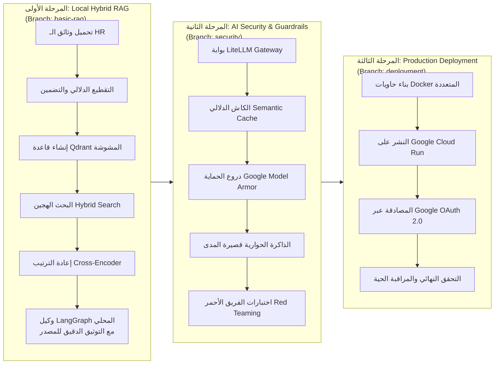
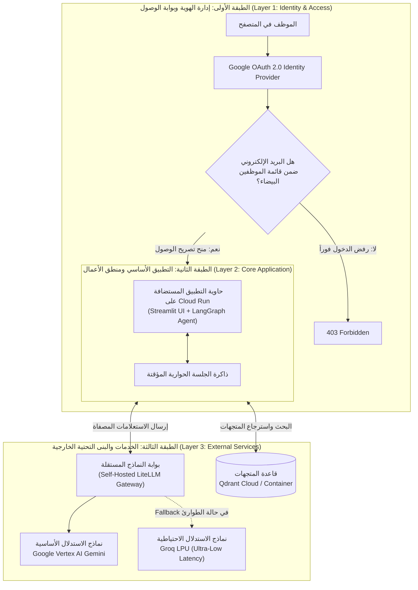

# القسم 30 / المحاضرة 143: معمارية المشروع ومراحل التطور الثلاث
# (Section 30 / Lecture 143: Project Architecture & Three-Phase Progressive Evolution)

---

## 1. القاعدة الذهبية لتعلم المشاريع الكبرى (The Cardinal Engineering Rule)

في مقدمة هذه المحاضرة، يضع المحاضر قاعدة صارمة تمثل الفارق بين "المطور السطحي" و"المهندس المعماري":
> **"صبرك سيُختبر بشدة في هذا المشروع؛ إياك أن تقفز إلى مرحلة جديدة قبل أن تفهم وتهضم المرحلة السابقة بالكامل."**

بناء أنظمة الإنتاج الحقيقية (`Production-Grade Enterprise Systems`) لا يتم عبر كتابة مئات الأسطر في ملف واحد؛ بل يتم عبر **التطور التراكمي المنظم (`Incremental Modular Evolution`)**. كل مرحلة تبني فوق ما قبلها وتختبره وتؤمنه.

---

## 2. مراحل المشروع الثلاث وتطور الفروع البرمجية (`Three-Phase Git Evolution`)

تم تقسيم المشروع إلى **ثلاث مراحل رئيسية** تتطابق حرفياً مع فروع المستودع المصدري (`Git Branches`) والمجلدات المستخرجة من السورس كود:

---

### تفكيك المراحل الهندسية الثلاث:

#### 1. الطور الأول: الاسترجاع الهجين المحلي (`Phase 1: Local Hybrid RAG`)
* **الهدف:** بناء محرك استرجاع يعمل محلياً بكفاءة 100% ويقدم إجابات موثوقة ومقتبسة مباشرة من اللوائح الرسمية.
* **المكونات الأساسية:**
  1. `data_ingestion_pipeline`: قراءة ومعالجة 10 لوائح رسمية للموارد البشرية.
  2. `noisy_data_injection`: حقن 8 ملفات ضوضاء غير ذات صلة (تقارير مبيعات، عروض استراتيجية، كتيبات تشغيل مستودعات) لاختبار متانة النظام.
  3. `qdrant_vector_store`: تخزين المتجهات في مجموعتين منفصلتين (`hr_policies` و `hr_policies_noisy_demo`).
  4. `re_ranking_engine`: فلترة واستبعاد مقاطع الضوضاء بدقة عبر نماذج الـ `Cross-Encoder`.
  5. `hr_assistant_agent`: وكيل مبني بـ `LangGraph` ينسق عملية البحث، الصياغة، وذكر اسم الوثيقة ورقم البند.

#### 2. الطور الثاني: دروع الأمان واختبارات الاختراق (`Phase 2: LLM Security & Evals`)
* **الهدف:** تحويل النظام من مجرد "شات بوت يجيب" إلى "نظام مؤسسي منيع" لا يمكن خداعه أو استغلاله.
* **المكونات الأساسية:**
  1. `litellm_gateway`: بوابة ذاتية الاستضافة لإدارة الاستدعاءات والتبديل التلقائي بين النماذج (`Fallback`).
  2. `content_guardrails`: فلاتر لفحص مدخلات الموظف ورفض الأسئلة الخارجة عن نطاق العمل (`Out-of-Domain`).
  3. `model_armor`: حماية النظام ضد هجمات كسر الموجهات (`Prompt Injection & Jailbreaks`).
  4. `semantic_caching`: كاش ذكي يخزن الأسئلة الشائعة ويجيب عليها بزمن استجابة $0\text{ ms}$ دون تكلفة استدلال.
  5. `red_teaming_harness`: حزمة هجمات برمجية مؤتمتة (`Persona Attack, Instruction Override, Roleplay Escape`) لتقييم مناعة النموذج.

#### 3. الطور الثالث: النشر السحابي والحاويات (`Phase 3: Production Deployment`)
* **الهدف:** تحويل الأكواد إلى منتج سحابي متاح لموظفي الشركة الحقيقيين عبر الإنترنت.
* **المكونات الأساسية:**
  1. `docker_containerization`: بناء صور Docker مخصصة لواجهة التطبيق ولبوابة الـ Gateway.
  2. `google_cloud_run`: استضافة الحاويات سحابياً ببيئة بدون خوادم (`Serverless Container Platform`).
  3. `google_oauth_rbac`: حصر الدخول على حسابات البريد الإلكتروني المعتمدة للموظفين فقط.

---

## 3. المعمارية الهندسية ثلاثية الطبقات (`The 3-Layer Enterprise Model`)

عند نشر التطبيق على السحابة، ينقسم النظام هندسياً إلى **3 طبقات مستقلة**:

---

## 4. أدلة التوثيق والأوامر المرجعية المتوفرة (`Docs & Commands Layout`)

وفرت حزمة السورس كود التي حصلنا عليها مرجعين هندسيين استثنائيين سنسير معهما بالتوازي:

### أ. ملفات التوثيق الفنية (`16 Documentation Guides`):
موجودة بالكامل في مسار السورس كود وتشرح كل مفهوم بالتفصيل:
* `01-overview.md` & `02-tech-stack.md`: نظرة عامة ومعمارية الأدوات.
* `03-document-processing.md` إلى `07-re-ranking.md`: تفاصيل استخراج وتنظيف وإعادة ترتيب المستندات.
* `08-the-agent.md`: بناء منسق الـ LangGraph.
* `09-reliability.md` & `10-evaluation-and-redteam.md`: الأمان واختبارات الاختراق.
* `11-gcp-apis-and-iam.md` إلى `16-hosting-architecture.md`: السحابة والنشر والحاويات.

### ب. ملفات الأوامر المباشرة (`Commands Reference`):
* `commands-basic-rag.md`: أوامر إعداد الحساب السحابي، إنشاء بيئة العمل، وتنفيذ الفهرسة للمرحلة الأولى.
* `commands-security.md`: أوامر تشغيل بوابة LiteLLM وفلاتر الحماية.
* `commands-deployment.md`: أوامر بناء Docker والنشر على Google Cloud Run.

---

## 5. مصفوفة المفاضلة والتطور بين الفروع (Branch Evolution Matrix)

| الخاصية الهندسية | فرع `basic-rag` (Phase 1) | فرع `security` (Phase 2) | فرع `deployment` (Phase 3) |
| :--- | :--- | :--- | :--- |
| **محرك الـ RAG** | هجين (Dense + Sparse + Re-ranker) | هجين مع كاش دلالي متقدم | هجين سحابي مؤمن بالكامل |
| **الحماية والدروع** | غير مفعلة (تركيز على الدقة) | فلاتر Model Armor ومكافحة الحقن | دروع حماية مفعلة في الإنتاج |
| **استدعاء النماذج** | استدعاء مباشر في الكود | عبر بوابة LiteLLM الموحدة | بوابة LiteLLM مع Fallback تلقائي |
| **إدارة الهوية** | مفتوح محلياً للمطور | مفتوح محلياً للاختبار | مقيد بـ Google OAuth 2.0 و RBAC |
| **بيئة التشغيل** | جهاز المطور المحلي | جهاز المطور مع خدمات Docker مساعدة | Google Cloud Run سحابي كامل |

---

## 6. الخطوة العملية القادمة

في **المحاضرة 144: PHASE 1 : LOCAL HYBRID RAG**، سنبدأ التنفيذ العملي للمرحلة الأولى:
1. مراجعة واستيراد إعدادات المشروع (`Project Settings & Configuration`).
2. البدء في خط تحميل وثائق الموارد البشرية (`Document Loading Pipeline`).
