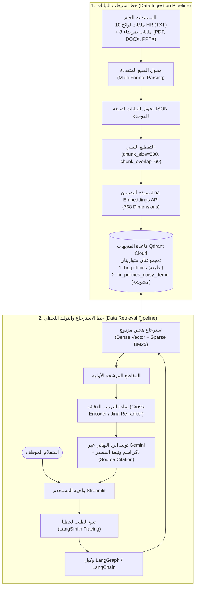

# القسم 30 / المحاضرة 144: الطور الأول - تأسيس الاسترجاع الهجين المحلي وهندسة البيانات المشوشة
# (Section 30 / Lecture 144: Phase 1 - Local Hybrid RAG Foundations & Noisy Data Engineering)

---

## 1. المفهوم الهندسي للـ "Basic RAG" في بيئات الإنتاج

في المشاريع التعليمية البسيطة، تعني كلمة "Basic RAG" عادةً مجرد استدعاء `Chroma.from_documents` مع نموذج استدلال في 10 أسطر كود. 

أما في المشاريع المؤسسية (`Enterprise RAG Projects`)، فإن **المرحلة الأولى (`Phase 1: Basic RAG`)** تعني بناء **خط عمل متكامل وشغال ومختبر من البداية للنهاية (`A RAG Pipeline That Works`)** يمتلك كافة تقنيات الاسترجاع المتقدمة قبل البدء في وضع طبقات الحماية (`Security`) والـ `Deployment`. 

القاعدة الذهبية هنا:
> **"لن تستطيع تأمين نظام لا يعمل بكفاءة، ولن تستطيع نشر نظام لم يتم تأمينه واختباره."**

---

## 2. معمارية الخطين المتوازيين (The Dual-Pipeline Architecture)

ينقسم أي نظام RAG احترافي إلى خطين مستقلين تماماً في دورة الحياة:
1. **خط استيعاب البيانات (`Data Ingestion Pipeline`)**: يعمل كمعالجة دفعية (`Batch Process`) غير متزامنة لتحويل المستندات الخام إلى متجهات مرتبة.
2. **خط استرجاع البيانات والتوليد (`Data Retrieval & Query Pipeline`)**: يعمل كخدمة لحظية تفاعلية (`Real-Time Service`) تستقبل استفسارات المستخدمين وتولد الردود الموثقة.



---

## 3. التشريح العميق لخط استيعاب البيانات (`Data Ingestion Pipeline`)

### أ. استيعاب الصيغ المتعددة والتحويل لصيغة JSON الموحدة
في الشركات، لا تأتي البيانات بصيغة نصية موحدة؛ بل تأتي في خليط غير متجانس:
* لوائح الـ HR: ملفات نصية نقية (`.txt`).
* البيانات الأخرى (المبيعات، تقارير الميزانية، كتيبات التشغيل): ملفات ميكروسوفت وورد (`.docx`)، عروض تقديمية (`.pptx`)، وملفات `PDF`.

تقوم دالة المعالجة بقراءة كل صيغة باستخدام المكتبة المناسبة (`pypdf`, `python-docx`, `python-pptx`) وتحويلها إلى كائن مهيكل موحد (`Standardized JSON Payload`):
```json
{
  "document_name": "leave_policy.txt",
  "category": "hr_policy",
  "content": "...",
  "metadata": {
    "source": "leave_policy.txt",
    "format": "txt",
    "ingested_at": "2026-11-16T12:00:00Z"
  }
}
```

### ب. استراتيجية التقطيع المعتمدة (`Chunking Strategy`)
* **حجم المقطع (`chunk_size`)**: $500\text{ characters}$.
  * اختيار 500 حرف يعتبر حجم متوسط مثالي للوائح الإدارية؛ يضمن أن كل مقطع يحتوي على بند أو شرط قانوني واحد دون اقتطاع الفكرة أو إدخال سياق مشتت.
* **التداخل بين المقاطع (`chunk_overlap`)**: $60\text{ characters}$.
  * يضمن عدم ضياع الكلمات المفتاحية أو شروط الاستثناء إذا وقعت في نهاية مقطع وبداية المقطع التالي.

### ج. نموذج التضمين الدلالي (`Jina Embeddings API`)
* يتم استخدام نموذج التضمين المتطور من **Jina AI**:
  `jina-embeddings-v2-base-en`
* **أبعاد المتجه (`Embedding Dimensions`)**: $768\text{ dimensions}$.
* يتميز النموذج بقدرته الفائقة على تمثيل النصوص التقنية والقانونية بدقة متناهية تفوق نماذج التضمين التقليدية.

---

## 4. فلسفة "الضوضاء المتعمدة" واختبارات الإجهاد (`Noisy Vector Database Benchmark`)

تعتبر هذه النقطة من أندر وأقوى الأفكار الهندسية في المشروع:
* **المشكلة في الواقع العملي**: لا توجد شركة تمتلك قاعدة بيانات تحتوي فقط على الملفات التي يحتاجها البوت؛ بحيرات البيانات المؤسسية (`Enterprise Data Lakes`) تكون دائماً مليئة بملايين المستندات المجمعة من أقسام المبيعات والتسويق وسلاسل الإمداد.
* **الحل الهندسي المطبق**:
  يتم إنشاء مجموعتين (`Collections`) مستقلتين بالتوازي داخل قاعدة `Qdrant`:
  1. **المجموعة النظيفة (`hr_policies`)**: تحتوي فقط على الـ 10 لوائح الخاصة بالموارد البشرية (وهي المجموعة التي سيعمل عليها نظام الإنتاج).
  2. **المجموعة المشوشة (`hr_policies_noisy_demo`)**: تحتوي على لوائح الـ HR بالإضافة إلى الـ 8 ملفات الضوضاء المشوشة (الميزانية، تقارير الإيرادات، خطة التوسع، كتيب تشغيل المستودعات).
* **الهدف المعماري**: إجراء **اختبارات إجهاد (`Stress Testing`)** للتأكد من أن خوارزميات الاسترجاع الهجين وإعادة الترتيب (`Re-ranking`) قادرة على تجاهل أطنان الضوضاء واستخراج البند الصحيح للموظف بنسبة دقة 100%.

---

## 5. خط الاسترجاع الهجين وإعادة الترتيب (`Hybrid Search & Re-ranking`)

عندما يطرح الموظف سؤالاً، لا نعتمد على البحث الدلالي النقطي وحده (`Dense Search`)؛ بل نطبق استراتيجية الاندماج الهجين:

$$S_{\text{hybrid}}(d, q) = \alpha \cdot S_{\text{dense}}(d, q) + (1 - \alpha) \cdot S_{\text{sparse\_BM25}}(d, q)$$

حيث:
* $S_{\text{dense}}$: يحسب التشابه الدلالي العميق للمفاهيم حتى لو اختلفت المفردات (مثلاً: *"أنا حامل"* تطابق *"maternity leave"*).
* $S_{\text{sparse\_BM25}}$: يحسب التطابق الحرفي الدقيق للمصطلحات الإدارية والأرقام (مثل: *"Notice period 30 days"* أو *"Probation 3 months"*).

بعد استرجاع أفضل المقاطع المشتركة، يتم تمريرها على نموذج **`Cross-Encoder / Jina Re-ranker`** لإعادة حساب درجة الصلة بدقة متناهية وإرسال أفضل المقاطع ذات الصلة فقط إلى نموذج `Gemini` لصياغة الإجابة الموثقة.

---

## 6. متطلبات بيئة العمل وربط منصة Google Cloud Platform

### أ. حزمة المكتبات الأساسية (`requirements.txt`)
* **الأوركسترا والوكلاء**: `langchain`, `langgraph`, `langchain-community`, `langchain-text-splitters`.
* **النماذج اللغوية والاستدلال**: `langchain-google-genai` (لنماذج Vertex AI Gemini) و `langchain-groq` (للاستدلال الاحتياطي السريع).
* **قاعدة المتجهات**: `qdrant-client`, `fastembed`, `langchain-qdrant`.
* **قراءة المستندات المتعددة**: `google-cloud-storage`, `pypdf`, `python-docx`, `python-pptx`.
* **واجهة العرض والمراقبة**: `streamlit`, `langsmith`, `langgraph-cli`.

### ب. تهيئة حساب وسحابة Google Cloud (GCloud CLI Setup)
لربط بيئة التطوير بمشروع Google Cloud الرسمي:

```bash
# 1. تسجيل الدخول في منصة جوجل كلاود
gcloud auth login

# 2. فحص وعرض حسابات الفوترة المتاحة
gcloud billing accounts list

# 3. إنشاء مشروع جديد وتحديده كافتراضي
gcloud projects create rag-hr-assistant-demo --name="RAG HR Assistant Demo"
gcloud config set project rag-hr-assistant-demo

# 4. ربط المشروع بحساب الفوترة (إلزامي لتفعيل خدمات الذكاء الاصطناعي)
gcloud billing projects link rag-hr-assistant-demo --billing-account=YOUR_BILLING_ACCOUNT_ID

# 5. تفعيل مفاتيح الاعتماد الافتراضية للتطبيقات (Application Default Credentials - ADC)
gcloud auth application-default login
gcloud auth application-default set-quota-project rag-hr-assistant-demo
```

---

## 7. مصفوفة المفاضلة الهندسية لخيارات المرحلة الأولى

| المكون الهندسي | الخيار المعتمد في المشروع | البدائل الشائعة | سبب اختيار المكون في هذا المشروع |
| :--- | :--- | :--- | :--- |
| **نموذج التضمين** | `Jina Embeddings v2` (768-dim) | `text-embedding-ada-002` أو MiniLM | دعم أطوال نصوص ممتدة وأداء استثنائي في المصطلحات الإدارية |
| **قاعدة المتجهات** | `Qdrant Cloud` | `Chroma` أو `Pinecone` | دعم أصلي فائق السرعة للبحث الهجين المدمج (`Dense + Sparse Payload`) |
| **محرك الفلترة** | `Jina Cross-Encoder Re-ranker` | `Cohere Re-rank` | خفة استدعاء REST API ودقة متناهية في فرز وثائق الضوضاء |
| **واجهة العرض** | `Streamlit Web App` | `Gradio` أو `FastAPI` | بناء واجهات تفاعلية سريعة للموظفين تدعم المحادثات والـ Citations |

---

بهذا تكون معمارية المرحلة الأولى واضحة هندسياً؛ وسننتقل في **المحاضرة 145: Configure Project Settings** لتفصيل ملف الإعدادات `config.py` وإدارة المتغيرات البيئية بدقة.
