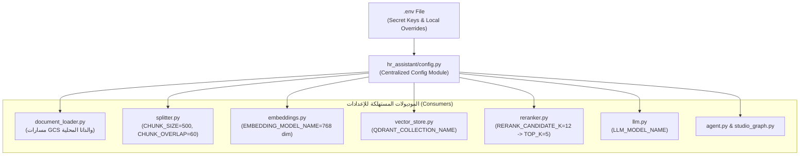

# القسم 30 / المحاضرة 145: إدارة الإعدادات المركزية وتكوين البيئة
# (Section 30 / Lecture 145: Centralized Configuration Management & Environment Schema)

---

## 1. الفلسفة المعمارية لإدارة الإعدادات (`Centralized Configuration Pattern`)

في المشاريع المؤسسية، يُعد انتشار القيم الثابتة (`Hardcoded Strings`) مثل أسماء النماذج، ومسارات التخزين، وأحجام المقاطع، ومعاملات البحث عبر ملفات الكود المختلفة بمثابة **دين تقني خطير (`Technical Debt`)**. 

إذا قررت الشركة تغيير نموذج التضمين من `jina-embeddings-v2` إلى نموذج أحدث، أو تغيير حجم الـ `chunk_size`، فسيضطر المهندس لتعديل عشرات الملفات، مما يرفع احتمالية الأخطاء البشرية (`Regression Bugs`).

لحل هذه المعضلة، يعتمد هذا المشروع نمط **المصدر الأوحد للحقيقة (`Single Source of Truth - config.py`)**:
* يقرأ المتغيرات السرية والبيئية من ملف `.env` عبر مكتبة `python-dotenv`.
* يضع قيماً افتراضية آمنة (`Safe Defaults`) للمتغيرات غير الحساسة.
* يُصدر ثوابت برمجية مكتوبة بصيغة قياسية تستوردها كافة العقد والملفات في المشروع.



---

## 2. التشريح الهندسي لحقول الإعدادات في `config.py`

ينقسم ملف الإعدادات إلى 7 أقسام وظيفية مترابطة:

### أ. إعدادات السحابة والمشروع (`GCP & Region`)
* `PROJECT_ID`: المعرف الفريد لمشروع السحابة.
* `LOCATION`: المنطقة الجغرافية لخوادم الذكاء الاصطناعي (مثل `us-central1`).

---

### ب. المفاتيح والروابط السرية (`Secrets & Endpoints`)
* `JINA_API_KEY`: مفتاح المصادقة لاستدعاء نماذج التضمين وإعادة الترتيب من منصة Jina AI.
* `QDRANT_URL`: رابط الوصول لخدمة `Qdrant Cloud` أو السيرفر المحلي.
* `QDRANT_API_KEY`: مفتاح التوثيق لتأمين الاتصال بقاعدة المتجهات.

---

### ج. هيكلة مناطق التخزين السحابي والمحلي (`Storage Zones`)
يتبع المشروع معمارية البحيرات المنظمة (`Data Lake Zones`):
1. **المنطقة الخام (`Raw Zone`)**:
   * `GCS_PREFIX = "raw/hr-policies/"`: لوائح الـ HR النصية غير المعدلة.
   * `NOISE_GCS_PREFIX = "raw/other-data/"`: ملفات الضوضاء بصيغها الأصلية (`PDF`, `DOCX`, `PPTX`).
2. **المنطقة المعالجة (`Processed Zone`)**:
   * `PROCESSED_HR_PREFIX = "processed/hr-policies/"`.
   * `PROCESSED_NOISE_PREFIX = "processed/other-data/"`.
   * **الهدف المعماري**: معالجة واستخراج النصوص من الـ PDF و PPTX مرة واحدة فقط وحفظها كملفات `JSON` مهيكلة، لمنع استهلاك المعالج في إعادة فك الملفات الثنائية عند كل إعادة بناء للجراف.

---

### د. مجموعات قاعدة المتجهات (`Qdrant Collections`)
* `QDRANT_COLLECTION_NAME = "hr_policies"`: المجموعة الرسمية النظيفة التي يتصل بها تطبيق الموظفين.
* `QDRANT_NOISY_COLLECTION_NAME = "hr_policies_noisy_demo"`: المجموعة المدمجة التي تحتوي على الضوضاء، وتُستخدم حصرياً في اختبارات الإجهاد (`Stress Testing`).

---

### هـ. مواصفات النماذج والتقطيع (`Models & Chunking Parameters`)
* `LLM_MODEL_NAME = "gemini-2.5-flash"`: نموذج الاستدلال الأساسي (مع دعم نماذج بديلة مثل Groq).
* `EMBEDDING_MODEL_NAME = "jina-embeddings-v2-base-en"`: نموذج التضمين بأبعاد $768\text{ dimensions}$.
* `RERANKER_MODEL_NAME = "jina-reranker-v2-base-multilingual"`: نموذج إعادة الترتيب متعدد اللغات.
* `CHUNK_SIZE = 500`: عدد الأحرف لكل مقطع نصي.
* `CHUNK_OVERLAP = 60`: مقدار التداخل لضمان استمرارية المعنى.

---

### و. المعمارية ثنائية المراحل لنسبة الاسترجاع (`Two-Stage Retrieval Ratio`)
أحد أهم الأسرار الهندسية في دقة أنظمة الـ RAG المتقدمة:

$$\text{Initial Candidates } (K_1 = 12) \xrightarrow[\text{Cross-Encoder}]{\text{Re-ranking}} \text{Final Context } (K_2 = 5)$$

* **لماذا نسترجع 12 مقطعاً في البداية (`RERANK_CANDIDATE_K = 12`)؟**
  عندما يسأل الموظف سؤالاً عريضاً مثل: *"ما هي كافة شروط ومستحقات إجازة الوضع والأمومة؟"*، فإن الوثيقة القانونية تنقسم عادة إلى 4 أو 5 مقاطع. إذا كان الاسترجاع الأولي ضيقاً (مثلاً 5 مقاطع فقط)، فقد تسقط بعض الشروط الاستثنائية لصالح نصوص أخرى.
* **لماذا نصفيها إلى 5 فقط (`TOP_K_RESULTS = 5`)؟**
  بعد أن يقوم الـ Re-ranker بحساب درجة المطابقة الدقيقة، نختار أعلى 5 مقاطع فائقة الصلة فقط ونمررها للـ LLM، مما يقلل استهلاك التوكنات ويمنع تشتيت النموذج.

---

### ز. فحص الصحة الاستباقي (`Fail-Fast Health Check`)
تحتوي الإعدادات على دالة دفاعية أساسية:
```python
def check_api_keys() -> None:
    ...
```
* وظيفتها التأكد من وجود كافة المفاتيح الإلزامية قبل تشغيل أي خطوة. إذا كان هناك مفتاح مفقود، يتوقف البرنامج فوراً ويخرج رسالة خطأ واضحة تحدد المفتاح الناقص بالضبط بدلاً من الانهيار في منتصف عمليات الفهرسة.

---

## 3. مصفوفة التحقق من الإعدادات قبل التشغيل

| اسم المتغير | النوع | القيمة الافتراضية | إلزامي؟ | الغرض الأساسي |
| :--- | :---: | :---: | :---: | :--- |
| `PROJECT_ID` | `str` | لا يوجد | نعم (في نمط GCP) | ربط خدمات جوجل السحابية |
| `JINA_API_KEY` | `str` | لا يوجد | نعم | التضمين وإعادة الترتيب |
| `QDRANT_URL` | `str` | لا يوجد | نعم | نقطة نهاية قاعدة المتجهات |
| `QDRANT_API_KEY` | `str` | لا يوجد | نعم | مفتاح مصادقة قاعدة المتجهات |
| `QDRANT_COLLECTION_NAME`| `str` | `"hr_policies"` | اختياري | اسم مجموعة البيانات النظيفة |
| `CHUNK_SIZE` | `int` | `500` | ثابت | طول المقطع النصي |
| `CHUNK_OVERLAP` | `int` | `60` | ثابت | تداخل المقاطع المتجاورة |
| `TOP_K_RESULTS` | `int` | `5` | ثابت | المقاطع النهائية المقتبسة |
| `RERANK_CANDIDATE_K` | `int` | `12` | ثابت | المقاطع المرشحة قبل التصفية |
| `LANGSMITH_TRACING` | `str` | `"false"` | اختياري | تفعيل التتبع اللحظي |

---

بهذا يكتمل التأسيس النظري لملف الإعدادات، والخطوة التالية في **المحاضرة 146: Document Loading** هي بناء خط قراءة وتحميل الوثائق الرسمية والضوضاء.
