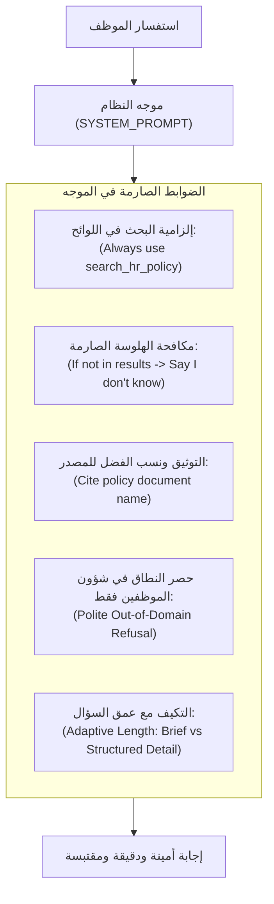
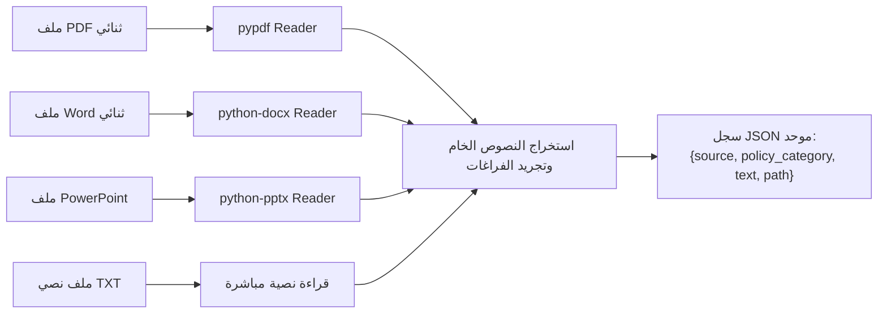

# القسم 30 / المحاضرة 146: تحميل الوثائق وهندسة معالجة الصيغ المتعددة
# (Section 30 / Lecture 146: Document Loading & Multi-Format Parsing Architecture)

---

## 1. المدخل المعماري: مرحلة الإدخال والتحويل (`Ingestion & Transformation`)

تعتبر مرحلة تحميل وتجهيز البيانات (`Document Loading & Processing`) بمثابة صمام الأمان لأي نظام RAG حقيقي. جودة الإجابات التي يولدها الذكاء الاصطناعي تعتمد بنسبة 100% على جودة ونظافة النصوص المستخلصة من الوثائق الأصلية:

$$\text{Garbage In} \implies \text{Garbage Out}$$

في هذه المحاضرة، ننتقل من مرحلة الإعدادات العامة إلى بناء **أربعة موديولات أساسية**:
1. **`prompts.py`**: صياغة موجه النظام الحاكم لسلوك وكيل الموارد البشرية (`System Prompt`).
2. **`logging_config.py`**: تأسيس نظام المراقبة وتسجيل الأحداث (`Structured Console Logging`).
3. **`document_loader.py`**: محرك قراءة واستخراج البيانات وتغليفها في كائنات `LangChain Document`.
4. **`processor.py`**: محرك تفكيك ومعالجة الصيغ الثنائية المعقدة (`PDF`, `DOCX`, `PPTX`) وتحويلها إلى سجلات `JSON` موحدة.

---

## 2. هندسة موجه النظام لوكيل الـ HR (`Prompt Engineering Philosophy`)

تم عزل الموجهات في ملف مستقل `prompts.py` لأنه يمثل **التكوين السلوكي (`Behavioral Configuration`)** للنظام، وليس مجرد إعدادات تقنية.



### القواعد الخمس الحاكمة لوكيل الموارد البشرية:
1. **الأولوية المطلقة للاسترجاع (`Tool-First Answering`)**:
   لا يجوز للنموذج الإجابة من ذاكرته العامة مسبقة التدريب؛ بل يجب عليه استدعاء أداة البحث في لوائح الشركة أولاً.
2. **مكافحة الهلوسة (`Zero-Hallucination Guardrail`)**:
   إذا لم يجد الوكيل الإجابة صراحة في نتائج البحث، يُلزم بقول: *"لا أعلم، هذه المعلومة غير واردة في لوائح الشركة"* بدلاً من التخمين.
3. **التوثيق ونسب المصدر (`Source Attribution & Citation`)**:
   كل رد يجب أن يذكر اسم الوثيقة الرسمية المستند عليها (مثل: `leave_policy.txt` أو `exit_process_policy.txt`).
4. **حصار النطاق الإداري (`Strict Domain Fence`)**:
   رفض أي أسئلة خارج نطاق الـ HR (مثل أسئلة البرمجة، الشؤون المالية للشركة، أو إعداد القهوة).
5. **الطول التكيفي للإجابة (`Adaptive Length`)**:
   * الأسئلة المحددة السريعة $\implies$ إجابة مركزة وموجزة في سطرين.
   * الأسئلة العريضة والتفصيلية $\implies$ إجابة مهيكلة بنقاط ورؤوس موضوعات شاملة.

---

## 3. معالجة الصيغ المتعددة والتحويل لصيغة موحدة (`processor.py`)

في الشركات الحقيقية، لا تأتي وثائق الضوضاء كملفات نصية نقية، بل تأتي في صيغ ثنائية مختلفة:
* ملفات **PDF**: تستخرج النصوص بواسطة مكتبة `pypdf.PdfReader` مع تجميع صفحات المستند.
* ملفات **Word (.docx)**: تستخرج الفقرات النصية بواسطة مكتبة `python-docx`.
* عروض **PowerPoint (.pptx)**: تستخرج العناوين والأشكال التوضيحية ومربعات النصوص بواسطة `python-pptx`.



### المبدأ المعماري: المعالجة لمرة واحدة فقط (`Parse Once, Store JSON`)
لماذا نقوم بتحويل الملفات الثنائية إلى `JSON`؟
* تفكيك ملفات الـ `PDF` و `PPTX` بالذكاء الاصطناعي يستهلك وقتاً ومعالجة حسابية عالية (`CPU-Intensive`).
* يقوم موديول `processor.py` بفك هذه الملفات **مرة واحدة فقط** وتخزينها كسجلات `JSON` جاهزة، بحيث عند إعادة بناء قاعدة المتجهات أو عمل `Re-index`، يقرأ خط الفهرسة نصوص الـ JSON مباشرة في أجزاء من الثانية.

---

## 4. محرك استخراج الفئات والتحميل (`document_loader.py`)

### أ. استخراج الفئة الوظيفية (`extract_policy_category`)
تبدأ كل وثيقة من وثائق الشركة في أسطرها الخمسة الأولى بسطر وصفي:
* في لوائح الـ HR: `Policy Category: Leave Policy`
* في ملفات الضوضاء: `Category: Finance Report`
تقوم الدالة بفحص الأسطر الأولى واستخراج الفئة ووضعها داخل الـ `metadata` الخاصة بالمستند، مما يتيح للـ Vector Store لاحقاً تصفية النتائج بناءً على هذه الفئة.

### ب. هيكل كائن `LangChain Document`
كل مستند يتم تحويله في الذاكرة إلى كائن قياسي موحد:
```python
Document(
    page_content="النص الصافي المستخرج من الملف...",
    metadata={
        "source": "leave_policy.txt",
        "policy_category": "Leave Policy"
    }
)
```

---

## 5. مصفوفة مقارنة أدوات معالجة الملفات في بايثون

| صيغة الملف | المكتبة المعتمدة في المشروع | البدائل الممكنة | سبب الاختيار |
| :--- | :--- | :--- | :--- |
| **PDF** | `pypdf` | `pdfplumber`, `PyMuPDF (fitz)` | خفيفة، مفتوحة المصدر، متوافقة 100% مع بيئات السحابة والـ Docker |
| **DOCX** | `python-docx` | `mammoth`, `unstructured` | المعيار القياسي في بايثون لقراءة ملفات ميكروسوفت وورد المهيكلة |
| **PPTX** | `python-pptx` | `unstructured` | تدعم فحص مربعات النصوص والعناوين داخل كل شريحة بشكل متسلسل |
| **TXT** | بايثون القياسي (`utf-8`) | — | قراءة سريعة جداً بدون أي مكتبات خارجية |

---

بهذا تكتمل المعمارية الهندسية لمرحلة تحميل ومعالجة الوثائق، وسننتقل في **المحاضرة 147: Document chunking embedding and storing to vector DB** إلى مرحلة التقطيع الدلالي، استدعاء نماذج التضمين، والتخزين الفعلي داخل قاعدة `Qdrant`.
