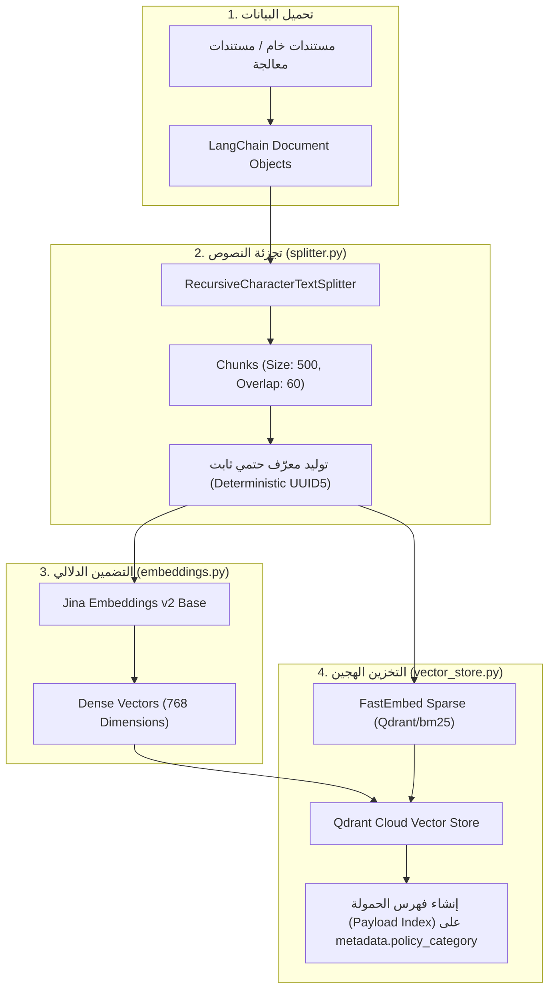

# تقطيع المستندات وتوليد التضمينات والتخزين المتجهي الهجين

تتناول هذه الوثيقة البنية الهندسية لمرحلة تجزئة النصوص (`Chunking`)، وتحويلها إلى متجهات دلالية (`Vector Embeddings`)، وبناء مستودع المتجهات السحابي (`Qdrant Cloud`) مع تفعيل البحث الهجين (`Hybrid Search`) والفهرسة الوصفية (`Metadata Payload Indexing`).

---

## 1. البنية المعمارية لخط الأنابيب (Ingestion Architecture)

تتكامل ثلاث وحدات برمجية مستقلة لتجهيز البيانات قبل مرحلة الاسترجاع:



---

## 2. استراتيجية التقطيع التكراري (`splitter.py`)

تعتمد التجزئة على وحدة `RecursiveCharacterTextSplitter` لتقطيع النصوص الكبيرة إلى مقاطع دلالية متداخلة تحافظ على السياق اللغوي:

### المعادلات الرياضية للتقطيع والتراكب
إذا كان طول المستند الكلي $L$ من المحارف، وحجم المقطع المستهدف $C = 500$، وحجم التراكب $O = 60$، فإن حجم الخطوة الفعلية بين مقطعين متتاليين (Stride) هو:

$$S = C - O = 500 - 60 = 440 \text{ characters}$$

ويُحسب العدد التقريبي للمقاطع الناتجة $N$ بالعلاقة:

$$N = \left\lceil \frac{L - O}{S} \right\rceil = \left\lceil \frac{L - 60}{440} \right\rceil$$

### الحفاظ التلقائي على الميتاداتا
عند تقسيم كائن `Document` رئيسي، ترث جميع المقاطع الفرعية قاموس الميتاداتا كاملاً:
* `source`: اسم الملف الأصلي (مثل `leave_policy.txt`).
* `policy_category`: تصنيف السياسة المقتطع من الترويسة (مثل `Leave`).
* `local_path`: المسار المحلي للملف.

---

## 3. التضمين الدلالي والاحتياطي المحلي (`embeddings.py`)

تم تصميم وحدة التضمين لدعم المزود الأساسي مع توفير مسار احتياطي دفاعي تلقائي:

1. **المزود الأساسي (`JinaEmbeddings`):**
   * النموذج: `jina-embeddings-v2-base-en`.
   * أبعاد الفضاء المتجهي: $d = 768$.
   * نافذة السياق: حتى 8192 رمزا (`tokens`).
2. **المسار الاحتياطي المحلي (`HuggingFaceEmbeddings`):**
   * النموذج: `sentence-transformers/all-MiniLM-L6-v2`.
   * أبعاد الفضاء المتجهي: $d = 384$.
   * يعمل محلياً دون تكلفة أو اتصال بالإنترنت في حال تعذر الوصول إلى واجهة البرمجة.

---

## 4. مستودع المتجهات السحابي والبحث الهجين (`vector_store.py`)

### أ. معرّفات المقاطع الحتمية المستقرة (Deterministic Stable Point IDs)
لمنع تكرار المقاطع عند إعادة تشغيل خط الأنابيب، يتم توليد معرّف فريد باستخدام خوارزمية `UUID5` القائمة على فضاء أسماء ثابت ومحتوى المقطع:

$$\text{Point ID} = \text{UUID5}\Big(\text{Namespace}_{\text{fixed}}, \; \text{source} \mathbin{\Vert} \text{chunk\_text}\Big)$$

هذا يضمن أن عملية الإدخال هي عملية تحديث دمجية (`Idempotent Upsert`) وليست إضافة تكرارية.

### ب. البحث الهجين (Dense + Sparse Hybrid Search)
يجمع الاسترجاع بين دقة التشابه الدلالي وقوة مطابقة الكلمات المفتاحية الدقيقة:

$$\text{Score}_{\text{hybrid}}(q, d) = \alpha \cdot \text{Sim}_{\text{dense}}(\mathbf{e}_q, \mathbf{e}_d) + (1 - \alpha) \cdot \text{Score}_{\text{BM25}}(q, d)$$

حيث:
* $\mathbf{e}_q, \mathbf{e}_d \in \mathbb{R}^{768}$ هما متجها الاستعلام والمستند.
* $\text{Score}_{\text{BM25}}$ يمثل درجة المطابقة المعجمية عبر `Qdrant/bm25`.

### ج. فهرسة الحقول الوصفية (Payload Indexing)
يتطلب محرك `Qdrant` إنشاء فهرس صريح من النوع `KEYWORD` على حقل `metadata.policy_category` لتنفيذ التصفية الدقيقة أثناء الاسترجاع:

```python
store.client.create_payload_index(
    collection_name=collection_name,
    field_name="metadata.policy_category",
    field_schema=PayloadSchemaType.KEYWORD,
)
```

---

## 5. مصفوفة المقارنة الهندسية

| الخاصية | التضمين المتجهي البحت (Dense Only) | البحث المعجمي البحت (Sparse Only) | البحث الهجين (Dense + Sparse) |
| :--- | :--- | :--- | :--- |
| **التقنية المستخدمة** | `Jina v2 (Cosine Similarity)` | `BM25 (FastEmbed)` | `Qdrant Hybrid Fusion` |
| **التعامل مع المرادفات** | ممتاز دلالياً | ضعيف (يعتمد على تطابق الكلمات) | ممتاز دلالياً ومعجمياً |
| **التعامل مع المصطلحات وأرقام المواد** | متوسط (قد يخلط بين الأرقام) | فائق الدقة في مطابقة النصوص | فائق الدقة عبر الجمع بين الاثنين |
| **استهلاك الذاكرة وحجم الفهرس** | منخفض ($768$ أبعاد عائمة) | منخفض إلى متوسط | متوسط (يتضمن فهرسين متكاملين) |
| **زمن استجابة الاسترجاع** | سريع ($< 25\text{ ms}$) | فائق السرعة ($< 10\text{ ms}$) | سريع ومتوازن ($< 35\text{ ms}$) |
