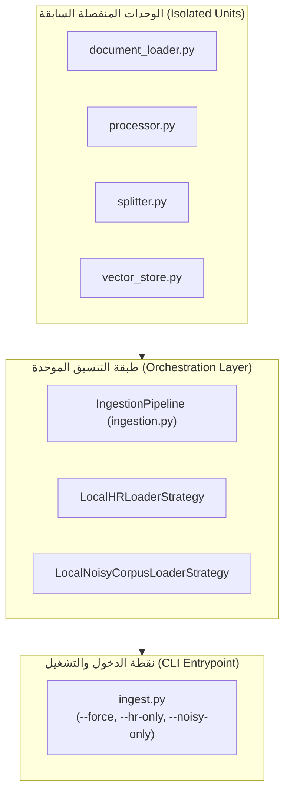
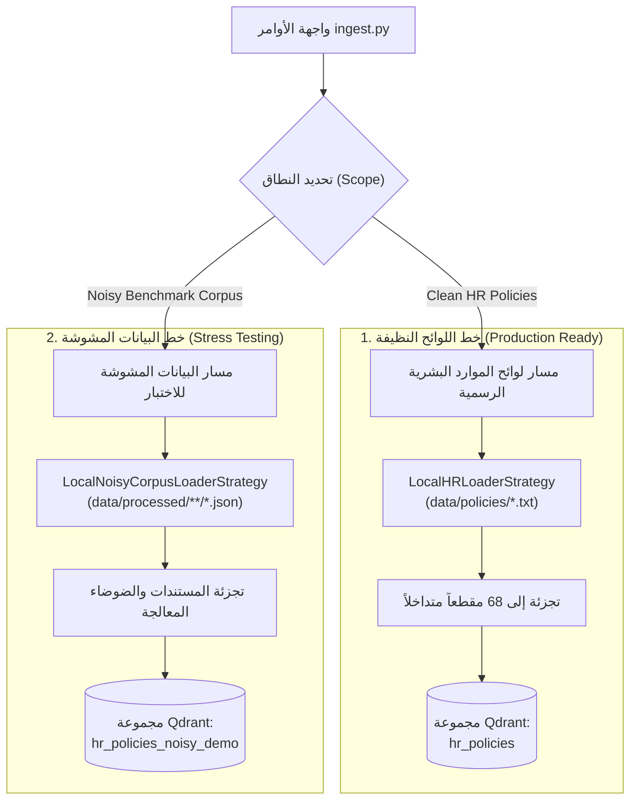

# القسم 30 / المحاضرة 148: أتمتة وتنسيق خط إدخال البيانات
# (Section 30 / Lecture 148: Data Ingestion Pipeline Orchestration)

---

## 1. المدخل المعماري: من الوحدات المنفصلة إلى خط الأنابيب المتكامل

في المحاضرات السابقة، قمنا ببناء واختبار كل وحدة برمجية من وحدات النظام في معزل (`In Isolation`):
* قراءة ومعالجة المستندات المحلية ومتعددة الصيغ (`document_loader.py` و `processor.py`).
* تجزئة النصوص وتوليد المعرفات الحتمية الثابتة (`splitter.py`).
* التضمين الدلالي الهجين وحفظ المتجهات في السحابة (`embeddings.py` و `vector_store.py`).

الهدف الأساسي للمحاضرة **148** هو **العزف والتنسيق الجماعي (`Pipeline Orchestration`)**، حيث يتم ربط هذه الوحدات داخل محرك موحد لإدخال البيانات (`Ingestion Engine`)، مع إتاحة التحكم الكامل فيه عبر واجهة سطر الأوامر (`CLI`).



---

## 2. تطبيق مبادئ التصميم SOLID في بناء خط الأنابيب

تم بناء موديول `hr_assistant/ingestion.py` وفقاً لأعلى معايير هندسة البرمجيات لتفادي الاعتماد المباشر على مصادر بيانات محددة وتسهيل التوسع المستقبلي:

### أ. مبدأ المسؤولية الواحدة (Single Responsibility Principle - SRP)
* تم فصل استراتيجية قراءة البيانات (`Loader Strategies`) عن منطق التجزئة والرفع (`IngestionPipeline`).
* الـ Pipeline مسؤول فقط عن تنسيق التدفق: `Load -> Chunk -> Upsert`.

### ب. مبدأ الانفتاح/الانغلاق (Open/Closed Principle - OCP)
* يمكن إضافة أي مصدر بيانات جديد (مثل قاعدة بيانات SQL أو Google Drive أو Notion) بمجرد كتابة فئة تطبق بروتوكول `DocumentLoaderStrategy` دون الحاجة لتعديل سطر كود واحد داخل `IngestionPipeline`.

### ج. مبدأ استبدال لسكوف (Liskov Substitution Principle - LSP) ومبدأ فصل الواجهات (ISP)
* تم استخدام `typing.Protocol` مع `@runtime_checkable` لتعريف واجهة رشيقة وصريحة:
  ```python
  @runtime_checkable
  class DocumentLoaderStrategy(Protocol):
      def load(self) -> List[Document]:
          ...
  ```
  أي استراتيجية تطبق هذه الدالة قابلة للاستبدال الفوري دون أي آثار جانبية.

### د. مبدأ عكس التبعية (Dependency Inversion Principle - DIP)
* فئة `IngestionPipeline` تعتمد على التجريدات (`Callables` و `Protocols`) وتستقبل دوال التقطيع والبناء عبر حقن التبعيات (`Dependency Injection`):
  ```python
  class IngestionPipeline:
      def __init__(
          self,
          chunker: Callable[[List[Document]], List[Document]] = split_into_chunks,
          vector_store_builder: Callable[..., Any] = build_vector_store,
          collection_checker: Callable[[str], bool] = collection_exists,
      ) -> None:
          ...
  ```

---

## 3. مسارا الحقن المزدوج (Dual Ingestion Pathways)

يدير المنسق مسارين متوازيين تماماً للبيانات:



### المقارنة المعمارية بين المجموعتين:

| وجه المقارنة | مجموعة الإنتاج (`hr_policies`) | مجموعة اختبار الضغط (`hr_policies_noisy_demo`) |
| :--- | :--- | :--- |
| **مصدر البيانات** | 10 لوائح إدارية نصية نقية (`data/policies/*.txt`) | 10 لوائح إدارية + 8 ملفات ضوضاء ثنائية (`data/processed`) |
| **طبيعة المحتوى** | سياسات الإجازات، مكافآت العمل، ضوابط السلوك، إنهاء الخدمة | سياسات إدارية + تقارير مبيعات إقليمية، عروض تسويق، ميزانيات تشغيل |
| **الهدف الهندسي** | استرجاع مباشر وسريع للإجابات اليومية الموثوقة | اختبار قدرة محرك إعادة الترتيب (`Re-ranker`) على تصفية الضوضاء |
| **طريقة التوليد** | مباشرة عبر نصوص اللوائح | عبر تحويل الوثائق الثنائية (`PDF/DOCX/PPTX`) إلى `JSON` موحد |

---

## 4. التحكم عبر سطر الأوامر والتخطي الذكي (`CLI & Idempotency`)

يوفر الملف [`ingest.py`](file:///d:/Code/AI/rag-mastery/projects/01-rag-applications/01-hr-policy-rag-assistant/ingest.py) واجهة سطر أوامر سهلة ومحمية:

```bash
# 1. إدخال لوائح الموارد البشرية فقط (الافتراضي - يتخطى الفهرسة إذا كانت المجموعة تحتوي نقاطاً بالفعل):
python ingest.py

# 2. إدخال المجموعة المشوشة فقط لاختبارات الإجهاد:
python ingest.py --noisy-only

# 3. إجبار خط الأنابيب على مسح وإعادة بناء المجموعات من الصفر (Force Rebuild):
python ingest.py --force

# 4. تشغيل متوافق مع أوامر الكورس السحابية القديمة (يتجاهل الرفع السحابي محلياً):
python ingest.py --no-upload
```

### خوارزمية التخطي الذكي وحماية التكلفة (`Smart Idempotency`)
قبل استدعاء نماذج التضمين (`Jina Embeddings`) وحرق التوكنات، يقوم خط الأنابيب بفحص المستودع:
```python
if self.collection_checker(collection_name) and not force:
    logger.info("Collection '%s' already exists with indexed points. Skipping ingestion.", collection_name)
    return 0
```
هذا يضمن أن إعادة تشغيل الأمر عن طريق الخطأ لن تعيد استهلاك رصيد الـ API ولن تستغرق وقتاً إضافياً.

---

## 5. اختبارات الوحدة الآلية (`tests/test_ingestion.py`)

تم تأكيد صحة منطق خط الأنابيب عبر اختبارات محاكاة معزولة بالكامل دون الحاجة للاتصال بالإنترنت:
1. **اختبار التوافق البروتوكولي (`Protocol Compliance`):** التأكد من أن كل فئة تحميل تطبق واجهة `DocumentLoaderStrategy`.
2. **اختبار التخطي التلقائي (`Idempotency Test`):** التحقق من أن الـ Chunker ومستودع المتجهات لا يتم استدعاؤهما نهائياً إذا كانت المجموعة ممتلئة و `force=False`.
3. **اختبار الإجبار على التحديث (`Force Execution Test`):** التحقق من تدمير وإعادة بناء المقاطع عند ضبط `force=True`.

---

## 6. الخلاصة وما تحقق في المحاضرة 148

* [x] بناء منسق الـ Ingestion الموحد `hr_assistant/ingestion.py` بمعايير SOLID.
* [x] دعم بنية محلية 100% دون الحاجة إلى Google Cloud Storage مع الحفاظ على التوافق السحابي.
* [x] إطلاق واجهة سطر الأوامر `ingest.py` مع وسائط التحكم بالكامل.
* [x] تغطية الموديول باختبارات وحدة آلية شاملة بنسبة نجاح 100%.
