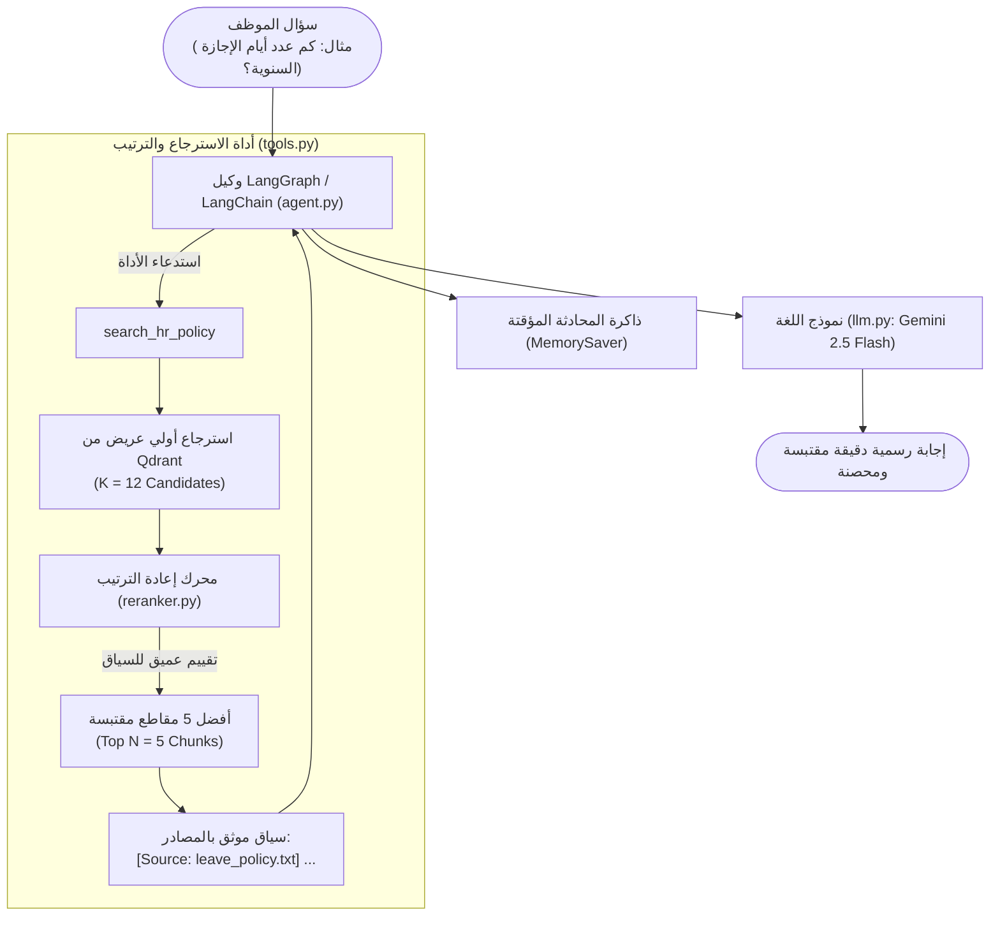
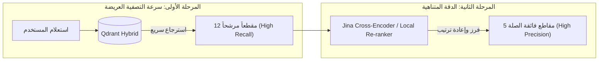

# محرك الاسترجاع وإعادة الترتيب ووكيل المساعد
# (Retrieval Pipeline, Cross-Encoder Re-ranking & HR Assistant Agent)

---

## 1. المدخل المعماري: الانتقال إلى خط الاسترجاع والتوليد اللحظي

بعد أن اكتمل خط إدخال البيانات (`Ingestion Pipeline`) وفهرسة المقاطع في مستودع `Qdrant`، ننتقل في هذا الموديول إلى الشق الثاني من النظام: **خط الاسترجاع والتوليد التفاعلي (`Query & Retrieval Pipeline`)**.

تتكامل في هذه المرحلة أربعة مكونات أساسية:
1. **نموذج الاستدلال (`hr_assistant/llm.py`):** استدعاء نموذج `Gemini` مع ضبط المعاملات للحد من الإبداع الزائد والتركيز على الحقائق.
2. **محرك إعادة الترتيب (`hr_assistant/reranker.py`):** إعادة تقييم المقاطع المسترجعة بدقة فائقة عبر الـ `Cross-Encoder`.
3. **أداة الاسترجاع (`hr_assistant/tools.py`):** تغليف البحث وإعادة الترتيب في أداة معيارية (`@tool`) يستدعيها الوكيل.
4. **وكيل الموارد البشرية (`hr_assistant/agent.py`):** تنسيق عقل النظام (LLM + الأداة + موجه النظام الصارم + الذاكرة قصيرة المدى).



---

## 2. فلسفة الاسترجاع على مرحلتين ولماذا نحتاج الـ Re-ranking؟

في أنظمة الـ RAG البسيطة، يتم الاكتفاء بالبحث الدلالي الأولي (`Cosine Similarity`) أو البحث المعجمي (`BM25`). لكن في البيئات المؤسسية المشوشة، يُعد الاعتماد على التشابه المتجهي وحده **غير كافٍ** لسببين رياضيين وهندسيين:

### أ. قصور تشابه جيب التمام المنفصل (`Bi-Encoder Independence Limitation`)
نماذج التضمين الدلالي التقليدية (`Bi-Encoders`) تقوم بتشفير الاستعلام $q$ في متجه مستقل $\vec{u}$، وتشفير المقطع $d$ في متجه مستقل $\vec{v}$، ثم تحسب جيب التمام بينهما:

$$\text{Sim}_{\text{Bi}}(q, d) = \cos(\vec{u}, \vec{v}) = \frac{\vec{u} \cdot \vec{v}}{\|\vec{u}\| \|\vec{v}\|}$$

هذه العملية سريعة جداً ($O(1)$ عبر الفهرس)، لكنها **تتجاهل التفاعل المشترك المعقد بين كلمات السؤال وكلمات المقطع**.

### ب. قوة المشفر التقاطعي (`Cross-Encoder Deep Relevance`)
محرك الـ Re-ranker يقوم بتمرير السؤال والمقطع معاً في تمريرة واحدة عبر الشبكة العصبية:

$$\text{Score}_{\text{Cross}}(q, d) = f_{\text{Attention}}([q \circ d])$$

تسمح طبقات الانتباه متعدد الرؤوس (`Self-Attention Layers`) لكل كلمة في السؤال بالتفاعل المباشر مع كل كلمة في الوثيقة، مما يكشف المعنى الحقيقي للسياق ويصفي وثائق المبيعات والضوضاء المؤسسية بدقة تامة.



---

## 3. تشريح المكونات البرمجية للموديول

### 1. موصل النموذج اللغوي (`hr_assistant/llm.py`)
* يربط النظام بنموذج `Gemini 2.5 Flash`.
* يعتمد درجة حرارة استدلال حرجة: $\text{temperature} = 0.0$، لضمان أعلى درجات الدقة الإجرائية ومكافحة توليد معلومات عشوائية.
* يدعم الوضع المجاني المباشر عبر `GEMINI_API_KEY` (Google AI Studio) مع التوافق التام مع نمط `Vertex AI` المؤسسي.

### 2. محرك إعادة الترتيب الدفاعي (`hr_assistant/reranker.py`)
* يستقبل قائمة الـ $12$ مرشحاً ويعيد ترتيبها تنازلياً حسب درجة الملاءمة اللغوية.
* مزود بمسارين:
  1. مسار سحابي عالي الدقة عبر `Jina AI Cross-Encoder REST API`.
  2. مسار دفاعي محلي مدمج (`Local Cosine Re-scoring`) يضمن استمرار النظام دون توقف إذا انتهى رصيد الـ API.

### 3. أداة الاسترجاع كخدمة (`hr_assistant/tools.py`)
* نمط **Retriever-as-a-Tool**: بدلاً من إجبار الوكيل على البحث في كل محادثة، يتم تغليف الاسترجاع كأداة برمجية يقرر الوكيل الذاتي متى يستدعيها وما الكلمات المفتاحية الأنسب للبحث بها.
* توثيق المصدر: يُجبر كل مقطع مسترجع على إرفاق وسم المصدر الصريح:
  ```text
  [Source: leave_policy.txt]
  يحق للموظف الحصول على إجازة سنوية مدفوعة الأجر قدرها 30 يوماً تقويمياً...
  ```

### 4. وكيل الموارد البشرية والذاكرة قصيرة المدى (`hr_assistant/agent.py`)
* يتم تجميع الوكيل عبر مكتبة `langchain.agents.create_agent` ليعمل كـ `StateGraph` تنفيذي.
* **الذاكرة المؤقتة (`Short-Term Memory / Checkpointer`):**
  باستخدام `MemorySaver`، يمتلك الوكيل سياق المحادثة الممتد؛ فإذا سأل الموظف: *"كم عدد أيام الإجازة السنوية؟"* ثم أتبعها بسؤال: *"وهل تشمل أيام العطلات الأسبوعية؟"*، يدرك الوكيل فوراً أن السؤال الثاني تابع للائحة الإجازات دون الحاجة لإعادة ذكر اسم الموضوع.

---

## 4. اختبارات الوحدة والجودة (`tests/test_retrieval_agent.py`)

تمت تغطية مكونات خط الاسترجاع بحزمة اختبارات آلية تحقق الشروط التالية:
* [x] معالجة الحالات الحدية: إرجاع قائمة فارغة عند غياب المستندات أو ضبط `top_n <= 0`.
* [x] التحقق من تقليص الـ Shortlist من المرشحين العريضين إلى الحجم النهائي المحدد.
* [x] التأكد من سلامة توصيف وواجهة أداة `search_hr_policy`.
* [x] التأكد من نجاح تجميع الرسم البياني للوكيل (`Agent StateGraph Compilation`).
