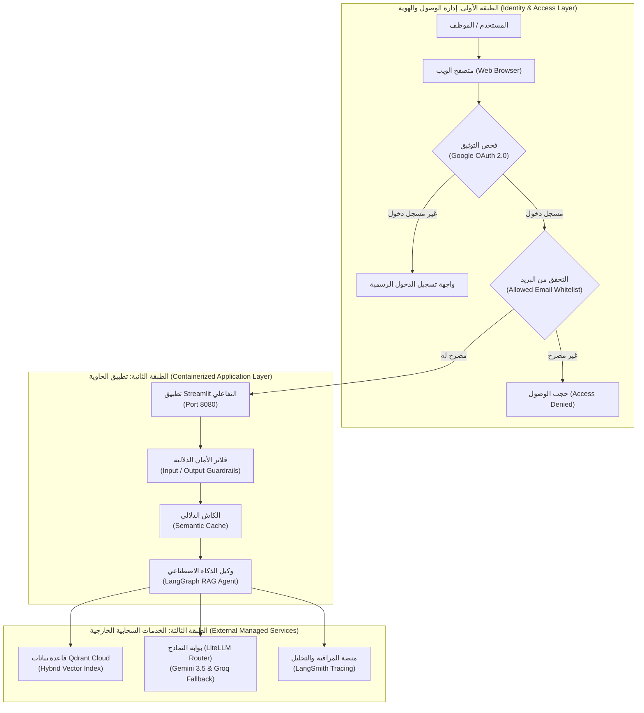

# الدليل الشامل لحاويات Docker والنشر السحابي والتحكم في الوصول (Containerization, Cloud Run & Access Control)

## 1. المقدمة والأهداف المعمارية

في الأنظمة الإنتاجية للمؤسسات (Enterprise Production Systems)، لا يكتمل بناء تطبيق الذكاء الاصطناعي بمجرد نجاح خط أنابيب الـ RAG محلياً أو اجتياز اختبارات التقييم. تتطلب المرحلة التشغيلية نقل التطبيق إلى بيئة عمل حية تلبي ثلاثة متطلبات جوهرية:

1. **العزل وقابلية النقل (Containerization & Portability):** حزم كافة الاعتماديات وملفات النماذج ومكتبات التشغيل داخل صورة موحدة (Docker Image) تعمل بنفس السلوك على أي بنية تحتية سحابية دون تباين في البيئات.
2. **الاستضافة السحابية الاقتصادية عديمة السيرفرات (Serverless Compute via Cloud Run):** تشغيل التطبيق في بيئة تتقلب تلقائياً مع حجم الطلب (Auto-scaling)، وتدعم تقنية التوقف التام عند انعدام الاستخدام (Scale-to-Zero) لتصفير التكلفة التشغيلية عند عدم وجود جلسات نشطة.
3. **طبقة الهوية والتحكم الصارم في الوصول (Identity & Access Management via OAuth):** بما أن المساعد يتعامل مع سياسات الموارد البشرية واللوائح الداخلية، يجب حجب الوصول العام وحصر الاستخدام على الموظفين المصرح لهم فقط عبر بريد العمل المعتمد (Google Workspace OAuth Whitelisting).

---

## 2. المخطط الهيكلي ثلاثي الطبقات للنظام الحي (Three-Tier Production Architecture)



---

## 3. تصميم ملف الـ Dockerfile الموجه لبيئات Cloud Run

لبناء حاوية إنتاجية خفيفة وسريعة الإقلاع، تم تصميم `Dockerfile` متعدد المراحل مع مراعاة التغلب على مشكلة الإقلاع البارد (Cold-Start Latency).

### تفاصيل التعليمات في `Dockerfile`:

```dockerfile
# استخدام صورة بايثون خفيفة مخصصة للإنتاج
FROM python:3.11-slim

# منع بايثون من كتابة ملفات التخزين المؤقت وضبط إخراج السجلات الفوري
ENV PYTHONDONTWRITEBYTECODE=1 \
    PYTHONUNBUFFERED=1 \
    PIP_NO_CACHE_DIR=1 \
    PORT=8080

WORKDIR /app

# تثبيت الاعتماديات الأساسية للنظام
RUN apt-get update && apt-get install -y --no-install-recommends \
    curl \
    build-essential \
    && rm -rf /var/lib/apt/lists/*

# استخدام uv لتسريع تثبيت مكتبات بايثون
RUN pip install --no-cache-dir uv

# نسخ الاعتماديات والتثبيت على مستوى النظام
COPY requirements.txt .
RUN uv pip install --system --no-cache -r requirements.txt

# تحميل مسبق لنموذج FastEmbed BM25 أثناء مرحلة البناء (Build-time Pre-warming)
RUN python -c "from fastembed import SparseTextEmbedding; SparseTextEmbedding(model_name='Qdrant/bm25')"

# نسخ الحزمة البرمجية وملفات اللوائح
COPY hr_assistant/ ./hr_assistant/
COPY data/ ./data/

# نسخ نقاط الدخول التشغيلية
COPY app.py ingest.py evaluate.py main.py ./

# فتح المنفذ القياسي لـ Cloud Run
EXPOSE 8080

# فحص صحة الحاوية التلقائي
HEALTHCHECK --interval=30s --timeout=10s --start-period=40s --retries=3 \
    CMD curl --fail http://localhost:8080/_stcore/health || exit 1

# تشغيل خادم Streamlit بالإعدادات الإنتاجية الصارمة
CMD ["streamlit", "run", "app.py", \
     "--server.port=8080", \
     "--server.address=0.0.0.0", \
     "--server.headless=true", \
     "--server.enableCORS=false", \
     "--server.enableXsrfProtection=false"]
```

### تقنية التحميل المسبق للنماذج (Pre-warming):
في العادة، عند تشغيل الحاوية لأول مرة بعد إيقافها (Cold Start)، تستغرق مكتبة `fastembed` حوالي 15 إلى 25 ثانية لتحميل أوزان الـ ONNX الخاصة بنموذج `Qdrant/bm25`. عبر تشغيل أمر التحميل المسبق داخل الـ `Dockerfile` أثناء مرحلة الـ Build:
$$\text{Build Phase} \xrightarrow{\text{Download weights}} \text{Local Cache (/root/.cache)} \xrightarrow{\text{Frozen in Image}} \text{Instant Zero-Latency Boot}$$
يتم تضمين الأوزان داخل طبقات الصورة، مما يقلل زمن إقلاع الحاوية على `Cloud Run` من 30 ثانية إلى أقل من ثانيتين.

---

## 4. تنظيم الخدمات الدقيقة عبر Docker Compose

لتمكين تشغيل خطوط الأنابيب المتعددة (التطبيق، الفهرسة، التقييم) محلياً كخدمات معزولة، تم تنظيم بنية `docker-compose.yml` باستخدام تقنية الـ Profiles:

| اسم الخدمة (Service) | الأمر المنفذ (Command) | المنفذ (Port) | الـ Profile | الغرض التشغيلي |
| :--- | :--- | :--- | :--- | :--- |
| `app` | `streamlit run app.py` | `8501:8080` | افتراضي (Default) | الواجهة الرئيسية للمساعد وتفاعل الموظفين |
| `ingest` | `python ingest.py` | معزول | `tools` | إعادة بناء فهرس Qdrant وفهرسة المستندات عند الطلب |
| `eval` | `python evaluate.py` | معزول | `tools` | تشغيل تجارب التقييم المؤتمتة ومطابقتها على LangSmith |

عند تنفيذ `docker compose up`، يتم تشغيل خدمة `app` فقط دون إهدار موارد النظام في تشغيل الفهرسة أو التقييم، بينما يتم تشغيل خدمات الأدوات عند الحاجة عبر:
```bash
docker compose --profile tools run --rm ingest
docker compose --profile tools run --rm eval
```

---

## 5. منظومة التحكم في الوصول والتوثيق (Google OAuth Gating)

تتكون منظومة الأمان من مستويين متكاملين:

1. **النمط المحلي المرن (Local Open Mode Fallback):**
   عند تشغيل التطبيق في بيئة التطوير المحلية دون وجود ملف `secrets.toml`، تكتشف الدالة `is_auth_configured()` غياب إعدادات المصادقة تلقائياً، وتسمح بالتشغيل دون انهيار النظام (Graceful Degradation).
2. **النمط الإنتاجي الصارم (Production Whitelist Enforcement):**
   عند النشر على `Cloud Run` وتمرير أسرار `Google OAuth`، يُفعل النظام بوابة التوثيق:
   * التحقق من وجود جلسة دخول نشطة عبر `st.user.is_logged_in`.
   * استخراج البريد الإلكتروني للمستخدم ومطابقته بالقائمة البيضاء المحددة في المتغير `ALLOWED_EMPLOYEE_EMAILS`.
   * حجب أي محاولة دخول من حساب خارجي مع عرض رسالة تنبيهية وزر صريح لتسجيل الخروج.

```python
def verify_access_control() -> bool:
    if not is_auth_configured():
        return True

    user = getattr(st, "user", None)
    if not (user and getattr(user, "is_logged_in", False)):
        st.subheader("Employee Authentication Required")
        st.info("Please sign in with your corporate Google Workspace account.")
        if hasattr(st, "login"):
            if st.button("Log in with Google", type="primary", use_container_width=True):
                st.login("google")
        st.stop()
        return False

    user_email = str(getattr(user, "email", "")).strip().lower()
    allowed_emails = [e.lower() for e in config.ALLOWED_EMPLOYEE_EMAILS]

    if allowed_emails and user_email not in allowed_emails:
        st.error(f"Access Denied: Account '{user_email}' is not authorized.")
        st.stop()
        return False

    return True
```

---

## 6. استراتيجية التكلفة الصفرية (Zero-Cost Deployment Strategy)

لضمان عدم تحميل المستخدم أي تكاليف على Google Cloud Platform:
1. **Cloud Run Free Tier:** تقدم جوجل شهرياً 2 مليون طلب (Requests) مجاني، و 360,000 جيجابايت-ثانية من الذاكرة، و 180,000 ثانية vCPU مجاناً، وهو ما يكفي لتشغيل تطبيق داخلي لمئات الموظفين دون دفع سنت واحد.
2. **Artifact Registry Free Tier:** تمنح جوجل 0.5 جيجابايت شهرياً لتخزين صور الحاويات مجاناً.
3. **Google OAuth 2.0:** خدمة التوثيق وتوليد الـ Client ID والـ Client Secret مجانية تماماً ولا تتطلب ربط أي بطاقة ائتمانية مفعلة بالدفع.
