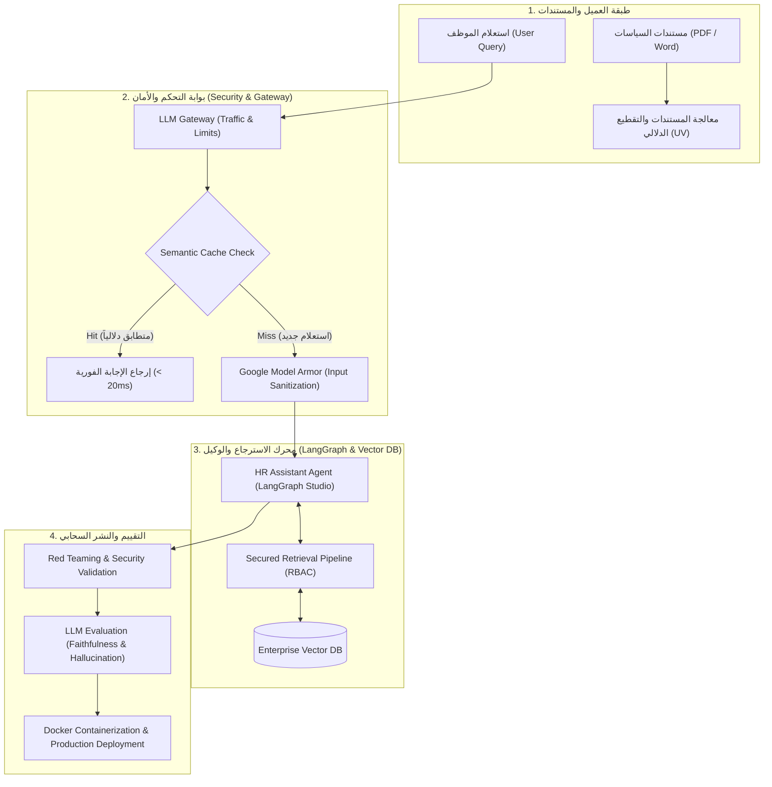
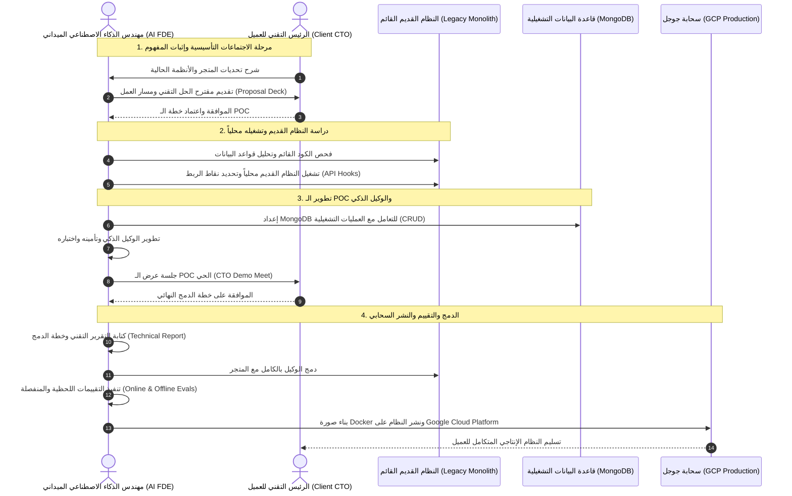

# الدليل المعماري للمشاريع الإنتاجية المتقدمة: Enterprise RAG & AI Forward Deployed Engineer

> **توثيق معماري شامل للـ 50 محاضرة الجديدة (المحاضرات 142 إلى 191)**  
> **الكورس:** Ultimate RAG Bootcamp using LangChain, LangGraph, and LangSmith  
> **المرجع الأكاديمي والمهني:** `rag-mastery / notes`  
> **المستوى:** متقدم — Enterprise Production & System Design

---

## 1. النظرة التنفيذية والتحول المعماري (Executive Overview)

شهد مسار تعلم الـ `RAG` نقلة جذرية بإضافة **50 محاضرة عملية (11 ساعة إضافية)**، رافعةً إجمالي الكورس من **30 سكشن (141 محاضرة / ~34 ساعة)** إلى **32 سكشن (191 محاضرة / ~45 ساعة)**.

الهدف الأساسي من هذا التحديث ليس مجرد تقديم تقنيات استرجاع إضافية، بل الانتقال بالمهندس من مرحلة **"النماذج الأولية الأكاديمية (`Tutorial RAG`)"** إلى مرحلة **"الأنظمة المؤسسية المتكاملة (`Enterprise-Grade Production Systems`)"**، وتأهيله لشغل وظيفة **مهندس الذكاء الاصطناعي الميداني (`AI Forward Deployed Engineer - AI FDE`)**.

```
                        ┌─────────────────────────────────────────────────────────┐
                        │               التطور المعماري في الكورس                 │
                        └─────────────────────────────────────────────────────────┘
                                                     │
         ┌───────────────────────────────────────────┴───────────────────────────────────────────┐
         ▼                                                                                       ▼
┌─────────────────────────────────┐                                     ┌─────────────────────────────────┐
│     المرحلة الأولى: الأساسيات    │                                     │     المرحلة الثانية: الإنتاج     │
│   Tutorial & Academic RAG       │                                     │ Enterprise & FDE Systems        │
├─────────────────────────────────┤                                     ├─────────────────────────────────┤
│ • نصوص وبحث دلالي في الذاكرة    │ ─────────── [ النقلة المعمارية ] ─────────► │ • أنظمة دفاعية Google Model Armor│
│ • نصوص مفردة وتجارب منفصلة       │        (+50 محاضرة / +11 ساعة)        │ • بوابات LLM Gateways و Caching │
│ • غياب معايير الأمان والحماية   │                                     │ • قواعد هجينة: Vector + MongoDB │
│ • لا يوجد تقييم كمي أو أمني     │                                     │ • محاكاة CTO واختبارات Red Team │
│ • سكريبتات Python محلية فقط     │                                     │ • بيئة سحابية GCP و Docker كامل │
└─────────────────────────────────┘                                     └─────────────────────────────────┘
```

---

## 2. جدول المقارنة والتحليل الكمي للتحديث

| المعيار المعماري | ما قبل التحديث (محاضرة 1 - 141) | ما بعد التحديث (المحاضرات 142 - 191) | الأثر الهندسي في بيئة العمل |
| :--- | :--- | :--- | :--- |
| **مجال التطبيق** | مفاهيم منفصلة وخوارزميات متباينة | مشروعان متكاملان بنظام `End-to-End Enterprise` | بناء محفظة مشاريع تحاكي أنظمة الشركات الكبرى. |
| **الطبقة الأمنية (`Security`)** | `Guardrails` نظرية وتطبيقات مبسطة | `Google Model Armor` و `Red Teaming` عملي | حماية النظام من هجمات الاختراق وحقن الأوامر وتسريب البيانات. |
| **كفاءة التكلفة والزمن** | استدعاء مباشر لنموذج `LLM` في كل استعلام | تطبيق `Semantic Caching` عبر الفيكتورز | خفض تكاليف الاستهلاك بنسبة تصل إلى 70% وخفض زمن الاستجابة. |
| **إدارة البنية التحتية للنماذج** | ربط مباشر بمفتاح `API` أحادي | تطبيق `LLM Gateways` للتحكم والفلترة والمراقبة | استقرار الخدمة مع إمكانية التبديل السلس وإدارة الـ `Rate Limits`. |
| **تكامل قواعد البيانات** | `Vector DBs` فقط (`Chroma`, `FAISS`, `AstraDB`) | هيكل هجين: `Vector DB` + `MongoDB (NoSQL)` | حفظ المعاملات والعمليات التشغيلية بجانب البحث الدلالي. |
| **أدوات التطوير والتصحيح** | طباعة المخرجات في التيرمينال وسجلات خفيفة | استخدام `LangGraph Studio` لتتبع دورات الوكيل | تصحيح أخطاء مسارات الوكلاء المرئية واختبار الحالات المعقدة. |
| **اختبارات الجودة والتقييم** | تقييم أكاديمي عبر دوال منفصلة | تقييم مستمر: `Online & Offline Evaluation` | قياس الأداء الفعلي في بيئة الإنتاج ورصد انحراف النماذج (`Drift`). |
| **بيئة التشغيل والنشر** | أجهزة محلية وبيئات افتراضية `venv` | حاويات `Docker` ونشر سحابي على `Google Cloud` | جاهزية تامة للتكامل مع مسارات الـ `DevOps` والـ `CI/CD`. |

---

## 3. تفكيك وتحليل السكشن 30: مشروع `HR Policy RAG Assistant with AI Security`

> **عدد المحاضرات:** 23 محاضرة (من 142 إلى 164)  
> **المدة الزمنية:** ~5 ساعات و 27 دقيقة  
> **الهدف:** بناء مساعد سياسات الموارد البشرية لشركة كبرى، محمي بحلول أمنية من الفئة المؤسسية وجاهز للنشر.



### 3.1 المرحلة الأولى: `PHASE 1 : LOCAL HYBRID RAG`
1. **إدارة البيئة عبر `UV`**:
   * استخدام مدير الحزم `UV` لإنشاء بيئة افتراضية صارمة فائقة السرعة تضمن تطابق إصدارات المكتبات وحل التعارضات تلقائياً.
2. **هندسة خط استيعاب البيانات (`Data Ingestion Pipeline`)**:
   * استخراج النصوص من ملفات سياسات الشركة واللوائح المنظمة.
   * تطبيق التقطيع المناسب لتقسيم البنود القانونية والتعاقدية دون بتر السياق.
   * توليد التضمينات (`Embeddings`) وتخزينها في قاعدة بيانات فيكتور مجهزة للفهرسة المتقدمة.
3. **بناء الوكيل وتكامل `LangGraph Studio`**:
   * تصميم الـ `HR Assistant Agent` باستخدام `LangGraph` لإدارة الحالات المعقدة (مثل استفسارات الإجازات، التأمين، الاستقالة، واللوائح الداخلية).
   * الاستعانة بـ `LangGraph Studio` لإجراء تصحيح بصري لحظي (`Visual Breakpoints`) لتدفق الرسائل داخل الـ `StateGraph`.

---

### 3.2 المرحلة الثانية: `PHASE 2 : LLM SECURITY & ENTERPRISE GUARDRAILS` (الطبقة الدفاعية)

هذه المرحلة هي الركيزة الأساسية التي تُميز المهندس المتقدم، وتتكون من خمس طبقات دفاعية:

#### أ. بوابة النماذج الذكية (`LLM Gateways`)
* تعمل كـ `Reverse Proxy` موحد بين تطبيق الـ `RAG` ومزودي النماذج (`OpenAI`, `Anthropic`, `Groq`).
* المسؤولة عن إدارة مفاتيح الـ `API` مركزياً، وتوزيع الحمل (`Load Balancing`)، والتنقل التلقائي عند انقطاع الخدمة (`Fallbacks / Circuit Breaking`)، وفرض سقف لاستهلاك التوكنز لكل موظف أو قسم.

#### ب. درع الحماية المؤسسي (`Google Model Armor Guardrail`)
* طبقة حماية متخصصة من `Google Cloud` توضع أمام النموذج.
* **فحص المدخلات (`Input Sanitization`)**: منع هجمات حقن الأوامر (`Prompt Injections`) ومحاولات كسر القيود (`Jailbreaks`).
* **تنقية البيانات الحساسة (`PII Redaction`)**: طمس أرقام الهويات الوطنية، بطاقات الائتمان، ومعلومات التأمين الخاصة قبل إرسالها إلى الـ `LLM`.
* **مراقبة المخرجات (`Output Scrubbing`)**: التأكد من خلو إجابة النموذج من ألفاظ غير لائقة أو تسريب لبيانات موظفين آخرين.

#### ج. التخزين المؤقت الدلالي (`Semantic Caching`)
* في بيئات العمل، تتكرر أسئلة الموظفين بصيغ مختلفة لكن بنفس المعنى (مثال: "ما هو رصيد الإجازة السنوية؟" و "كم يوم إجازة يحق لي سنوياً؟").
* التخزين المؤقت التقليدي (`Exact Match Cache`) يفشل في رصد هذا التطابق.
* يقوم `Semantic Cache` بتحويل الاستعلام إلى `Embedding` وحساب التشابه الدلالي مع الاستعلامات المحفوظة:
$$\text{Similarity}(q_{\text{new}}, q_{\text{cached}}) \ge \tau \quad (\text{حيث } \tau \approx 0.92)$$
* عند تحقق الشرط (`Cache Hit`)، يتم إرجاع الإجابة المحفوظة مباشرة في أقل من $20\,\text{ms}$ دون استهلاك سنت واحد أو إرسال طلب للـ `LLM`.

#### د. الاسترجاع المحمي بصلاحيات الوصول (`Secured Retrieval`)
* لا يحق لجميع الموظفين الاطلاع على كافة المستندات (مثلاً: مستندات الرواتب وسياسات المديرين).
* دمج مصفوفة التحكم في الوصول المبنية على الأدوار (`Role-Based Access Control - RBAC`) مباشرة داخل فلاتر الـ `Vector DB` لضمان عدم استرجاع أي معلومة تتجاوز صلاحية المستخدم.

#### هـ. المحاكاة الهجومية واختبارات الاختراق (`Red Teaming`)
* تنفيذ هجمات منظمة على النظام لاختباره:
  * محاولة استدراج الوكيل لإفشاء وثائق سرية.
  * محاولة تغيير منطق الوكيل عن طريق نصوص خبيثة داخل المستندات المسترجعة (`Indirect Prompt Injection`).
* تحليل نقاط الضعف وتعديل قواعد الحماية بناءً على النتائج.

#### و. تقييم جودة النماذج (`LLM Evaluations`)
* قياس جودة النظام كمياً بالاعتماد على منهجية `LLM-as-a-judge`:
  * **الأمانة العلمية (`Faithfulness`)**: هل الإجابة مشتقة حصراً من المستندات المسترجعة أم تحتوي على هلوسة؟
  * **ملاءمة الإجابة (`Answer Relevance`)**: هل تجيب المخرجات على سؤال المستخدم بدقة؟
  * **دقة السياق (`Context Precision & Recall`)**: هل استرجع المحرك الأجزاء ذات الصلة فقط من وثائق السياسات؟

---

### 3.3 المرحلة الثالثة: `PHASE 3 : DOCKERIZATION & DEPLOYMENT`
1. **صياغة ملف `Dockerfile` مخصص للإنتاج**:
   * استخدام البناء متعدد المراحل (`Multi-Stage Build`) لتقليل حجم الصورة النهائية والتخلص من حزم التطوير غير اللازمة.
   * عزل التطبيق وتشغيله تحت مستخدم غير جذري (`Non-Root User`) لتعزيز الأمان.
2. **فحوصات الجاهزية والتشغيل (`Healthchecks & Graceful Shutdown`)**:
   * توفير نقاط نهاية (`Endpoints`) للتحقق من سلامة الخدمة وجاهزيتها لاستقبال الطلبات.
3. **التنظيف والهيكلة المعمارية (`Cleanup & Architecture Review`)**:
   * توثيق مسار المشروع بالكامل وتطبيق أفضل الممارسات البرمجية قبل التسليم.

---

## 4. تفكيك وتحليل السكشن 31 و 32: محاكاة مهندس الذكاء الاصطناعي الميداني (`AI FDE Roleplay`)

> **عدد المحاضرات:** 28 محاضرة (من 165 إلى 191 + السكشن الختامي)  
> **المدة الزمنية:** ~5 ساعات و 34 دقيقة  
> **المشروع:** `Ecommerce Store Automation - Enterprise Integration & Production Deployment`  
> **الدور الوظيفي:** `AI Forward Deployed Engineer (AI FDE)`

### 4.1 ما هو دور الـ `AI Forward Deployed Engineer`؟
في كبرى شركات الذكاء الاصطناعي العالمية (مثل `Palantir`, `OpenAI`, `Anthropic`)، لا يجلس مهندس الـ `FDE` في برج عاجي ليكتب كوداً نظرياً فقط؛ بل يتم إرساله للعمل جنباً إلى جنب مع قيادات الشركات العميلة (`CTO`, `VP of Engineering`).  
مهمته هي:
1. فهم التحديات التقنية والتجارية المعقدة للعميل وتحويلها إلى متطلبات برمجية قابلة للتنفيذ.
2. التعامل مع الأنظمة البرمجية القديمة للعميل (`Legacy Systems`) ودمج نماذج الذكاء الاصطناعي فيها دون تعطيل العمليات اليومية.
3. بناء نموذج إثبات المفهوم (`POC`) سريع، واختباره، وعرضه على الإدارة التنفيذية، ثم نقله للإنتاج الحقيقي على السحابة.



---

### 4.2 المراحل الهندسية التفصيلية لمشروع الـ `AI FDE`

#### المرحلة الأولى: مهارات القيادة وهندسة العميل (`Client Interfacing & Proposal`)
* **اجتماع التوجيه مع الـ `CTO` (`Onboarding Meet`)**: استخلاص المتطلبات غير المكتوبة، القيود الزمنية، وسعة النظام المستهدفة.
* **جلسة العصف الذهني لاختيار الـ `POC`**: الموازنة بين سرعة التسليم والقيمة المضافة لتقليل المخاطر التقنية.
* **عرض المقترح التنفيذي (`Proposal Presentation to CTO`)**: ترجمة المصطلحات الذكية المعقدة إلى مقاييس مالية وتقنية تهم الإدارة (زمن الاستجابة، خفض الأخطاء، زيادة المبيعات).
* **إتقان تصميم العروض التقديمية الفنية (`Technical Client Pitching`)**: كيفية هيكلة الشرائح لتقنع الفرق الهندسية وفرق الأعمال في آن واحد.

#### المرحلة الثانية: التعامل مع الأنظمة البرمجية القديمة (`Legacy System Engineering`)
* معظم الشركات لا تبني من الصفر، بل تمتلك كوداً برمجياً ضخماً تم بناؤه عبر سنوات (`Monolithic Legacy Code`).
* تحليل منطق النظام القديم لمتجر التجارة الإلكترونية وتشغيله محلياً مع كافة تبعاته.
* تحديد استراتيجية الدمج دون التأثير على استقرار المتجر القائم (`Zero-Downtime Integration`).

#### المرحلة الثالثة: دمج قواعد البيانات التشغيلية (`MongoDB`) وتطوير الوكيل
* **لماذا لا تكفي قواعد بيانات الفيكتورز وحدها؟**:
  * الفيكتورز ممتازة في البحث الدلالي والاسترجاع التقريبي.
  * لكن عمليات المتجر تتطلب دقة متناهية (`ACID Properties`) وتحديثاً لحظياً لحالات الطلبات، الأسعار، والمخزون.
* **تأسيس `MongoDB` وإدارتها**:
  * تثبيت بيئة `MongoDB` وربطها برمز الـ `Agent`.
  * تنفيذ العمليات التشغيلية الأساسية (`CRUD Operations`) بكفاءة.
* **تطوير وكيل المتجر الذكي وتأمينه**:
  * تصميم دوال المساعدة (`Helper Functions`) لتنفيذ الإجراءات الفعلية (الاستعلام عن حالة الطلب، تعديل العنوان، إلغاء الشحنة).
  * فرض قيود أمنية على صلاحيات الوكيل لمنع تنفيذ أوامر غير مصرح بها.
* **اختبار خط الـ `POC` وعرضه على الـ `CTO` (`POC Demo Meet`)**:
  * عرض حي أمام القيادة التقنية يوضح قدرة الوكيل على حل المشكلات الحقيقية.

#### المرحلة الرابعة: الدمج النهائي والتقييم والنشر على سحابة جوجل (`GCP`)
1. **صياغة التقرير التقني قبل الدمج (`Pre-Integration Technical Report`)**:
   * وثيقة هندسية تشرح للفرق التقنية المعمارية المعتمدة، نقاط التلامس، خطة التراجع عند الفشل (`Rollback Strategy`)، ومقاييس الأمان.
2. **الدمج البرمجي الكامل (`Legacy System Integration`)**:
   * ربط مسارات الوكيل بمسارات المتجر القديم وجعلها تعمل كمنظومة موحدة.
3. **هندسة التقييم المزدوج (`Online vs. Offline Evaluation`)**:
   * **التقييم غير المتصل (`Offline Evaluation`)**: اختبار النظام على مجموعة بيانات مرجعية قياسية قبل دفعه للإنتاج للتحقق من عدم حدوث تراجع في الكفاءة (`Regression Testing`).
   * **التقييم المتصل (`Online Evaluation`)**: مراقبة أداء الوكيل في الوقت الفعلي مع تفاعل المستخدمين الحقيقيين، وقياس معدل الرضا، ومتابعة انحراف أداء النموذج (`Drift`).
4. **النشر السحابي على `Google Cloud Platform (GCP)`**:
   * إعداد حساب وخدمات `GCP` ومستودع صور الحاويات (`Artifact Registry`).
   * بناء صورة الحاوية عبر `Docker` وتجهيزها للبيئة السحابية.
   * إطلاق التطبيق الإنتاجي وضمان استقراره وتسليمه بنجاح (`Production Handover`).

---

## 5. مصفوفة الكفاءات المهنية لمهندس الذكاء الاصطناعي (Skills Matrix)

يوضح الجدول التالي كيف تنقلك هذه المحاضرات الـ 50 إلى مصاف كبار مهندسي الذكاء الاصطناعي:

```
┌─────────────────────────────────┬─────────────────────────────────┬─────────────────────────────────┐
│     الكفاءة المعمارية           │      الأدوات والتقنيات المستخدمة  │     سؤال المقابلة التقنية المرتبط│
├─────────────────────────────────┼─────────────────────────────────┼─────────────────────────────────┤
│ أمان النماذج اللغوية            │ Google Model Armor, Red Teaming │ كيف تمنع Indirect Prompt        │
│ (AI Security & Guardrails)      │ Prompt Injection Scrubbing      │ Injection في بيئة RAG إنتاجية؟   │
├─────────────────────────────────┼─────────────────────────────────┼─────────────────────────────────┤
│ تحسين الكفاءة والتكلفة          │ Semantic Caching                │ كيف تتعامل مع تكرار الاستعلامات  │
│ (Cost & Latency Optimization)   │ Vector Similarity Cache Check   │ لتوفير 70% من ميزانية LLM؟      │
├─────────────────────────────────┼─────────────────────────────────┼─────────────────────────────────┤
│ إدارة حركة المرور للنماذج       │ LLM Gateways, Rate Limiting,    │ كيف تصمم نظام Fallback يضمن     │
│ (Gateway & Traffic Routing)     │ Failover Routing                │ عدم انقطاع الخدمة في حال سقوط المزود؟│
├─────────────────────────────────┼─────────────────────────────────┼─────────────────────────────────┤
│ قواعد البيانات الهجينة          │ MongoDB (NoSQL) +               │ متى تفصل بين البيانات التشغيلية │
│ (Hybrid DB Architecture)        │ Vector Database                 │ وبيانات الفيكتورز داخل الوكيل؟  │
├─────────────────────────────────┼─────────────────────────────────┼─────────────────────────────────┤
│ دورة حياة التقييم               │ Online vs Offline Evaluation,   │ ما الفرق بين التقييم القبلي     │
│ (Evaluation Engineering)        │ LLM-as-a-judge                  │ والتقييم اللحظي في بيئة الإنتاج؟│
├─────────────────────────────────┼─────────────────────────────────┼─────────────────────────────────┤
│ النشر السحابي والهندسة الميدانية│ Docker, Google Cloud (GCP),     │ كيف تدمج وكيل ذكي داخل تطبيق قديم│
│ (Cloud Deployment & FDE)        │ Legacy Systems, UV Manager      │ (Legacy Monolith) بدون تعطيله؟   │
└─────────────────────────────────┴─────────────────────────────────┴─────────────────────────────────┘
```

---

## 6. استراتيجية النشر على لينكد إن للمحتوى الجديد (LinkedIn Strategy)

لتعظيم الاستفادة المهنية من هذه المشاريع واستعراضها أمام مديري التوظيف والشركات التقنية، يُوصى بتقسيمها إلى سلسلة منشورات تقنية متخصصة:

```
[خطة النشر الاحترافية على LinkedIn]
  │
  ├── منشور 1: "لماذا يفشل 80% من مشاريع RAG في الوصول للإنتاج؟"
  │            (الحديث عن معايير الأمان، Google Model Armor، وحقن الأوامر).
  │
  ├── منشور 2: "كيف وفرنا 75% من تكلفة استدعاء النماذج باستخدام Semantic Caching؟"
  │            (شرح الفرق بين التخزين التقليدي والتخزين الدلالي المعتمد على الفيكتورز).
  │
  ├── منشور 3: "تجربة واقعية لـ AI Forward Deployed Engineer: التحدث مع الـ CTO ودمج الذكاء الاصطناعي مع الأنظمة القديمة"
  │            (استعراض مشروع المتجر الإلكتروني، MongoDB، والتعامل مع Legacy Systems).
  │
  ├── منشور 4: "هندسة التقييم: الفرق بين التقييم المكتبي (Offline) والتقييم في الإنتاج (Online) لأنظمة الذكاء الاصطناعي"
  │            (الحديث عن قياس الهلوسة والأمانة العلمية وقياس الأداء اللحظي).
  │
  └── منشور 5: "رحلة نشر نظام RAG متكامل على Google Cloud Platform باستخدام Docker"
               (استعراض العمارة الإنتاجية الشاملة للمشروع النهائي مع الكود والتوثيق).
```

---

## 7. الخلاصة والخطوات القادمة

هذا الدليل يمثل المرجع النظري والمعماري المعتمد لمشاريع المرحلة المتقدمة داخل مستودعنا `rag-mastery`. 

عند وصولنا إلى هذه السكاشن في خطتنا الدراسية، سنقوم بتنفيذ كل مرحلة برمجياً وتطبيقياً عبر أركاننا الثلاثة الصارمة:
1. **`docs/`**: النظريات، المعادلات، والمخططات المعمارية.
2. **`stages/`**: الأكواد المرجعية المعتمدة الخالية تماماً من الرموز التعبيرية مع فحص جميع الـ `Assertions`.
3. **`playground/`**: الدفاتر التفاعلية والمختبرات التطبيقية المخصصة للتجربة والتعلم العملي.
