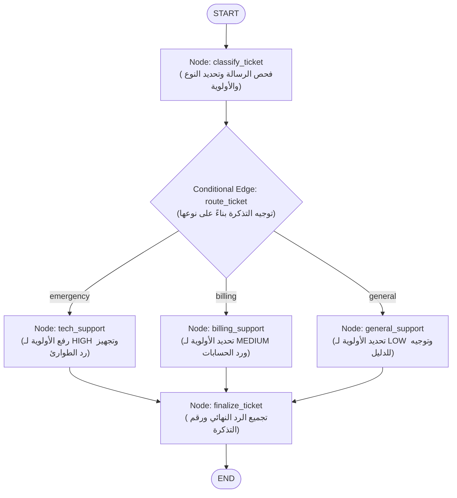

# مشروع 01: نظام توجيه وتصنيف تذاكر الدعم الفني الذكي
### Project 01: Intelligent Customer Support Ticket Triage & Routing System

## 1. نبذة عن المشروع والقيمة في بيئة العمل (Business Value)
في شركات التكنولوجيا وخدمات الـ SaaS، يستقبل قسم الدعم الفني مئات التذاكر يومياً. ترك التذاكر بدون فرز آلي يتسبب في:
* تأخر الاستجابة للأعطال التقنية الحرجة التي توقف أعمال العملاء.
* تشتت الموظفين بين أسئلة الفواتير البسيطة ومشاكل البنية التحتية.

هذا المشروع يبني نظاماً ذاتياً باستخدام **`LangGraph`** يقرأ رسالة العميل، يصنفها، يحدد أولويتها، ويوجهها للمسار المختص، مع صياغة رد فوري يناسب طبيعة الحالة.

---

## 2. المخطط المعماري لسير العمل (Workflow Architecture)

---

## 3. محتويات المجلد
* **`customer_support_triage.ipynb`**: الدفتر التفاعلي الكامل المنفذ بالكامل مع الحالات التجريبية.
* **`README.md`**: هذا الدليل التوضيحي.
