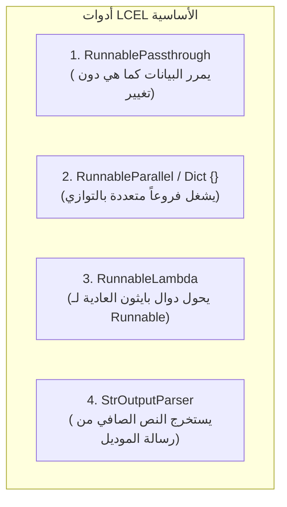
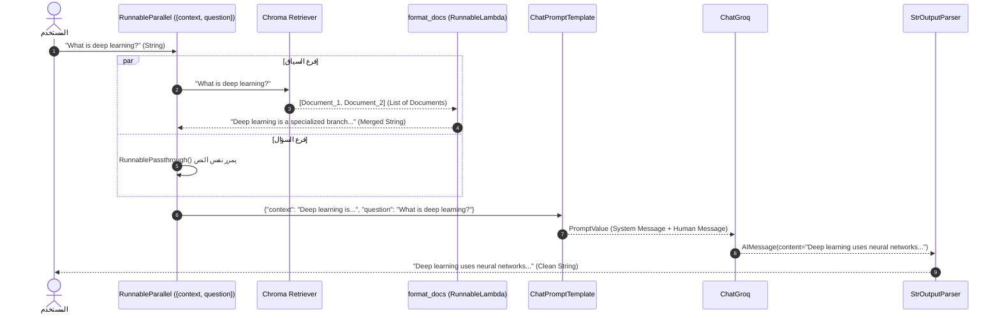

# الدرس 03: بناء خط أنابيب RAG متكامل باستخدام لغة تعبير لانج تشين (LCEL)
### Building End-to-End Traditional RAG with LangChain Expression Language (LCEL)

مرحبًا بك في الدرس الثالث من مرحلة **فهارس وقواعد بيانات المتجهات (Vector Stores & Vector Databases)**، والمخصص لـ **المحاضرة 28** في الكورس.

في المحاضرات السابقة، قمنا ببناء مسار الـ RAG باستخدام دوال عالية المستوى جاهزة من لانج تشين مثل `create_retrieval_chain` و `create_stuff_documents_chain`. على الرغم من سهولتها، إلا أنها تعمل كـ "صندوق أسود" (Black Box) يخفي التفاصيل الدقيقة لكيفية تدفق البيانات بين المسترجع والنموذج.

في هذا الدرس، سنقوم بفك هذا الصندوق وإعادة بناء نفس المسار المتكامل بأكمله بالتفصيل المعماري الدقيق باستخدام **لغة تعبير لانج تشين (LCEL)** ومشغل الربط (`|` Pipe Operator)، مما يمنحنا تحكماً مطلقاً، شفافية كاملة، ودعماً أصيلاً لميزة البث الحرفي الفوري (`Streaming`).

---

## 📌 أهداف الدرس (Learning Objectives)

1. **فهم بروتوكول الـ `Runnable` المعياري**: الأساس الهندسي الموحد لكل كائنات LCEL في لانج تشين الحديثة.
2. **استيعاب الدوال الـ 6 الموحدة**: (`invoke`, `stream`, `batch`, `ainvoke`, `astream`, `abatch`).
3. **فهم آلية مشغل الربط (`|`) برمجياً**: كيف يتم استدعاء ميثود `__or__` في بايثون لتمرير مخرجات كل مكون كمدخل للمكون التالي.
4. **التمكن من الأدوات الأساسية (Primitives)**:
   - `RunnablePassthrough`: تمرير المدخلات بدون تعديل أو إضافة حقول ديناميكية.
   - `RunnableParallel` (القواميس `{}`): التنفيذ المتوازي للفروع المستقلة (البحث وتمرير السؤال في نفس الوقت).
   - `RunnableLambda`: تحويل أي دالة بايثون مخصصة إلى مكون قابل للربط في السلسلة.
   - `StrOutputParser`: استخراج النص الصافي من كائن `AIMessage`.
5. **تتبع تدفق البيانات بدقة (Data Flow Trace)**: معرفة نوع وحجم وشكل البيانات في كل محطة من محطات السلسلة.
6. **ميزات الإنتاج المتقدمة**: خطط الطوارئ (`with_fallbacks`) وإعادة المحاولة التلقائية والتتبع عبر LangSmith.

---

## 🧠 1. ما هي LCEL في جوهرها؟ (The Runnable Protocol)

قبل ظهور LCEL، كانت لانج تشين عبارة عن كلاسات متفرقة (`LLMChain`, `RetrievalQA`, `StuffDocumentsChain`). كان لكل كلاس واجهة برمجية ومدخلات مختلفة تجعل دمجها أو تعديلها أمراً شديد التعقيد ومقفولاً داخل دوال جاهزة.

قامت لانج تشين بحل جذري: **توحيد كل مكونات المكتبة تحت واجهة برمجية موحدة اسمها `Runnable`**.

> **القاعدة الذهبية:**  
> كل عنصر في مسار الـ RAG (المسترجع، القالب، الموديل، دالة الدمج، والمحلل النصي) هو كائن `Runnable` يخضع لنفس القواعد المعيارية.

### الدوال الـ 6 الموحدة في أي `Runnable`:
بمجرد بناء سلسلتك بـ LCEL، تصبح السلسلة بالكامل كائناً واحداً يدعم الدوال التالية تلقائياً:

| الدالة | نوع التنفيذ | الوظيفة |
| :--- | :--- | :--- |
| **`invoke(input)`** | متزامن (Sync) | تشغيل استعلام واحد وانتظار النتيجة كاملة. |
| **`stream(input)`** | بث فوري (Sync Streaming) | إرجاع الكلمات حرفاً بحرف وتدفقاً فورياً (زي ChatGPT). |
| **`batch([inputs])`** | متوازي (Sync Batch) | تنفيذ قائمة استعلامات متعددة في نفس الوقت بأعلى كفاءة. |
| **`ainvoke(input)`** | غير متزامن (Async) | تشغيل استعلام واحد في بيئات الـ Async (مثل FastAPI و Tornado). |
| **`astream(input)`** | بث غير متزامن (Async Stream) | بث فوري مخصص لتطبيقات الويب الحديثة وغرف الشات. |
| **`abatch([inputs])`** | دفعات غير متزامنة (Async Batch) | معالجة مجمعة غير متزامنة للطلبات الضخمة. |

---

## ⚙️ 2. كيف يعمل مشغل الربط `|` برمجياً؟ (Operator Overloading)

مشغل `|` هو استخدام أنيق لميزة **Operator Overloading** في بايثون:
عند وضع العلامة `|` بين كائنين، يستدعي بايثون داخلياً الدالة الخاصة `__or__`.

```python
# عندما تكتب:
chain = component_A | component_B

# ما ينفذه بايثون في الحقيقة:
# مخرج A يدخل كمدخل مباشر لـ B:
B.invoke(A.invoke(input))
```

---

## 🧩 3. التروس الأساسية الأربعة في LCEL (Core Primitives)



### أ. `RunnablePassthrough` (الممرر السلس)
وظيفته: **أخذ المدخلات وتسليمها للمحطة التالية كما هي**.
* عندما يدخل سؤال المستخدم كنص خام، نحتاجه أن يذهب للمسترجع ليبحث عنه، وفي نفس الوقت يمر بدون أي تعديل ليوضع في خانة `{question}` داخل القالب.

### ب. `RunnableParallel` أو القواميس `{}` (التنفيذ المتوازي)
عندما نكتب في السلسلة:
```python
{
    "context": retriever | format_docs,
    "question": RunnablePassthrough()
}
```
تفهم لانج تشين تلقائياً أن هذا قاموس متوازي (`RunnableParallel`).  
يقوم المعالج بتشغيل **فرع استرجاع المستندات** و **فرع تمرير السؤال** في نفس الوقت بالتوازي (Asynchronously / Concurrently)، ثم يجمعهما في قاموس واحد جاهز للـ Prompt.

### ج. `RunnableLambda` (دوال بايثون المخصصة)
أي دالة بايثون عادية (مثل دالة دمج النصوص `format_docs`) يتم تحويلها تلقائياً بمجرد وضعها بعد الـ `|` إلى `RunnableLambda`، مما يسمح لها بالجلوس على ماسورة التنفيذ واستلام مخرجات الخطوة السابقة.

### د. `StrOutputParser` (مستخرج النصوص)
النموذج اللغوي يرجع كائناً معقداً من نوع `AIMessage` يحوي بيانات وصفية وتفاصيل استهلاك الـ Tokens.  
يقوم `StrOutputParser()` بقراءة حقل `content` فقط وإرجاع نص صافٍ (`str`).

---

## 🏛️ 4. المعمارية الهندسية ومخطط التتابع الزمني للبيانات



---

## 🔬 5. تتبع شكل البيانات خطوة بخطوة (Step-by-Step Data Trace)

دعنا نتتبع شكل ونوع البيانات في كل محطة أثناء استدعاء:
`rag_chain_lcel.invoke("What is deep learning?")`

### المحطة 1: المدخل الأولي (Input)
```python
input_data = "What is deep learning?"  # النوع: str
```

### المحطة 2: المعالجة المتوازية (Parallel Dict)
- **فرع `question`**: يمرر `RunnablePassthrough()` النص:
  `"What is deep learning?"`
- **فرع `context`**:
  1. يأخذ `retriever` السؤال ويبحث في ChromaDB عن أقرب المتجهات ($k=3$).
  2. يخرج قائمة كائنات: `[Document(page_content="..."), Document(page_content="...")]`
  3. تستلم دالة `format_docs` القائمة وتدمجها بفاصل سطرين:
     `"Deep learning is a specialized branch...\n\nConvolutional Neural Networks..."`

### المحطة 3: المخرج إلى قالب التوجيه (To Prompt)
يتشكل قاموس متكامل:
```python
{
    "context": "Deep learning is a specialized branch of machine learning...",
    "question": "What is deep learning?"
}
```

### المحطة 4: المخرج من القالب إلى الموديل (To LLM)
كائن `PromptValue` يحتوي على رسائل مهيكلة:
- `SystemMessage`: تحوي التعليمات الصارمة مع النصوص المسترجعة في موضع `{context}`.
- `HumanMessage`: تحوي سؤال المستخدم في موضع `{question}`.

### المحطة 5: المخرج من الموديل إلى المحلل (To Parser)
```python
AIMessage(
    content="Deep learning is a branch of machine learning that uses multi-layer neural networks...",
    response_metadata={'token_usage': {'total_tokens': 214}, 'model_name': 'openai/gpt-oss-20b'}
)
```

### المحطة 6: المخرج النهائي للمستخدم (Final Output)
```python
"Deep learning is a branch of machine learning that uses multi-layer neural networks..."  # النوع: str صافٍ
```

---

## 💻 6. الشيفرة البرمجية الكاملة للمسار

```python
import os
from pathlib import Path
from dotenv import load_dotenv

load_dotenv()

# استدعاء مكتبات LCEL الأساسية
from langchain_community.document_loaders import DirectoryLoader, TextLoader
from langchain_text_splitters import RecursiveCharacterTextSplitter
from langchain_huggingface import HuggingFaceEmbeddings
from langchain_chroma import Chroma
from langchain_groq import ChatGroq
from langchain_core.prompts import ChatPromptTemplate
from langchain_core.output_parsers import StrOutputParser
from langchain_core.runnables import RunnablePassthrough

# 1. دالة دمج المستندات المسترجعة (تلقائياً تتحول إلى RunnableLambda)
def format_docs(docs):
    return "\n\n".join(doc.page_content for doc in docs)

# 2. إعداد قاعدة المتجهات والمسترجع
data_dir = Path("../../data") if Path("../../data").exists() else Path("./data")
db_dir = str(data_dir / "databases" / "chroma_vector_store")

embeddings = HuggingFaceEmbeddings(model_name="sentence-transformers/all-MiniLM-L6-v2")
vector_store = Chroma(persist_directory=db_dir, embedding_function=embeddings, collection_name="rag_collection")
retriever = vector_store.as_retriever(search_kwargs={"k": 3})

# 3. إعداد القالب والموديل
template = """You are a helpful AI assistant. Use the following context to answer the question.
If you don't know the answer, say "I don't know."
Keep the answer concise and accurate.

Context:
{context}

Question:
{question}

Answer:"""
prompt = ChatPromptTemplate.from_template(template)

llm = ChatGroq(
    api_key=os.getenv("GROQ_API_KEY"),
    model="openai/gpt-oss-20b",
    temperature=0.2,
    max_tokens=512
)

# 4. بناء السلسلة الأنيقة بمشغل الـ |
rag_chain = (
    {"context": retriever | format_docs, "question": RunnablePassthrough()}
    | prompt
    | llm
    | StrOutputParser()
)

# 5. الاستدعاء العادي (النص المباشر)
answer = rag_chain.invoke("What is deep learning?")
print(answer)

# 6. البث المباشر الفوري (Streaming)
for chunk in rag_chain.stream("What are CNNs best used for?"):
    print(chunk, end="", flush=True)
```

---

## 🚀 7. ميزات متقدمة لبيئات الإنتاج (Production Ready)

### أ. خطة الطوارئ البديلة بسطر واحد (`with_fallbacks`):
لو انقطع اتصال Groq أو حدث RateLimit، يمكنك تحويل السلسلة تلقائياً إلى نموذج بديل دون أن يتوقف تطبيقك:
```python
robust_chain = rag_chain.with_fallbacks([backup_chain_openai])
```

### ب. إعادة المحاولة التلقائية (`with_retry`):
```python
resilient_chain = rag_chain.with_retry(stop_after_attempt=3)
```

### ج. التتبع اللحظي (LangSmith Observability):
بما أن كل مكون هو `Runnable`، فإن كل مدخل ومخرج ومعدل استهلاك Tokens وزمن استجابة يُسجل تلقائياً في LangSmith دون كتابة أي كود إضافي.

---

## ⚖️ المقارنة الملخصة: السلاسل القديمة مقابل LCEL

| المعيار | السلاسل القديمة (`create_retrieval_chain`) | سلاسل LCEL الحديثة (`Retriever \| Prompt \| LLM`) |
| :--- | :--- | :--- |
| **طبيعة المعمارية** | صندوق أسود مغلق بدوال جاهزة | قطع ليجو شفافة ومفتوحة بالكامل |
| **مشغل الربط** | غير موجود (دوال متداخلة) | المشغل القياسي `\|` (Pipe) |
| **التحكم في السياق** | محكوم بقواعد الدالة المسبقة | كامل: دالة `format_docs` بيدك بسطرين بايثون |
| **البث الفوري (Streaming)** | معقد ومحدود | مدعوم أصلياً وبكفاءة عبر `.stream()` |
| **المدخل** | قاموس إجباري `{"input": ...}` | نص مباشر بفضل `RunnablePassthrough()` |
| **المخرج** | قاموس متعدد المفاتيح | نص نقي صافٍ عبر `StrOutputParser()` |
| **التوافق المستقبلي** | مصنفة كـ Legacy | الأساس الرسمي لوكلاء الذكاء الاصطناعي و LangGraph |

---

## 📁 ملفات التطبيق العملي
- 📓 **دفتر الشرح المرجعي**: [`03-rag-pipeline-lcel.ipynb`](./03-rag-pipeline-lcel.ipynb)
- 📓 **دفتر معمل التجارب المباشر**: [`playground/03-vector-stores-and-databases/03-rag-pipeline-lcel.ipynb`](../../../playground/03-vector-stores-and-databases/03-rag-pipeline-lcel.ipynb)

---

## 🎯 ملخص الدرس والخطوة التالية:
- أتقنا صياغة وفهم مسارات RAG من الداخل عبر **LCEL** وبروتوكول **Runnable**.
- أصبح لدينا خط أنابيب خفيف، سريع، شفاف، ويدعم البث المباشر.

**المحاضرة التالية (29)**:
سنتعلم كيفية **تحديث فهرس المتجهات وإضافة مستندات جديدة (`Updating Vector Store`)** إلى قاعدة بيانات موجودة مسبقاً دون مسحها أو إعادة بنائها من الصفر!
