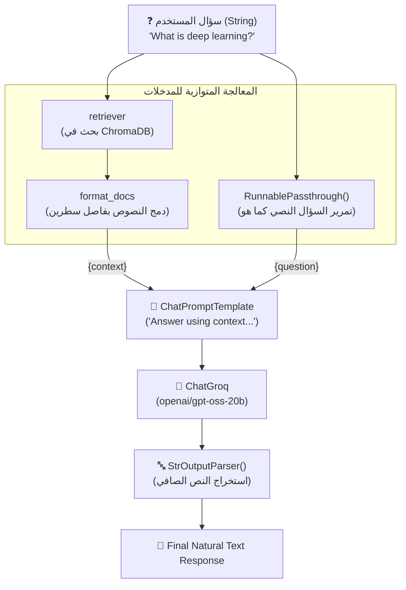

# الدرس 03: بناء خط أنابيب RAG متكامل باستخدام لغة تعبير لانج تشين (LCEL)
### Building End-to-End Traditional RAG with LangChain Expression Language (LCEL)

مرحبًا بك في الدرس الثالث من مرحلة **فهارس وقواعد بيانات المتجهات (Vector Stores & Vector Databases)**، والمخصص لـ **المحاضرة 28** في الكورس.

في المحاضرات السابقة، قمنا ببناء مسار الـ RAG باستخدام دوال عالية المستوى جاهزة من لانج تشين مثل `create_retrieval_chain` و `create_stuff_documents_chain`. على الرغم من سهولتها، إلا أنها تعمل كـ "صندوق أسود" (Black Box) يخفي التفاصيل الدقيقة لكيفية تدفق البيانات بين المسترجع والنموذج.

في هذا الدرس، سنقوم بفك هذا الصندوق وإعادة بناء نفس المسار المتكامل بأكمله باستخدام **لغة تعبير لانج تشين (LCEL)** ومشغل الربط (`|` Pipe Operator)، مما يمنحنا تحكماً مطلقاً، شفافية كاملة، ودعماً أصيلاً لميزة البث الحرفي الفوري (`Streaming`).

---

## 📌 أهداف الدرس (Learning Objectives)

1. **فهم لغة تعبير لانج تشين (LCEL)**: كيفية ربط المكونات كسلاسل تنفيذية متسلسلة باستخدام مشغل الـ Unix Pipe (`|`).
2. **استخراج النصوص النقية (`StrOutputParser`)**: تحويل كائنات رسائل النموذج (`AIMessage`) مباشرة إلى نصوص خام (`str`).
3. **تمرير المدخلات بدون تغيير (`RunnablePassthrough`)**: تمرير سؤال المستخدم النصي مباشرة في أكثر من مسار متوازٍ دون تغليفه بقواميس معقدة.
4. **تجميع المستندات يدوياً (`format_docs`)**: فهم الآلية البسيطة التي تدمج محتوى المستندات المسترجعة بفاصل أسطر داخل المتغير `{context}`.
5. **البث المباشر للإجابات (`Streaming`)**: تشغيل وتوليد الإجابات تدريجياً كلمة بكلمة في الوقت الفعلي عبر دالة `stream()`.

---

## ⚖️ المقارنة: السلاسل التقليدية (Chains) مقابل سلاسل LCEL

| المعيار | السلاسل التقليدية (`create_retrieval_chain`) | سلاسل LCEL الحديثة (`Retriever | Prompt | LLM`) |
| :--- | :--- | :--- |
| **الشفافية** | صندوق أسود يخفي معالجة السياق | واضحة 100%، ترى كل تحويل للبيانات بعينك |
| **طريقة الإدخال** | تتطلب دائماً قاموساً `{"input": query}` | مرنة؛ يمكن إدخال نص مباشر بفضل `RunnablePassthrough` |
| **طريقة الإخراج** | قاموس يضم `{"answer": ..., "context": ...}` | نص مباشر أو قاموس حسب رغبة المطور |
| **تعديل السياق** | محكوم بقواعد الدالة المسبقة | يمكنك تعديل دالة `format_docs` كما تشاء (إضافة فواصل، أرقام، تلخيص) |
| **دعم البث (Streaming)** | محدود أو يحتاج إعدادات إضافية | مدعوم أصلياً وبكفاءة عالية عبر `.stream()` |

---

## 🏛️ المعمارية الهندسية لمسار LCEL (Pipeline Architecture)



---

## 💻 الكود البرمجي الأساسي (Core LCEL Snippets)

### 1. دالة دمج المستندات (`format_docs`):
```python
def format_docs(docs):
    return "\n\n".join(doc.page_content for doc in docs)
```

### 2. بناء السلسلة باستخدام المشغل `|`:
```python
from langchain_core.runnables import RunnablePassthrough
from langchain_core.output_parsers import StrOutputParser

rag_chain_lcel = (
    {"context": retriever | format_docs, "question": RunnablePassthrough()}
    | prompt
    | llm
    | StrOutputParser()
)
```

### 3. تشغيل الاستعلام العادي (`invoke`):
```python
question = "What is deep learning?"
answer = rag_chain_lcel.invoke(question)
print(answer)
```

### 4. البث الحرفي الفوري (`streaming`):
```python
for chunk in rag_chain_lcel.stream("What are CNNs best used for?"):
    print(chunk, end="", flush=True)
```

---

## 📁 ملفات التطبيق العملي
- 📓 **دفتر الشرح المرجعي**: [`03-rag-pipeline-lcel.ipynb`](./03-rag-pipeline-lcel.ipynb)
- 📓 **دفتر التدريب التفاعلي**: [`playground/03-vector-stores-and-databases/03-rag-pipeline-lcel.ipynb`](../../../playground/03-vector-stores-and-databases/03-rag-pipeline-lcel.ipynb)

---

## 🎯 ملخص الدرس والخطوة التالية:
- أتقنا صياغة مسارات RAG باستخدام **LCEL** دون الاعتماد على دوال لانج تشين المغلقة.
- أصبح لدينا خط أنابيب خفيف وسريع ويدعم الـ Streaming.

**المحاضرة التالية (29)**:
سنتعلم كيفية **تحديث فهرس المتجهات وإضافة مستندات جديدة (`Updating Vector Store`)** إلى قاعدة بيانات موجودة مسبقاً دون مسحها أو إعادة بنائها من البداية.
