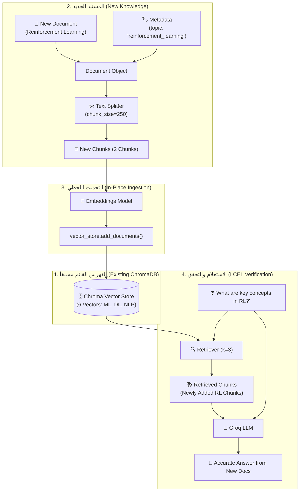

# الدرس 04: تحديث فهرس المتجهات وإضافة مستندات جديدة
### Adding New Documents and In-Place Updates to an Existing Vector Store

مرحبًا بك في الدرس الرابع من مرحلة **فهارس وقواعد بيانات المتجهات (Vector Stores & Vector Databases)**، والمخصص لـ **المحاضرة 29** في الكورس.

في التطبيقات الإنتاجية الحقيقية (Production RAG)، المعرفة ليست ثابتة؛ فالشركات تستقبل يومياً مستندات وسياسات وتقارير جديدة. مسح قاعدة بيانات المتجهات وإعادة بنائها وتضمينها من الصفر في كل مرة هو أمر مكلف مالياً وبطيء وغير عملي على الإطلاق.

في هذا الدرس، نتعلم كيفية **تحديث الفهرس القائم موضعياً (In-Place Update)** بإضافة مستندات جديدة مباشرة باستخدام دالة `add_documents`، مع تزويدها ببيانات وصفية غنية (`Metadata`)، واختبار قدرة مسار الـ RAG على استيعاب المعرفة الجديدة فوراً.

---

## 📌 أهداف الدرس (Learning Objectives)

1. **إعادة استخدام الفهرس الدائم**: فتح واستدعاء قاعدة بيانات `Chroma` القائمة على القرص وفحص حجمها الحالي دون مسح محتواها.
2. **إنشاء كائنات `Document` مهيكلة**: فهم كيفية بناء مستند برمجي وتزويده ببيانات وصفية (`source`, `topic`, `author`, `version`).
3. **التجزئة المتسلسلة للمستندات الجديدة**: تمرير المستند الجديد على `RecursiveCharacterTextSplitter` مع توارث الـ Metadata آلياً.
4. **الإضافة الموضعية (`add_documents`)**: استخدام الميثود القياسي لإلحاق المتجهات الجديدة في الـ Vector Store.
5. **متابعة تعداد السجلات**: التحقق من زيادة عدد المتجهات عبر `vector_store._collection.count()`.
6. **التحقق والاستعلام الفوري**: اختبار مسار الـ RAG (المبني بـ LCEL) على الموضوع الجديد المضاف والتأكد من استرجاعه في الصدارة.

---

## ⚖️ المقارنة: إعادة البناء الكامل مقابل التحديث الموضعي

| المعيار | إعادة البناء الكامل (Full Rebuild) | التحديث الموضعي (`add_documents`) |
| :--- | :--- | :--- |
| **التكلفة المالية (Embedding Cost)** | إعادة دفع تكلفة تضمين ملايين الكلمات القديمة | دفع تكلفة تضمين المستند الجديد فقط |
| **الوقت والتأخير (Latency)** | يستغرق ساعات أو أيام في البيانات الضخمة | ينتهي في أجزاء من الثانية إلى ثوانٍ معدودة |
| **توقف النظام (Downtime)** | يتعطل محرك البحث أثناء إعادة البناء | متاح 24/7 دون أي انقطاع في الخدمة |
| **الملاءمة للإنتاج** | مناسب فقط للتهيئة الأولى (Initial Setup) | المعيار القياسي لبيئات العمل الحقيقية |

---

## 🏛️ المعمارية الهندسية للتحديث الموضعي (Update Architecture)



---

## 💻 أهم الشيفرات البرمجية لتحديث الفهرس

### 1. فتح الفهرس القائم على القرص:
```python
vector_store = Chroma(
    persist_directory=db_dir,
    embedding_function=embeddings,
    collection_name="rag_collection"
)
print("Count before:", vector_store._collection.count())
```

### 2. إنشاء المستند الجديد بالـ Metadata:
```python
from langchain_core.documents import Document

new_doc = Document(
    page_content="Reinforcement learning is a subfield of ML where an agent learns to maximize reward...",
    metadata={"source": "manual_addition", "topic": "reinforcement_learning"}
)
```

### 3. التقطيع والإضافة الموضعية:
```python
# 1. التقطيع
new_chunks = text_splitter.split_documents([new_doc])

# 2. الإضافة المباشرة
added_ids = vector_store.add_documents(new_chunks)

print(f"Added {len(added_ids)} new vectors!")
print("Count after:", vector_store._collection.count())
```

### 4. الاستعلام المباشر عبر LCEL:
```python
rag_chain = (
    {"context": retriever | format_docs, "question": RunnablePassthrough()}
    | prompt
    | llm
    | StrOutputParser()
)

response = rag_chain.invoke("What are the key concepts in reinforcement learning?")
print(response)
```

---

## 📁 ملفات التطبيق العملي
- 📓 **دفتر الشرح المرجعي**: [`04-updating-vector-store.ipynb`](./04-updating-vector-store.ipynb)
- 📓 **دفتر معمل التجارب المباشر**: [`playground/03-vector-stores-and-databases/04-updating-vector-store.ipynb`](../../../playground/03-vector-stores-and-databases/04-updating-vector-store.ipynb)

---

## 🎯 ملخص الدرس والخطوة التالية:
- أتقنا كيفية إضافة معرفة ومستندات جديدة لفهرس المتجهات القائم دون الحاجة لإعادة بنائه.
- استوعبنا أهمية الـ Metadata في إعطاء هوية واضحة للبيانات المضافة لتسهيل التصفية وتتبع المصادر.

**المحاضرة التالية (30)**:
سنتعلم تقنيات الـ RAG المتقدمة وإضافة **ذاكرة المحادثة (`Conversational Memory`)** ليصبح شات بوت حقيقياً يتذكر تاريخ الحوار والأسئلة السابقة!
