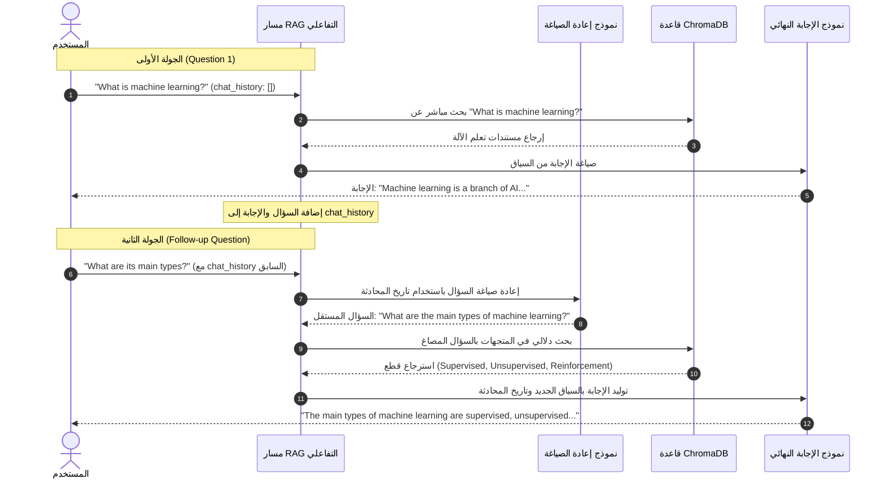

# الدرس 05: تقنيات RAG المتقدمة - ذاكرة المحادثة وسياق الحوار
### Advanced RAG: Conversational Memory & History-Aware Retrieval (Lecture 30)

مرحبًا بك في الدرس الخامس من مرحلة **فهارس وقواعد بيانات المتجهات (Vector Stores & Databases)**، والمخصص لتطبيق **المحاضرة 30** من الكورس.

في أنظمة الـ RAG التقليدية التي بنيناها حتى الآن، يعتبر كل استعلام عملية مستقلة بذاتها ومجردة من السياق (Stateless). إذا سأل المستخدم سؤالاً تالياً يعتمد على ما سبقه مثل: *"وما هي أنواعه؟"* أو *"قارن بينهما"*, سيفشل المسترجع (Retriever) تماماً لأنه لا يفهم عَمَّن تعود الضمائر (its, them, they)، مما يؤدي لاسترجاع نصوص عشوائية وإجابة فاشلة أو هلوسة من النموذج.

في هذا الدرس، نتعلم المعمارية الاحترافية لبناء **Conversational RAG** باستخدام دوال لانج تشين المتخصصة: `create_history_aware_retriever` و `MessagesPlaceholder` و `create_stuff_documents_chain` و `create_retrieval_chain`، ليتحول نظام البحث إلى روبوت محادثة حقيقي ذكي يتذكر كل ما دار في الجلسة.

---

## 📌 أهداف الدرس (Learning Objectives)

1. **فهم مشكلة الـ Stateless RAG**: إدراك لماذا تفشل الاستعلامات التتابعية (Follow-up Questions) في أنظمة البحث المعتادة.
2. **إعادة صياغة السؤال بسياق الحوار (Query Reformulation)**: فهم دور `contextualize_q_prompt` في تحويل السؤال الناقص إلى سؤال مستقل ومكتمل دلالياً قبل إرساله لقاعدة المتجهات.
3. **مسترجع يعي تاريخ المحادثة (`create_history_aware_retriever`)**: دمج نموذج اللغة مع الـ Retriever لإعادة الصياغة آلياً.
4. **حاجز سجل الرسائل (`MessagesPlaceholder`)**: كيفية حقن قائمة رسائل الحوار السابقة (`chat_history`) بسلاسة داخل قوالب التوجيه (`ChatPromptTemplate`).
5. **ربط سلسلة الـ RAG التفاعلية (`create_retrieval_chain`)**: تجميع المسترجع الذكي وسلسلة الإجابة في مسار واحد متكامل.
6. **إدارة سجل المحادثات برمجياً**: استخدام كائنات `HumanMessage` و `AIMessage` لتحديث الذاكرة بعد كل جولة حوارية.

---

## ⚖️ المقارنة: RAG التقليدي بدون ذاكرة مقابل RAG التفاعلي

| المعيار | RAG التقليدي (Stateless RAG) | RAG التفاعلي (Conversational RAG) |
| :--- | :--- | :--- |
| **طبيعة المعالجة** | كل سؤال مستقل ومنفصل تماماً | يفهم السياق التراكمي للحوار |
| **التعامل مع الضمائر** | يفشل في فهم أسئلة مثل *"ما هي أنواعه؟"* | يعيد صياغتها إلى *"ما هي أنواع تعلم الآلة؟"* |
| **جودة البحث الدلالي** | يبحث عن كلمات غامضة بدون سياق | يبحث عن سؤال كامل وصريح دلالياً |
| **هيكل البيانات** | يستقبل فقط نص السؤال (`input`) | يستقبل السؤال وسجل المحادثة (`chat_history`) |
| **تجربة المستخدم** | محرك بحث جاف | مساعد ذكي ومحادثة طبيعية |

---

## 🏛️ المعمارية الهندسية لذاكرة المحادثة (Architecture)



---

## 🧩 المكونات البرمجية الأساسية (Core Building Blocks)

### 1. قالب إعادة صياغة السؤال (`Contextualize Prompt`):
```python
from langchain_core.prompts import ChatPromptTemplate, MessagesPlaceholder

contextualize_q_system_prompt = (
    "Given a chat history and the latest user question "
    "which might reference context in the chat history, "
    "formulate a standalone question which can be understood "
    "without the chat history. Do NOT answer the question, "
    "just reformulate it if needed and otherwise return it as it is."
)

contextualize_q_prompt = ChatPromptTemplate.from_messages([
    ("system", contextualize_q_system_prompt),
    MessagesPlaceholder("chat_history"),
    ("human", "{input}")
])
```

### 2. المسترجع الواعي بالتاريخ (`create_history_aware_retriever`):
```python
from langchain.chains import create_history_aware_retriever

history_aware_retriever = create_history_aware_retriever(
    llm=llm,
    retriever=retriever,
    prompt=contextualize_q_prompt
)
```

### 3. قالب وسلسلة الإجابة النهائية (`create_stuff_documents_chain`):
```python
from langchain.chains.combine_documents import create_stuff_documents_chain

qa_system_prompt = (
    "You are an assistant for question-answering tasks. "
    "Use the following pieces of retrieved context to answer the question. "
    "If you don't know the answer, say that you don't know. "
    "Use three sentences maximum and keep the answer concise.\n\n"
    "{context}"
)

qa_prompt = ChatPromptTemplate.from_messages([
    ("system", qa_system_prompt),
    MessagesPlaceholder("chat_history"),
    ("human", "{input}")
])

question_answer_chain = create_stuff_documents_chain(llm, qa_prompt)
```

### 4. دمج السلسلة التفاعلية الكاملة (`create_retrieval_chain`):
```python
from langchain.chains import create_retrieval_chain

conversational_rag_chain = create_retrieval_chain(
    history_aware_retriever,
    question_answer_chain
)
```

### 5. إدارة سجل المحادثات (`chat_history`):
```python
from langchain_core.messages import HumanMessage, AIMessage

chat_history = []

# السؤال الأول
res1 = conversational_rag_chain.invoke({"input": "What is machine learning?", "chat_history": chat_history})
print(res1["answer"])

# حفظ الرد في الذاكرة
chat_history.extend([
    HumanMessage(content=res1["input"]),
    AIMessage(content=res1["answer"])
])

# السؤال الثاني الذي يعتمد على الأول
res2 = conversational_rag_chain.invoke({"input": "What are its main types?", "chat_history": chat_history})
print(res2["answer"])
```

---

## 🎯 ملخص الدرس والفوائد العملية:
1. **القضاء على غموض الضمائر**: النظام يعيد صياغة الأسئلة الناقصة ذاتياً قبل البحث في قاعدة البيانات.
2. **تكامل ثنائي المراحل**: مرحلة أولى لفهم السؤال ومرحلة ثانية للإجابة من السياق المسترجع.
3. **مرونة كاملة**: يمكن تخزين `chat_history` في الذاكرة المؤقتة، أو حفظها في قاعدة بيانات (مثل Redis أو SQLite) لكل مستخدم لتبقى المحادثات مستمرة عبر الجلسات.
