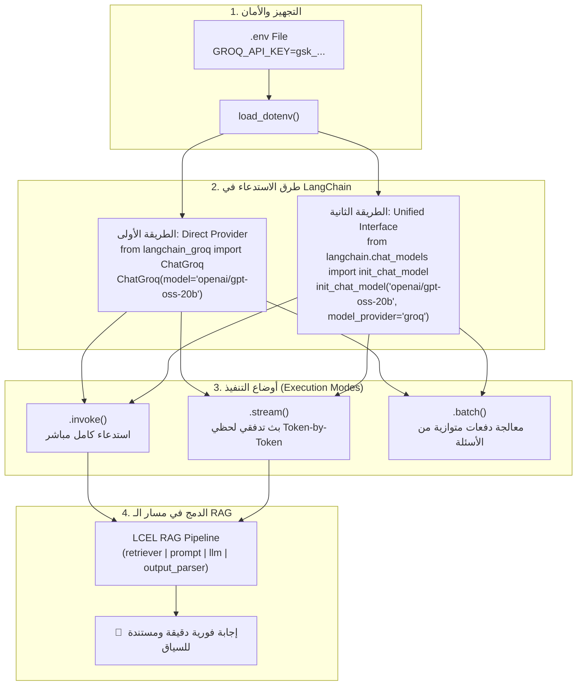

# الدرس 06: ربط واستخدام نماذج اللغات فائقة السرعة مع Groq API
### Fast LLM Inference with Groq Cloud & LangChain Integration (Lecture 31)

مرحبًا بك في الدرس السادس من مرحلة **فهارس وقواعد بيانات المتجهات (Vector Stores & Databases)**، والمخصص لتطبيق **المحاضرة 31** من الكورس.

في بناء تطبيقات الـ RAG والذكاء الاصطناعي التوليدي، يواجه المطورون تحديين رئيسيين:
1. **التكلفة المالية (API Cost)**: نماذج مثل OpenAI تتطلب رصيداً مدفوعاً مقدماً للاستخدام التجريبي والتعلم.
2. **زمن الاستجابة (Latency)**: النماذج الكبيرة قد تستغرق ثوانٍ عديدة لإنتاج الردود، مما يعطل تجربة المستخدم في المحادثات التفاعلية.

توفر منصة **Groq** الحل الأمثل من خلال معالجاتها الثورية **LPUs (Language Processing Units)** المصممة خصيصاً لتسريع توليد الرموز (Token Generation) بسرعات تتجاوز 500-1000 كلمة في الثانية مع باقة مجانية سخية جداً للاختبار والتطوير.

---

## 📌 أهداف الدرس (Learning Objectives)

1. **فهم معمارية Groq LPU**: معرفة الفارق الجوهري بين وحدات المعالجة الرسومية (GPUs) ووحدات معالجة اللغة (LPUs) في سرعة الاستدلال اللحظي.
2. **الحصول على المفتاح وإعداد البيئة**: تسجيل حساب على `console.groq.com` وتخزين `GROQ_API_KEY` داخل `.env`.
3. **طريقتان لاستدعاء النماذج في LangChain**:
   - الطريقة الأولى: الاستدعاء المباشر عبر حزمة `langchain_groq` وكائن `ChatGroq`.
   - الطريقة الثانية: الواجهة القياسية الموحدة `init_chat_model` (المناسبة لبيئات الإنتاج للتبديل بين مزودي النماذج بمرونة).
4. **فهم دورة حياة وتحديث النماذج**: التعامل مع تحديثات ونماذج المنصة (مثل استبدال الموديلات القديمة كـ Gemma بالنماذج الحديثة المتاحة).
5. **البث المباشر (Token Streaming)**: استعراض ميزة الـ Streaming اللحظية لتوليد النصوص كلمة بكلمة.
6. **الدمج مع خط أنابيب RAG و ChromaDB**: استبدال نماذج OpenAI بنموذج Groq فائق السرعة داخل مسار الـ RAG التوليدي.

---

## ⚖️ المقارنة: Groq LPUs مقابل Traditional GPUs / Cloud APIs

| المعيار | مزودو النماذج التقليدية (OpenAI / GPUs) | منصة Groq (LPUs) |
| :--- | :--- | :--- |
| **نوع المعالج** | معالجات رسومية عامة (NVIDIA H100 / A100) | معالجات تسلسلية مخصصة للغات (LPUs) |
| **سرعة توليد الكلمات** | 30 إلى 80 كلمة / ثانية | 400 إلى 800+ كلمة / ثانية |
| **زمن استجابة الرمز الأول (TTFT)** | متوسط (1-3 ثوانٍ) | فائق السرعة (أجزاء من الثانية) |
| **التكلفة التجريبية** | تتطلب اشتراكاً وبطاقة بنكية مدفوعة | توفر باقة مجانية بمعدل طلبات ممتاز |
| **الاستخدام المثالي** | النماذج الاحتكارية المغلقة والتدريب | الاستدلال اللحظي فائق السرعة وتطبيقات RAG التفاعلية |

---

## 🏛️ المعمارية البرمجية لاستدعاء النماذج في LangChain



---

## 💻 أهم الشيفرات البرمجية للدرس

### 1. استيراد المكتبات وتحميل المفتاح:
```python
import os
from dotenv import load_dotenv

load_dotenv()
groq_key = os.getenv("GROQ_API_KEY")
```

### 2. الطريقة الأولى: الاستدعاء المباشر عبر `ChatGroq`:
```python
from langchain_groq import ChatGroq

llm = ChatGroq(
    model="openai/gpt-oss-20b",
    temperature=0.2,
    max_tokens=512,
    api_key=groq_key
)

response = llm.invoke("Explain RAG in one concise sentence.")
print(response.content)
```

### 3. الطريقة الثانية: الواجهة الموحدة `init_chat_model`:
```python
from langchain.chat_models import init_chat_model

# تمكنك من تبديل المزود (groq, openai, anthropic) بمجرد تغيير الاسم
llm = init_chat_model("openai/gpt-oss-20b", model_provider="groq", temperature=0.2)
response = llm.invoke("What is an LPU?")
print(response.content)
```

### 4. البث المباشر للردود (Streaming):
```python
query = "What are the benefits of using vector databases?"
for chunk in llm.stream(query):
    print(chunk.content, end="", flush=True)
```

---

## 🎯 ملخص الدرس وأهم النصائح:
1. **أفضل خيار للمشاريع والتعلم**: Groq توفر سرعة خارقة وتكلفة منعدمة للمطورين، مما يجعلها الاختيار الأول في هذا المسار التدريبي.
2. **مرونة `init_chat_model`**: استخدامها في مشاريع الإنتاج يتيح لك تجربة موديلات مختلفة من مزودين مختلفين دون إعادة كتابة كود الـ Integration.
3. **تكامل كامل مع LCEL**: كائنات `ChatGroq` ترث من كلاس `BaseChatModel` التابع لـ LangChain، وبالتالي فهي متوافقة 100% مع كل الـ Chains والـ Prompts وخطوط أنابيب RAG التي بنيناها.
