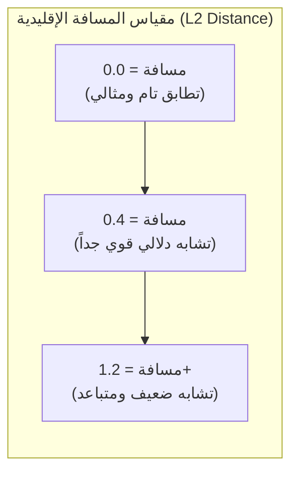
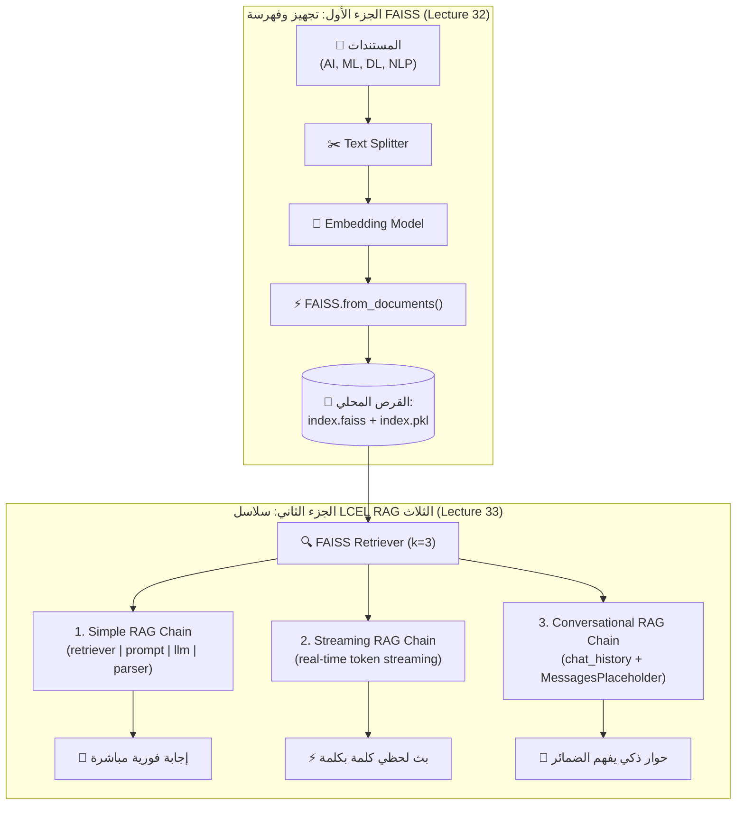

# الدرس 07: بناء نظام RAG محلي باستخدام مكتبة FAISS (أجزاء 1 و 2)
### Local Vector Search & RAG Pipelines with Meta FAISS (Lectures 32-33)

مرحبًا بك في الدرس السابع من مرحلة **فهارس وقواعد بيانات المتجهات (Vector Stores & Databases)**، والذي يغطي بالكامل **المحاضرتين 32 و 33** من الكورس.

تعتبر مكتبة **FAISS (Facebook AI Similarity Search)** المطورة من قبل شركة **Meta (Facebook)** المعيار الذهبي للبحث فائق السرعة في التضمينات الكثيفة (Dense Vectors).  
في هذا الدرس المزدوج، نتعلم دورة حياة النظام بالكامل:
- **الجزء الأول (المحاضرة 32):** معمارية FAISS، ومقاييس المسافات، وبناء الفهرس، والحفظ والاسترجاع المحلي، والبحث بالـ Scores والـ Filters.
- **الجزء الثاني (المحاضرة 33):** بناء سلاسل RAG متكاملة بثلاثة أنماط (Simple, Streaming, Conversational) باستخدام لغة تعبير لانج تشين (**LCEL**) ونماذج **Groq LLM** فائقة السرعة.

---

## 📌 أهداف الدرس المتكاملة (Learning Objectives)

### أولاً: أهداف الجزء الأول (المحاضرة 32 - الفهرسة والبحث):
1. **فهم معمارية مكتبة FAISS**: خوارزميات البحث عن أقرب جار (Nearest Neighbor Search) وكفاءتها الاستثنائية المكتوبة بلغة C++.
2. **فهم مقاييس المسافة والتشابه**:
   - مسافة إقليدس التربيعية (L2 Euclidean Distance).
   - الضرب النقطي وتشابه جيب التمام (Dot Product / Cosine Similarity).
3. **توليد ومقارنة التضمينات**: استخدام `embed_query` و `embed_documents` وبناء دالة لحساب التشابه الدلالي.
4. **إنشاء وحفظ الفهرس محلياً (Persistence)**:
   - حفظ الفهرس عبر `save_local` (ينتج ملفين: `index.faiss` للأرقام و `index.pkl` للنصوص).
   - إعادة تحميل الفهرس عبر `load_local` مع تفعيل `allow_dangerous_deserialization=True`.
5. **أنماط البحث الدلالي في FAISS**: البحث البسيط، والبحث مع درجات المسافة (`similarity_search_with_score`)، والفلترة بالـ Metadata.

### ثانياً: أهداف الجزء الثاني (المحاضرة 33 - خطوط أنابيب LCEL RAG):
6. **تحويل فهرس FAISS إلى مسترجع (`Retriever`)**: ربط الفهرس المحلي بسلاسل LCEL عبر `.as_retriever()`.
7. **بناء السلسلة البسيطة (Simple RAG Chain)**: دمج المسترجع مع دالة `format_docs` الغنية بالبيانات الوصفية ونموذج اللغة.
8. **بناء السلسلة المتدفقة (Streaming RAG Chain)**: البث اللحظي للكلمات كلمة بكلمة عبر `.stream()` لتجربة محادثة فورية.
9. **بناء السلسلة التفاعلية (Conversational RAG Chain)**: استخدام `MessagesPlaceholder("chat_history")` لحفظ سياق الحوار وفهم الضمائر التتابعية بدون لبس.

---

## ⚖️ المقارنة: ChromaDB مقابل Meta FAISS

| المعيار | ChromaDB | Meta FAISS |
| :--- | :--- | :--- |
| **طبيعة الأداة** | قاعدة بيانات متجهات متكاملة (Vector DB) | مكتبة خوارزميات وفهرسة سريعة (Search Library) |
| **التخزين الدائم** | قاعدة بيانات SQLite مدمجة + HNSW | ملفات ثنائية مخصصة (`index.faiss` + Pickle) |
| **السرعة وقابلية التوسع** | ممتازة للمشاريع المتوسطة والتطبيقات | خارقة لملايين المتجهات مع دعم تسريع GPU |
| **العمليات (CRUD)** | تدعم الإضافة والتعديل والحذف بسهولة | تركز بشكل أساسي على القراءة والبحث فائق السرعة |
| **مقياس المسافة الافتراضي** | Cosine / L2 حسب الإعداد | L2 Euclidean Distance افتراضياً |

---

## 📐 فهم مقاييس المسافة في FAISS (L2 Distance vs Cosine Similarity)

> [!IMPORTANT]
> **كيف تقرأ نتائج `similarity_search_with_score` في FAISS؟**
> - في مقياس **L2 Euclidean Distance**: كلما **قلت المسافة (اقتربت من 0.0)**، كان المستند **أكثر تطابقاً وتطابقاً دلالياً**!
> - على عكس Cosine Similarity حيث 1.0 يعني تطابقاً تاماً و 0.0 يعني عدم وجود تشابه، في L2:
>   - مسافة `0.35` ⬅️ **أقوى وأقرب دلالياً** من مسافة `1.20`.



---

## 🏛️ المعمارية الكاملة لنظام FAISS RAG مع LCEL



---

## 💻 أهم الأكواد البرمجية للدرس

### 1. حفظ الفهرس وإعادة تحميله محلياً:
```python
from langchain_community.vectorstores import FAISS

# حفظ الفهرس
vector_store.save_local("data/databases/faiss_index")

# إعادة التحميل
loaded_store = FAISS.load_local(
    "data/databases/faiss_index",
    embeddings,
    allow_dangerous_deserialization=True
)
```

### 2. السلسلة البسيطة (Simple LCEL Chain):
```python
simple_rag_chain = (
    {"context": retriever | format_docs, "question": RunnablePassthrough()}
    | prompt
    | llm
    | StrOutputParser()
)
answer = simple_rag_chain.invoke("What is machine learning?")
```

### 3. السلسلة المتدفقة (Streaming):
```python
for chunk in simple_rag_chain.stream("What is deep learning?"):
    print(chunk, end="", flush=True)
```

### 4. السلسلة التفاعلية (Conversational Chain):
```python
conv_prompt = ChatPromptTemplate.from_messages([
    ("system", "Answer using the context:\n{context}"),
    MessagesPlaceholder("chat_history"),
    ("human", "{question}")
])

conv_rag = (
    RunnablePassthrough.assign(context=lambda x: format_docs(retriever.invoke(x["question"])))
    | conv_prompt
    | llm
    | StrOutputParser()
)
```

---

## 🎯 ملخص الدرس 07 (المحاضرتان 32 و 33):
1. **السرعة المطلقة**: أثبتت FAISS أنها الأسرع لمعالجة ملايين المتجهات ودعم كروت الشاشة.
2. **مرونة LCEL**: سهولة تحويل أي Vector Store إلى 3 أنماط RAG مختلفة بدون إعادة كتابة النظام.
3. **دفاتر التطبيق العملي**:
   - الدفتر الأول: [`07-rag-faiss.ipynb`](./07-rag-faiss.ipynb) (الفهرسة والبحث).
   - الدفتر الثاني: [`07-rag-faiss-lcel.ipynb`](./07-rag-faiss-lcel.ipynb) (سلاسل الـ RAG والبث والمحادثة).
