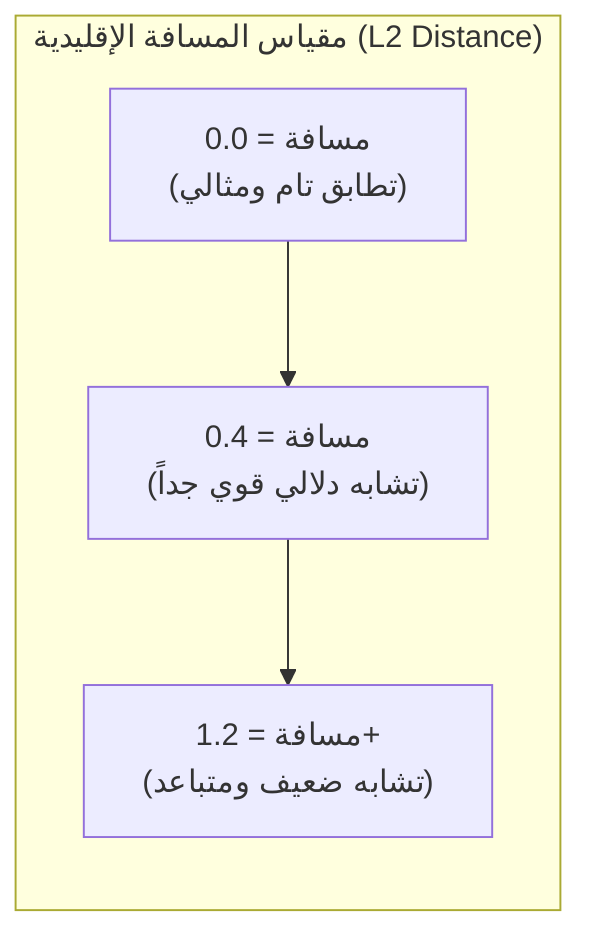
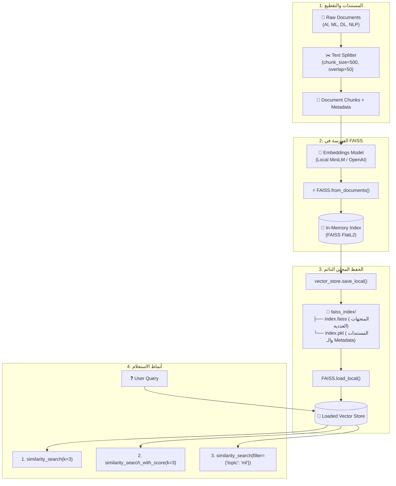

# الدرس 07: بناء نظام RAG محلي باستخدام مكتبة FAISS (الجزء الأول)
### Local Vector Search with Meta FAISS - Fundamentals, Indexing & Persistence (Lecture 32)

مرحبًا بك في الدرس السابع من مرحلة **فهارس وقواعد بيانات المتجهات (Vector Stores & Databases)**، والمخصص لتطبيق **المحاضرة 32** من الكورس.

بعد أن تعاملنا بتوسع مع قاعدة بيانات `ChromaDB`، ننتقل الآن للتعرف على إحدى أشهر وأقوى مكتبات البحث الدلالي في العالم: مكتبة **FAISS (Facebook AI Similarity Search)** المطورة من قبل شركة **Meta (Facebook)**.

تعتبر FAISS المعيار الذهبي للبحث فائق السرعة في التضمينات الكثيفة (Dense Vectors) لأنها مكتوبة بلغة C++ عالية الكفاءة مع دعم مباشر لمعالجات CPU و GPU، وتستطيع التعامل مع مئات الملايين من المتجهات بزمن استجابة يقاس بأجزاء من الميلي ثانية.

---

## 📌 أهداف الدرس (Learning Objectives)

1. **فهم معمارية مكتبة FAISS**: ما هي خوارزميات البحث عن أقرب جار (Nearest Neighbor Search) وكيف تختلف عن قواعد البيانات التقليدية؟
2. **فهم مقاييس المسافة والتشابه**:
   - مسافة إقليدس التربيعية (L2 Euclidean Distance).
   - الضرب النقطي وتشابه جيب التمام (Dot Product / Cosine Similarity).
3. **توليد ومقارنة التضمينات**: استخدام `embed_query` و `embed_documents` وبناء دالة لحساب التشابه الدلالي بين الجمل.
4. **إنشاء فهرس FAISS في الذاكرة**: تحويل المستندات والـ Chunks إلى كائن `FAISS` Vector Store.
5. **الحفظ والاسترجاع المحلي (Persistence)**:
   - حفظ الفهرس على القرص الصلب عبر `save_local` (ينتج ملفين: `index.faiss` و `index.pkl`).
   - إعادة تحميل الفهرس عبر `load_local` مع تفعيل `allow_dangerous_deserialization=True`.
6. **أنماط البحث الدلالي في FAISS**:
   - البحث العادي (`similarity_search`).
   - البحث مع استخراج درجات المسافة (`similarity_search_with_score`).
   - البحث مع التصفية بالبيانات الوصفية (`Metadata Filtering`).

---

## ⚖️ المقارنة: ChromaDB مقابل Meta FAISS

| المعيار | ChromaDB | Meta FAISS |
| :--- | :--- | :--- |
| **طبيعة الأداة** | قاعدة بيانات متجهات متكاملة (Vector DB) | مكتبة خوارزميات فهرسة وبحث سريع (Search Library) |
| **التخزين الدائم** | قاعدة بيانات SQLite مدمجة + HNSW | ملفات ثنائية مخصصة (`index.faiss` + Pickle) |
| **السرعة وقابلية التوسع** | ممتازة للمشاريع المتوسطة والتطبيقات | خارقة لملايين المتجهات مع دعم تسريع GPU |
| **العمليات (CRUD)** | تدعم الإضافة والتعديل والحذف بسهولة | تركز بشكل أساسي على القراءة والبحث فائق السرعة |
| **مقياس المسافة الافتراضي** | Cosine / L2 حسب الإعداد | L2 Euclidean Distance افتراضياً |

---

## 📐 فهم مقاييس المسافة في FAISS (L2 Distance vs Cosine Similarity)

> [!IMPORTANT]
> **كيف تقرأ نتائج `similarity_search_with_score` في FAISS؟**
> - في مقياس **L2 Euclidean Distance**: كلما **قلت المسافة (اقتربت من 0.0)**، كان المستند **أكثر تطابقاً وتطابقاً دلالياً**!
> - على عكس Cosine Similarity حيث 1.0 يعني تطابقاً تاماً و 0.0 يعني عدم وجود تشابه، في L2:
>   - مسافة `0.35` ⬅️ **أقوى وأقرب دلالياً** من مسافة `1.20`.



---

## 🏛️ المعمارية الهندسية لمكتبة FAISS في الـ RAG



---

## 💻 أهم الأكواد البرمجية للدرس

### 1. إنشاء فهرس FAISS:
```python
from langchain_community.vectorstores import FAISS

# بناء الفهرس مباشرة من القطع
vector_store = FAISS.from_documents(chunks, embeddings)
print("عدد المتجهات المفهرسة:", vector_store.index.ntotal)
```

### 2. حفظ الفهرس وإعادة تحميله:
```python
# حفظ على القرص
vector_store.save_local("data/databases/faiss_index")

# إعادة التحميل
loaded_store = FAISS.load_local(
    "data/databases/faiss_index",
    embeddings,
    allow_dangerous_deserialization=True  # مطلوب لقراءة ملف الـ Pickle بأمان
)
```

### 3. البحث بالمسافة والتصفية:
```python
# البحث مع استخراج درجات الشبه (L2 Distance)
results = vector_store.similarity_search_with_score("What is deep learning?", k=3)
for doc, score in results:
    print(f"المسافة: {score:.4f} | المحتوى: {doc.page_content[:60]}")

# البحث مع الفلترة بالـ Metadata
filtered = vector_store.similarity_search(
    "Explain key concepts",
    k=2,
    filter={"topic": "ml"}
)
```

---

## 🎯 ملخص الدرس 07 (المحاضرة 32):
1. **السرعة القصوى**: FAISS هي الاختيار الأول عندما يكون عدد المستندات ضخماً جداً ويتطلب استرجاعاً في أجزاء من الميلي ثانية.
2. **الحفظ الثنائي المزدوج**: ينتج ملفين: `index.faiss` يحتوي على مصفوفات الأعداد والـ HNSW/Flat، و `index.pkl` يحتوي على نصوص المستندات والـ Metadata المقابلة لها.
3. **الجزء القادم (المحاضرة 33)**: سنقوم بربط هذا الفهرس بموديل Groq عبر LCEL لبناء خط أنابيب RAG متكامل يعتمد على FAISS.
