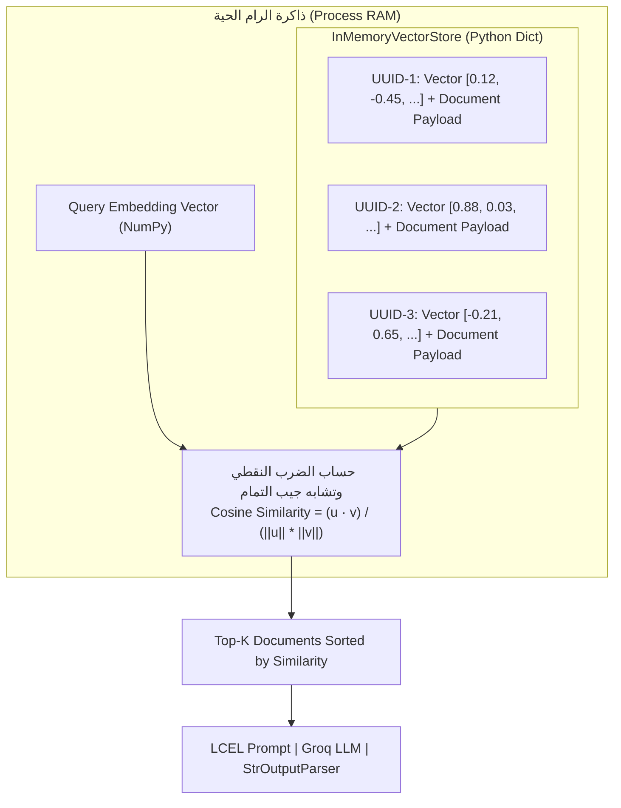

# الدرس 08: التخزين والفهرسة في الذاكرة الحية (InMemoryVectorStore)
### Ephemeral Vector Search & LCEL RAG Pipelines (Lecture 34)

مرحبًا بك في الدرس الثامن من مرحلة **فهارس وقواعد بيانات المتجهات (Vector Stores & Databases)**، والذي يغطي بالكامل **المحاضرة 34** من الكورس.

في هذا الدرس، نتعرف على أبسط وأخف تطبيق لمخزن المتجهات في لانج تشين: **`InMemoryVectorStore`** المدمج أصلياً في حزمة `langchain-core`.

---

## 📌 أهداف الدرس (Learning Objectives)

1. **فهم طبيعة ومعمارية `InMemoryVectorStore`**:
   - مخزن متجهات يعتمد 100% على الذاكرة الحية المؤقتة (Ephemeral Heap Memory / RAM).
   - مبني بالكامل بلغة بايثون (`dict`) ومصفوفات **NumPy** دون الحاجة لأي مكتبات خارجية أو ملفات ثنائية C++ أو قواعد بيانات SQLite.
2. **إدارة دورة حياة المستندات في الذاكرة**:
   - إنشاء كائنات `Document` وحقن بيانات وصفية غنية (`Metadata`) عبر مجالات متعددة.
   - إلحاق المستندات دفعة واحدة عبر `add_documents` وتوليد معرفات فريدة (`UUIDs`).
3. **أنماط البحث والتقييم الدلالي**:
   - البحث البسيط عن أقرب جيران دلاليين `similarity_search`.
   - استخراج درجات تشابه جيب التمام `similarity_search_with_score` (حيث القيمة الأقرب لـ 1.0 تعني تطابقاً أعلى).
4. **التصفية الوظيفية المرنة (Callable Metadata Filtering)**:
   - استخدام دوال `lambda` لفحص وتصفية البيانات الوصفية أثناء البحث بديناميكية تامة دون قيود استعلامات SQL.
5. **الدمج الكامل مع سلاسل RAG الحديثة**:
   - تحويل المخزن إلى مسترجع `Retriever` عبر `.as_retriever()`.
   - بناء خط أنابيب متكامل بلغة تعبير لانج تشين (**LCEL**) بمشغل الربط `|`.
   - توليد الردود بسرعة فائقة عبر معالجات **Groq LPUs**، ودعم البث اللحظي للكلمات (`.stream()`).

---

## 🏛️ المعمارية الداخلية لـ InMemoryVectorStore

يعمل `InMemoryVectorStore` كقاموس بايثون بسيط يحتوي على التضمينات والنصوص:



---

## ⚖️ المقارنة الشاملة: مخازن وقواعد بيانات المتجهات

| المعيار | `InMemoryVectorStore` | `FAISS` (Local Index) | `ChromaDB` (Persistent) | `Pinecone` (Cloud DB) |
| :--- | :--- | :--- | :--- | :--- |
| **وسيط التخزين** | رامات العملية (`dict` + NumPy) | رامات العملية (`IndexFlatL2` C++) | أقراص التخزين (SQLite + Parquet) | سحابة مدارة وموزعة عالمياً |
| **الحفظ الدائم (Persistence)** | ❌ يضيع بمجرد إغلاق البرنامج | ⚠️ يدوي (`save_local` / `load_local`) | ✅ تلقائي وفوري على القرص | ✅ سحابي دائم مع نسخ احتياطي |
| **الاعتماديات والمكتبات** | نقي 100% (`langchain-core`) | `faiss-cpu` (يتطلب C++ binaries) | `chromadb` (يتطلب SQLite و C++ wheels) | خفيف (API Client فقط) |
| **خوارزمية البحث** | مسح خطي دقيق (Exact Linear Scan) | مسح دقيق أو تقريبي (IVF, HNSW) | مسح تقريبي فائق السرعة (HNSW) | بحث تقريبي HNSW سحابي متقدم |
| **مقياس التشابه الافتراضي** | Cosine Similarity $[-1.0, 1.0]$ | L2 Euclidean Distance $[0.0, \infty)$ | Cosine / L2 حسب الإعداد | Cosine / Dot Product / Euclidean |
| **الحجم الأمثل للبيانات** | تجارب صغيرة (< 10,000 متجه) | حتى 1 مليون متجه محلياً | حتى 500,000 متجه محلياً | مليارات المتجهات للمؤسسات |

---

## 🎯 متى تستخدم ومتى تتجنب `InMemoryVectorStore`؟

### ✅ متى يجب استخدامه؟
1. **الاختبارات الآلية (Unit Testing & CI/CD):** عندما ترغب في اختبار مسارات RAG بسرعة وبدون إنشاء ملفات على الهارد أو استدعاء قواعد بيانات سحابية.
2. **جلسات المحادثة المؤقتة (Ephemeral Chat Sessions):** عندما يرفع المستخدم ملف PDF مؤقت لقراءته أثناء جلسة الشات الحالية فقط، ولا داعي لحفظه بعد خروجه.
3. **التطبيقات التعليمية والنماذج الأولية السريعة (PoC):** تجربة سريعة بدون أي خطوات تثبيت معقدة.

### ❌ متى يجب تجنبه؟
1. **البيانات الدائمة (Persistent Corpora):** إذا كنت تحتاج بقاء المعرفة بعد إغلاق البرنامج أو إعادة تشغيل السيرفر.
2. **البيانات الضخمة (> 50,000 متجه):** لأن البحث فيه عبارة عن مسح خطي $O(N \cdot D)$، مما يؤدي لبطء ملحوظ عند زيادة حجم البيانات مقارنة بـ FAISS.
3. **البيئات الموزعة ومتعددة الخوادم (Multi-Instance Scaling):** حيث لا يمكن مشاركة الذاكرة الحية لعملية واحدة بين عدة سيرفرات.

---

## 💻 طريقة الاستخدام السريعة (Quick Reference)

```python
from langchain_core.vectorstores import InMemoryVectorStore
from langchain_huggingface import HuggingFaceEmbeddings
from langchain_core.documents import Document

# 1. تهيئة النموذج والمخزن
embeddings = HuggingFaceEmbeddings(model_name="sentence-transformers/all-MiniLM-L6-v2")
vector_store = InMemoryVectorStore(embeddings)

# 2. إضافة المستندات
docs = [
    Document(page_content="The weather tomorrow is cloudy.", metadata={"topic": "weather"}),
    Document(page_content="Scrambled eggs for breakfast.", metadata={"topic": "food"})
]
ids = vector_store.add_documents(docs)

# 3. البحث مع الفلترة
results = vector_store.similarity_search(
    "what to eat?",
    k=1,
    filter=lambda d: d.metadata.get("topic") == "food"
)

# 4. التحويل لمسترجع ودمجه في LCEL
retriever = vector_store.as_retriever(search_kwargs={"k": 2})
```

---

> [!TIP]
> تجد في هذا المجلد الدفتر النموذجي المرجعي الشامل [08-in-memory-vector-store.ipynb](./08-in-memory-vector-store.ipynb)، كما يتوفر معمل التجارب المبسط مع مساحات التطبيق العملي التفاعلية في [`playground/03-vector-stores-and-databases/08-in-memory-vector-store.ipynb`](../../../../playground/03-vector-stores-and-databases/08-in-memory-vector-store.ipynb).
